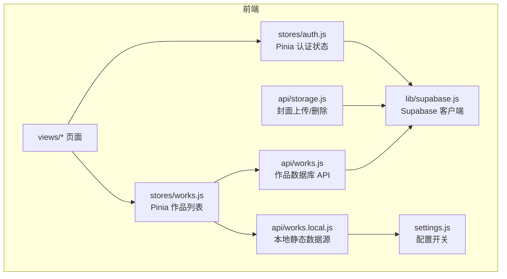
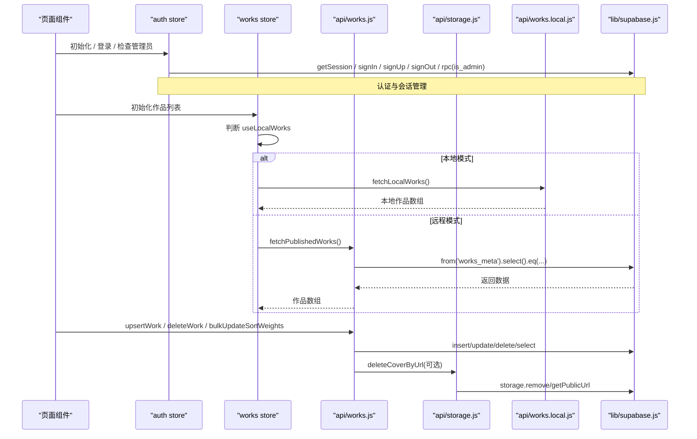
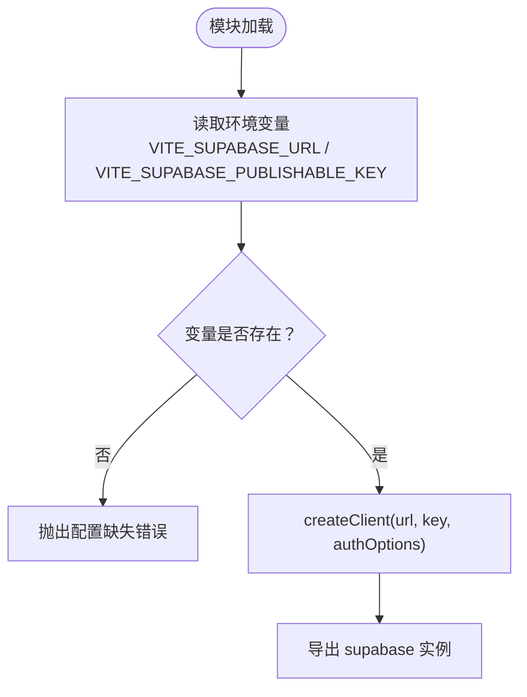
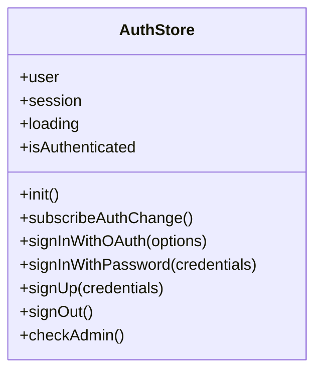
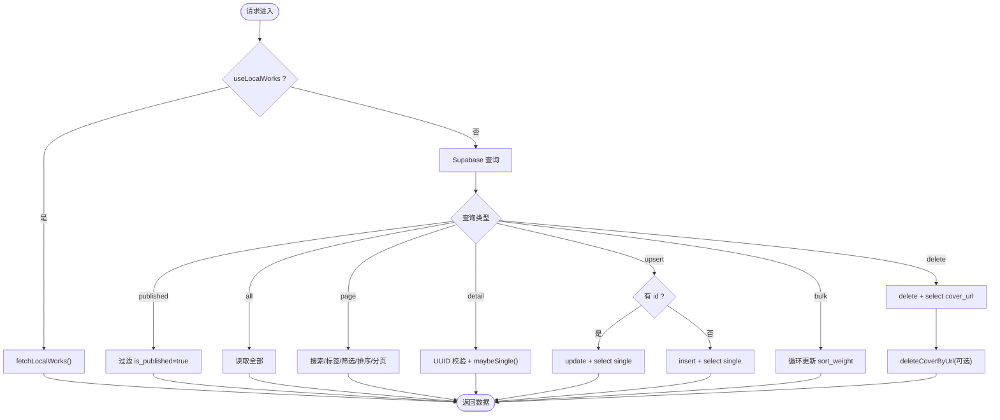
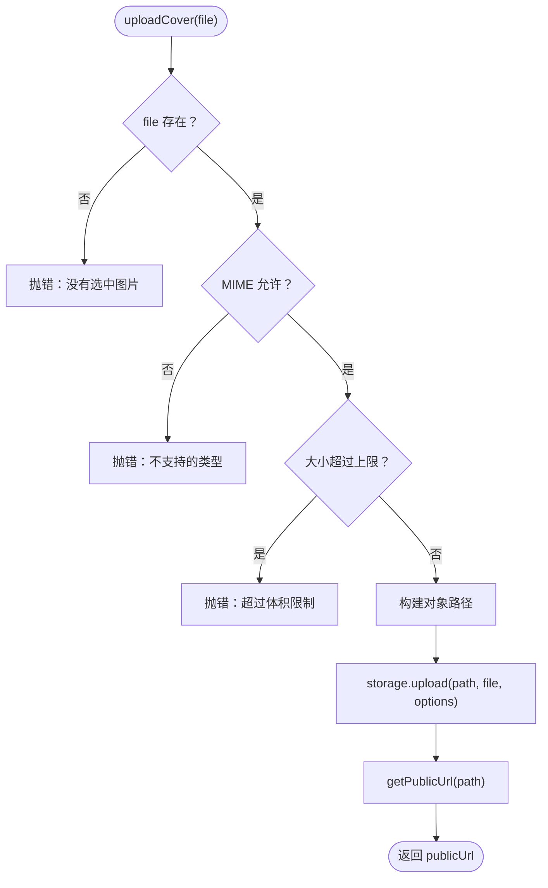
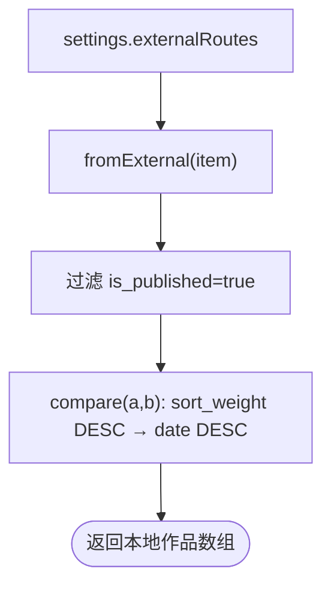
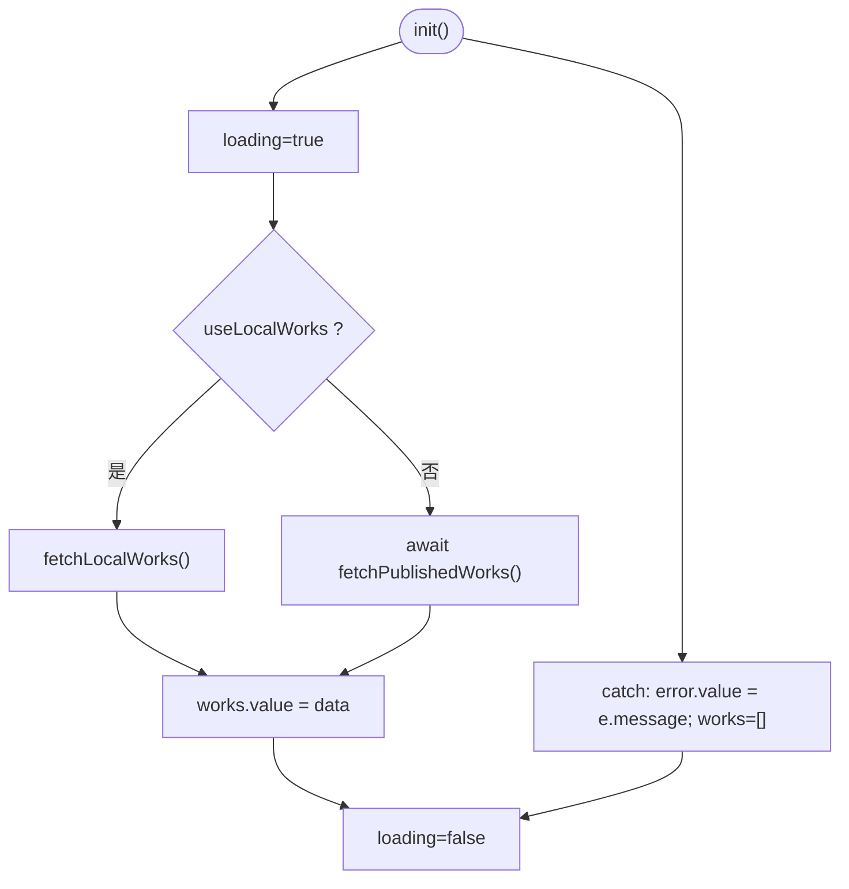
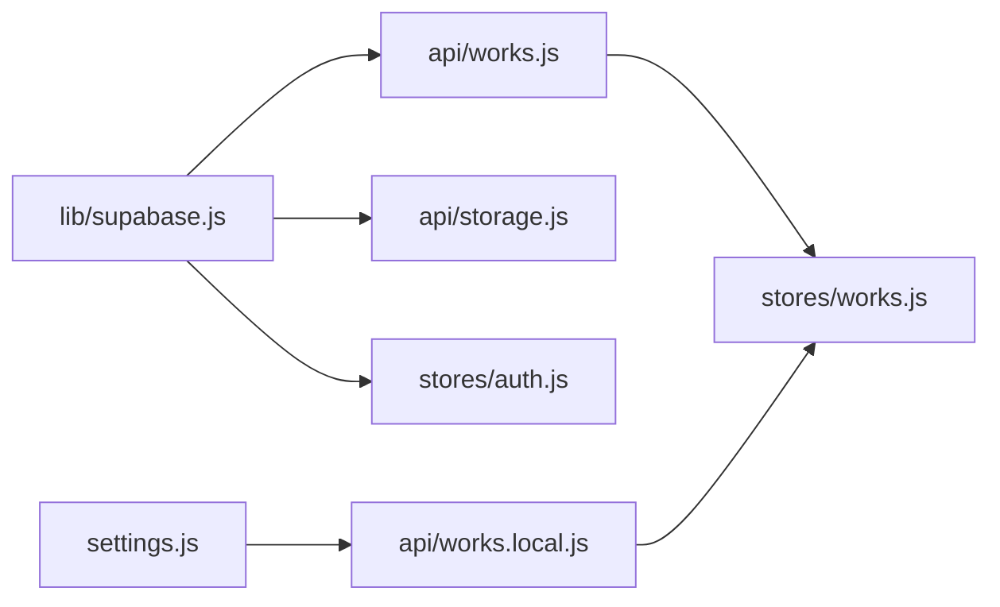

# API 集成

<cite>
**本文引用的文件**   
- [src/lib/supabase.js](file://src/lib/supabase.js)
- [src/api/works.js](file://src/api/works.js)
- [src/api/storage.js](file://src/api/storage.js)
- [src/api/works.local.js](file://src/api/works.local.js)
- [src/stores/auth.js](file://src/stores/auth.js)
- [src/stores/works.js](file://src/stores/works.js)
- [src/settings.js](file://src/settings.js)
- [README.md](file://README.md)
</cite>

## 目录
1. [引言](#引言)
2. [项目结构](#项目结构)
3. [核心组件](#核心组件)
4. [架构总览](#架构总览)
5. [详细组件分析](#详细组件分析)
6. [依赖关系分析](#依赖关系分析)
7. [性能与优化](#性能与优化)
8. [错误处理与重试策略](#错误处理与重试策略)
9. [接口参考](#接口参考)
10. [最佳实践](#最佳实践)
11. [常见问题排查](#常见问题排查)
12. [结论](#结论)

## 引言
本文件面向需要在 sunwenxu1997.github.io 中集成 Supabase 的开发者，系统性说明认证、数据库与文件存储的调用方式，并解释本地数据模拟层在开发环境中的使用。文档同时给出错误处理、重试机制、数据格式化策略、性能优化建议、常见故障排查以及完整的接口参考和使用示例路径，帮助你在前后端之间建立稳定、可维护的集成方案。

## 项目结构
本项目采用前端 Vue 3 + Pinia + Vite，后端通过 Supabase 提供认证、数据库和存储能力。API 封装集中在 src/api 下，状态管理集中在 src/stores 下，Supabase 客户端初始化在 src/lib 下，本地静态数据源在 src/api/works.local.js 中实现，并通过 src/settings.js 控制是否启用本地模式。

图表来源
- [src/stores/auth.js:1-82](file://src/stores/auth.js#L1-L82)
- [src/stores/works.js:1-29](file://src/stores/works.js#L1-L29)
- [src/api/works.js:1-267](file://src/api/works.js#L1-L267)
- [src/api/storage.js:1-100](file://src/api/storage.js#L1-L100)
- [src/api/works.local.js:1-59](file://src/api/works.local.js#L1-L59)
- [src/lib/supabase.js:1-17](file://src/lib/supabase.js#L1-L17)
- [src/settings.js:1-288](file://src/settings.js#L1-L288)

章节来源
- [README.md:37-67](file://README.md#L37-L67)
- [README.md:158-189](file://README.md#L158-L189)

## 核心组件
- Supabase 客户端：统一初始化 URL 与 Publishable Key，开启会话持久化、自动刷新 Token、URL 会话检测。
- 认证 Store：封装登录、注册、登出、OAuth、管理员权限校验等能力，并提供 session 与 user 状态。
- 作品 API：封装 works_meta 表的查询、分页、统计、新增/更新、批量排序更新、删除等操作。
- 存储 API：封装封面上传、公开 URL 获取、按 URL 删除旧封面等能力，包含类型与体积校验。
- 本地数据源：将 settings.externalRoutes 映射为 works_meta 结构，用于本地调试与演示。
- 作品 Store：根据 useLocalWorks 开关选择本地或远程数据源，统一加载、错误捕获与 loading 状态管理。

章节来源
- [src/lib/supabase.js:1-17](file://src/lib/supabase.js#L1-L17)
- [src/stores/auth.js:1-82](file://src/stores/auth.js#L1-L82)
- [src/api/works.js:1-267](file://src/api/works.js#L1-L267)
- [src/api/storage.js:1-100](file://src/api/storage.js#L1-L100)
- [src/api/works.local.js:1-59](file://src/api/works.local.js#L1-L59)
- [src/stores/works.js:1-29](file://src/stores/works.js#L1-L29)
- [src/settings.js:1-288](file://src/settings.js#L1-L288)

## 架构总览
下图展示从页面到 Supabase 的完整调用链路，包括认证、数据库与存储交互，以及本地数据源的切换逻辑。

图表来源
- [src/stores/auth.js:12-66](file://src/stores/auth.js#L12-L66)
- [src/stores/works.js:12-25](file://src/stores/works.js#L12-L25)
- [src/api/works.js:45-266](file://src/api/works.js#L45-L266)
- [src/api/storage.js:62-99](file://src/api/storage.js#L62-L99)
- [src/api/works.local.js:53-58](file://src/api/works.local.js#L53-L58)
- [src/lib/supabase.js:10-16](file://src/lib/supabase.js#L10-L16)

## 详细组件分析

### Supabase 客户端封装（lib/supabase.js）
- 作用：集中读取环境变量，创建 Supabase 客户端实例，并配置认证行为（会话持久化、自动刷新 Token、URL 会话检测）。
- 关键点：
  - 若缺少环境变量会直接抛出错误，便于早期发现配置问题。
  - 认证配置适合 SPA 场景，避免频繁手动刷新 Token。

图表来源
- [src/lib/supabase.js:3-16](file://src/lib/supabase.js#L3-L16)

章节来源
- [src/lib/supabase.js:1-17](file://src/lib/supabase.js#L1-L17)

### 认证 API（stores/auth.js）
- 作用：封装用户认证相关操作，暴露 user、session、loading、isAuthenticated 等状态与方法。
- 主要方法：
  - init：获取当前会话并填充 user/session。
  - subscribeAuthChange：监听认证状态变化，同步 user/session。
  - signInWithOAuth：GitHub OAuth 登录。
  - signInWithPassword：邮箱密码登录。
  - signUp：注册账号。
  - signOut：退出登录并清理状态。
  - checkAdmin：调用 is_admin RPC 判断管理员身份。

图表来源
- [src/stores/auth.js:5-80](file://src/stores/auth.js#L5-L80)

章节来源
- [src/stores/auth.js:1-82](file://src/stores/auth.js#L1-L82)

### 作品数据库 API（api/works.js）
- 作用：封装 works_meta 表的所有读写操作，包括公开列表、全量列表、分页查询、统计、详情、新增/更新、批量排序更新、删除。
- 关键设计：
  - 默认排序链：sort_weight DESC → date DESC → created_at DESC → id ASC，保证分页稳定。
  - RLS 策略：anon 仅读已发布；authenticated 可读全部；admin 可增删改。
  - 字段存在性筛选：支持 cover/date/links 的 filled/empty 条件。
  - 详情页路由参数校验：非 UUID 直接视为不存在，避免数据库报错。
  - 删除联动：删除记录后尝试删除对应封面文件，失败仅告警不影响主流程。

图表来源
- [src/api/works.js:14-38](file://src/api/works.js#L14-L38)
- [src/api/works.js:45-162](file://src/api/works.js#L45-L162)
- [src/api/works.js:169-266](file://src/api/works.js#L169-L266)

章节来源
- [src/api/works.js:1-267](file://src/api/works.js#L1-L267)

### 文件存储 API（api/storage.js）
- 作用：封装封面图上传、公开 URL 获取、按 URL 删除旧封面。
- 关键设计：
  - Bucket：works-covers，公开读，仅 admin 写（RLS 控制）。
  - 类型与体积限制：JPG/PNG/WebP ≤ 2MB，GIF ≤ 10MB，前端提前拦截。
  - 对象路径生成：covers/年月/时间戳-随机串.扩展名，避免中文文件名与覆盖问题。
  - 缓存控制：cacheControl=31536000，提升长缓存命中率。
  - 删除旧封面：解析 public URL 提取对象路径，删除失败仅告警。

图表来源
- [src/api/storage.js:25-83](file://src/api/storage.js#L25-L83)

章节来源
- [src/api/storage.js:1-100](file://src/api/storage.js#L1-L100)

### 本地数据模拟层（api/works.local.js）
- 作用：将 settings.externalRoutes 映射为 works_meta 结构，供本地调试与演示使用。
- 映射规则：
  - cover → cover_url
  - info → info_md
  - code/link/codepen/open → 外链字段
  - sort → sort_weight
  - hidden → is_published（取反）
  - tags → 默认 external
- 排序对齐 DB：sort_weight 降序 → date 降序。

图表来源
- [src/api/works.local.js:22-58](file://src/api/works.local.js#L22-L58)

章节来源
- [src/api/works.local.js:1-59](file://src/api/works.local.js#L1-L59)

### 作品 Store（stores/works.js）
- 作用：统一管理作品列表、loading、error 状态，并根据 useLocalWorks 选择数据源。
- 行为：
  - init：设置 loading，try/catch 捕获错误，finally 重置 loading。
  - 本地模式：直接读取本地数据。
  - 远程模式：调用 fetchPublishedWorks。

图表来源
- [src/stores/works.js:12-25](file://src/stores/works.js#L12-L25)

章节来源
- [src/stores/works.js:1-29](file://src/stores/works.js#L1-L29)

## 依赖关系分析
- 低耦合高内聚：
  - lib/supabase.js 只负责客户端初始化，被 api 与 stores 复用。
  - api/works.js 与 api/storage.js 分别关注数据库与存储，职责清晰。
  - stores/auth.js 与 stores/works.js 作为状态管理层，不直接操作网络细节。
- 外部依赖：
  - @supabase/supabase-js：认证、数据库、存储 SDK。
  - Pinia：状态管理。
  - Vite 环境变量：注入 Supabase 凭证。

图表来源
- [src/lib/supabase.js:1-17](file://src/lib/supabase.js#L1-L17)
- [src/api/works.js:1-267](file://src/api/works.js#L1-L267)
- [src/api/storage.js:1-100](file://src/api/storage.js#L1-L100)
- [src/api/works.local.js:1-59](file://src/api/works.local.js#L1-L59)
- [src/stores/auth.js:1-82](file://src/stores/auth.js#L1-L82)
- [src/stores/works.js:1-29](file://src/stores/works.js#L1-L29)
- [src/settings.js:1-288](file://src/settings.js#L1-L288)

章节来源
- [README.md:37-67](file://README.md#L37-L67)

## 性能与优化
- 数据库查询优化：
  - 使用精确列选择减少数据传输（如 fetchWorksStats 仅选轻量字段）。
  - 默认排序链加入唯一键 id，避免 LIMIT/OFFSET 重复或漏行。
  - 分页使用 range(from, to)，结合 count: 'exact' 获取总数。
- 存储优化：
  - 封面上传设置 cacheControl=31536000，提升浏览器缓存命中率。
  - 对象路径带随机串，避免多次上传覆盖。
- 前端状态优化：
  - Pinia 中 loading/error 状态明确，避免重复请求时的 UI 抖动。
  - 本地数据源在开发环境减少网络开销。

[本节为通用指导，不直接分析具体文件]

## 错误处理与重试策略
- 认证错误：
  - signIn/signUp/signInWithOAuth 返回 {data, error}，由调用方决定提示与跳转。
  - checkAdmin 失败时记录错误日志并返回 false，避免阻断主流程。
- 数据库错误：
  - 所有 Supabase 查询在 api/works.js 中若 error 存在则直接 throw，调用方需 try/catch。
  - 详情页对非 UUID 参数直接返回 null，避免数据库报错。
- 存储错误：
  - uploadCover 对类型/体积进行前置校验，不符合即抛错。
  - deleteCoverByUrl 删除失败仅 console.warn，不影响主流程。
- 重试机制：
  - 当前代码未内置重试逻辑。建议在调用处根据错误类型（网络超时、服务端 5xx）实现指数退避重试。
  - 对于幂等操作（如查询），可安全重试；对于写入操作需谨慎去重与补偿。

章节来源
- [src/stores/auth.js:59-66](file://src/stores/auth.js#L59-L66)
- [src/api/works.js:52-54](file://src/api/works.js#L52-L54)
- [src/api/works.js:169-177](file://src/api/works.js#L169-L177)
- [src/api/storage.js:62-83](file://src/api/storage.js#L62-L83)
- [src/api/storage.js:90-99](file://src/api/storage.js#L90-L99)

## 接口参考

### 认证接口（stores/auth.js）
- init：初始化会话与用户信息。
- subscribeAuthChange：订阅认证状态变化。
- signInWithOAuth({ provider, redirectTo })：第三方登录。
- signInWithPassword({ email, password })：邮箱密码登录。
- signUp({ email, password })：注册。
- signOut()：登出。
- checkAdmin()：判断是否为管理员。

章节来源
- [src/stores/auth.js:12-66](file://src/stores/auth.js#L12-L66)

### 作品数据库接口（api/works.js）
- fetchPublishedWorks()：获取已发布作品列表（anon 可调用）。
- fetchAllWorks()：获取全部作品（需登录态）。
- fetchWorksPage({ page, pageSize, search, tags, filters })：服务端分页查询（含搜索、标签、字段存在性筛选、状态筛选）。
- fetchWorksStats()：获取统计信息（total/published/withCover/withLink）。
- fetchWorkById(id)：按 id 查询单条作品。
- fetchWorkDetail(key)：详情页查询（本地模式走静态数据，远程模式校验 UUID）。
- upsertWork(record)：新增或更新作品（admin only）。
- bulkUpdateSortWeights(records)：批量更新排序权重。
- deleteWork(id)：删除作品（连带清理封面文件）。

章节来源
- [src/api/works.js:45-266](file://src/api/works.js#L45-L266)

### 文件存储接口（api/storage.js）
- uploadCover(file)：上传封面图并返回公开 URL。
- deleteCoverByUrl(publicUrl)：按公开 URL 删除旧封面。

章节来源
- [src/api/storage.js:62-99](file://src/api/storage.js#L62-L99)

### 本地数据接口（api/works.local.js）
- fetchLocalWorks()：返回本地静态作品数组（等价于 fetchPublishedWorks 的结构）。

章节来源
- [src/api/works.local.js:53-58](file://src/api/works.local.js#L53-L58)

### 使用示例（路径引用）
- 认证初始化与登录：
  - [src/stores/auth.js:12-43](file://src/stores/auth.js#L12-L43)
- 获取已发布作品列表：
  - [src/stores/works.js:12-25](file://src/stores/works.js#L12-L25)
  - [src/api/works.js:45-55](file://src/api/works.js#L45-L55)
- 上传封面图：
  - [src/api/storage.js:62-83](file://src/api/storage.js#L62-L83)
- 删除作品并清理封面：
  - [src/api/works.js:256-266](file://src/api/works.js#L256-L266)
  - [src/api/storage.js:90-99](file://src/api/storage.js#L90-L99)

## 最佳实践
- 环境变量管理：
  - 确保 .env.local 中配置 VITE_SUPABASE_URL 与 VITE_SUPABASE_PUBLISHABLE_KEY。
  - 启动前校验环境变量缺失会立即抛错，便于快速定位。
- 权限与安全：
  - 前台匿名访问仅能读取 is_published=true 的记录，后台管理需登录且具备 admin 权限。
  - 存储 bucket 仅 admin 可写，前端只做类型/体积校验，真正边界在 RLS。
- 数据一致性：
  - 详情页对非 UUID 参数直接返回 null，避免数据库报错。
  - 删除记录后再删除封面，文件删除失败不影响主流程。
- 性能优化：
  - 使用精确列选择与分页减少传输。
  - 封面上传设置长缓存，降低带宽消耗。
- 本地开发：
  - 使用 useLocalWorks=true 与 settings.externalRoutes 进行离线调试，无需连接 Supabase。

章节来源
- [README.md:73-80](file://README.md#L73-L80)
- [src/lib/supabase.js:6-8](file://src/lib/supabase.js#L6-L8)
- [src/api/works.js:169-195](file://src/api/works.js#L169-L195)
- [src/api/storage.js:62-83](file://src/api/storage.js#L62-L83)
- [src/settings.js:1-8](file://src/settings.js#L1-L8)

## 常见问题排查
- 环境变量缺失：
  - 现象：启动时报错提示缺少 VITE_SUPABASE_URL 或 VITE_SUPABASE_PUBLISHABLE_KEY。
  - 解决：检查 .env.local 是否正确配置，并确保 Vite 能读取这些变量。
- 匿名用户无法访问数据：
  - 现象：前台列表为空或报错。
  - 解决：确认 RLS 策略允许 anon 读取 is_published=true 的记录。
- 详情页路由参数非法：
  - 现象：传入非 UUID 导致数据库报错。
  - 解决：fetchWorkDetail 已对非 UUID 直接返回 null，避免请求；如需兼容 slug，请在后端增加映射。
- 封面上传失败：
  - 现象：类型或体积不符合限制。
  - 解决：前端已做前置校验；若仍失败，检查 Storage RLS 是否允许 admin 写入。
- 管理员权限判断失败：
  - 现象：checkAdmin 返回 false 或报错。
  - 解决：确认 is_admin RPC 是否存在且返回布尔值；查看控制台错误日志。

章节来源
- [src/lib/supabase.js:6-8](file://src/lib/supabase.js#L6-L8)
- [src/api/works.js:169-195](file://src/api/works.js#L169-L195)
- [src/api/storage.js:62-83](file://src/api/storage.js#L62-L83)
- [src/stores/auth.js:59-66](file://src/stores/auth.js#L59-L66)

## 结论
本项目通过统一的 Supabase 客户端封装、清晰的 API 分层与 Pinia 状态管理，实现了认证、数据库与存储的稳定集成。本地数据模拟层为开发与演示提供了便利，配合 settings.useLocalWorks 可无缝切换数据源。建议在调用处补充重试机制与更丰富的错误提示，同时在生产环境中严格遵循 RLS 与存储权限策略，确保数据安全与性能最优。