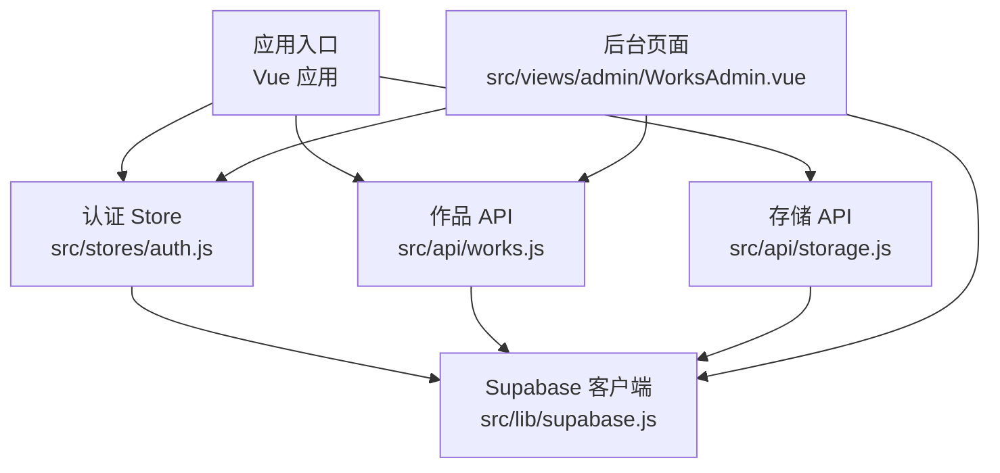
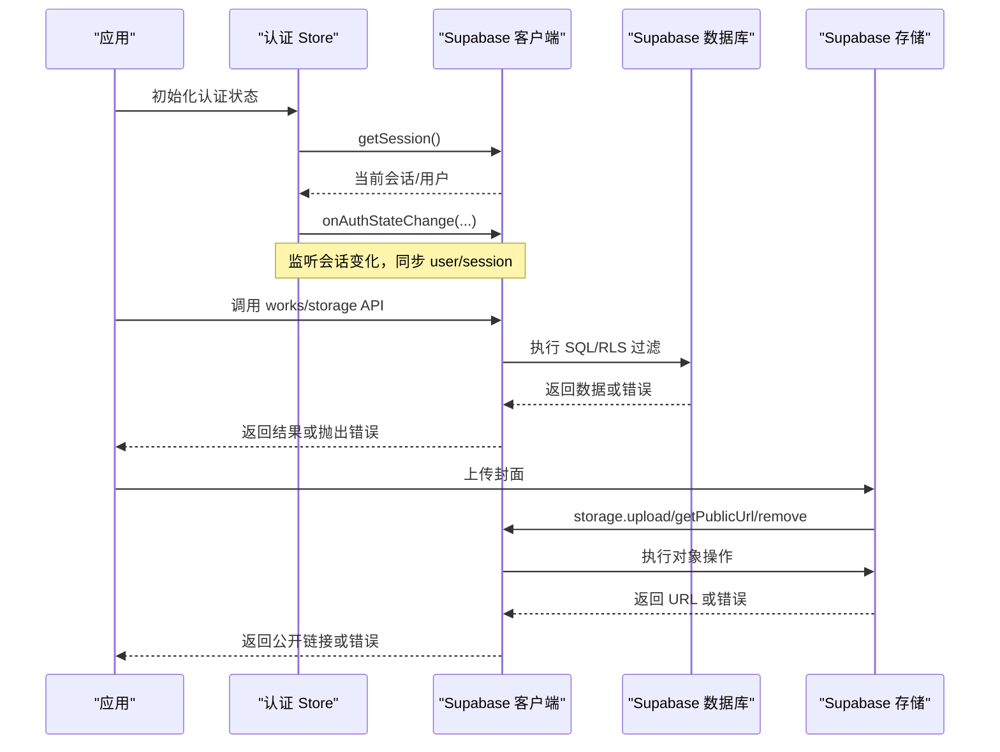
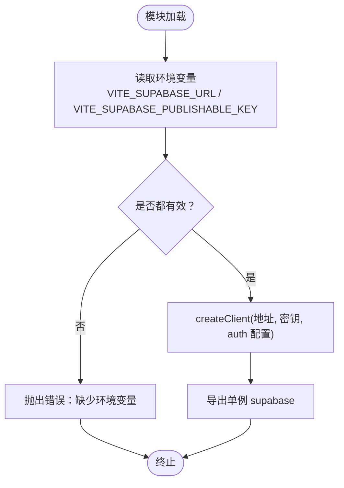
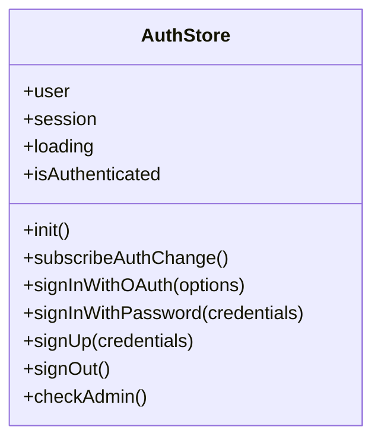
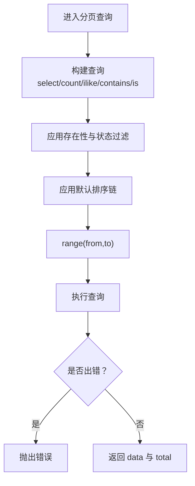
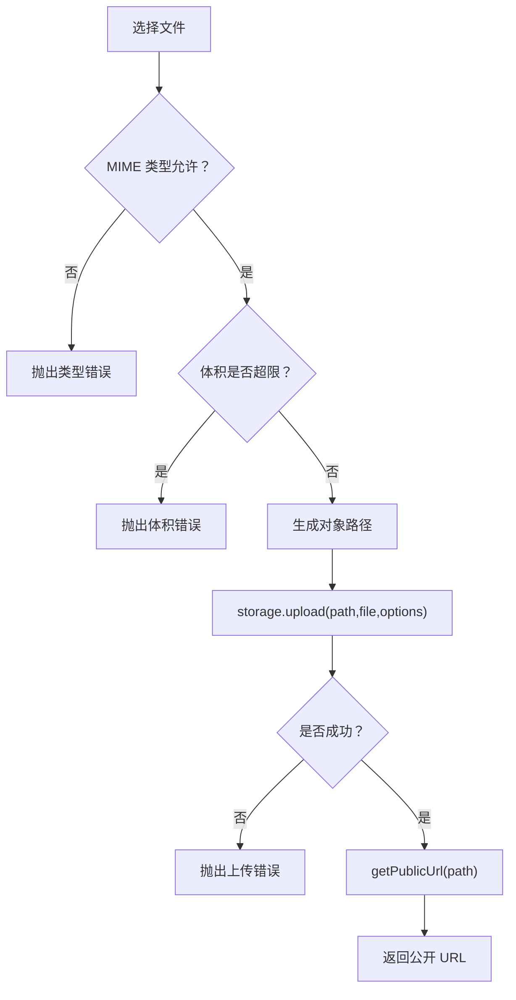
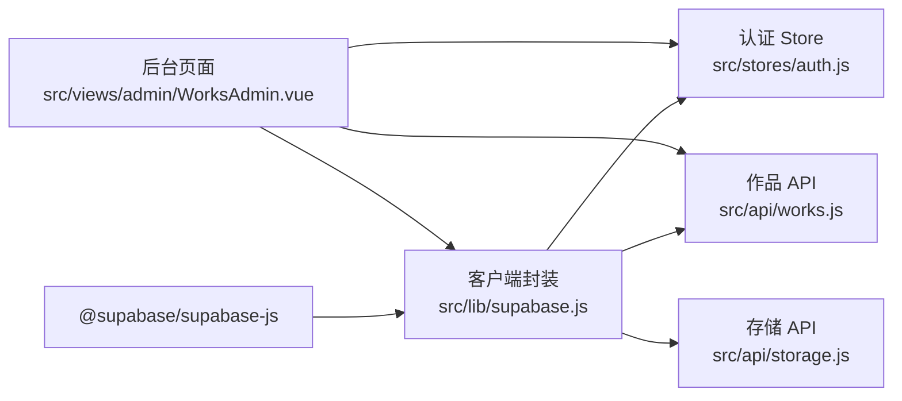

# Supabase 客户端封装

<cite>
**本文引用的文件**   
- [src/lib/supabase.js](file://src/lib/supabase.js)
- [src/stores/auth.js](file://src/stores/auth.js)
- [src/api/works.js](file://src/api/works.js)
- [src/api/storage.js](file://src/api/storage.js)
- [src/views/admin/WorksAdmin.vue](file://src/views/admin/WorksAdmin.vue)
- [package.json](file://package.json)
- [README.md](file://README.md)
</cite>

## 目录
1. [引言](#引言)
2. [项目结构](#项目结构)
3. [核心组件](#核心组件)
4. [架构总览](#架构总览)
5. [详细组件分析](#详细组件分析)
6. [依赖关系分析](#依赖关系分析)
7. [性能与连接优化](#性能与连接优化)
8. [故障排查指南](#故障排查指南)
9. [结论](#结论)
10. [附录：环境变量与环境配置](#附录环境变量与环境配置)

## 引言
本文面向前端工程中对 Supabase 的封装与使用，重点说明以下方面：
- Supabase 客户端的初始化、连接设置与环境变量管理
- 客户端实例创建过程、配置项含义与连接池行为
- 认证状态管理、错误处理机制与可落地的重试策略建议
- 在不同环境（开发、测试、生产）中的正确配置与最佳实践
- 结合本仓库的实际代码，给出数据访问、存储上传与权限校验的参考实现

## 项目结构
本项目基于 Vite + Vue 3 + Pinia，Supabase 客户端在模块层被集中创建并导出，供认证 Store、业务 API 与后台页面共同复用。关键路径如下：
- 客户端封装：`src/lib/supabase.js`
- 认证状态：`src/stores/auth.js`
- 作品数据 API：`src/api/works.js`
- 封面存储 API：`src/api/storage.js`
- 后台管理视图：`src/views/admin/WorksAdmin.vue`
- 依赖声明：`package.json`

图表来源
- [src/lib/supabase.js:1-16](file://src/lib/supabase.js#L1-L16)
- [src/stores/auth.js:1-82](file://src/stores/auth.js#L1-L82)
- [src/api/works.js:1-267](file://src/api/works.js#L1-L267)
- [src/api/storage.js:1-100](file://src/api/storage.js#L1-L100)
- [src/views/admin/WorksAdmin.vue:115-247](file://src/views/admin/WorksAdmin.vue#L115-L247)

章节来源
- [package.json:12-23](file://package.json#L12-L23)

## 核心组件
本节聚焦 Supabase 客户端封装及其在认证、数据访问与存储中的使用方式。

- 客户端封装 `src/lib/supabase.js`
  - 从构建时环境变量读取 Supabase 地址与发布密钥
  - 缺失环境变量时直接抛出错误，避免运行期静默失败
  - 通过 `createClient` 创建单例客户端，启用会话持久化、自动刷新令牌与 URL 中会话检测
- 认证 Store `src/stores/auth.js`
  - 维护用户、会话与加载状态
  - 提供 OAuth、邮箱密码登录、注册、登出与管理员权限检查
  - 订阅认证状态变化，保持全局状态一致
- 作品 API `src/api/works.js`
  - 对 `works_meta` 表进行查询、分页、统计、新增/更新、删除等封装
  - 统一排序、字段存在性过滤、UUID 校验与 RLS 安全边界说明
- 存储 API `src/api/storage.js`
  - 对封面图片上传、公开链接获取与旧图清理进行封装
  - 在前端做类型与体积预校验，配合后端 Storage RLS 完成最终权限控制

章节来源
- [src/lib/supabase.js:1-16](file://src/lib/supabase.js#L1-L16)
- [src/stores/auth.js:1-82](file://src/stores/auth.js#L1-L82)
- [src/api/works.js:1-267](file://src/api/works.js#L1-L267)
- [src/api/storage.js:1-100](file://src/api/storage.js#L1-L100)

## 架构总览
下图展示客户端初始化、认证流程与数据访问的整体交互。

图表来源
- [src/stores/auth.js:12-27](file://src/stores/auth.js#L12-L27)
- [src/api/works.js:45-140](file://src/api/works.js#L45-L140)
- [src/api/storage.js:62-99](file://src/api/storage.js#L62-L99)
- [src/lib/supabase.js:10-16](file://src/lib/supabase.js#L10-L16)

## 详细组件分析

### Supabase 客户端封装
- 初始化流程
  - 从构建环境变量读取 `VITE_SUPABASE_URL` 与 `VITE_SUPABASE_PUBLISHABLE_KEY`
  - 任一缺失即抛错，确保部署前必须配置完整
  - 使用 `createClient` 创建单例，开启：
    - 会话持久化：跨刷新保留登录态
    - 自动刷新令牌：减少频繁重新登录
    - URL 会话检测：支持 OAuth 回调参数解析
- 连接池与实例
  - 该模块以模块级常量导出单一客户端实例，全应用共享
  - 未显式配置连接池相关选项；实际连接行为由底层 SDK 决定
- 安全与配置
  - 仅暴露发布密钥给前端，敏感密钥不应出现在前端
  - 所有读写均受 RLS 策略约束，前端只做轻量校验与体验优化

图表来源
- [src/lib/supabase.js:3-16](file://src/lib/supabase.js#L3-L16)

章节来源
- [src/lib/supabase.js:1-16](file://src/lib/supabase.js#L1-L16)

### 认证状态管理
- 状态模型
  - `user`：当前用户对象
  - `session`：当前会话对象
  - `loading`：初始化加载标志
  - `isAuthenticated`：计算属性，判断是否已登录
- 生命周期
  - `init`：启动时拉取当前会话，填充 user/session
  - `subscribeAuthChange`：订阅认证状态变化，实时同步 user/session
- 认证方法
  - OAuth 登录：支持自定义 provider 与重定向地址
  - 邮箱密码登录/注册：标准表单认证
  - 登出：清除本地会话与状态
  - 管理员权限检查：通过 RPC 函数 `is_admin` 判定

图表来源
- [src/stores/auth.js:5-80](file://src/stores/auth.js#L5-L80)

章节来源
- [src/stores/auth.js:1-82](file://src/stores/auth.js#L1-L82)

### 作品数据访问 API
- 设计要点
  - 统一表名与列选择，便于维护
  - 默认排序链保证分页稳定，避免并列行导致重复或漏页
  - 字段存在性过滤用于“是否已配置”类筛选
  - UUID 校验防止非法 ID 触发数据库类型错误
- 主要能力
  - 公开列表：仅读已发布记录
  - 全量列表：需登录态
  - 分页查询：支持搜索、标签、状态与字段存在性过滤
  - 统计信息：轻量字段聚合
  - 单条查询：按 id 精确查询
  - 新增/更新：有 id 则更新，无 id 则新增并分配权重
  - 批量更新：拖拽排序后批量写回权重
  - 删除：先删记录，再清理封面文件

图表来源
- [src/api/works.js:115-140](file://src/api/works.js#L115-L140)
- [src/api/works.js:25-38](file://src/api/works.js#L25-L38)

章节来源
- [src/api/works.js:1-267](file://src/api/works.js#L1-L267)

### 封面存储 API
- 设计要点
  - 明确 bucket、MIME 类型与体积上限，前后端保持一致口径
  - 前端做类型与体积预校验，提升用户体验
  - 生成带时间戳与随机串的对象路径，避免中文文件名与覆盖问题
  - 公开访问 URL 缓存策略：长缓存降低带宽
  - 删除旧封面：非目标 bucket 外链忽略，删除失败只告警不阻断主流程
- 主要能力
  - 上传封面并返回公开 URL
  - 根据公开 URL 删除旧封面

图表来源
- [src/api/storage.js:25-83](file://src/api/storage.js#L25-L83)

章节来源
- [src/api/storage.js:1-100](file://src/api/storage.js#L1-L100)

### 后台管理页面中的客户端使用
- 在后台页面中直接导入并使用客户端，例如查询用户资料表
- 同时组合认证 Store 与作品 API，完成统计加载、保存、发布切换与删除等操作
- 错误处理采用 try/catch 捕获异常，并通过 UI 提示反馈给用户

章节来源
- [src/views/admin/WorksAdmin.vue:115-247](file://src/views/admin/WorksAdmin.vue#L115-L247)

## 依赖关系分析
- 运行时依赖
  - `@supabase/supabase-js`：提供客户端、认证、存储与数据库访问能力
- 模块依赖
  - 认证 Store、作品 API、存储 API 均依赖统一的客户端导出
  - 后台页面既依赖认证 Store，也直接调用客户端进行少量额外查询

图表来源
- [package.json:12-23](file://package.json#L12-L23)
- [src/lib/supabase.js:1-16](file://src/lib/supabase.js#L1-L16)
- [src/stores/auth.js:1-82](file://src/stores/auth.js#L1-L82)
- [src/api/works.js:1-267](file://src/api/works.js#L1-L267)
- [src/api/storage.js:1-100](file://src/api/storage.js#L1-L100)
- [src/views/admin/WorksAdmin.vue:115-247](file://src/views/admin/WorksAdmin.vue#L115-L247)

章节来源
- [package.json:12-23](file://package.json#L12-L23)

## 性能与连接优化
- 客户端实例
  - 使用模块级单例，避免重复创建客户端带来的连接开销
- 网络与缓存
  - 封面上传设置长缓存头，减少重复传输
  - 查询尽量指定必要字段，减少数据传输
- 分页与排序
  - 使用稳定的多列排序，避免分页重复/漏行
  - 合理设置 pageSize，平衡首屏与滚动加载体验
- 认证与会话
  - 启用会话持久化与自动刷新令牌，减少频繁鉴权
  - 使用 URL 会话检测，简化 OAuth 回调流程
- 错误与重试
  - 当前代码对多数接口采用直接抛出错误的策略
  - 建议在业务层增加指数退避重试，针对网络抖动与临时服务不可用场景
  - 对幂等写入（如 upsert）可考虑有限次重试，非幂等写入需谨慎

[本节为通用指导，不直接分析具体文件]

## 故障排查指南
- 环境变量缺失
  - 现象：模块加载阶段抛错，提示缺少环境变量
  - 排查：确认构建环境变量已注入且值有效
  - 定位：客户端封装的环境变量校验逻辑
- 认证状态不同步
  - 现象：登录后界面仍显示未登录，或刷新后丢失登录态
  - 排查：确认会话持久化与自动刷新令牌已启用；检查 OAuth 回调是否正确携带会话参数
  - 定位：认证 Store 的初始化与状态订阅逻辑
- 权限不足
  - 现象：匿名或普通用户无法访问某些数据
  - 排查：检查 RLS 策略与角色映射；确认 admin 权限判定逻辑
  - 定位：认证 Store 的管理员权限检查与 README 中的 RLS 说明
- 封面上传失败
  - 现象：上传时报错或被拒绝
  - 排查：确认 MIME 类型与体积限制；检查 Storage RLS 是否允许 anon 写入；查看控制台错误信息
  - 定位：存储 API 的类型/体积校验与上传逻辑
- 分页数据重复或缺失
  - 现象：翻页出现重复行或漏行
  - 排查：确认排序包含唯一键；检查是否存在并列键导致的不确定顺序
  - 定位：作品 API 的默认排序链与 range 分页逻辑

章节来源
- [src/lib/supabase.js:6-8](file://src/lib/supabase.js#L6-L8)
- [src/stores/auth.js:12-27](file://src/stores/auth.js#L12-L27)
- [src/api/storage.js:62-99](file://src/api/storage.js#L62-L99)
- [src/api/works.js:25-38](file://src/api/works.js#L25-L38)
- [README.md:133-156](file://README.md#L133-L156)

## 结论
本项目的 Supabase 客户端封装遵循“集中创建、统一导出、严格校验”的原则，结合认证 Store 与业务 API，形成清晰的前端数据访问边界。通过 RLS 与 Storage 策略保障数据安全，通过会话持久化与自动刷新提升用户体验。在生产环境中，应重点关注环境变量安全、RLS 策略完备性与错误重试策略的可控性。

[本节为总结性内容，不直接分析具体文件]

## 附录：环境变量与环境配置
- 必需环境变量
  - `VITE_SUPABASE_URL`：Supabase 项目地址
  - `VITE_SUPABASE_PUBLISHABLE_KEY`：前端发布密钥
- 配置位置
  - 客户端封装在模块加载时读取并校验这两个变量
- 环境差异建议
  - 开发/测试/生产分别配置不同的 Supabase 项目与密钥
  - 不要将私钥放入前端；仅使用发布密钥
  - 在 CI/CD 中注入环境变量，避免硬编码
- 安全与权限
  - 前台仅具备 anon/publishable key 的能力，真正权限边界由 RLS 与 Storage 策略决定
  - 管理员权限通过 RPC 函数判定，需在 Supabase 侧正确定义

章节来源
- [src/lib/supabase.js:3-8](file://src/lib/supabase.js#L3-L8)
- [README.md:133-156](file://README.md#L133-L156)