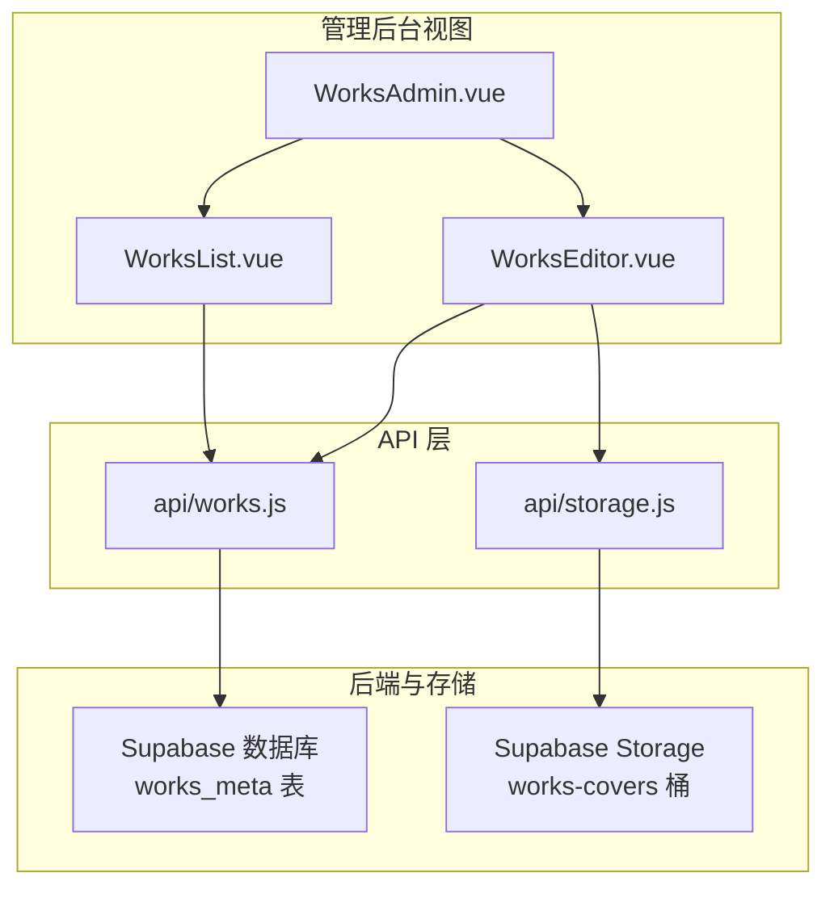
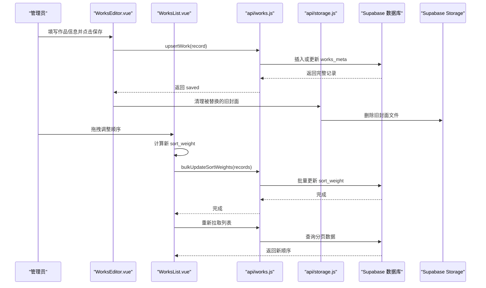
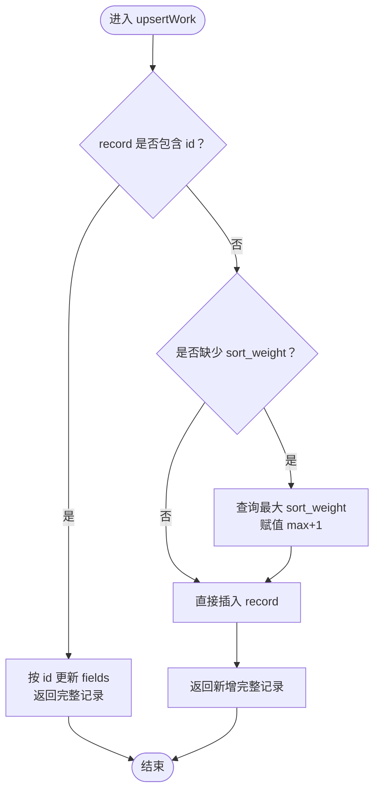
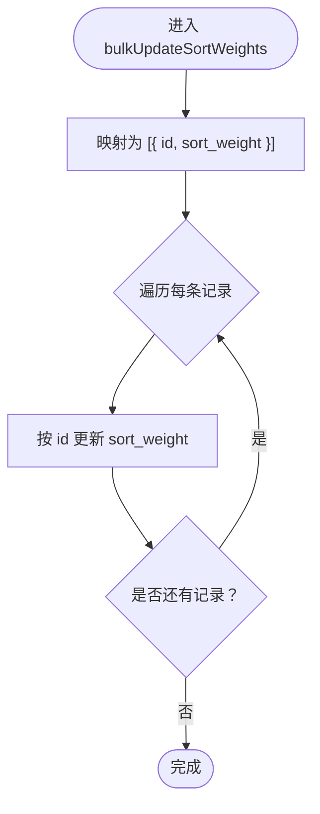
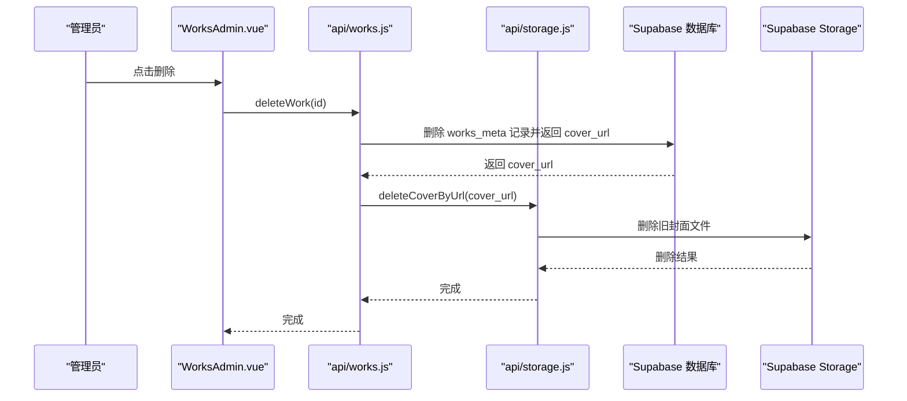
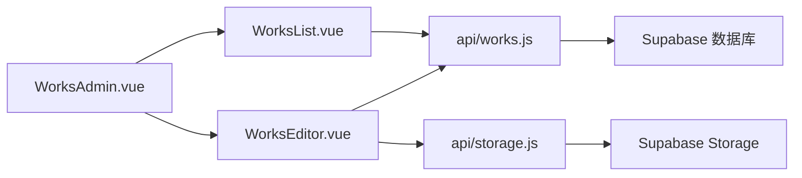

# 作品修改接口

<cite>
**本文引用的文件**   
- [src/api/works.js](file://src/api/works.js)
- [src/api/storage.js](file://src/api/storage.js)
- [src/views/admin/WorksAdmin.vue](file://src/views/admin/WorksAdmin.vue)
- [src/views/admin/WorksEditor.vue](file://src/views/admin/WorksEditor.vue)
- [src/views/admin/WorksList.vue](file://src/views/admin/WorksList.vue)
</cite>

## 目录
1. [简介](#简介)
2. [项目结构](#项目结构)
3. [核心接口总览](#核心接口总览)
4. [架构总览](#架构总览)
5. [详细接口分析](#详细接口分析)
6. [依赖关系分析](#依赖关系分析)
7. [性能与事务处理](#性能与事务处理)
8. [错误处理与排错指南](#错误处理与排错指南)
9. [管理员操作示例与最佳实践](#管理员操作示例与最佳实践)
10. [结论](#结论)

## 简介
本文聚焦作品修改相关的前端 API 封装与管理后台交互，围绕以下三个核心能力展开：
- upsertWork：新增或更新作品。有 id 时执行更新，无 id 时执行新增并自动分配 sort_weight。
- bulkUpdateSortWeights：批量更新排序权重，用于拖拽排序场景下的增量更新。
- deleteWork：删除作品，包含数据库记录删除与 Storage 中封面文件的级联清理。

文档同时说明权限要求、管理员验证机制、错误处理、事务语义以及性能优化建议，并提供完整的管理员操作示例和最佳实践。

## 项目结构
与作品修改相关的代码主要分布在以下模块：
- API 层：负责 Supabase 数据访问与 Storage 封面管理。
- 视图层：管理后台的编辑、列表、发布状态切换、删除与拖拽排序。
- 存储层：Supabase Storage 的封面上传与删除。

**图表来源**
- [src/views/admin/WorksAdmin.vue:93-110](file://src/views/admin/WorksAdmin.vue#L93-L110)
- [src/views/admin/WorksEditor.vue:292-293](file://src/views/admin/WorksEditor.vue#L292-L293)
- [src/views/admin/WorksList.vue:226-226](file://src/views/admin/WorksList.vue#L226-L226)
- [src/api/works.js:1-4](file://src/api/works.js#L1-L4)
- [src/api/storage.js:1-2](file://src/api/storage.js#L1-L2)

**章节来源**
- [src/views/admin/WorksAdmin.vue:93-110](file://src/views/admin/WorksAdmin.vue#L93-L110)
- [src/views/admin/WorksEditor.vue:292-293](file://src/views/admin/WorksEditor.vue#L292-L293)
- [src/views/admin/WorksList.vue:226-226](file://src/views/admin/WorksList.vue#L226-L226)
- [src/api/works.js:1-4](file://src/api/works.js#L1-L4)
- [src/api/storage.js:1-2](file://src/api/storage.js#L1-L2)

## 核心接口总览
本节从调用方视角总结三个接口的职责、参数、返回值与权限边界。

| 接口 | 职责 | 关键参数 | 返回值 | 权限要求 |
|---|---|---|---|---|
| upsertWork | 新增或更新作品；有 id 更新，无 id 新增并自动分配 sort_weight | record：作品行对象，至少包含 name；更新时需带 id | Promise\<Object\>：写入后的完整记录 | 前端逻辑限制为管理员使用；实际写权限由 RLS 控制 |
| bulkUpdateSortWeights | 批量更新作品的 sort_weight，用于拖拽排序 | records：[{ id, sort_weight }] 数组；conflictKey 默认 'id' | Promise\<Array\<Object\>\>（当前实现返回 void） | 管理员使用；写权限由 RLS 控制 |
| deleteWork | 删除作品记录，并尝试清理 Storage 中的旧封面 | id：works_meta.id（UUID） | Promise\<void\> | 管理员使用；写权限由 RLS 与 Storage 策略控制 |

补充说明：
- works_meta 表的 RLS 策略注释指出：anon 只能读 is_published=true；authenticated 可读取全部；admin 可增删改。
- Storage 的 bucket 仅 admin 可写，匿名 key 在前端无法真正写入，真正的权限边界在 Storage RLS。

**章节来源**
- [src/api/works.js:6-12](file://src/api/works.js#L6-L12)
- [src/api/storage.js:3-10](file://src/api/storage.js#L3-L10)
- [src/api/works.js:197-231](file://src/api/works.js#L197-L231)
- [src/api/works.js:234-249](file://src/api/works.js#L234-L249)
- [src/api/works.js:251-266](file://src/api/works.js#L251-L266)

## 架构总览
作品修改的整体流程分为三类：
- 新增或更新：编辑器提交表单 → upsertWork → 数据库写入 → 成功后清理被替换的旧封面。
- 拖拽排序：列表拖拽 → 计算新 sort_weight → bulkUpdateSortWeights → 刷新列表。
- 删除作品：确认删除 → deleteWork → 删除数据库记录 → 清理 Storage 封面。

**图表来源**
- [src/views/admin/WorksEditor.vue:516-566](file://src/views/admin/WorksEditor.vue#L516-L566)
- [src/views/admin/WorksList.vue:473-542](file://src/views/admin/WorksList.vue#L473-L542)
- [src/api/works.js:203-249](file://src/api/works.js#L203-L249)
- [src/api/storage.js:62-83](file://src/api/storage.js#L62-L83)
- [src/api/storage.js:90-99](file://src/api/storage.js#L90-L99)

## 详细接口分析

### upsertWork：新增或更新作品
upsertWork 是作品修改的核心入口。其智能判断逻辑如下：
- 如果 record 包含 id：执行更新操作，将除 id 之外的字段更新到对应记录，并返回更新后的完整记录。
- 如果 record 不包含 id：执行新增操作。若未提供 sort_weight，则先查询当前最大 sort_weight，并赋值为最大值加一，从而避免多条记录权重相同导致首次拖拽触发全量重排。

**图表来源**
- [src/api/works.js:203-231](file://src/api/works.js#L203-L231)

参数定义：
- record：works_meta 行对象，必须包含 name。更新时必须包含 id；新增时可省略 id，sort_weight 可选。

返回值结构：
- Promise\<Object\>：写入后的完整记录，包含 id、name、cover_url、info_md、code_url、link_url、codepen_url、open_url、date、sort_weight、is_published、tags 等字段。

权限要求：
- 前端逻辑限定为管理员使用；数据库侧通过 RLS 控制 anon/authenticated/admin 的读写权限。

错误处理：
- 数据库更新失败会抛出异常，调用方需捕获并提示用户。

性能考虑：
- 新增时若未提供 sort_weight，需要一次额外查询以获取最大权重。建议在批量导入场景预先计算权重，减少多次查询。

**章节来源**
- [src/api/works.js:197-231](file://src/api/works.js#L197-L231)
- [src/views/admin/WorksEditor.vue:516-566](file://src/views/admin/WorksEditor.vue#L516-L566)

### bulkUpdateSortWeights：批量更新排序权重
bulkUpdateSortWeights 用于拖拽排序后批量更新 sort_weight。当前实现将每个记录的 id 与新的 sort_weight 组合为更新项，逐个执行更新。

**图表来源**
- [src/api/works.js:240-249](file://src/api/works.js#L240-L249)

参数定义：
- records：数组，每项包含 id 与 sort_weight。
- conflictKey：冲突检测字段，默认 'id'。

返回值结构：
- 函数签名标注返回 Promise\<Array\<Object\>\>，但当前实现没有显式 return，因此实际行为更接近 Promise\<void\>。调用方不应依赖返回值。

拖拽排序场景下的批量更新机制：
- 列表组件在拖拽结束后计算移动项的新 sort_weight。
- 如果相邻两项权重差值过小（精度过低），会触发全量重排：按列表长度乘以基数，依次分配整数权重，并调用 bulkUpdateSortWeights 批量更新整页数据。
- 否则只更新移动项的 sort_weight，随后重新拉取列表以确保 UI 与数据库一致。

权限要求：
- 管理员使用；写权限由 RLS 控制。

错误处理：
- 单条更新失败会抛出异常，调用方应捕获并提示用户。

性能优化建议：
- 当前逐条更新存在 N 次网络往返。可考虑在后端或数据库侧支持批量更新语句，或使用 Supabase 的批量 upsert 能力以减少请求次数。

**章节来源**
- [src/api/works.js:234-249](file://src/api/works.js#L234-L249)
- [src/views/admin/WorksList.vue:515-542](file://src/views/admin/WorksList.vue#L515-L542)

### deleteWork：删除作品与级联清理
deleteWork 负责删除作品记录，并在删除成功后尝试清理 Storage 中的封面文件。

**图表来源**
- [src/views/admin/WorksAdmin.vue:231-243](file://src/views/admin/WorksAdmin.vue#L231-L243)
- [src/api/works.js:256-266](file://src/api/works.js#L256-L266)
- [src/api/storage.js:90-99](file://src/api/storage.js#L90-L99)

参数定义：
- id：works_meta.id（UUID）。

返回值结构：
- Promise\<void\>。

级联删除逻辑：
- 先删除数据库记录，再删除 Storage 中的封面文件。
- 如果封面 URL 不是本 bucket 的外链 URL，deleteCoverByUrl 会忽略删除。
- 文件删除失败只会告警，不会让作品删除失败，保证主流程健壮性。

权限要求：
- 管理员使用；数据库与 Storage 均受 RLS 策略保护。

错误处理：
- 数据库删除失败会抛出异常。
- Storage 删除失败仅记录警告，不影响主流程。

**章节来源**
- [src/api/works.js:251-266](file://src/api/works.js#L251-L266)
- [src/api/storage.js:90-99](file://src/api/storage.js#L90-L99)
- [src/views/admin/WorksAdmin.vue:231-243](file://src/views/admin/WorksAdmin.vue#L231-L243)

## 依赖关系分析
- WorksEditor 依赖 upsertWork 与 storage 的 uploadCover、deleteCoverByUrl。
- WorksList 依赖 fetchWorksPage 与 bulkUpdateSortWeights。
- WorksAdmin 聚合 editor 与 list，并调用 upsertWork 与 deleteWork。
- api/works.js 依赖 supabase 客户端与 storage 模块。
- api/storage.js 依赖 supabase 客户端与 Storage bucket 策略。

**图表来源**
- [src/views/admin/WorksEditor.vue:292-293](file://src/views/admin/WorksEditor.vue#L292-L293)
- [src/views/admin/WorksList.vue:226-226](file://src/views/admin/WorksList.vue#L226-L226)
- [src/views/admin/WorksAdmin.vue:121-123](file://src/views/admin/WorksAdmin.vue#L121-L123)
- [src/api/works.js:1-4](file://src/api/works.js#L1-L4)
- [src/api/storage.js:1-2](file://src/api/storage.js#L1-L2)

**章节来源**
- [src/views/admin/WorksEditor.vue:292-293](file://src/views/admin/WorksEditor.vue#L292-L293)
- [src/views/admin/WorksList.vue:226-226](file://src/views/admin/WorksList.vue#L226-L226)
- [src/views/admin/WorksAdmin.vue:121-123](file://src/views/admin/WorksAdmin.vue#L121-L123)
- [src/api/works.js:1-4](file://src/api/works.js#L1-L4)
- [src/api/storage.js:1-2](file://src/api/storage.js#L1-L2)

## 性能与事务处理
- upsertWork：
  - 新增时若无 sort_weight，会多一次查询以获取最大权重。建议在批量导入时预计算权重，减少多次查询。
  - 更新时直接按 id 更新，性能稳定。
- bulkUpdateSortWeights：
  - 当前逐条更新，N 条记录产生 N 次网络往返。推荐在后端或数据库侧支持批量更新，或使用 Supabase 的批量 upsert 能力。
  - 拖拽排序中当相邻权重差值过小时，会触发全量重排，避免浮点精度问题。
- deleteWork：
  - 先删数据库记录，再删 Storage 文件。文件删除失败不阻塞主流程，提升健壮性。
- 事务处理：
  - 当前前端未显式开启数据库事务。删除与文件清理分两步执行，属于最终一致性设计。若需强一致性，应在后端服务中封装事务，确保数据库与 Storage 原子性。

[本节为通用性能讨论，不直接分析具体文件]

## 错误处理与排错指南
- 常见错误来源：
  - 数据库 RLS 拒绝写入：检查用户角色是否为 admin，或 Supabase RLS 策略是否正确配置。
  - Storage 上传失败：检查 MIME 类型、文件大小、bucket 策略与网络状态。
  - 拖拽排序失败：检查网络连接与 bulkUpdateSortWeights 调用是否成功。
- 前端错误处理：
  - upsertWork 与 deleteWork 抛出异常时，调用方应捕获并提示用户。
  - Storage 删除失败仅告警，不影响主流程；可在日志中排查旧封面残留。
- 排错步骤：
  - 确认登录态与管理员权限。
  - 检查浏览器控制台错误信息与 Supabase 日志。
  - 对拖拽排序问题，查看列表组件的 persistOrder 与 bulkUpdateSortWeights 调用。
  - 对封面问题，检查 uploadCover 与 deleteCoverByUrl 的参数与返回。

**章节来源**
- [src/views/admin/WorksEditor.vue:516-566](file://src/views/admin/WorksEditor.vue#L516-L566)
- [src/views/admin/WorksAdmin.vue:231-243](file://src/views/admin/WorksAdmin.vue#L231-L243)
- [src/views/admin/WorksList.vue:473-542](file://src/views/admin/WorksList.vue#L473-L542)
- [src/api/storage.js:62-83](file://src/api/storage.js#L62-L83)
- [src/api/storage.js:90-99](file://src/api/storage.js#L90-L99)

## 管理员操作示例与最佳实践
- 新增作品：
  - 打开编辑器，填写名称、封面、介绍与外链。
  - 点击“发布”或“存为草稿”，触发 upsertWork。
  - 成功后系统回填 id，并清理被替换的旧封面。
- 更新作品：
  - 从列表进入编辑器，修改字段后点击“更新”。
  - upsertWork 根据 id 执行更新。
- 拖拽排序：
  - 在无搜索、筛选状态下启用拖拽。
  - 拖动条目到目标位置，系统计算新 sort_weight 并调用 bulkUpdateSortWeights。
  - 若相邻权重差值过小，触发全量重排。
- 删除作品：
  - 在列表中点击删除，确认后调用 deleteWork。
  - 数据库记录删除成功后，尝试清理 Storage 中的封面文件。
- 最佳实践：
  - 始终使用管理员账号进行操作。
  - 批量导入时预计算 sort_weight，减少查询开销。
  - 封面上传前进行类型与大小校验，避免无效请求。
  - 删除作品后检查 Storage 是否有遗留文件，必要时手动清理。

**章节来源**
- [src/views/admin/WorksEditor.vue:516-566](file://src/views/admin/WorksEditor.vue#L516-L566)
- [src/views/admin/WorksList.vue:473-542](file://src/views/admin/WorksList.vue#L473-L542)
- [src/views/admin/WorksAdmin.vue:231-243](file://src/views/admin/WorksAdmin.vue#L231-L243)
- [src/api/storage.js:62-83](file://src/api/storage.js#L62-L83)

## 结论
作品修改接口通过 upsertWork、bulkUpdateSortWeights 与 deleteWork 覆盖了新增、更新、排序与删除的核心场景。前端实现了智能判断与用户体验优化，如自动分配 sort_weight、拖拽排序与封面清理。权限控制依赖 Supabase RLS 与 Storage 策略，管理员操作需在安全策略下执行。未来可进一步优化批量更新性能，并在后端引入事务以保证数据库与 Storage 的一致性。