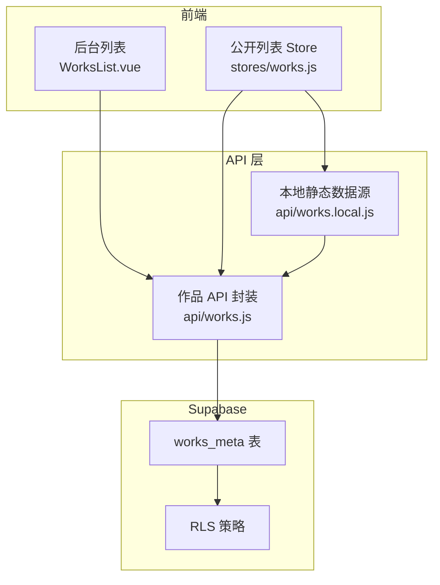
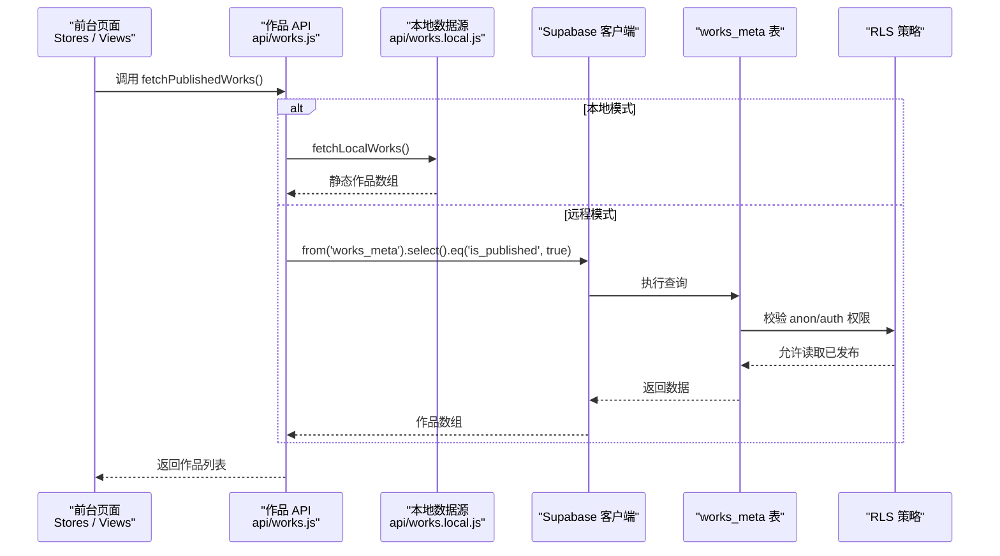
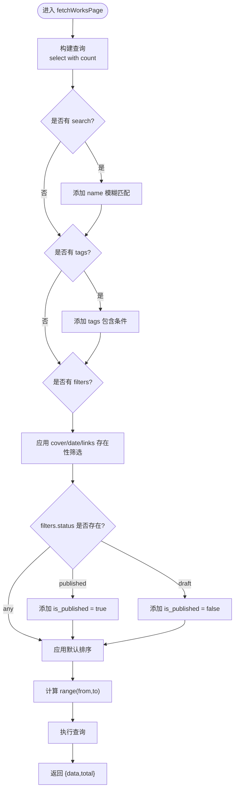
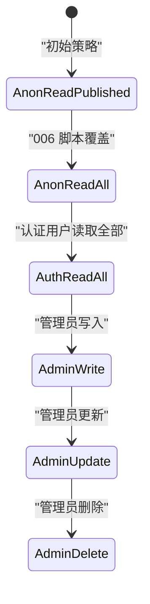
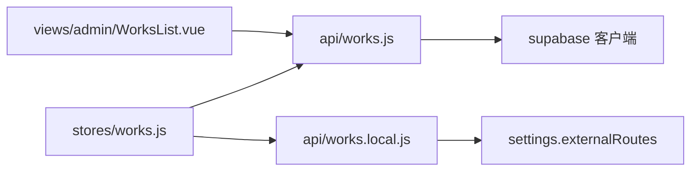

# 作品数据 API

<cite>
**本文引用的文件**   
- [src/api/works.js](file://src/api/works.js)
- [src/api/works.local.js](file://src/api/works.local.js)
- [sql/002-works-meta.sql](file://sql/002-works-meta.sql)
- [sql/006-anon-read-all.sql](file://sql/006-anon-read-all.sql)
- [src/stores/works.js](file://src/stores/works.js)
- [src/views/admin/WorksList.vue](file://src/views/admin/WorksList.vue)
</cite>

## 目录
1. [简介](#简介)
2. [项目结构](#项目结构)
3. [核心接口总览](#核心接口总览)
4. [架构总览](#架构总览)
5. [详细接口说明](#详细接口说明)
6. [RLS 行级安全策略](#rls-行级安全策略)
7. [搜索、过滤与排序规则](#搜索过滤与排序规则)
8. [依赖关系分析](#依赖关系分析)
9. [性能与分页特性](#性能与分页特性)
10. [错误处理与调试建议](#错误处理与调试建议)
11. [常见使用场景与最佳实践](#常见使用场景与最佳实践)
12. [结论](#结论)

## 简介
本文件面向“作品数据 API”，围绕 `works_meta` 表提供完整的数据访问能力，包括：
- 获取已发布作品列表（匿名可访问）
- 获取全部作品（需登录态）
- 分页查询（支持关键词搜索、标签筛选、字段存在性筛选、发布状态筛选）
- 单条作品查询（详情）
- 新增、更新、批量更新排序权重、删除（管理员权限）

同时说明 Supabase RLS 策略如何控制匿名、认证用户和管理员权限，并给出前端调用示例和常见问题排查思路。

## 项目结构
与作品数据 API 直接相关的代码分布在以下位置：
- 后端数据访问封装：`src/api/works.js`
- 本地静态数据源适配：`src/api/works.local.js`
- 数据库表结构与 RLS 策略：`sql/002-works-meta.sql`、`sql/006-anon-read-all.sql`
- 公开作品列表 Store：`src/stores/works.js`
- 后台管理列表 UI 与分页交互：`src/views/admin/WorksList.vue`

**图表来源**
- [src/views/admin/WorksList.vue:221-227](file://src/views/admin/WorksList.vue#L221-L227)
- [src/stores/works.js:1-28](file://src/stores/works.js#L1-L28)
- [src/api/works.js:1-15](file://src/api/works.js#L1-L15)
- [src/api/works.local.js:1-20](file://src/api/works.local.js#L1-L20)
- [sql/002-works-meta.sql:31-64](file://sql/002-works-meta.sql#L31-L64)

**章节来源**
- [src/api/works.js:1-15](file://src/api/works.js#L1-L15)
- [src/api/works.local.js:1-20](file://src/api/works.local.js#L1-L20)
- [sql/002-works-meta.sql:1-33](file://sql/002-works-meta.sql#L1-L33)
- [src/stores/works.js:1-28](file://src/stores/works.js#L1-L28)
- [src/views/admin/WorksList.vue:221-227](file://src/views/admin/WorksList.vue#L221-L227)

## 核心接口总览
| 接口 | 方法名 | 用途 | 权限要求 | 主要参数 | 返回值 |
|---|---|---|---|---|---|
| 获取已发布作品列表 | `fetchPublishedWorks` | 公开列表，仅返回已发布作品 | 匿名或认证均可；匿名受 RLS 限制为已发布 | 无 | 作品数组 |
| 获取全部作品 | `fetchAllWorks` | 后台全量列表，包含未发布 | 需登录（authenticated） | 无 | 作品数组 |
| 分页查询 | `fetchWorksPage` | 后台分页 + 搜索 + 标签 + 条件筛选 | 需登录（authenticated） | `page`、`pageSize`、`search`、`tags`、`filters` | `{ data, total }` |
| 单条作品查询 | `fetchWorkById` | 按 id 查单条记录 | 受 RLS 控制 | `id` | 单条记录或 null |
| 详情页查询 | `fetchWorkDetail` | 兼容本地静态数据与远程 UUID 校验 | 受 RLS 控制 | `key` | 单条记录或 null |
| 新增或更新 | `upsertWork` | 有 id 更新，无 id 新增 | 管理员（admin） | 作品对象 | 写入后的完整记录 |
| 批量更新排序权重 | `bulkUpdateSortWeights` | 拖拽排序后批量写 `sort_weight` | 管理员（admin） | 记录数组 | 写入结果（内部逐行更新） |
| 删除作品 | `deleteWork` | 删除记录并尝试清理封面文件 | 管理员（admin） | `id` | 无返回值，异常时抛错 |

**章节来源**
- [src/api/works.js:45-67](file://src/api/works.js#L45-L67)
- [src/api/works.js:115-140](file://src/api/works.js#L115-L140)
- [src/api/works.js:169-178](file://src/api/works.js#L169-L178)
- [src/api/works.js:186-195](file://src/api/works.js#L186-L195)
- [src/api/works.js:203-232](file://src/api/works.js#L203-L232)
- [src/api/works.js:240-249](file://src/api/works.js#L240-L249)
- [src/api/works.js:256-266](file://src/api/works.js#L256-L266)

## 架构总览
作品数据 API 的调用链路如下：
- 公开页面通过 `stores/works.js` 调用 `fetchPublishedWorks`，默认走 Supabase；若启用本地模式则走 `fetchLocalWorks`。
- 后台管理页面 `WorksList.vue` 调用 `fetchWorksPage` 进行分页查询，并通过 `upsertWork`、`bulkUpdateSortWeights`、`deleteWork` 完成增删改。
- 所有数据库操作最终由 `supabase` 客户端发起，受 `works_meta` 表的 RLS 策略约束。

**图表来源**
- [src/stores/works.js:12-25](file://src/stores/works.js#L12-L25)
- [src/api/works.js:45-55](file://src/api/works.js#L45-L55)
- [src/api/works.local.js:53-58](file://src/api/works.local.js#L53-L58)
- [sql/002-works-meta.sql:42-50](file://sql/002-works-meta.sql#L42-L50)

## 详细接口说明

### 获取已发布作品列表
- **方法名**：`fetchPublishedWorks`
- **用途**：获取公开可见的作品列表，只返回已发布作品。
- **权限**：匿名用户可通过 RLS 读取 `is_published=true` 的记录；认证用户也可读取。
- **参数**：无。
- **返回值**：作品数组。
- **行为细节**：
  - 默认排序：按 `sort_weight` 降序、`date` 降序、`created_at` 降序、`id` 升序。
  - 如果数据库返回错误，会抛出异常。

**章节来源**
- [src/api/works.js:45-55](file://src/api/works.js#L45-L55)
- [src/api/works.js:25-38](file://src/api/works.js#L25-L38)

### 获取全部作品
- **方法名**：`fetchAllWorks`
- **用途**：后台管理需要查看所有作品，包括未发布和隐藏作品。
- **权限**：需登录（authenticated）。
- **参数**：无。
- **返回值**：作品数组。
- **行为细节**：
  - 同样应用默认排序。
  - 如果数据库返回错误，会抛出异常。

**章节来源**
- [src/api/works.js:62-67](file://src/api/works.js#L62-L67)
- [src/api/works.js:25-38](file://src/api/works.js#L25-L38)

### 分页查询
- **方法名**：`fetchWorksPage`
- **用途**：后台分页查询，支持搜索、标签、字段存在性筛选、发布状态筛选。
- **权限**：需登录（authenticated）。
- **参数**：
  - `page`：页码，从 1 开始。
  - `pageSize`：每页条数。
  - `search`：关键词，匹配作品名称。
  - `tags`：标签数组，多选且为 AND 关系。
  - `filters`：条件筛选对象，支持：
    - `cover`：`any`、`filled`、`empty`
    - `date`：`any`、`filled`、`empty`
    - `links`：`any`、`filled`、`empty`，表示四个外链字段中是否任一有值
    - `status`：`any`、`published`、`draft`
- **返回值**：`{ data: Array, total: number }`
- **行为细节**：
  - 搜索使用模糊匹配。
  - 标签使用数组包含判断。
  - 字段存在性筛选基于是否为 null。
  - 发布状态筛选对应 `is_published`。
  - 最后应用默认排序和分页范围。

**图表来源**
- [src/api/works.js:115-140](file://src/api/works.js#L115-L140)
- [src/api/works.js:87-103](file://src/api/works.js#L87-L103)
- [src/api/works.js:25-38](file://src/api/works.js#L25-L38)

**章节来源**
- [src/api/works.js:115-140](file://src/api/works.js#L115-L140)
- [src/api/works.js:87-103](file://src/api/works.js#L87-L103)

### 单条作品查询
- **方法名**：`fetchWorkById`
- **用途**：根据作品 id 查询单条记录。
- **参数**：`id`，类型为 uuid。
- **返回值**：单条记录或 null。
- **行为细节**：
  - 使用 `maybeSingle()`，不存在时返回 null。
  - 非 uuid 类型 id 在 SQL 层可能报错，因此上层应做校验。

**章节来源**
- [src/api/works.js:169-178](file://src/api/works.js#L169-L178)

### 详情页查询
- **方法名**：`fetchWorkDetail`
- **用途**：详情页加载，优先兼容本地静态数据；否则走远程查询。
- **参数**：`key`，作品 id。
- **返回值**：单条记录或 null。
- **行为细节**：
  - 空 key 直接返回 null。
  - 启用本地模式时，从静态数据中查找。
  - 非 uuid 的 key 直接视为不存在，避免数据库 uuid 校验错误。
  - 否则调用 `fetchWorkById`。

**章节来源**
- [src/api/works.js:186-195](file://src/api/works.js#L186-L195)
- [src/api/works.js:169-178](file://src/api/works.js#L169-L178)
- [src/api/works.local.js:53-58](file://src/api/works.local.js#L53-L58)

### 新增或更新作品
- **方法名**：`upsertWork`
- **用途**：有 id 时更新，无 id 时新增。
- **权限**：管理员（admin）。
- **参数**：作品对象，至少包含 `name`。
- **返回值**：写入后的完整记录。
- **行为细节**：
  - 更新时排除 id 字段，只更新业务字段。
  - 新增时若未提供 `sort_weight`，自动取当前最大权重加 1。
  - 插入或更新失败会抛出异常。

**章节来源**
- [src/api/works.js:203-232](file://src/api/works.js#L203-L232)

### 批量更新排序权重
- **方法名**：`bulkUpdateSortWeights`
- **用途**：拖拽排序后批量更新 `sort_weight`。
- **权限**：管理员（admin）。
- **参数**：记录数组，每条记录至少包含 `id` 和 `sort_weight`。
- **返回值**：内部逐行更新，异常时抛出。
- **行为细节**：
  - 当前实现为循环逐行更新，并非单次批量 insert/update。
  - 任何一行更新失败都会抛出异常。

**章节来源**
- [src/api/works.js:240-249](file://src/api/works.js#L240-L249)

### 删除作品
- **方法名**：`deleteWork`
- **用途**：删除作品记录，并尝试清理封面文件。
- **权限**：管理员（admin）。
- **参数**：`id`，作品 uuid。
- **返回值**：无返回值，异常时抛出。
- **行为细节**：
  - 先删除记录，再删除封面文件。
  - 文件清理失败不会让作品删除失败，但会抛出异常。

**章节来源**
- [src/api/works.js:256-266](file://src/api/works.js#L256-L266)

## RLS 行级安全策略
`works_meta` 表启用了行级安全，并通过策略控制不同角色的访问权限：

| 角色 | 策略 | 行为 |
|---|---|---|
| 匿名（anon） | `works_meta: anon read published` | 只能读取 `is_published=true` 的记录 |
| 匿名（anon） | `works_meta: anon read all` | 覆盖上一条，允许读取全部记录（草稿凭链接可见） |
| 认证用户（authenticated） | `works_meta: auth read all` | 可读取全部记录 |
| 管理员（admin） | `works_meta: admin write` | 可插入 |
| 管理员（admin） | `works_meta: admin update` | 可更新 |
| 管理员（admin） | `works_meta: admin delete` | 可删除 |

注意：
- 初始脚本 `002-works-meta.sql` 中匿名策略只允许读取已发布作品。
- 后续脚本 `006-anon-read-all.sql` 将匿名策略改为可读全部记录，使草稿详情链接对任何人可见。
- 公开列表接口仍通过 `.eq('is_published', true)` 主动过滤，因此列表不会暴露草稿。

**图表来源**
- [sql/002-works-meta.sql:42-64](file://sql/002-works-meta.sql#L42-L64)
- [sql/006-anon-read-all.sql:25-32](file://sql/006-anon-read-all.sql#L25-L32)

**章节来源**
- [sql/002-works-meta.sql:31-64](file://sql/002-works-meta.sql#L31-L64)
- [sql/006-anon-read-all.sql:1-33](file://sql/006-anon-read-all.sql#L1-L33)

## 搜索、过滤与排序规则

### 搜索规则
- 关键词搜索作用于作品名称字段。
- 使用模糊匹配，适合快速检索标题。

**章节来源**
- [src/api/works.js:118-120](file://src/api/works.js#L118-L120)

### 标签筛选规则
- 标签为数组字段。
- 传入多个标签时采用 AND 关系，即必须同时包含所有选中标签。
- 前端 `WorksList.vue` 动态收集当前页标签，并提供多选切换。

**章节来源**
- [src/api/works.js:121-123](file://src/api/works.js#L121-L123)
- [src/views/admin/WorksList.vue:338-343](file://src/views/admin/WorksList.vue#L338-L343)
- [src/views/admin/WorksList.vue:355-362](file://src/views/admin/WorksList.vue#L355-L362)

### 字段存在性筛选
- 封面图：`cover_url` 是否为 null。
- 日期：`date` 是否为 null。
- 外链：四个外链字段任一非空算“已配置”，全部为空算“未配置”。

**章节来源**
- [src/api/works.js:73-76](file://src/api/works.js#L73-L76)
- [src/api/works.js:87-103](file://src/api/works.js#L87-L103)

### 发布状态筛选
- `status=any`：不限制。
- `status=published`：只读已发布。
- `status=draft`：只读草稿。

**章节来源**
- [src/api/works.js:125-129](file://src/api/works.js#L125-L129)

### 默认排序规则
默认排序链为：
1. `sort_weight` 降序
2. `date` 降序，null 在后
3. `created_at` 降序
4. `id` 升序

最后一列 `id` 作为唯一键兜底，避免并列行导致分页重复或漏行。

**章节来源**
- [src/api/works.js:25-38](file://src/api/works.js#L25-L38)

## 依赖关系分析
- `src/stores/works.js` 依赖 `fetchPublishedWorks` 和 `fetchLocalWorks`，用于公开作品列表初始化。
- `src/views/admin/WorksList.vue` 依赖 `fetchWorksPage` 和 `bulkUpdateSortWeights`，用于后台分页、筛选、拖拽排序。
- `src/api/works.js` 依赖 `supabase` 客户端和 `settings`，并可选依赖本地数据源。
- `src/api/works.local.js` 依赖 `settings.externalRoutes`，将外部路由映射为 `works_meta` 结构。

**图表来源**
- [src/stores/works.js:1-28](file://src/stores/works.js#L1-L28)
- [src/views/admin/WorksList.vue:221-227](file://src/views/admin/WorksList.vue#L221-L227)
- [src/api/works.js:1-5](file://src/api/works.js#L1-L5)
- [src/api/works.local.js:1-20](file://src/api/works.local.js#L1-L20)

**章节来源**
- [src/stores/works.js:1-28](file://src/stores/works.js#L1-L28)
- [src/views/admin/WorksList.vue:221-227](file://src/views/admin/WorksList.vue#L221-L227)
- [src/api/works.js:1-5](file://src/api/works.js#L1-L5)
- [src/api/works.local.js:1-20](file://src/api/works.local.js#L1-L20)

## 性能与分页特性
- 分页查询使用 `count: 'exact'` 获取总数，并结合 `range(from,to)` 实现服务端分页。
- 默认排序链配合索引优化常用查询路径。
- 后台列表通过防抖搜索减少频繁请求。
- 拖拽排序在精度不足时会重新分配整数权重，避免浮点溢出。

**章节来源**
- [src/api/works.js:116-139](file://src/api/works.js#L116-L139)
- [sql/002-works-meta.sql:66-70](file://sql/002-works-meta.sql#L66-L70)
- [src/views/admin/WorksList.vue:324-332](file://src/views/admin/WorksList.vue#L324-L332)
- [src/views/admin/WorksList.vue:531-541](file://src/views/admin/WorksList.vue#L531-L541)

## 错误处理与调试建议
- API 层大多数查询在发生错误时抛出异常，调用方应捕获并展示错误信息。
- 详情页对非 uuid 的 key 直接返回 null，避免数据库类型校验错误。
- 删除作品时，封面文件清理失败不会阻止记录删除，但仍会抛出异常，建议在日志中记录。
- 后台列表在加载失败时显示 toast 提示，并在 finally 中关闭 loading。

**章节来源**
- [src/api/works.js:169-178](file://src/api/works.js#L169-L178)
- [src/api/works.js:256-266](file://src/api/works.js#L256-L266)
- [src/views/admin/WorksList.vue:377-407](file://src/views/admin/WorksList.vue#L377-L407)

## 常见使用场景与最佳实践

### 公开作品列表
- 推荐在前端初始化时调用 `fetchPublishedWorks`。
- 若启用本地模式，`stores/works.js` 会自动切换到 `fetchLocalWorks`。
- 公开列表始终只显示已发布作品，即使 RLS 放开匿名读取全部记录。

**章节来源**
- [src/stores/works.js:12-25](file://src/stores/works.js#L12-L25)
- [src/api/works.js:45-55](file://src/api/works.js#L45-L55)
- [src/api/works.local.js:53-58](file://src/api/works.local.js#L53-L58)

### 后台分页查询
- 调用 `fetchWorksPage` 时传入 `page`、`pageSize`、`search`、`tags`、`filters`。
- 使用 `filters.status` 区分已发布和草稿。
- 使用 `filters.cover`、`filters.date`、`filters.links` 快速定位运营质量。

**章节来源**
- [src/api/works.js:115-140](file://src/api/works.js#L115-L140)
- [src/views/admin/WorksList.vue:377-407](file://src/views/admin/WorksList.vue#L377-L407)

### 详情页加载
- 使用 `fetchWorkDetail` 兼容本地静态数据和远程 UUID。
- 确保 URL 中的 id 是合法 uuid，避免数据库类型校验错误。

**章节来源**
- [src/api/works.js:186-195](file://src/api/works.js#L186-L195)

### 新增或更新作品
- 新增时尽量提供 `name`，系统会自动分配 `sort_weight`。
- 更新时传入完整业务字段，id 不会被覆盖。

**章节来源**
- [src/api/works.js:203-232](file://src/api/works.js#L203-L232)

### 拖拽排序
- 在后台列表中进行拖拽排序，系统会计算新权重并调用 `bulkUpdateSortWeights`。
- 当相邻权重差过小导致精度问题时，会触发全量重排。

**章节来源**
- [src/views/admin/WorksList.vue:473-541](file://src/views/admin/WorksList.vue#L473-L541)
- [src/api/works.js:240-249](file://src/api/works.js#L240-L249)

### 删除作品
- 删除前确认用户意图，因为删除后会尝试清理封面文件。
- 文件清理失败不影响记录删除，但应记录日志以便排查存储问题。

**章节来源**
- [src/api/works.js:256-266](file://src/api/works.js#L256-L266)

## 结论
作品数据 API 围绕 `works_meta` 表提供了完整的 CRUD 能力，并通过 Supabase RLS 策略实现了匿名、认证用户和管理员的权限隔离。公开列表默认只展示已发布作品，后台管理支持分页、搜索、标签筛选、字段存在性筛选和发布状态筛选。详情页兼容本地静态数据，便于开发调试。拖拽排序通过智能权重分配和精度回退机制保证排序稳定性。整体设计兼顾了安全性、可扩展性和用户体验。