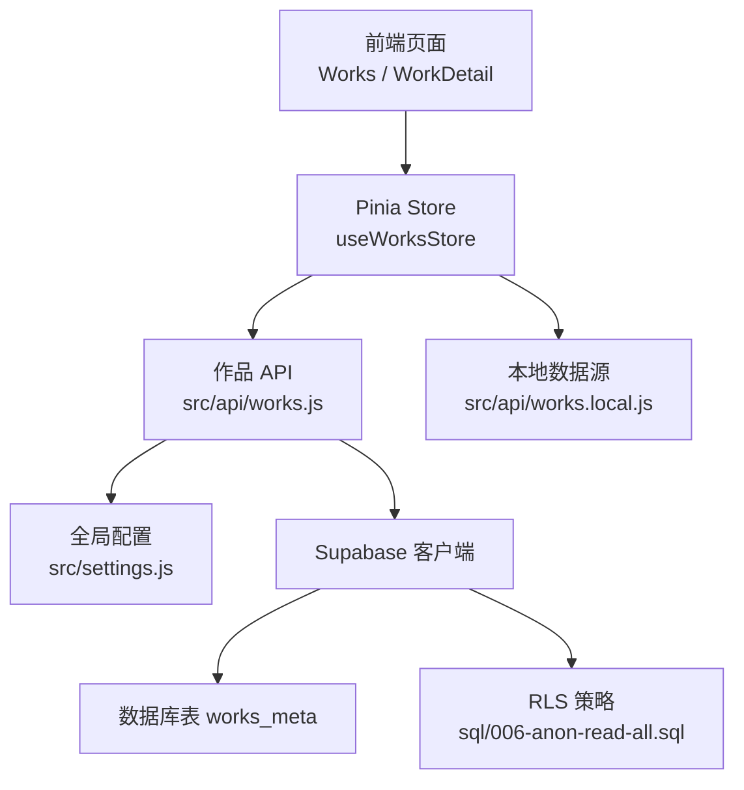
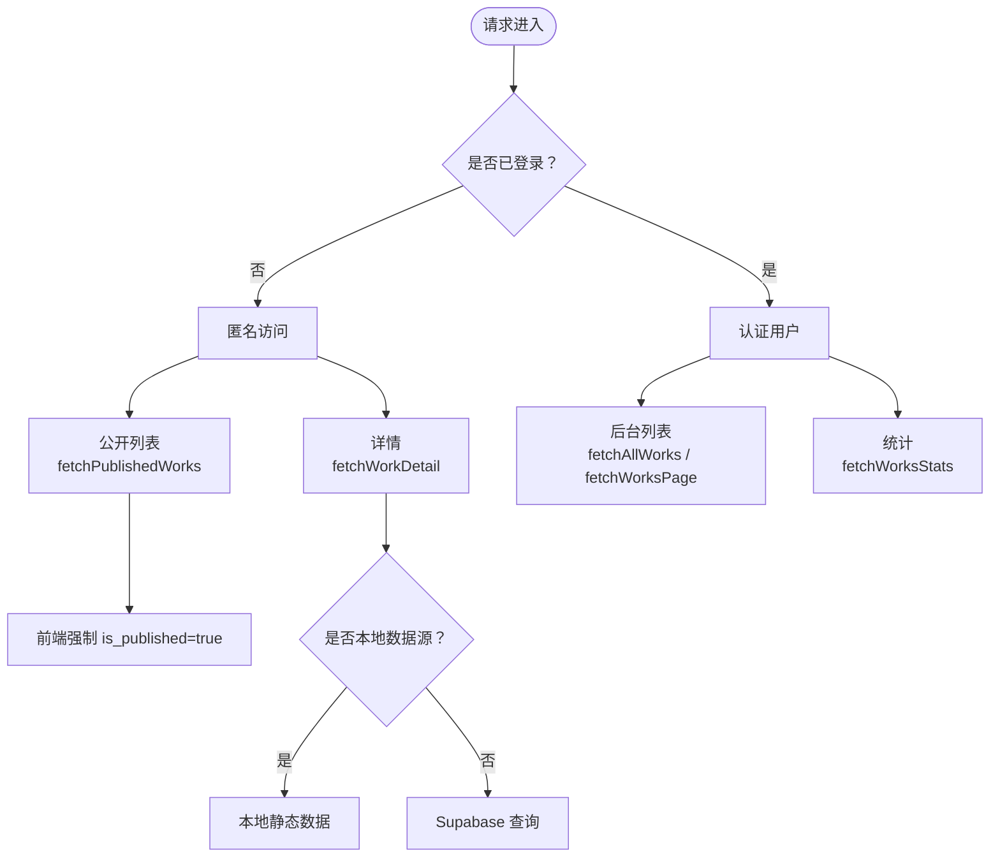
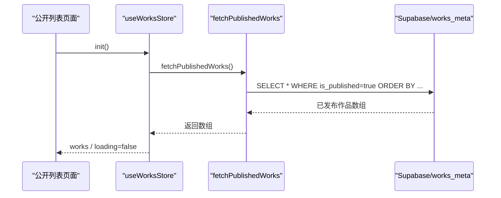
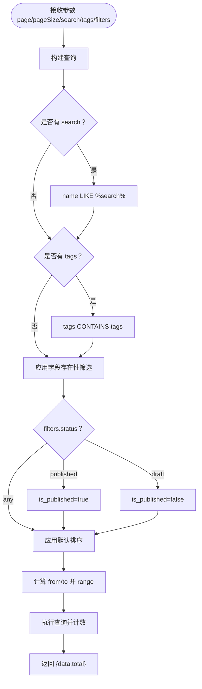
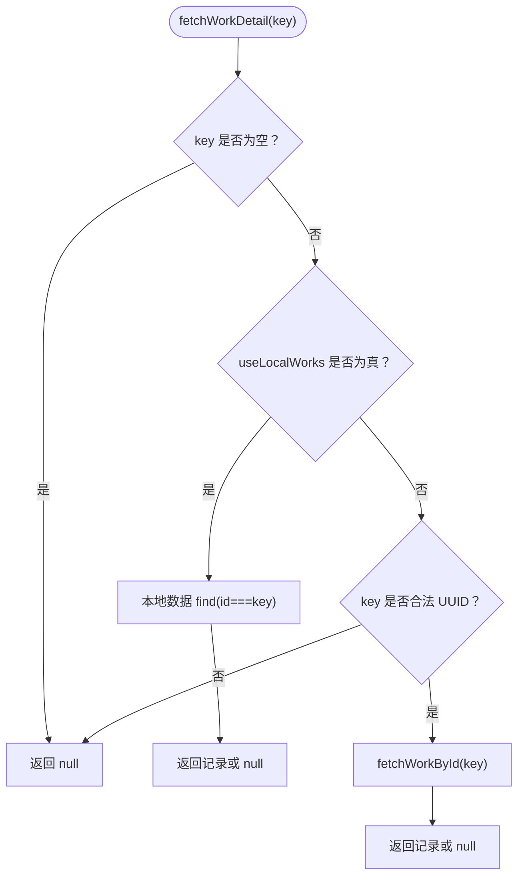
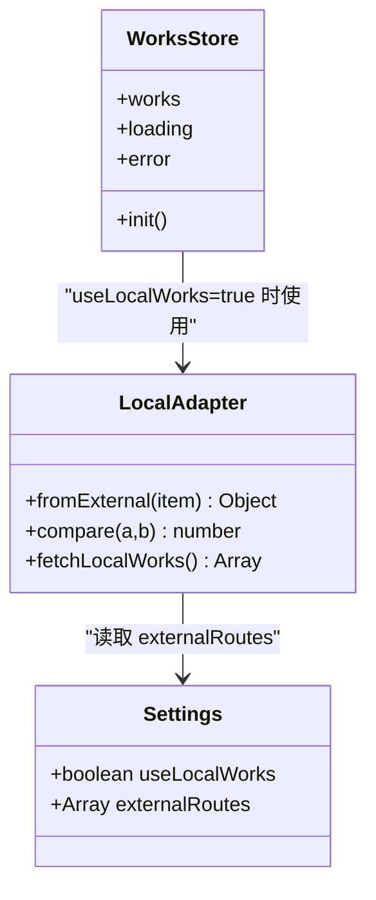
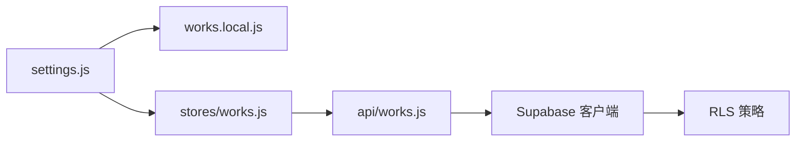

# 作品查询接口

<cite>
**本文引用的文件**   
- [src/api/works.js](file://src/api/works.js)
- [src/api/works.local.js](file://src/api/works.local.js)
- [src/stores/works.js](file://src/stores/works.js)
- [sql/006-anon-read-all.sql](file://sql/006-anon-read-all.sql)
- [src/settings.js](file://src/settings.js)
</cite>

## 目录
1. [简介](#简介)
2. [项目结构与数据源](#项目结构与数据源)
3. [核心查询接口总览](#核心查询接口总览)
4. [架构与权限模型](#架构与权限模型)
5. [接口详细文档](#接口详细文档)
6. [搜索、过滤与排序规则](#搜索过滤与排序规则)
7. [本地数据源模式行为差异](#本地数据源模式行为差异)
8. [依赖关系分析](#依赖关系分析)
9. [性能与分页特性](#性能与分页特性)
10. [错误处理与常见问题](#错误处理与常见问题)
11. [最佳实践与调用示例](#最佳实践与调用示例)
12. [结论](#结论)

## 简介
本文档面向“作品查询”相关的前端 API，覆盖以下能力：
- 获取已发布作品列表
- 获取全部作品（含未发布）
- 服务端分页查询
- 按 ID 查询单条作品
- 详情页查询
- 作品统计信息

同时说明 RLS（行级安全）策略对匿名访问和认证用户的影响，以及本地静态数据源模式下的行为差异。

## 项目结构与数据源
作品查询的核心实现位于前端 API 层，主要涉及：
- `src/api/works.js`：基于 Supabase 的数据库查询封装
- `src/api/works.local.js`：本地静态数据源适配层
- `src/stores/works.js`：Pinia Store，负责公开列表加载与本地/远程数据源切换
- `src/settings.js`：全局配置，控制是否使用本地静态数据源
- `sql/006-anon-read-all.sql`：Supabase RLS 策略脚本，影响匿名用户的读取范围

**图表来源**
- [src/stores/works.js:7-27](file://src/stores/works.js#L7-L27)
- [src/api/works.js:1-15](file://src/api/works.js#L1-L15)
- [src/api/works.local.js:1-20](file://src/api/works.local.js#L1-L20)
- [src/settings.js:1-8](file://src/settings.js#L1-L8)
- [sql/006-anon-read-all.sql:25-32](file://sql/006-anon-read-all.sql#L25-L32)

**章节来源**
- [src/api/works.js:1-15](file://src/api/works.js#L1-L15)
- [src/api/works.local.js:1-20](file://src/api/works.local.js#L1-L20)
- [src/stores/works.js:7-27](file://src/stores/works.js#L7-L27)
- [src/settings.js:1-8](file://src/settings.js#L1-L8)
- [sql/006-anon-read-all.sql:1-33](file://sql/006-anon-read-all.sql#L1-L33)

## 核心查询接口总览
| 接口 | 功能 | 是否需要登录 | 返回结构 | 典型用途 |
|---|---|---:|---|---|
| `fetchPublishedWorks` | 获取已发布作品列表 | 否 | 记录数组 | 公开作品列表页 |
| `fetchAllWorks` | 获取全部作品（含未发布） | 是 | 记录数组 | 后台管理列表 |
| `fetchWorksPage` | 分页查询（支持搜索、标签、条件筛选） | 是 | `{ data, total }` | 后台分页列表 |
| `fetchWorkById` | 按 ID 查询单条作品 | 受 RLS 影响 | 单条记录或 null | 详情接口内部复用 |
| `fetchWorkDetail` | 详情页查询（自动走本地或远程） | 视数据源而定 | 单条记录或 null | 作品详情页 |
| `fetchWorksStats` | 统计信息（总数、已发布数、带封面数、带外链数） | 是 | `{ total, published, withCover, withLink }` | 侧边栏统计 |

**章节来源**
- [src/api/works.js:45-162](file://src/api/works.js#L45-L162)
- [src/api/works.js:169-195](file://src/api/works.js#L169-L195)

## 架构与权限模型
### RLS 策略与访问权限
- 匿名访问：根据 SQL 策略，匿名用户可读取 `works_meta` 的全部记录；但前端公开接口 `fetchPublishedWorks` 仍通过查询条件限制为已发布作品，因此公开列表不会展示草稿。
- 认证用户：可读取全部作品，用于后台管理列表和分页查询。
- 管理员：具备增删改能力（写操作不在本文讨论范围内）。

**图表来源**
- [src/api/works.js:45-55](file://src/api/works.js#L45-L55)
- [src/api/works.js:186-195](file://src/api/works.js#L186-L195)
- [sql/006-anon-read-all.sql:25-32](file://sql/006-anon-read-all.sql#L25-L32)

**章节来源**
- [sql/006-anon-read-all.sql:1-33](file://sql/006-anon-read-all.sql#L1-L33)
- [src/api/works.js:45-55](file://src/api/works.js#L45-L55)
- [src/api/works.js:186-195](file://src/api/works.js#L186-L195)

## 接口详细文档

### fetchPublishedWorks（获取已发布作品列表）
- 功能：返回所有已发布的作品记录，供公开列表使用。
- 参数：无。
- 返回值：`Array<works_meta>`。
- 权限要求：匿名即可调用；虽然 RLS 允许匿名读全部，但查询自带 `is_published=true` 条件。
- 错误处理：若底层查询失败，抛出错误对象。
- 排序：默认按 `sort_weight DESC → date DESC → created_at DESC → id ASC`。

**图表来源**
- [src/stores/works.js:12-25](file://src/stores/works.js#L12-L25)
- [src/api/works.js:45-55](file://src/api/works.js#L45-L55)

**章节来源**
- [src/api/works.js:45-55](file://src/api/works.js#L45-L55)
- [src/stores/works.js:12-25](file://src/stores/works.js#L12-L25)

### fetchAllWorks（获取全部作品）
- 功能：返回全部作品记录，包含未发布和隐藏作品，主要用于后台管理。
- 参数：无。
- 返回值：`Array<works_meta>`。
- 权限要求：需要认证用户。
- 错误处理：若底层查询失败，抛出错误对象。
- 排序：默认同上。

**章节来源**
- [src/api/works.js:62-67](file://src/api/works.js#L62-L67)

### fetchWorksPage（分页查询）
- 功能：服务端分页查询，支持关键词搜索、标签多选、字段存在性筛选、状态筛选。
- 参数：
  - `page`：页码，从 1 开始，默认 1
  - `pageSize`：每页条数，默认 10
  - `search`：关键词，匹配作品名称（不区分大小写）
  - `tags`：标签数组，多选且为 AND 关系
  - `filters`：条件筛选对象
    - `cover`：`'filled'` 表示有封面，`'empty'` 表示无封面
    - `date`：`'filled'` 表示有日期，`'empty'` 表示无日期
    - `links`：`'filled'` 表示任一外链字段非空，`'empty'` 表示所有外链字段为空
    - `status`：`'published'` 仅已发布，`'draft'` 仅草稿
- 返回值：`{ data: Array<works_meta>, total: number }`
- 权限要求：需要认证用户。
- 错误处理：若底层查询失败，抛出错误对象。

**图表来源**
- [src/api/works.js:115-140](file://src/api/works.js#L115-L140)
- [src/api/works.js:87-103](file://src/api/works.js#L87-L103)

**章节来源**
- [src/api/works.js:115-140](file://src/api/works.js#L115-L140)
- [src/api/works.js:87-103](file://src/api/works.js#L87-L103)

### fetchWorkById（按ID查询单条作品）
- 功能：根据作品 ID 查询单条记录。
- 参数：
  - `id`：作品 ID（数据库为 UUID 类型）
- 返回值：单条记录或 `null`。
- 权限要求：受 RLS 策略影响；当前匿名也可读取全部，但业务上通常由认证用户使用。
- 错误处理：若底层查询失败，抛出错误对象。

**章节来源**
- [src/api/works.js:169-178](file://src/api/works.js#L169-L178)

### fetchWorkDetail（详情页查询）
- 功能：查询单条作品详情，优先判断本地数据源模式。
- 参数：
  - `key`：作品标识（数据库模式下为 UUID；本地模式下为 `/external/<name>`）
- 返回值：单条记录或 `null`。
- 行为分支：
  - 如果 `settings.useLocalWorks` 为真，则从本地静态数据中查找对应 ID 的记录。
  - 否则校验 key 是否为合法 UUID，非法直接返回 `null`，避免数据库类型校验报错。
  - 合法 UUID 时调用 `fetchWorkById(key)`。
- 权限要求：取决于数据源；本地模式无需登录，远程模式受 RLS 影响。

**图表来源**
- [src/api/works.js:186-195](file://src/api/works.js#L186-L195)
- [src/api/works.js:169-178](file://src/api/works.js#L169-L178)
- [src/api/works.local.js:22-40](file://src/api/works.local.js#L22-L40)

**章节来源**
- [src/api/works.js:186-195](file://src/api/works.js#L186-L195)
- [src/api/works.local.js:22-40](file://src/api/works.local.js#L22-L40)

### fetchWorksStats（统计信息）
- 功能：返回轻量统计信息，包括总数、已发布数量、带封面数量、带外链数量。
- 参数：无。
- 返回值：`{ total, published, withCover, withLink }`
- 权限要求：需要认证用户。
- 错误处理：若底层查询失败，抛出错误对象。

**章节来源**
- [src/api/works.js:146-162](file://src/api/works.js#L146-L162)

## 搜索、过滤与排序规则

### 搜索
- 关键词搜索作用于作品名称字段，采用不区分大小写的模糊匹配。
- 仅在提供 `search` 参数时生效。

### 标签筛选
- 标签字段为数组类型，传入多个标签时采用 AND 关系，即必须同时包含所有指定标签。
- 空标签数组不参与筛选。

### 字段存在性筛选
- `cover`：支持 `'filled'`（有封面）和 `'empty'`（无封面）。
- `date`：支持 `'filled'`（有日期）和 `'empty'`（无日期）。
- `links`：将外链字段视为一组，支持 `'filled'`（任一外链非空）和 `'empty'`（所有外链为空）。

### 状态筛选
- `status='published'`：仅已发布作品。
- `status='draft'`：仅草稿。
- 其他值或不传：不进行状态过滤。

### 默认排序
默认排序链如下：
1. `sort_weight` 降序
2. `date` 降序（空值排在后）
3. `created_at` 降序
4. `id` 升序（作为唯一键兜底，保证分页稳定）

该排序设计用于避免并列行在 LIMIT/OFFSET 分页时出现重复或漏行。

**章节来源**
- [src/api/works.js:25-38](file://src/api/works.js#L25-L38)
- [src/api/works.js:115-140](file://src/api/works.js#L115-L140)
- [src/api/works.js:87-103](file://src/api/works.js#L87-L103)

## 本地数据源模式行为差异
当 `settings.useLocalWorks` 为真时：
- 公开列表：`useWorksStore.init()` 会调用本地数据源 `fetchLocalWorks()`，不再请求 Supabase。
- 详情页：`fetchWorkDetail` 直接从本地静态数据中查找对应 ID 的记录。
- 本地数据映射：
  - `cover` → `cover_url`
  - `info` → `info_md`
  - `code` → `code_url`
  - `link` → `link_url`
  - `codepen` → `codepen_url`
  - `open` → `open_url`
  - `sort` → `sort_weight`
  - `hidden` → `is_published`（取反）
  - `tags`：未设置时固定为 `['external']`
- 本地排序：按 `sort_weight` 降序，再按 `date` 降序。

**图表来源**
- [src/settings.js:1-8](file://src/settings.js#L1-L8)
- [src/api/works.local.js:22-58](file://src/api/works.local.js#L22-L58)
- [src/stores/works.js:12-25](file://src/stores/works.js#L12-L25)

**章节来源**
- [src/settings.js:1-8](file://src/settings.js#L1-L8)
- [src/api/works.local.js:22-58](file://src/api/works.local.js#L22-L58)
- [src/stores/works.js:12-25](file://src/stores/works.js#L12-L25)

## 依赖关系分析
- `src/stores/works.js` 依赖 `src/api/works.js` 与 `src/api/works.local.js`，并通过 `src/settings.js` 决定数据源。
- `src/api/works.js` 依赖 Supabase 客户端与全局配置，并在详情页逻辑中回退到本地数据源。
- RLS 策略由 SQL 脚本定义，影响匿名用户的读取范围。

**图表来源**
- [src/settings.js:1-8](file://src/settings.js#L1-L8)
- [src/stores/works.js:1-6](file://src/stores/works.js#L1-L6)
- [src/api/works.js:1-4](file://src/api/works.js#L1-L4)
- [sql/006-anon-read-all.sql:25-32](file://sql/006-anon-read-all.sql#L25-L32)

**章节来源**
- [src/stores/works.js:1-6](file://src/stores/works.js#L1-L6)
- [src/api/works.js:1-4](file://src/api/works.js#L1-L4)
- [sql/006-anon-read-all.sql:25-32](file://sql/006-anon-read-all.sql#L25-L32)

## 性能与分页特性
- 分页查询使用服务端分页，通过 `range(from,to)` 限制返回行数，并结合 `count: 'exact'` 获取总数。
- 默认排序链包含唯一键 `id`，确保分页结果稳定，避免重复或遗漏。
- 统计接口只选择轻量字段，减少数据传输量。
- 本地数据源模式适合离线调试，避免网络开销。

**章节来源**
- [src/api/works.js:115-140](file://src/api/works.js#L115-L140)
- [src/api/works.js:146-162](file://src/api/works.js#L146-L162)
- [src/api/works.js:25-38](file://src/api/works.js#L25-L38)

## 错误处理与常见问题
- 查询异常：各接口在底层查询失败时会抛出错误对象，调用方应捕获并处理。
- UUID 校验：详情页在非 UUID 的 key 下直接返回 `null`，避免数据库类型校验报错。
- 空参数：详情页空 key 直接视为不存在，不发起请求。
- 本地数据源：开启后公开列表和详情页均走本地静态数据，不再请求数据库。

建议调用方：
- 对异步调用进行 try/catch 包裹，统一错误提示。
- 对分页参数做边界校验（如 pageSize 正整数、page 从 1 开始）。
- 对详情页 key 做合法性校验后再调用。

**章节来源**
- [src/api/works.js:169-195](file://src/api/works.js#L169-L195)
- [src/stores/works.js:12-25](file://src/stores/works.js#L12-L25)

## 最佳实践与调用示例

### 公开列表加载
- 使用 Pinia Store 初始化公开列表，自动处理本地/远程数据源切换。
- 推荐在页面组件挂载时调用 store 的 `init()`。

参考路径：
- [src/stores/works.js:12-25](file://src/stores/works.js#L12-L25)
- [src/api/works.js:45-55](file://src/api/works.js#L45-L55)

### 后台分页列表
- 构造分页参数：`page`、`pageSize`。
- 可选搜索：`search`。
- 可选标签：`tags` 数组。
- 可选筛选：`filters.cover/date/links/status`。
- 处理返回的 `total` 用于分页控件显示。

参考路径：
- [src/api/works.js:115-140](file://src/api/works.js#L115-L140)

### 详情页加载
- 优先检查路由参数是否存在。
- 本地数据源模式下，使用 `/external/<name>` 作为 key。
- 远程数据源模式下，确保 key 为合法 UUID。

参考路径：
- [src/api/works.js:186-195](file://src/api/works.js#L186-L195)
- [src/api/works.local.js:22-40](file://src/api/works.local.js#L22-L40)

### 统计信息展示
- 在后台侧边栏调用统计接口，展示总数、已发布数、带封面数、带外链数。
- 注意该接口需要认证用户。

参考路径：
- [src/api/works.js:146-162](file://src/api/works.js#L146-L162)

## 结论
本项目的作品查询接口围绕 `works_meta` 表展开，通过统一的 API 层封装了公开列表、后台全量列表、分页查询、单条查询与统计等能力。RLS 策略允许匿名读取全部记录，但公开列表通过查询条件限制为已发布作品；认证用户可访问全部作品。本地数据源模式为开发调试提供了便捷替代方案，保持字段结构一致，便于无缝切换。建议在调用方做好参数校验、错误处理和分页稳定性保障，以获得更稳定的用户体验。