# 权限控制机制

<cite>
**本文引用的文件**   
- [sql/001-rbac-setup.sql](file://sql/001-rbac-setup.sql)
- [sql/002-works-meta.sql](file://sql/002-works-meta.sql)
- [sql/006-anon-read-all.sql](file://sql/006-anon-read-all.sql)
- [src/lib/supabase.js](file://src/lib/supabase.js)
- [src/stores/auth.js](file://src/stores/auth.js)
- [src/router/index.js](file://src/router/index.js)
- [src/api/works.js](file://src/api/works.js)
- [src/views/admin/WorksAdmin.vue](file://src/views/admin/WorksAdmin.vue)
- [src/views/admin/WorksList.vue](file://src/views/admin/WorksList.vue)
- [src/views/admin/WorksEditor.vue](file://src/views/admin/WorksEditor.vue)
- [src/views/Works.vue](file://src/views/Works.vue)
- [src/views/WorkDetail.vue](file://src/views/WorkDetail.vue)
</cite>

## 目录
1. [引言](#引言)
2. [项目结构中的权限相关位置](#项目结构中的权限相关位置)
3. [核心权限模型](#核心权限模型)
4. [数据库与 RBAC 设计](#数据库与-rbac-设计)
5. [作品数据行级安全策略](#作品数据行级安全策略)
6. [前端权限检查与路由守卫](#前端权限检查与路由守卫)
7. [后端 RLS 与前端协同流程](#后端-rls-与前端协同流程)
8. [详细组件分析](#详细组件分析)
9. [依赖关系分析](#依赖关系分析)
10. [性能与索引特性](#性能与索引特性)
11. [错误处理与常见问题](#错误处理与常见问题)
12. [安全最佳实践与审计建议](#安全最佳实践与审计建议)
13. [权限配置示例](#权限配置示例)
14. [结论](#结论)

## 引言
本文围绕“作品数据权限控制机制”展开，重点说明基于 Supabase 行级安全（RLS）的策略实现，以及前端 Vue 应用如何与后端权限协同。系统支持三类访问者：
- 匿名用户：只能读取已发布的公开作品；在特定脚本下也可凭链接查看草稿详情。
- 认证用户：可读取全部作品用于后台管理列表和统计。
- 管理员：拥有作品的增删改能力，并可提升其他用户为管理员。

该机制的核心是数据库层的 RBAC 表结构与 RLS 策略，前端只做界面级权限提示、路由守卫和调用封装，不替代数据库的安全判断。

## 项目结构中的权限相关位置
权限相关代码分布在 SQL 脚本、Supabase 客户端初始化、认证状态管理、路由守卫、作品 API 封装以及后台管理页面中：
- SQL 脚本负责建表、RBAC、RLS 策略、辅助函数和初始管理员设置。
- `src/lib/supabase.js` 提供全局 Supabase 客户端。
- `src/stores/auth.js` 维护登录态、会话和用户角色判断。
- `src/router/index.js` 对需要管理员权限的路由做前置校验。
- `src/api/works.js` 封装作品数据的查询、新增、更新、删除操作，并注释了 RLS 行为。
- 后台管理页面负责管理员 UI 交互，但真正的写入权限仍由 RLS 控制。

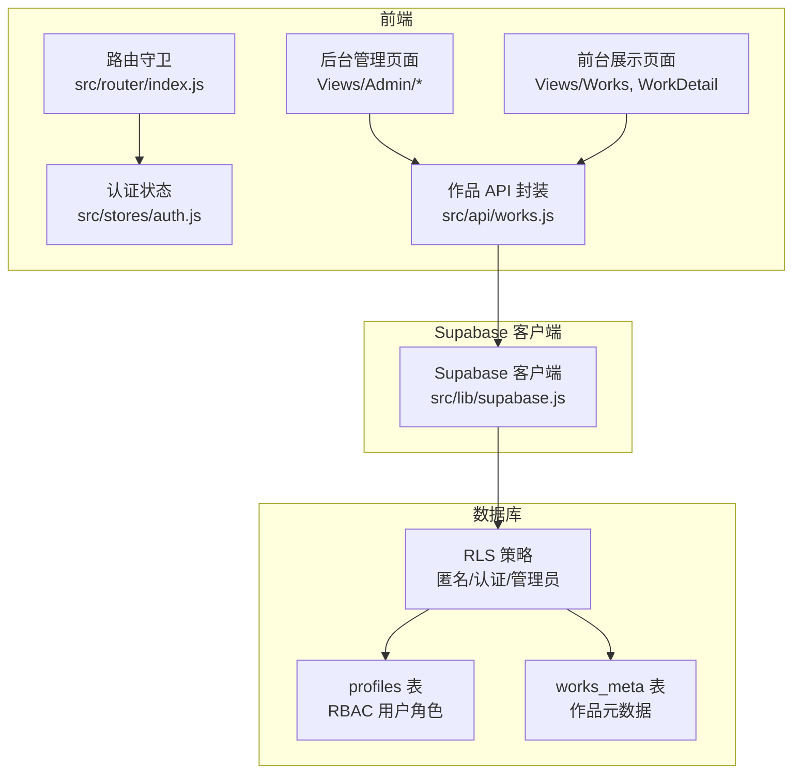

**图表来源**
- [src/router/index.js:51-70](file://src/router/index.js#L51-L70)
- [src/stores/auth.js:59-66](file://src/stores/auth.js#L59-L66)
- [src/api/works.js:6-12](file://src/api/works.js#L6-L12)
- [sql/001-rbac-setup.sql:55-92](file://sql/001-rbac-setup.sql#L55-L92)
- [sql/002-works-meta.sql:31-64](file://sql/002-works-meta.sql#L31-L64)

**章节来源**
- [src/router/index.js:1-73](file://src/router/index.js#L1-L73)
- [src/lib/supabase.js:1-17](file://src/lib/supabase.js#L1-L17)
- [src/stores/auth.js:1-82](file://src/stores/auth.js#L1-L82)
- [src/api/works.js:1-267](file://src/api/works.js#L1-L267)
- [sql/001-rbac-setup.sql:1-128](file://sql/001-rbac-setup.sql#L1-L128)
- [sql/002-works-meta.sql:1-76](file://sql/002-works-meta.sql#L1-L76)

## 核心权限模型
系统的权限模型可以概括为“前端体验层 + 数据库强制层”：
- 前端通过认证状态和路由守卫限制管理员页面的访问入口。
- 数据库通过 RLS 策略强制限制不同角色的读写范围。
- 管理员角色由 `profiles.role = 'admin'` 决定，普通用户默认为 `user`。
- 作品是否公开由 `works_meta.is_published` 控制。

| 角色 | 匿名访问 | 认证访问 | 管理员访问 |
|---|---|---|---|
| 读取已发布作品 | 允许 | 允许 | 允许 |
| 读取未发布作品 | 不允许 | 允许（后台管理） | 允许 |
| 新增作品 | 不允许 | 不允许 | 允许 |
| 更新作品 | 不允许 | 不允许 | 允许 |
| 删除作品 | 不允许 | 不允许 | 允许 |
| 查看个人 profile | 不允许 | 允许读取他人 profile | 允许 |
| 修改个人 profile | 不允许 | 仅能修改自己 | 允许 |
| 删除 profile | 不允许 | 不允许 | 允许 |
| 提升管理员 | 不允许 | 不允许 | 允许（通过专用函数） |

**章节来源**
- [sql/001-rbac-setup.sql:8-16](file://sql/001-rbac-setup.sql#L8-L16)
- [sql/001-rbac-setup.sql:67-82](file://sql/001-rbac-setup.sql#L67-L82)
- [sql/002-works-meta.sql:42-64](file://sql/002-works-meta.sql#L42-L64)
- [src/api/works.js:6-12](file://src/api/works.js#L6-L12)

## 数据库与 RBAC 设计
### profiles 表结构
`profiles` 表与 `auth.users` 一一对应，保存用户名、头像和管理员角色。关键字段包括：
- `id`：主键，关联 `auth.users.id`。
- `username`：用户名，唯一。
- `avatar_url`：头像 URL。
- `role`：角色，限定为 `user` 或 `admin`。
- `created_at` / `updated_at`：时间戳，自动更新。

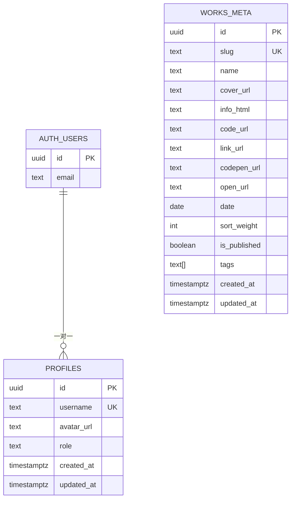

**图表来源**
- [sql/001-rbac-setup.sql:8-16](file://sql/001-rbac-setup.sql#L8-L16)
- [sql/002-works-meta.sql:7-23](file://sql/002-works-meta.sql#L7-L23)

### 用户注册与自动创建 profile
当新用户注册时，系统会自动插入一条 `profiles` 记录，用户名优先取 OAuth 返回的 `user_name` 或 `full_name`，否则使用邮箱前缀。这保证了每个认证用户都有对应的 profile 记录，便于后续角色判断。

### 管理员提升与辅助函数
- `public.is_admin()`：判断当前登录用户是否为管理员，供 RLS 策略复用。
- `public.promote_to_admin(target_id)`：将目标用户提升为管理员，要求调用者本身是管理员。
- `public.bootstrap_first_admin(user_email)`：用于首次部署时把某个邮箱对应的用户设为管理员，仅允许 `service_role` 执行，防止普通用户越权。

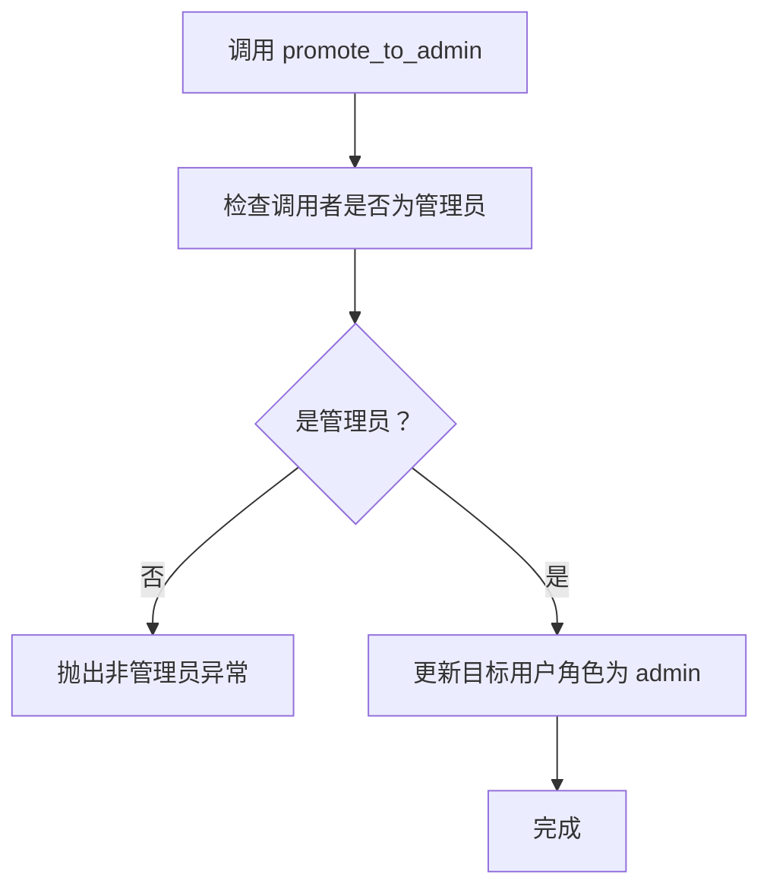

**图表来源**
- [sql/001-rbac-setup.sql:94-104](file://sql/001-rbac-setup.sql#L94-L104)

**章节来源**
- [sql/001-rbac-setup.sql:8-16](file://sql/001-rbac-setup.sql#L8-L16)
- [sql/001-rbac-setup.sql:18-39](file://sql/001-rbac-setup.sql#L18-L39)
- [sql/001-rbac-setup.sql:84-121](file://sql/001-rbac-setup.sql#L84-L121)

## 作品数据行级安全策略
### works_meta 表结构
`works_meta` 表存储作品的运营态字段，包括标题、封面、外链、标签、排序权重、发布状态和时间戳。关键字段包括：
- `slug`：路由标识，唯一。
- `name`：显示标题。
- `cover_url`：封面图 URL。
- `info_html`：富文本介绍（HTML）。
- `code_url` / `link_url` / `codepen_url` / `open_url`：各类外链。
- `date`：发布日期。
- `sort_weight`：排序权重。
- `is_published`：是否发布。
- `tags`：分类标签数组。

### RLS 策略定义
- 匿名用户只能读取 `is_published=true` 的记录。
- 认证用户可以读取所有记录，用于后台管理。
- 只有管理员才能新增、更新、删除作品。

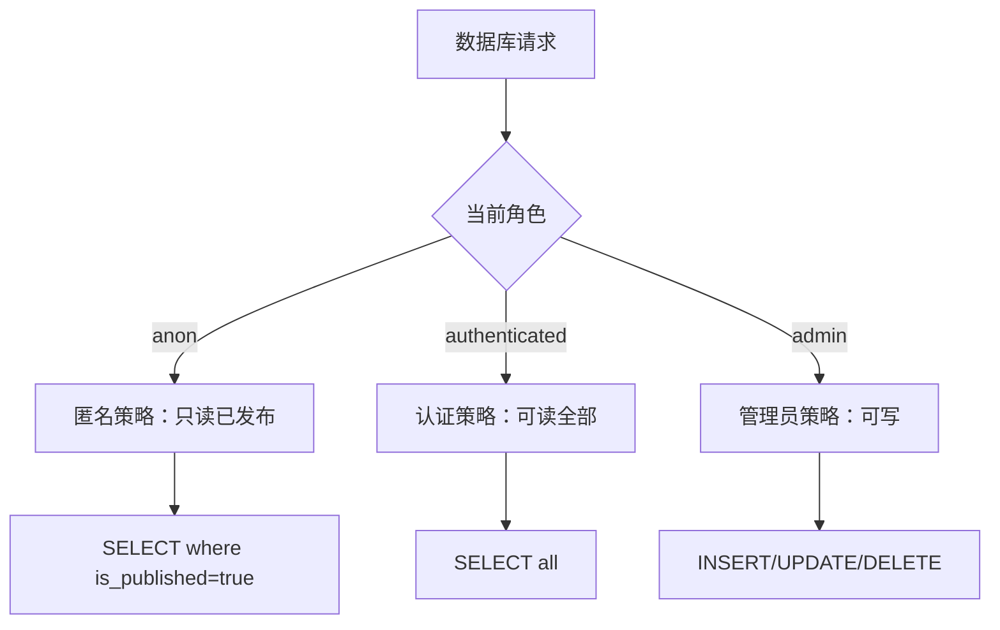

**图表来源**
- [sql/002-works-meta.sql:42-64](file://sql/002-works-meta.sql#L42-L64)

### 匿名读取草稿的特殊情况
脚本 `006-anon-read-all.sql` 将匿名用户的读取策略从“只读已发布”改为“可读全部”。这意味着：
- 作品列表页不受影响，因为前端查询显式过滤 `is_published=true`。
- 后台管理不受影响，认证用户策略未变。
- 唯一变化是：持有草稿详情链接的人可以直接查看草稿内容。

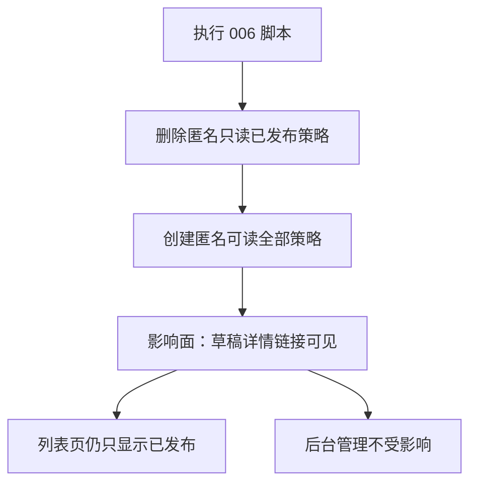

**图表来源**
- [sql/006-anon-read-all.sql:25-32](file://sql/006-anon-read-all.sql#L25-L32)

**章节来源**
- [sql/002-works-meta.sql:7-23](file://sql/002-works-meta.sql#L7-L23)
- [sql/002-works-meta.sql:31-64](file://sql/002-works-meta.sql#L31-L64)
- [sql/006-anon-read-all.sql:1-33](file://sql/006-anon-read-all.sql#L1-L33)

## 前端权限检查与路由守卫
### 认证状态管理
`useAuthStore` 负责：
- 初始化会话和用户信息。
- 监听认证状态变化。
- 提供登录、注册、登出方法。
- 调用 `is_admin` RPC 判断当前用户是否为管理员。

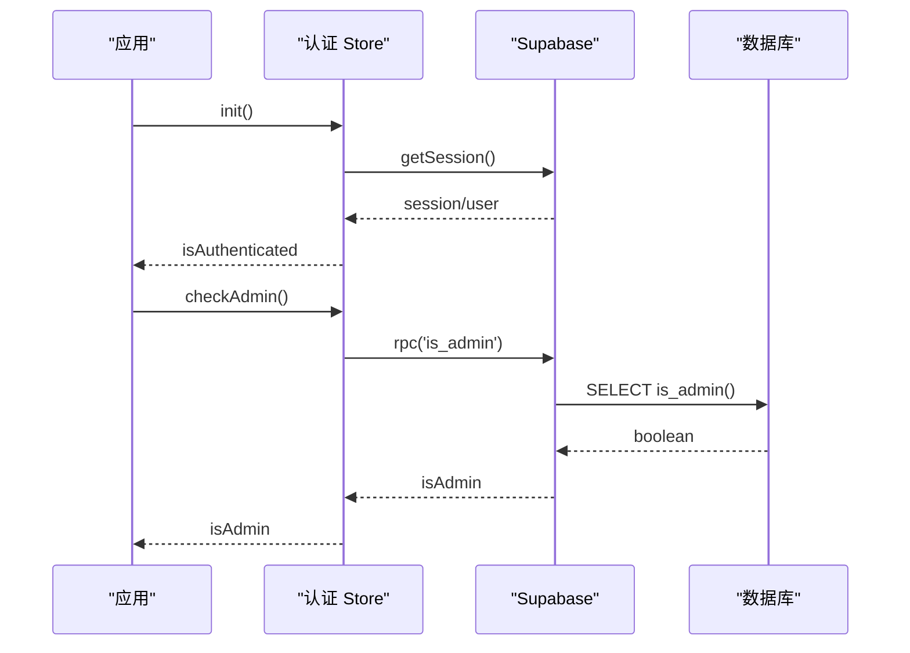

**图表来源**
- [src/stores/auth.js:12-27](file://src/stores/auth.js#L12-L27)
- [src/stores/auth.js:59-66](file://src/stores/auth.js#L59-L66)
- [sql/001-rbac-setup.sql:84-92](file://sql/001-rbac-setup.sql#L84-L92)

### 路由守卫
路由守卫对 `/admin/works` 路径进行保护：
- 如果用户未登录，跳转到登录页。
- 如果用户已登录但不是管理员，弹出提示并退出登录，跳转回登录页。
- 管理员可正常进入后台管理页面。

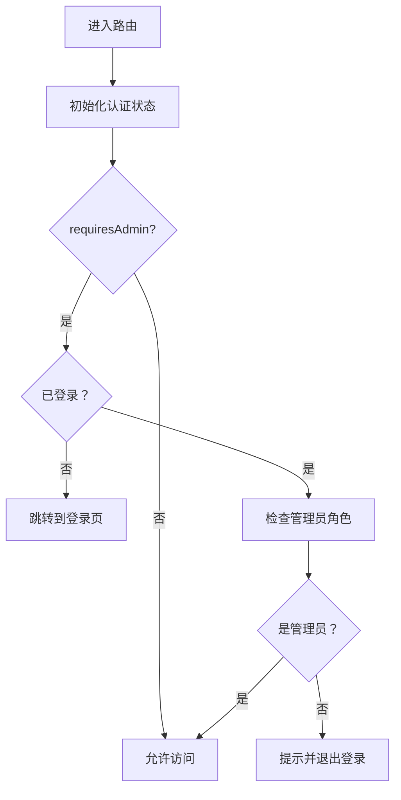

**图表来源**
- [src/router/index.js:51-70](file://src/router/index.js#L51-L70)

**章节来源**
- [src/stores/auth.js:1-82](file://src/stores/auth.js#L1-L82)
- [src/router/index.js:30-35](file://src/router/index.js#L30-L35)
- [src/router/index.js:51-70](file://src/router/index.js#L51-L70)

## 后端 RLS 与前端协同流程
### 公开作品列表加载
前台作品列表页调用 `fetchPublishedWorks`，该函数显式过滤 `is_published=true`。即使 RLS 允许匿名用户读取更多数据，前端也会进一步限制结果。

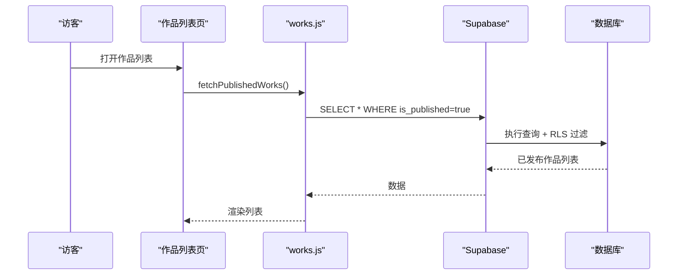

**图表来源**
- [src/api/works.js:45-55](file://src/api/works.js#L45-L55)
- [src/views/Works.vue:31-35](file://src/views/Works.vue#L31-L35)

### 后台管理加载全部作品
后台管理页调用 `fetchWorksPage` 或 `fetchAllWorks`，这些接口不需要显式过滤 `is_published`，因此认证用户可以看到草稿和已发布作品。

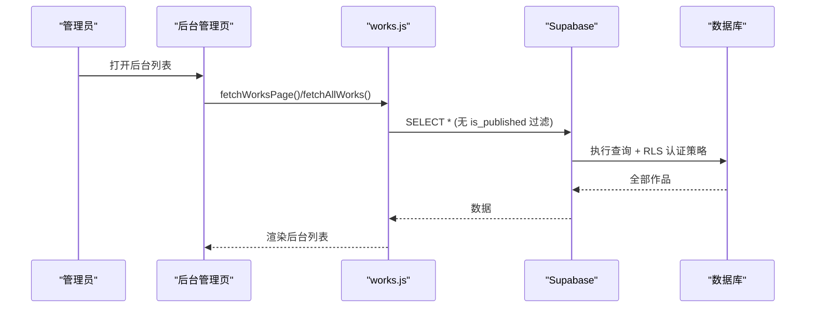

**图表来源**
- [src/api/works.js:62-67](file://src/api/works.js#L62-L67)
- [src/api/works.js:115-140](file://src/api/works.js#L115-L140)
- [sql/002-works-meta.sql:47-50](file://sql/002-works-meta.sql#L47-L50)

### 管理员写入操作
管理员的新增、更新、删除操作由 `upsertWork` 和 `deleteWork` 发起，最终由 RLS 策略验证管理员身份。

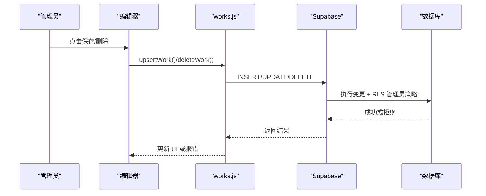

**图表来源**
- [src/api/works.js:203-231](file://src/api/works.js#L203-L231)
- [src/api/works.js:256-266](file://src/api/works.js#L256-L266)
- [sql/002-works-meta.sql:52-64](file://sql/002-works-meta.sql#L52-L64)

**章节来源**
- [src/api/works.js:45-55](file://src/api/works.js#L45-L55)
- [src/api/works.js:62-67](file://src/api/works.js#L62-L67)
- [src/api/works.js:115-140](file://src/api/works.js#L115-L140)
- [src/api/works.js:203-266](file://src/api/works.js#L203-L266)

## 详细组件分析
### 后台管理入口
`WorksAdmin.vue` 是后台管理的根组件，包含侧边栏、统计信息和两个子模块：编辑器与列表。它负责：
- 加载统计数据。
- 加载当前用户 profile。
- 触发编辑、新建、切换发布状态、删除等操作。
- 调用 `upsertWork` 和 `deleteWork` 完成数据变更。

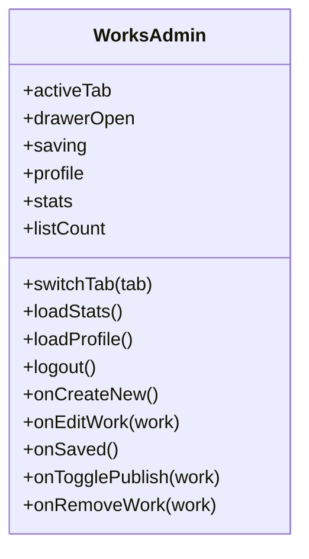

**图表来源**
- [src/views/admin/WorksAdmin.vue:115-247](file://src/views/admin/WorksAdmin.vue#L115-L247)

**章节来源**
- [src/views/admin/WorksAdmin.vue:1-263](file://src/views/admin/WorksAdmin.vue#L1-L263)

### 后台作品列表
`WorksList.vue` 提供分页、搜索、标签筛选、发布状态筛选、拖拽排序等功能。它调用 `fetchWorksPage` 获取分页数据，并在拖拽后批量更新 `sort_weight`。

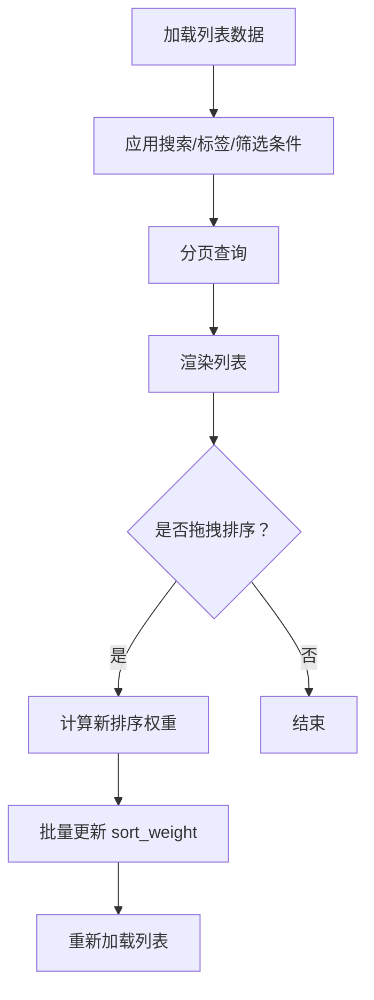

**图表来源**
- [src/views/admin/WorksList.vue:377-407](file://src/views/admin/WorksList.vue#L377-L407)
- [src/views/admin/WorksList.vue:515-542](file://src/views/admin/WorksList.vue#L515-L542)
- [src/api/works.js:115-140](file://src/api/works.js#L115-L140)

**章节来源**
- [src/views/admin/WorksList.vue:1-585](file://src/views/admin/WorksList.vue#L1-L585)

### 作品编辑器
`WorksEditor.vue` 负责作品的新建和编辑，包括封面上传、Markdown 正文、外链配置、标签管理和发布开关。保存时调用 `upsertWork`，并根据是否有 `id` 决定新增还是更新。

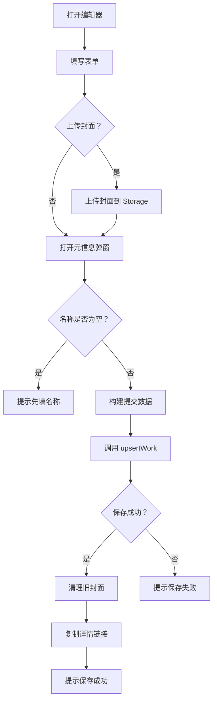

**图表来源**
- [src/views/admin/WorksEditor.vue:516-566](file://src/views/admin/WorksEditor.vue#L516-L566)
- [src/api/works.js:203-231](file://src/api/works.js#L203-L231)

**章节来源**
- [src/views/admin/WorksEditor.vue:1-585](file://src/views/admin/WorksEditor.vue#L1-L585)

### 前台作品列表与详情
前台作品列表页 `Works.vue` 调用 `fetchPublishedWorks`，并按关键词在前端过滤。详情页 `WorkDetail.vue` 调用 `fetchWorkDetail`，根据路由参数加载单条作品。

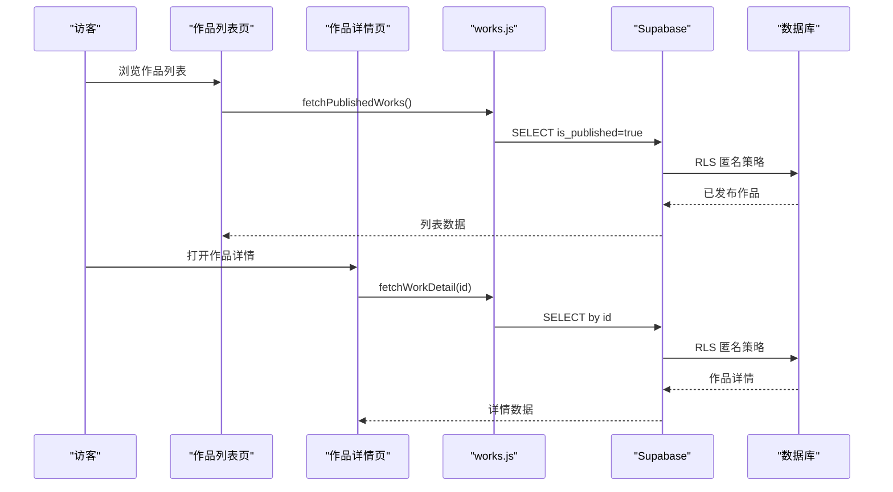

**图表来源**
- [src/views/Works.vue:31-35](file://src/views/Works.vue#L31-L35)
- [src/views/WorkDetail.vue:68-93](file://src/views/WorkDetail.vue#L68-L93)
- [src/api/works.js:45-55](file://src/api/works.js#L45-L55)
- [src/api/works.js:186-195](file://src/api/works.js#L186-L195)

**章节来源**
- [src/views/Works.vue:1-394](file://src/views/Works.vue#L1-L394)
- [src/views/WorkDetail.vue:1-340](file://src/views/WorkDetail.vue#L1-L340)
- [src/api/works.js:45-55](file://src/api/works.js#L45-L55)
- [src/api/works.js:186-195](file://src/api/works.js#L186-L195)

## 依赖关系分析
### 前端模块依赖
- `src/router/index.js` 依赖 `src/stores/auth.js` 进行路由守卫。
- `src/stores/auth.js` 依赖 `src/lib/supabase.js` 进行认证操作。
- `src/api/works.js` 依赖 `src/lib/supabase.js` 进行数据操作。
- 后台管理页面依赖 `src/api/works.js` 和 `src/stores/auth.js`。
- 前台页面依赖 `src/api/works.js` 获取公开数据。

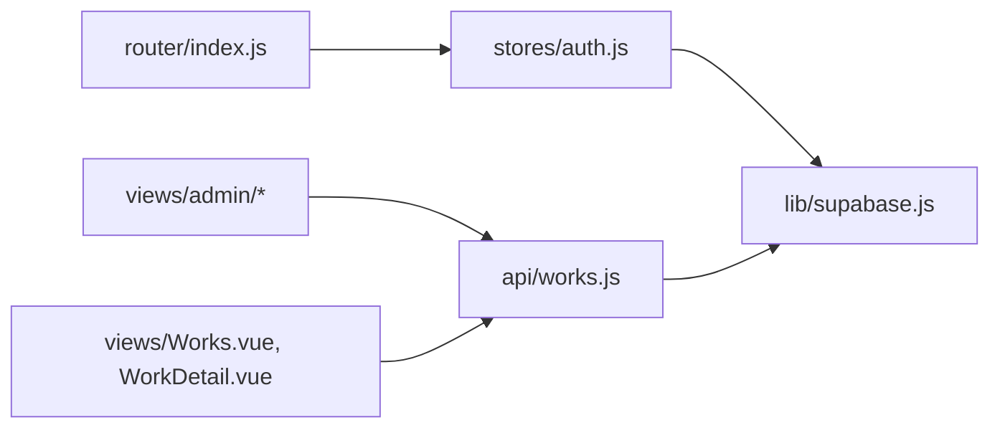

**图表来源**
- [src/router/index.js:2-3](file://src/router/index.js#L2-L3)
- [src/stores/auth.js:3-3](file://src/stores/auth.js#L3-L3)
- [src/api/works.js:1-1](file://src/api/works.js#L1-L1)

**章节来源**
- [src/router/index.js:1-73](file://src/router/index.js#L1-L73)
- [src/stores/auth.js:1-82](file://src/stores/auth.js#L1-L82)
- [src/api/works.js:1-267](file://src/api/works.js#L1-L267)

## 性能与索引特性
### 排序与分页优化
- 默认排序使用 `sort_weight DESC`、`date DESC`、`created_at DESC`、`id ASC`，确保分页稳定。
- 分页查询使用 `range(from, to)` 实现服务端分页。
- 搜索使用 `ilike` 模糊匹配标题。
- 标签过滤使用 Postgres 数组 `contains` 操作。

### 索引优化
- `idx_works_meta_sort`：按排序权重、日期、创建时间优化列表查询。
- `idx_works_meta_slug`：针对已发布作品的 slug 查询建立部分索引。

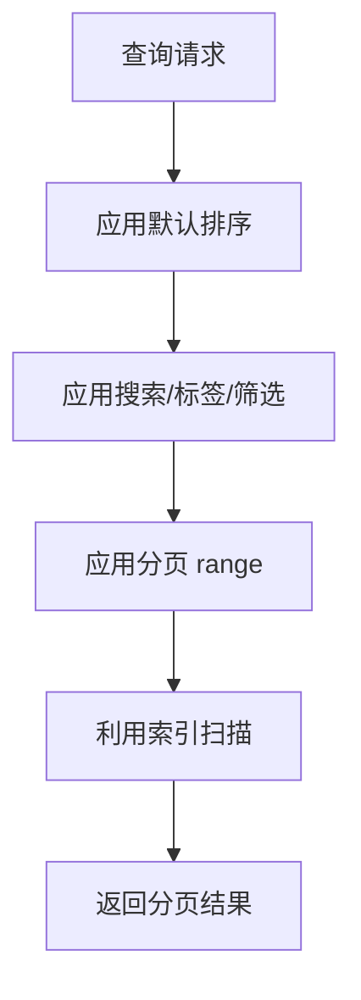

**图表来源**
- [src/api/works.js:25-38](file://src/api/works.js#L25-L38)
- [src/api/works.js:115-140](file://src/api/works.js#L115-L140)
- [sql/002-works-meta.sql:66-70](file://sql/002-works-meta.sql#L66-L70)

**章节来源**
- [src/api/works.js:25-38](file://src/api/works.js#L25-L38)
- [src/api/works.js:115-140](file://src/api/works.js#L115-L140)
- [sql/002-works-meta.sql:66-70](file://sql/002-works-meta.sql#L66-L70)

## 错误处理与常见问题
### 常见错误场景
- **环境变量缺失**：如果缺少 `VITE_SUPABASE_URL` 或 `VITE_SUPABASE_PUBLISHABLE_KEY`，客户端初始化会抛出错误。
- **UUID 类型校验失败**：如果传入非法 UUID，数据库会返回 `22P02` 错误。前端对详情 ID 做了正则校验，避免直接传给数据库。
- **权限不足**：非管理员尝试写入作品会被 RLS 拒绝；非管理员访问后台路由会被路由守卫拦截。
- **匿名读取草稿**：如果执行了 `006-anon-read-all.sql`，匿名用户可通过链接查看草稿，但列表页仍只显示已发布作品。

### 错误处理策略
- 前端捕获 API 错误并显示 toast 提示。
- 路由守卫在非管理员访问后台时弹出提示并退出登录。
- 认证状态变化时同步更新用户信息和加载状态。
- 封面上传失败时保留表单状态并提示用户重试。

**章节来源**
- [src/lib/supabase.js:6-8](file://src/lib/supabase.js#L6-L8)
- [src/api/works.js:16-17](file://src/api/works.js#L16-L17)
- [src/api/works.js:192-194](file://src/api/works.js#L192-L194)
- [src/router/index.js:57-66](file://src/router/index.js#L57-L66)
- [src/views/admin/WorksEditor.vue:516-566](file://src/views/admin/WorksEditor.vue#L516-L566)

## 安全最佳实践与审计建议
### 安全最佳实践
- **始终信任数据库层**：前端权限检查仅用于用户体验，不能替代 RLS。
- **最小权限原则**：匿名用户只能读取必要数据，管理员权限严格限制。
- **防止自提升**：用户不能通过更新自己的 profile 将自己提升为管理员。
- **服务角色保护**：`bootstrap_first_admin` 仅允许 `service_role` 执行，防止普通用户调用。
- **输入校验**：前端对 UUID 等敏感参数进行格式校验，减少数据库错误。

### 安全审计建议
- 定期检查 `profiles` 表中的管理员账号，确认没有意外提升。
- 审查 RLS 策略变更历史，确保没有误放开匿名或认证用户的写入权限。
- 监控后台管理操作的日志，关注异常删除或批量更新行为。
- 定期评估 `006-anon-read-all.sql` 的影响，确认草稿链接泄露风险是否在可接受范围内。
- 检查环境变量配置，确保生产环境不使用开发密钥。

**章节来源**
- [sql/001-rbac-setup.sql:71-78](file://sql/001-rbac-setup.sql#L71-L78)
- [sql/001-rbac-setup.sql:119-121](file://sql/001-rbac-setup.sql#L119-L121)
- [sql/006-anon-read-all.sql:10-22](file://sql/006-anon-read-all.sql#L10-L22)

## 权限配置示例
### 初始管理员配置
1. 执行 `sql/001-rbac-setup.sql` 创建 RBAC 表和 RLS 策略。
2. 使用 `bootstrap_first_admin` 函数将第一个管理员账号设置为 `admin`。
3. 验证 `profiles` 表中目标用户的 `role` 字段是否为 `admin`。

### 作品发布配置
1. 默认 `is_published=true`，新作品自动发布。
2. 管理员可在编辑器中关闭发布开关，将作品转为草稿。
3. 如果希望匿名用户无法查看草稿，不要执行 `006-anon-read-all.sql`。

### 后台访问配置
1. 确保用户已登录且 `role='admin'`。
2. 访问 `/admin/works` 路由，路由守卫会调用 `checkAdmin()` 验证权限。
3. 非管理员会被重定向到登录页。

**章节来源**
- [sql/001-rbac-setup.sql:106-121](file://sql/001-rbac-setup.sql#L106-L121)
- [sql/002-works-meta.sql:19-19](file://sql/002-works-meta.sql#L19-L19)
- [sql/006-anon-read-all.sql:25-32](file://sql/006-anon-read-all.sql#L25-L32)
- [src/router/index.js:57-66](file://src/router/index.js#L57-L66)

## 结论
本项目的权限控制机制以 Supabase RLS 为核心，结合前端路由守卫和 API 封装，实现了匿名用户、认证用户和管理员的分层访问控制。数据库层强制执行数据隔离，前端层提供用户体验和界面级权限提示。通过 RBAC 表结构、RLS 策略和辅助函数，系统确保了管理员权限的安全性，同时提供了灵活的公开与草稿管理机制。在实际使用中，应重点关注 RLS 策略变更、管理员账号安全和匿名访问范围，定期进行安全审计和权限复核。