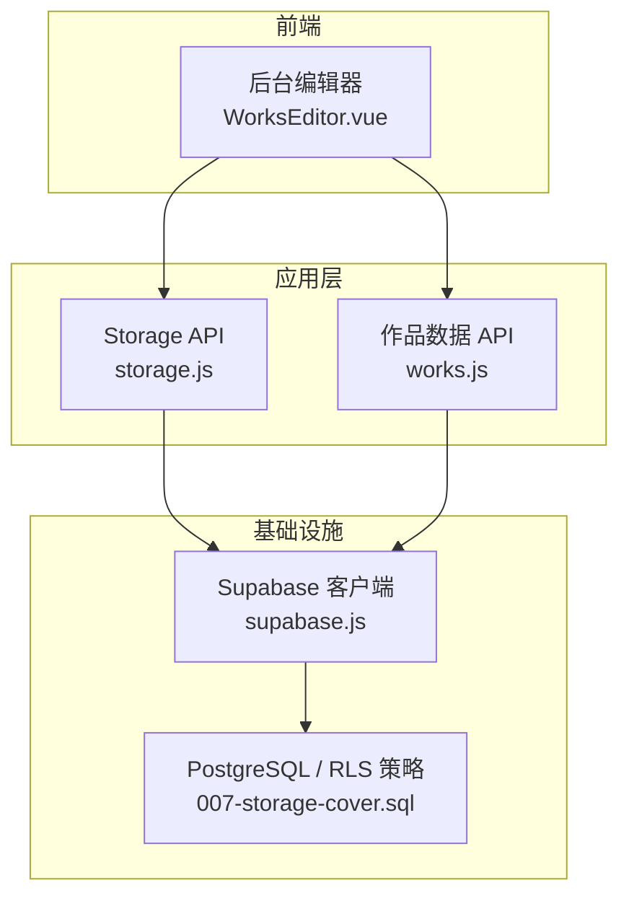
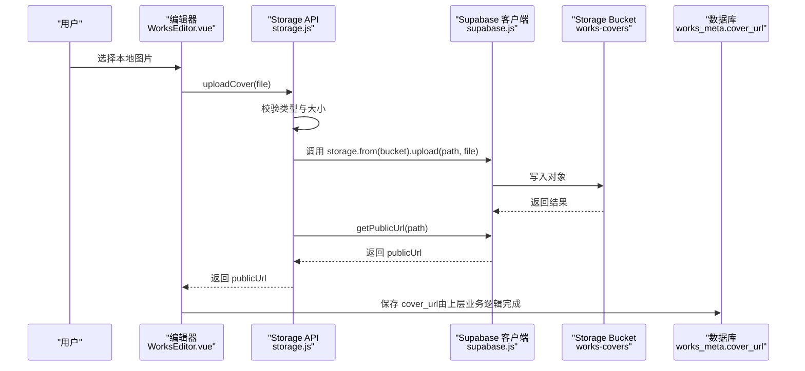
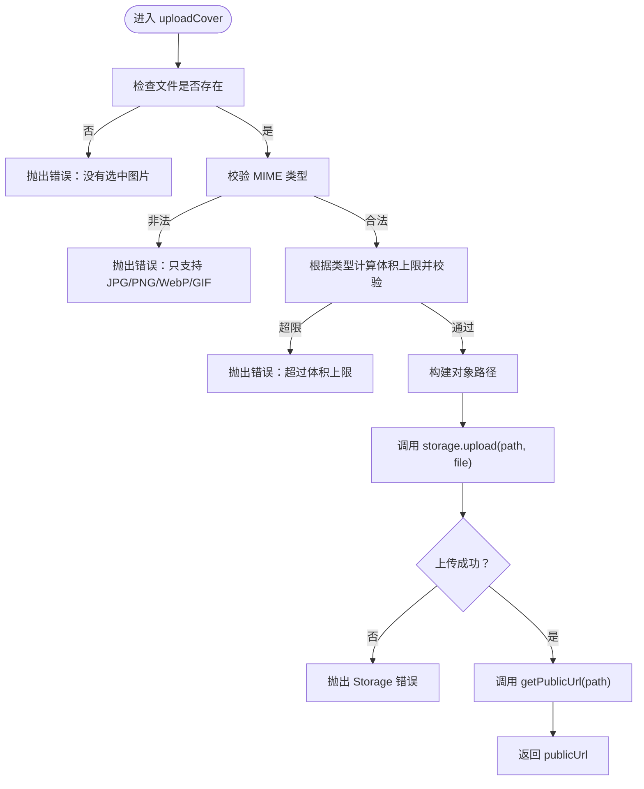
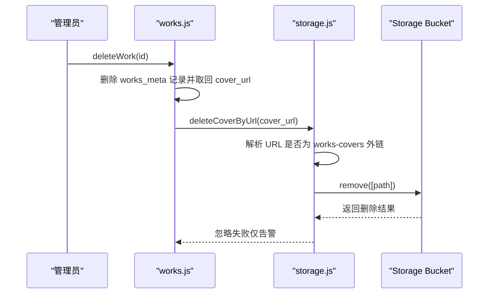
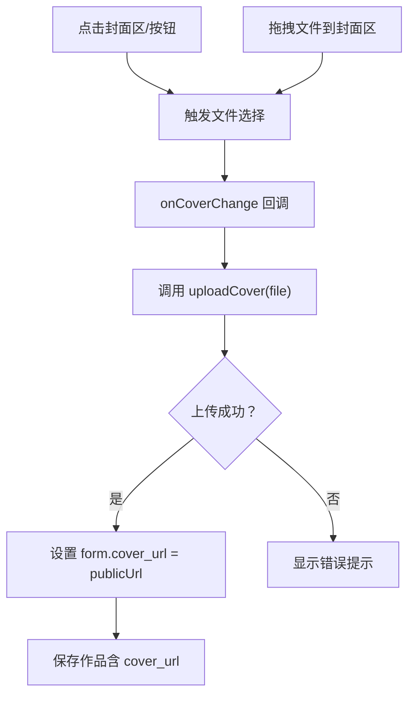
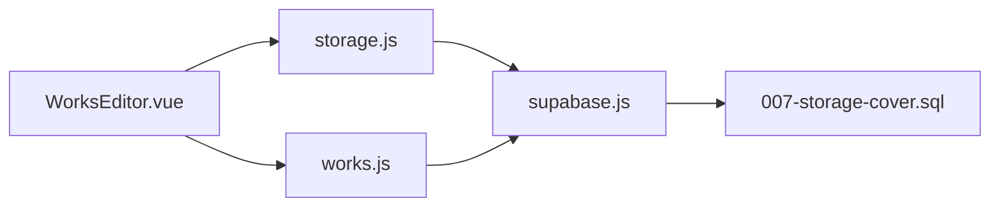
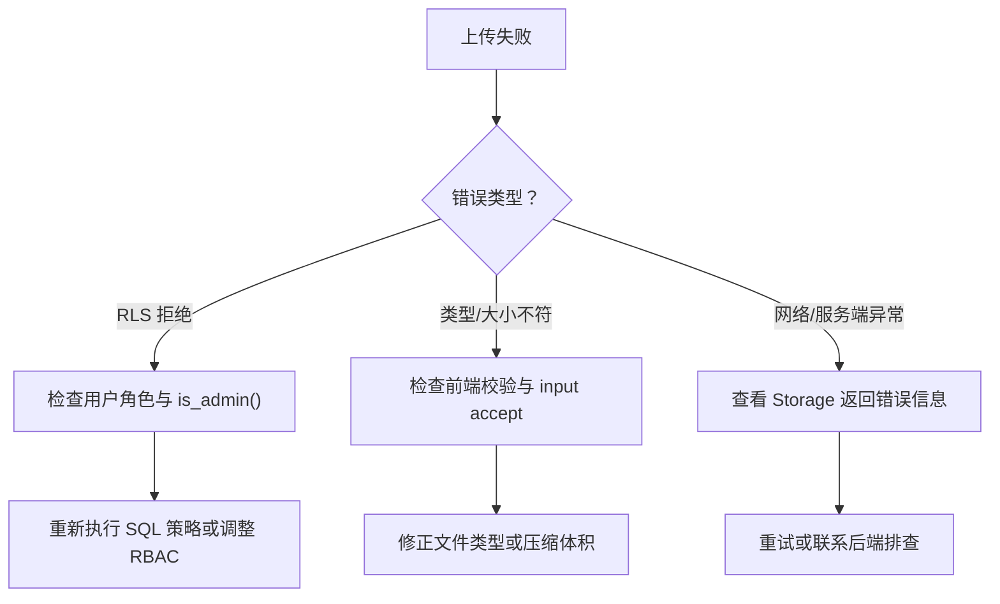

# 文件存储 API

<cite>
**本文引用的文件**   
- [src/api/storage.js](file://src/api/storage.js)
- [src/lib/supabase.js](file://src/lib/supabase.js)
- [sql/007-storage-cover.sql](file://sql/007-storage-cover.sql)
- [src/api/works.js](file://src/api/works.js)
- [src/views/admin/WorksEditor.vue](file://src/views/admin/WorksEditor.vue)
</cite>

## 目录
1. [简介](#简介)
2. [项目结构](#项目结构)
3. [核心组件](#核心组件)
4. [架构总览](#架构总览)
5. [详细组件分析](#详细组件分析)
6. [依赖关系分析](#依赖关系分析)
7. [性能与缓存策略](#性能与缓存策略)
8. [错误处理与排错指南](#错误处理与排错指南)
9. [结论](#结论)

## 简介
本文档面向使用 Supabase Storage 的文件存储 API，重点说明封面图片的完整生命周期：上传、下载、删除、URL 生成、权限控制、类型与大小校验、以及数据库记录中的路径更新和级联清理。读者无需深入代码即可理解整体流程；同时提供面向开发者的实现细节、调用约定和排错建议。

## 项目结构
本项目围绕“作品封面”这一典型文件场景，将前端 UI、API 封装、Supabase 客户端初始化与数据库策略脚本解耦：
- 前端编辑器负责用户交互与表单数据绑定
- storage.js 封装上传、删除、URL 生成等 Storage 操作
- works.js 封装数据库 CRUD，并在删除作品时触发旧封面文件的清理
- supabase.js 统一初始化 Supabase 客户端
- SQL 脚本创建并配置 Storage Bucket 与 RLS 策略

**图表来源**
- [src/views/admin/WorksEditor.vue:28-110](file://src/views/admin/WorksEditor.vue#L28-L110)
- [src/api/storage.js:1-100](file://src/api/storage.js#L1-L100)
- [src/api/works.js:1-267](file://src/api/works.js#L1-L267)
- [src/lib/supabase.js:1-17](file://src/lib/supabase.js#L1-L17)
- [sql/007-storage-cover.sql:1-87](file://sql/007-storage-cover.sql#L1-L87)

**章节来源**
- [src/views/admin/WorksEditor.vue:28-110](file://src/views/admin/WorksEditor.vue#L28-L110)
- [src/api/storage.js:1-100](file://src/api/storage.js#L1-L100)
- [src/api/works.js:1-267](file://src/api/works.js#L1-L267)
- [src/lib/supabase.js:1-17](file://src/lib/supabase.js#L1-L17)
- [sql/007-storage-cover.sql:1-87](file://sql/007-storage-cover.sql#L1-L87)

## 核心组件
- Storage API（storage.js）
  - 定义封面桶常量、允许的文件类型、体积上限、UI 提示文案
  - 实现 uploadCover(file)：上传封面图并返回公开访问 URL
  - 实现 deleteCoverByUrl(publicUrl)：按公开 URL 删除旧封面文件
  - 内部工具函数：构建对象路径、推断扩展名、格式化体积
- 作品数据 API（works.js）
  - 封装 works_meta 表的查询、新增、更新、删除
  - 在删除作品时，调用 deleteCoverByUrl 清理旧封面文件
- Supabase 客户端（supabase.js）
  - 从环境变量读取 URL 与可发布密钥，初始化客户端
- 数据库策略（007-storage-cover.sql）
  - 创建 bucket：works-covers，公开可读，限制 MIME 与文件大小
  - 设置 RLS 策略：公开读，仅管理员可写（插入/更新/删除）

**章节来源**
- [src/api/storage.js:1-100](file://src/api/storage.js#L1-L100)
- [src/api/works.js:1-267](file://src/api/works.js#L1-L267)
- [src/lib/supabase.js:1-17](file://src/lib/supabase.js#L1-L17)
- [sql/007-storage-cover.sql:1-87](file://sql/007-storage-cover.sql#L1-L87)

## 架构总览
封面图片的生命周期涉及前端编辑器、Storage API、Supabase Storage 与数据库策略。下图展示一次封面上传与回填 URL 的端到端流程。

**图表来源**
- [src/views/admin/WorksEditor.vue:28-110](file://src/views/admin/WorksEditor.vue#L28-L110)
- [src/api/storage.js:62-83](file://src/api/storage.js#L62-L83)
- [src/lib/supabase.js:10-16](file://src/lib/supabase.js#L10-L16)
- [sql/007-storage-cover.sql:34-46](file://sql/007-storage-cover.sql#L34-L46)

## 详细组件分析

### Storage API（storage.js）
该模块是文件存储的核心封装，职责清晰：
- 常量与策略
  - COVER_BUCKET：bucket 名称
  - COVER_MAX_SIZE、COVER_GIF_MAX_SIZE：静态图与 GIF 的体积上限
  - COVER_ALLOWED_TYPES：允许的图片 MIME 类型
  - COVER_ACCEPT、COVER_SIZE_HINT：用于前端 input accept 与界面提示
- 上传流程（uploadCover）
  - 参数校验：非空、MIME 白名单、按类型分档的大小限制
  - 对象路径构建：covers/年月/时间戳-随机串.扩展名，避免中文文件名导致 URL 编码问题与同名覆盖
  - 上传选项：cacheControl 长缓存、upsert=false、contentType=file.type
  - 获取公开 URL：getPublicUrl(path)
- 删除流程（deleteCoverByUrl）
  - 从公开 URL 反解对象路径，仅对属于本 bucket 的 URL 执行删除
  - 删除失败仅告警，不阻断主流程（例如换封面或删除作品）

**图表来源**
- [src/api/storage.js:62-83](file://src/api/storage.js#L62-L83)

**章节来源**
- [src/api/storage.js:1-100](file://src/api/storage.js#L1-L100)

### 作品数据 API（works.js）
- 删除作品时的级联清理
  - 先删除数据库记录，再尝试删除对应封面文件
  - 若 cover_url 不是本 bucket 外链，deleteCoverByUrl 会忽略
  - 文件删除失败仅告警，不影响作品删除的主流程

**图表来源**
- [src/api/works.js:251-266](file://src/api/works.js#L251-L266)
- [src/api/storage.js:90-99](file://src/api/storage.js#L90-L99)

**章节来源**
- [src/api/works.js:251-266](file://src/api/works.js#L251-L266)
- [src/api/storage.js:90-99](file://src/api/storage.js#L90-L99)

### 前端编辑器（WorksEditor.vue）
- 封面区域提供点击选择、拖拽上传、预览、复制链接等功能
- 使用 storage.js 提供的常量（COVER_ACCEPT、COVER_SIZE_HINT）统一输入限制与提示文案
- 上传成功后将返回的 publicUrl 回填到 form.cover_url，供后续保存至数据库

**图表来源**
- [src/views/admin/WorksEditor.vue:28-110](file://src/views/admin/WorksEditor.vue#L28-L110)
- [src/views/admin/WorksEditor.vue:293-419](file://src/views/admin/WorksEditor.vue#L293-L419)
- [src/api/storage.js:62-83](file://src/api/storage.js#L62-L83)

**章节来源**
- [src/views/admin/WorksEditor.vue:28-110](file://src/views/admin/WorksEditor.vue#L28-L110)
- [src/views/admin/WorksEditor.vue:293-419](file://src/views/admin/WorksEditor.vue#L293-L419)

### Supabase 客户端（supabase.js）
- 从环境变量读取 VITE_SUPABASE_URL 与 VITE_SUPABASE_PUBLISHABLE_KEY
- 初始化客户端并启用会话持久化、自动刷新 token、URL 中检测会话
- 缺少环境变量时直接抛出错误，便于快速定位配置问题

**章节来源**
- [src/lib/supabase.js:1-17](file://src/lib/supabase.js#L1-L17)

### 数据库策略（007-storage-cover.sql）
- 创建 bucket：works-covers，public=true，file_size_limit=10MB，allowed_mime_types 限定为 image/jpeg/png/webp/gif
- RLS 策略：
  - 公开读：anon 与 authenticated 均可 select
  - 写操作（insert/update/delete）：仅 authenticated 且 is_admin() 为真
- 幂等设计：重复执行不会报错；提供回滚语句参考

**章节来源**
- [sql/007-storage-cover.sql:1-87](file://sql/007-storage-cover.sql#L1-L87)

## 依赖关系分析
- 前端编辑器依赖 storage.js 提供的上传与删除能力，并使用其常量统一 UI 行为
- storage.js 依赖 supabase.js 提供的客户端实例进行 Storage 操作
- works.js 依赖 storage.js 的删除能力，在删除作品时触发旧封面清理
- SQL 脚本定义了 Storage 的权限边界，是真正的安全防线

**图表来源**
- [src/views/admin/WorksEditor.vue:293-419](file://src/views/admin/WorksEditor.vue#L293-L419)
- [src/api/storage.js:1-100](file://src/api/storage.js#L1-L100)
- [src/api/works.js:1-267](file://src/api/works.js#L1-L267)
- [src/lib/supabase.js:1-17](file://src/lib/supabase.js#L1-L17)
- [sql/007-storage-cover.sql:1-87](file://sql/007-storage-cover.sql#L1-L87)

**章节来源**
- [src/views/admin/WorksEditor.vue:293-419](file://src/views/admin/WorksEditor.vue#L293-L419)
- [src/api/storage.js:1-100](file://src/api/storage.js#L1-L100)
- [src/api/works.js:1-267](file://src/api/works.js#L1-L267)
- [src/lib/supabase.js:1-17](file://src/lib/supabase.js#L1-L17)
- [sql/007-storage-cover.sql:1-87](file://sql/007-storage-cover.sql#L1-L87)

## 性能与缓存策略
- 长缓存策略
  - 上传时设置 cacheControl 为长期缓存值，减少重复请求流量
  - 对象路径包含时间戳与随机串，确保内容变更时 URL 不变但对象唯一，利于 CDN/浏览器缓存命中
- 类型与大小分档
  - 静态图（JPG/PNG/WebP）上限 2MB，GIF 上限 10MB，兼顾动图体积偏大的现实
  - 前端提前拦截无效上传，提升用户体验并降低后端压力
- 公开访问
  - bucket 设置为 public=true，前台  可直接加载，无需签名 URL

**章节来源**
- [src/api/storage.js:14-23](file://src/api/storage.js#L14-L23)
- [src/api/storage.js:62-83](file://src/api/storage.js#L62-L83)
- [sql/007-storage-cover.sql:34-46](file://sql/007-storage-cover.sql#L34-L46)

## 错误处理与排错指南
- 常见错误与处理
  - 未选中图片：抛出“没有选中图片”
  - 不支持的文件类型：抛出“只支持 JPG/PNG/WebP/GIF”
  - 超出体积限制：抛出“图片/GIF 不能超过 X MB”
  - Storage 上传失败：抛出 Storage 返回的错误（如 RLS 拒绝）
  - 删除旧封面失败：仅 console.warn 告警，不阻断主流程
- 权限相关排查
  - 确认 SQL 脚本已执行，bucket 与策略正确创建
  - 确认当前用户为 authenticated 且 is_admin() 为真，否则 insert/update/delete 会被拒绝
  - 前端仅使用 anon/publishable key，真正的权限边界在 Storage RLS
- 配置相关排查
  - 检查环境变量 VITE_SUPABASE_URL 与 VITE_SUPABASE_PUBLISHABLE_KEY 是否配置
  - 若缺少环境变量，客户端初始化时会抛出错误

**图表来源**
- [src/api/storage.js:62-83](file://src/api/storage.js#L62-L83)
- [src/api/storage.js:90-99](file://src/api/storage.js#L90-L99)
- [sql/007-storage-cover.sql:55-75](file://sql/007-storage-cover.sql#L55-L75)
- [src/lib/supabase.js:6-8](file://src/lib/supabase.js#L6-L8)

**章节来源**
- [src/api/storage.js:62-83](file://src/api/storage.js#L62-L83)
- [src/api/storage.js:90-99](file://src/api/storage.js#L90-L99)
- [sql/007-storage-cover.sql:55-75](file://sql/007-storage-cover.sql#L55-L75)
- [src/lib/supabase.js:6-8](file://src/lib/supabase.js#L6-L8)

## 结论
本项目通过 storage.js 封装了 Supabase Storage 的封面上传、删除与 URL 生成能力，结合 works.js 的数据库操作实现了封面文件的级联清理；SQL 脚本则提供了严格的权限与类型限制。前端编辑器以统一的常量驱动 UI 行为，保证体验一致性与安全性。整体方案在前端做轻量校验以提升体验，在后端用 RLS 作为最终安全防线，兼顾性能与可维护性。