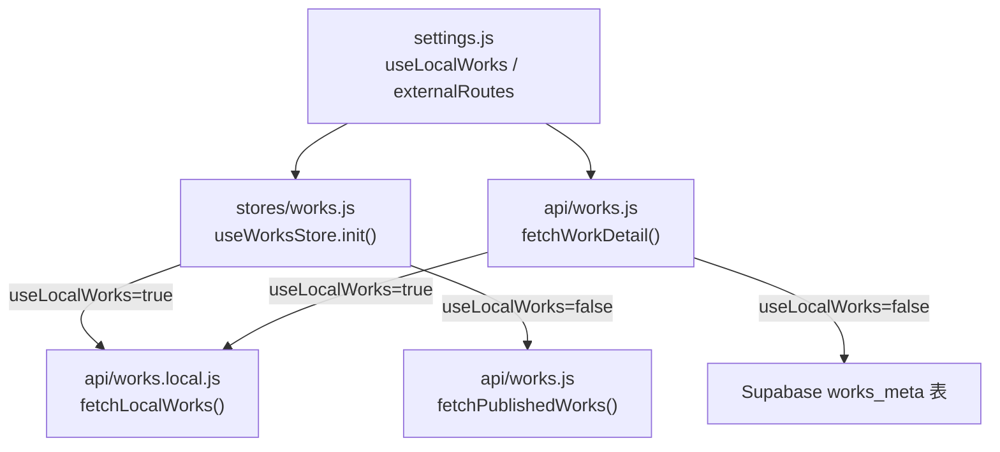
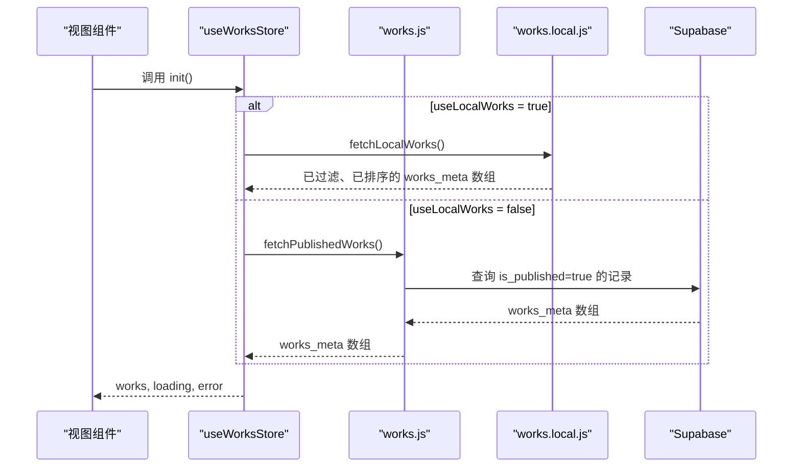
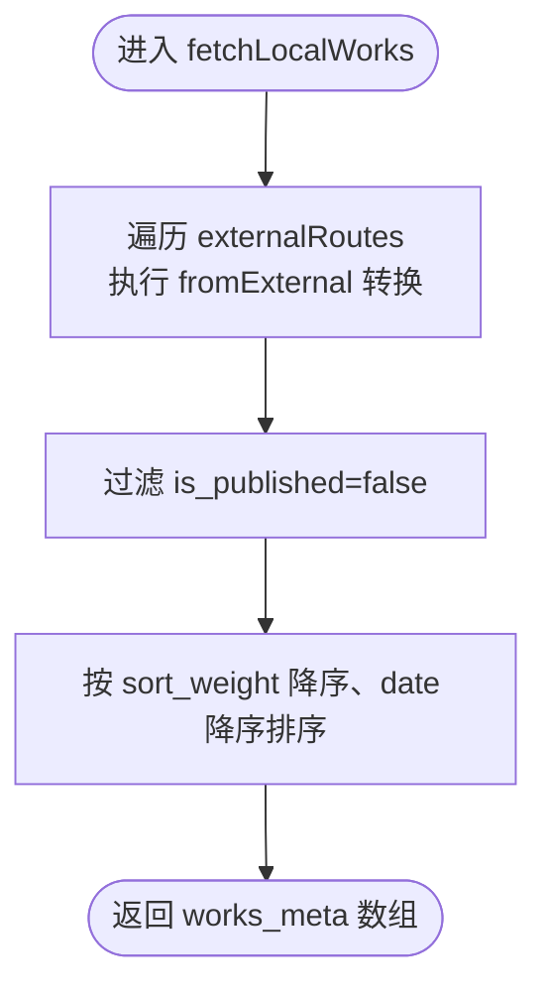
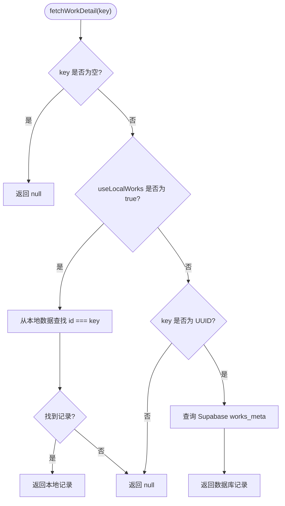
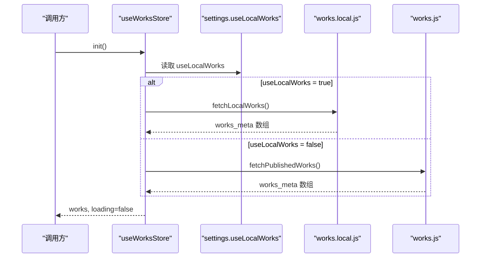
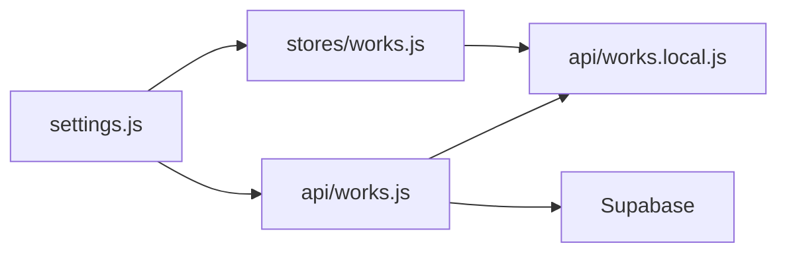

# 本地模拟层

<cite>
**本文引用的文件**   
- [src/api/works.local.js](file://src/api/works.local.js)
- [src/api/works.js](file://src/api/works.js)
- [src/stores/works.js](file://src/stores/works.js)
- [src/settings.js](file://src/settings.js)
</cite>

## 目录
1. [引言](#引言)
2. [项目结构定位](#项目结构定位)
3. [核心组件](#核心组件)
4. [架构总览](#架构总览)
5. [详细组件分析](#详细组件分析)
6. [依赖关系分析](#依赖关系分析)
7. [性能与行为特征](#性能与行为特征)
8. [本地开发工作流程](#本地开发工作流程)
9. [调试技巧与常见问题](#调试技巧与常见问题)
10. [数据一致性维护指南](#数据一致性维护指南)
11. [结论](#结论)

## 引言
本文档面向前端开发者，说明本项目的“本地模拟层”机制：在不需要后端 Supabase 服务的情况下，通过静态配置完成作品列表和详情页的本地开发与测试。文档重点包括：
- 本地模拟数据的结构与字段定义
- 默认值、排序规则与示例数据位置
- 如何切换真实 API 和本地模拟层
- `useLocalWorks` 配置项的作用范围
- 模拟数据的维护方法、扩展新字段的注意事项
- 与真实 API 的数据一致性保证策略
- 本地开发完整流程与调试技巧

## 项目结构定位
本地模拟层主要涉及以下模块：
- 配置层：`src/settings.js` 提供 `useLocalWorks` 开关与 `externalRoutes` 静态作品数据
- 模拟数据适配层：`src/api/works.local.js` 将 `externalRoutes` 映射为与数据库一致的 `works_meta` 结构
- 统一 API 入口：`src/api/works.js` 根据 `useLocalWorks` 决定走本地模拟还是 Supabase
- 状态管理：`src/stores/works.js` 在初始化时按配置选择数据源

**图表来源**
- [src/settings.js:1-8](file://src/settings.js#L1-L8)
- [src/stores/works.js:12-17](file://src/stores/works.js#L12-L17)
- [src/api/works.js:186-194](file://src/api/works.js#L186-L194)
- [src/api/works.local.js:53-58](file://src/api/works.local.js#L53-L58)

**章节来源**
- [src/settings.js:1-8](file://src/settings.js#L1-L8)
- [src/stores/works.js:12-17](file://src/stores/works.js#L12-L17)
- [src/api/works.js:186-194](file://src/api/works.js#L186-L194)
- [src/api/works.local.js:53-58](file://src/api/works.local.js#L53-L58)

## 核心组件
- **配置中心（settings.js）**
  - `useLocalWorks`：布尔开关，控制是否使用本地静态数据
  - `externalRoutes`：本地模拟作品的静态数组，每条记录包含 `name` 与 `meta`
- **模拟数据适配器（works.local.js）**
  - `fromExternal`：把 `externalRoutes` 条目转换为 `works_meta` 标准结构
  - `compare`：实现与数据库一致的排序逻辑
  - `fetchLocalWorks`：返回已发布、已排序的作品列表
- **统一 API（works.js）**
  - `fetchWorkDetail`：根据 `useLocalWorks` 路由到本地或 Supabase
  - `fetchPublishedWorks`：线上公开接口，读取已发布作品
- **状态管理（stores/works.js）**
  - `useWorksStore.init`：初始化时按配置加载作品列表

**章节来源**
- [src/settings.js:1-8](file://src/settings.js#L1-L8)
- [src/api/works.local.js:22-58](file://src/api/works.local.js#L22-L58)
- [src/api/works.js:45-55](file://src/api/works.js#L45-L55)
- [src/stores/works.js:12-17](file://src/stores/works.js#L12-L17)

## 架构总览
本地模拟层的核心思想是“数据源可插拔”，但对外暴露的字段结构保持一致。这样页面组件无需关心数据来源，只需消费统一的 `works_meta` 数据结构。

**图表来源**
- [src/stores/works.js:12-17](file://src/stores/works.js#L12-L17)
- [src/api/works.local.js:53-58](file://src/api/works.local.js#L53-L58)
- [src/api/works.js:45-55](file://src/api/works.js#L45-L55)

## 详细组件分析

### 配置层：settings.js
- `useLocalWorks`
  - 默认值为 `false`，表示线上行为走 Supabase
  - 本地调试时可改为 `true`，直接读取 `externalRoutes`
- `externalRoutes`
  - 每个条目代表一个外部作品
  - `name`：作品名称，同时用于生成本地详情链接兼容 ID
  - `meta`：作品元信息，支持可选字段：
    - `date`：日期
    - `cover`：封面图地址
    - `link`：文章链接
    - `info`：Markdown 正文
    - `sort`：排序权重
    - `hidden`：是否隐藏
    - `codepen`：CodePen 在线代码地址
    - `tags`：标签数组（未设置时默认为 `['external']`）

**章节来源**
- [src/settings.js:1-8](file://src/settings.js#L1-L8)
- [src/settings.js:9-31](file://src/settings.js#L9-L31)
- [src/settings.js:37-286](file://src/settings.js#L37-L286)

### 模拟数据适配器：works.local.js
- `fromExternal(item)`
  - 输入：`externalRoutes` 中的单条记录
  - 输出：`works_meta` 标准对象
  - 关键字段映射：
    - `id`：由 `/external/${item.name}` 生成，用于兼容旧版详情链接
    - `name`：来自 `item.name`
    - `cover_url`：来自 `meta.cover`
    - `info_md`：来自 `meta.info`
    - `code_url`：来自 `meta.code`
    - `link_url`：来自 `meta.link`
    - `codepen_url`：来自 `meta.codepen`
    - `open_url`：来自 `meta.open`
    - `date`：来自 `meta.date`
    - `sort_weight`：来自 `meta.sort`，默认 `0`
    - `is_published`：由 `!meta.hidden` 计算
    - `tags`：来自 `meta.tags`，默认 `['external']`
- `compare(a, b)`
  - 先按 `sort_weight` 降序比较
  - 权重相同则按 `date` 降序比较
  - 该排序与数据库默认排序对齐，避免本地与线上顺序不一致
- `fetchLocalWorks()`
  - 过滤掉 `is_published=false` 的记录
  - 应用 `compare` 排序
  - 返回与 Supabase 一致的 `works_meta` 数组

**图表来源**
- [src/api/works.local.js:22-47](file://src/api/works.local.js#L22-L47)
- [src/api/works.local.js:53-58](file://src/api/works.local.js#L53-L58)

**章节来源**
- [src/api/works.local.js:22-58](file://src/api/works.local.js#L22-L58)

### 统一 API：works.js
- `fetchWorkDetail(key)`
  - 当 `useLocalWorks=true` 时，从本地模拟数据中查找匹配 `id` 的作品
  - 当 `useLocalWorks=false` 时，校验 key 是否为合法 UUID，再查询 Supabase
- `fetchPublishedWorks()`
  - 查询 `is_published=true` 的记录并返回
- 其他管理接口（如新增、更新、删除、分页、统计等）主要用于后台管理，本地模拟层不覆盖这些写操作

**图表来源**
- [src/api/works.js:186-194](file://src/api/works.js#L186-L194)

**章节来源**
- [src/api/works.js:186-194](file://src/api/works.js#L186-L194)

### 状态管理：stores/works.js
- `init()`
  - 如果 `useLocalWorks=true`，直接调用 `fetchLocalWorks()`
  - 否则调用 `fetchPublishedWorks()` 获取线上数据
  - 捕获错误并设置 `error`，最终关闭 `loading`

**图表来源**
- [src/stores/works.js:12-17](file://src/stores/works.js#L12-L17)

**章节来源**
- [src/stores/works.js:12-17](file://src/stores/works.js#L12-L17)

## 依赖关系分析
- `stores/works.js` 依赖：
  - `@/api/works`：线上数据接口
  - `@/api/works.local`：本地模拟数据接口
  - `@/settings`：`useLocalWorks` 开关
- `api/works.js` 依赖：
  - `@/lib/supabase`：线上数据库客户端
  - `@/settings`：`useLocalWorks` 开关
  - `@/api/storage`：封面清理（写操作相关）
  - `@/api/works.local`：本地模拟数据（仅读路径）
- `api/works.local.js` 依赖：
  - `@/settings`：读取 `externalRoutes`

**图表来源**
- [src/stores/works.js:1-5](file://src/stores/works.js#L1-L5)
- [src/api/works.js:1-4](file://src/api/works.js#L1-L4)
- [src/api/works.local.js:1](file://src/api/works.local.js#L1)

**章节来源**
- [src/stores/works.js:1-5](file://src/stores/works.js#L1-L5)
- [src/api/works.js:1-4](file://src/api/works.js#L1-L4)
- [src/api/works.local.js:1](file://src/api/works.local.js#L1)

## 性能与行为特征
- 本地模拟层完全在内存中运行，无网络请求，适合快速迭代 UI 和交互
- 排序逻辑与数据库一致，确保本地预览与线上展示顺序一致
- 本地模拟层只覆盖“读”场景；写操作（新增、更新、删除）仍走 Supabase，避免本地状态与线上数据产生持久化差异

**章节来源**
- [src/api/works.local.js:42-47](file://src/api/works.local.js#L42-L47)
- [src/api/works.js:186-194](file://src/api/works.js#L186-L194)

## 本地开发工作流程
1. 打开 `src/settings.js`
2. 将 `useLocalWorks` 设置为 `true`
3. 编辑 `externalRoutes`，添加或修改作品条目
4. 启动本地开发服务器，刷新页面即可看到本地数据
5. 如需验证线上行为，将 `useLocalWorks` 改回 `false`

注意：
- `externalRoutes` 中的 `meta` 字段是可选的，未设置的字段会使用默认值
- 本地详情链接基于 `id=/external/${name}`，与旧版兼容

**章节来源**
- [src/settings.js:1-8](file://src/settings.js#L1-L8)
- [src/settings.js:37-286](file://src/settings.js#L37-L286)
- [src/api/works.local.js:22-39](file://src/api/works.local.js#L22-L39)

## 调试技巧与常见问题
- 确认 `useLocalWorks` 是否正确切换
  - 若列表为空，检查 `externalRoutes` 是否被误设为隐藏（`hidden=true`）
- 详情页无法打开
  - 本地模式下详情 ID 为 `/external/${name}`，请确认 URL 参数与 `name` 一致
  - 线上模式要求 ID 为 UUID，非 UUID 会被视为不存在
- 排序不符合预期
  - 检查 `meta.sort` 是否设置；未设置时默认 `0`
  - 权重相同时按 `meta.date` 降序
- 封面或链接未显示
  - 检查 `meta.cover`、`meta.link`、`meta.code`、`meta.codepen`、`meta.open` 是否填写
- 标签显示异常
  - 未设置 `meta.tags` 时，本地模拟层会固定为 `['external']`

**章节来源**
- [src/api/works.js:186-194](file://src/api/works.js#L186-L194)
- [src/api/works.local.js:22-47](file://src/api/works.local.js#L22-L47)

## 数据一致性维护指南
- 字段映射必须保持对称
  - `settings.externalRoutes.meta.*` 与 `works_meta.*` 的映射关系集中在 `fromExternal`
  - 新增字段时，需同步更新映射逻辑，确保本地与线上渲染一致
- 默认值必须明确
  - `sort_weight` 默认 `0`
  - `is_published` 由 `!hidden` 计算
  - `tags` 默认 `['external']`
  - 其他可选字段未设置时为 `null`
- 排序规则必须对齐
  - 本地 `compare` 与数据库 `DEFAULT_ORDER` 应保持一致
  - 当前本地按 `sort_weight` 降序、`date` 降序；数据库还包含 `created_at` 和 `id` 作为兜底稳定排序
- 示例数据维护
  - 示例数据位于 `src/settings.js` 的 `externalRoutes`
  - 建议新增条目时补齐常用字段：`date`、`cover`、`link`、`info`、`sort`、`tags`
- 与真实 API 的一致性检查清单
  - 列表页：字段名、类型、默认值、排序、过滤条件
  - 详情页：ID 生成规则、字段可用性、Markdown 渲染
  - 管理端：写操作不走本地模拟层，需单独验证

**章节来源**
- [src/api/works.local.js:22-47](file://src/api/works.local.js#L22-L47)
- [src/api/works.js:20-30](file://src/api/works.js#L20-L30)
- [src/settings.js:37-286](file://src/settings.js#L37-L286)

## 结论
本地模拟层通过 `settings.useLocalWorks` 与 `externalRoutes` 提供了轻量、可控的离线开发体验。它在不改变页面组件的前提下，将静态配置映射为与数据库一致的 `works_meta` 结构，从而保证本地与线上的渲染一致性。开发者可在本地快速验证 UI、交互与内容排版，并在提交前恢复 `useLocalWorks=false` 以回归线上行为。对于新增字段与复杂逻辑，务必同步更新映射、默认值与排序规则，确保数据模型始终一致。