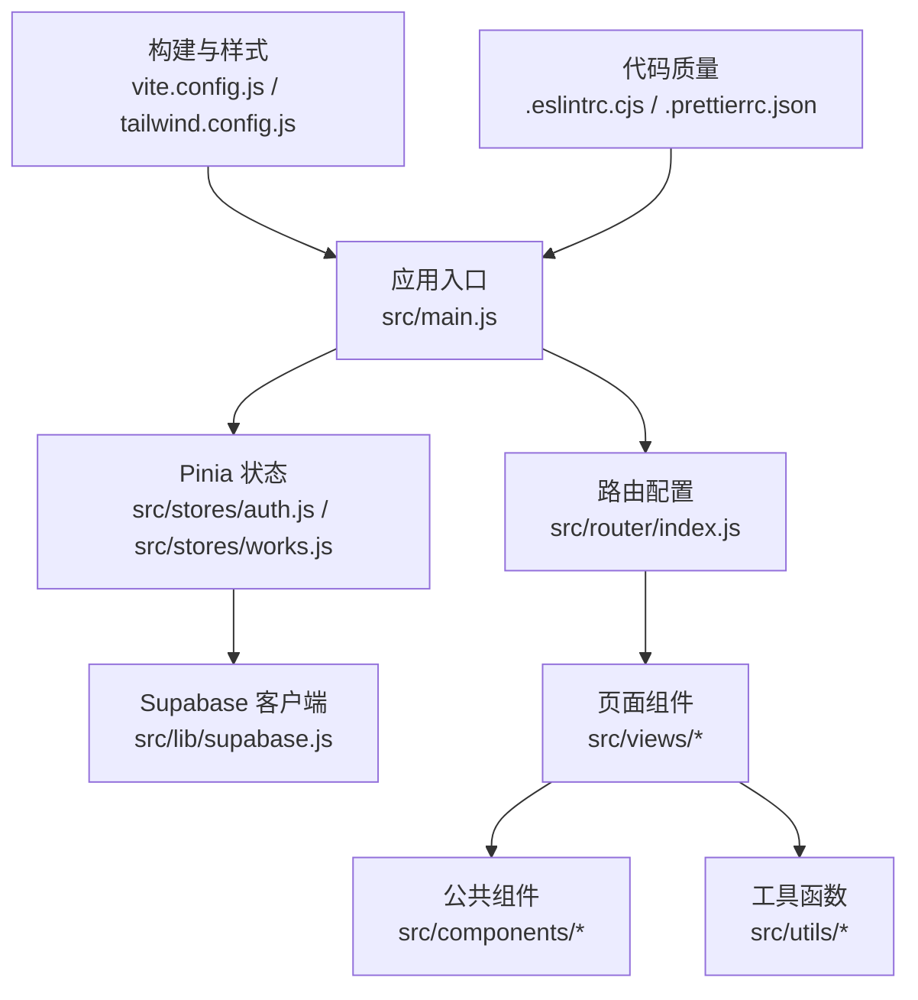
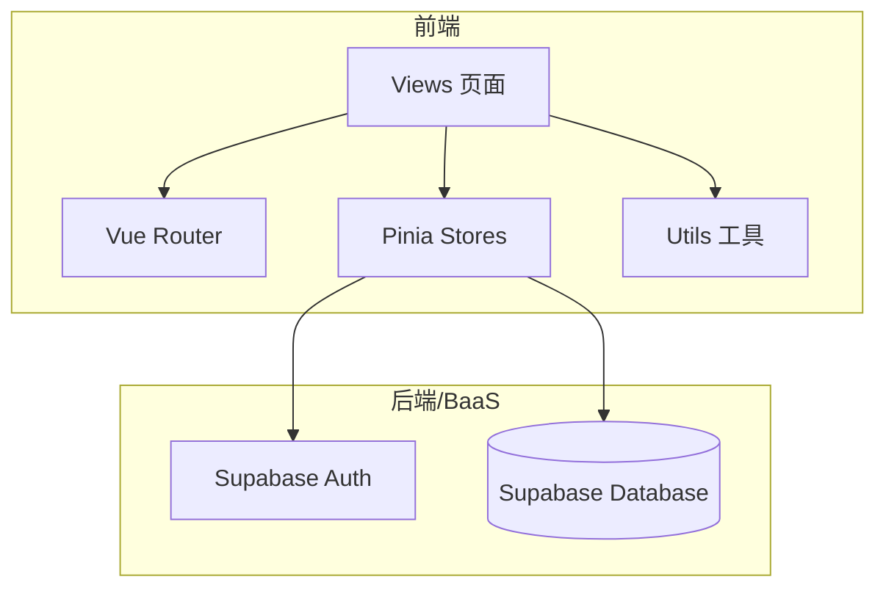
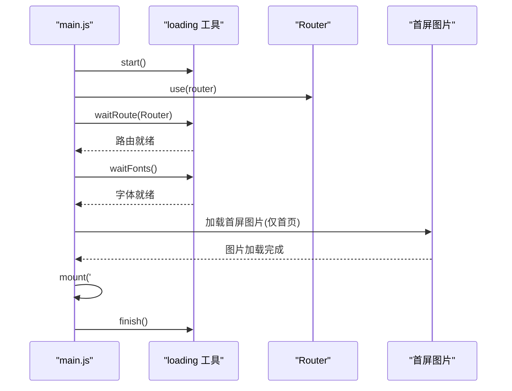
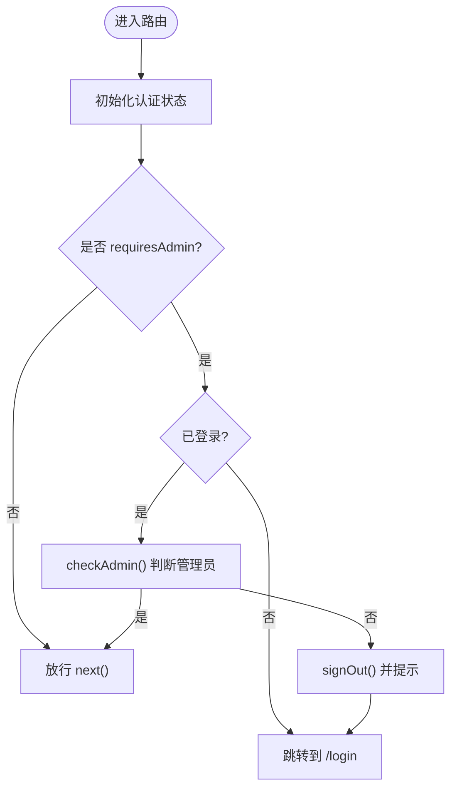
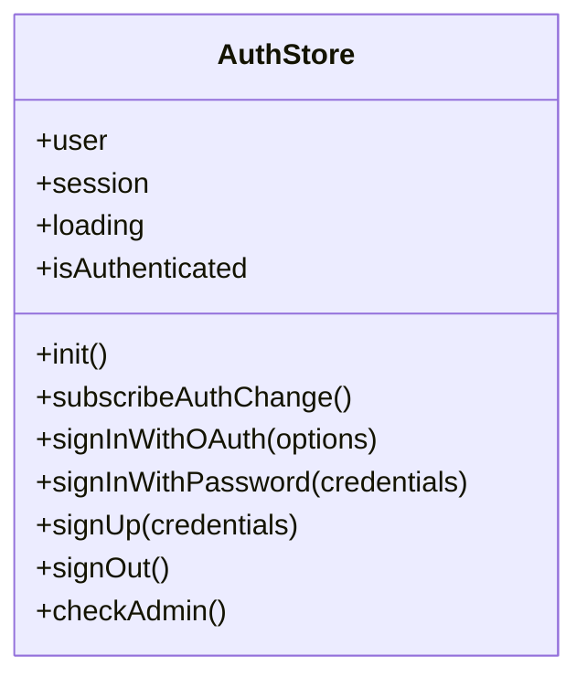
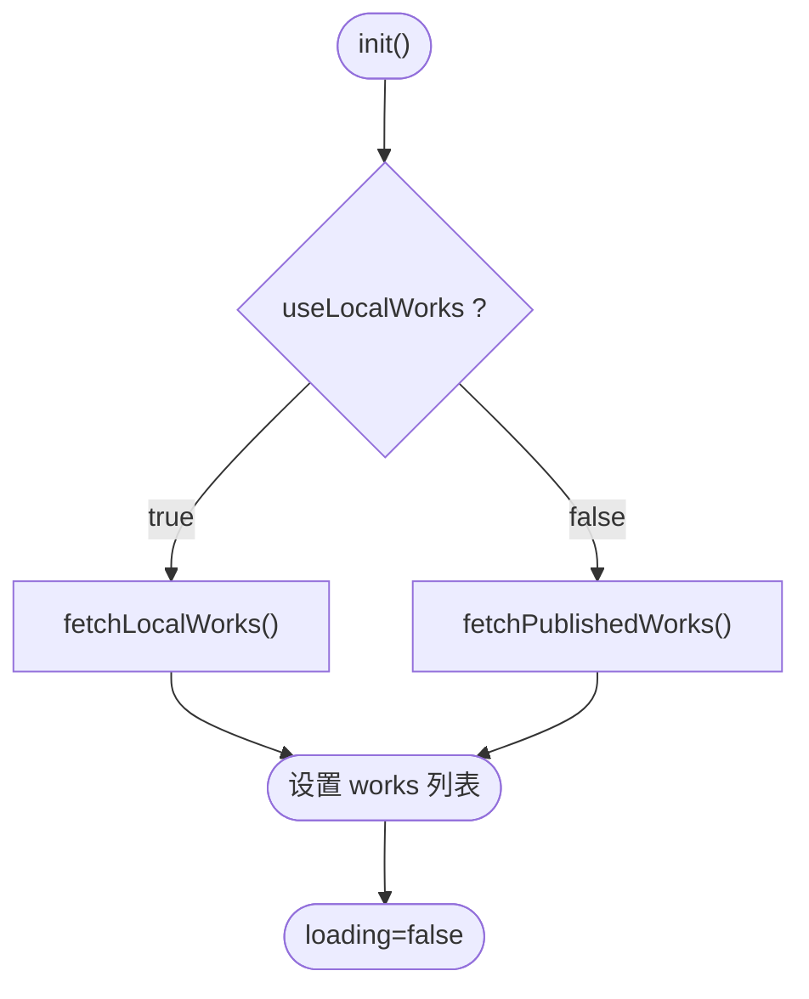
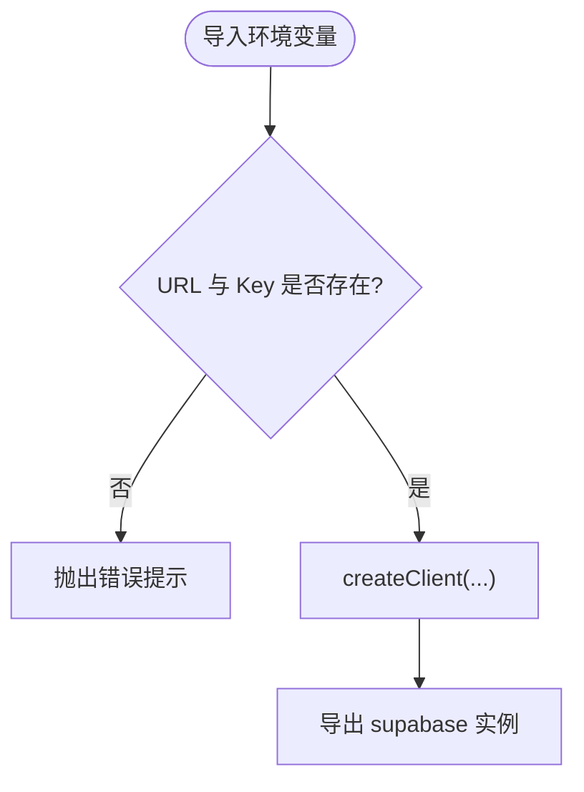
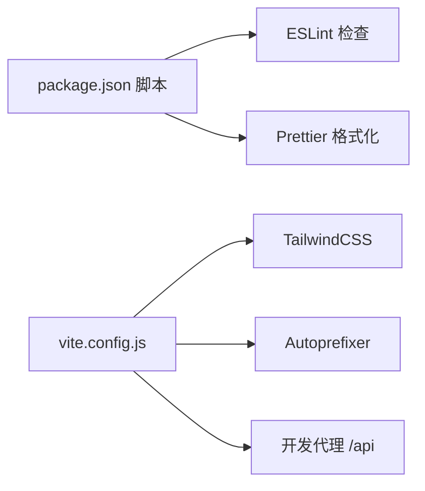

# 开发指南

<cite>
**本文引用的文件**   
- [README.md](file://README.md)
- [package.json](file://package.json)
- [.eslintrc.cjs](file://.eslintrc.cjs)
- [.prettierrc.json](file://.prettierrc.json)
- [vite.config.js](file://vite.config.js)
- [src/main.js](file://src/main.js)
- [src/settings.js](file://src/settings.js)
- [src/lib/supabase.js](file://src/lib/supabase.js)
- [src/router/index.js](file://src/router/index.js)
- [src/stores/auth.js](file://src/stores/auth.js)
- [src/stores/works.js](file://src/stores/works.js)
- [src/utils/index.js](file://src/utils/index.js)
</cite>

## 目录
1. [简介](#简介)
2. [项目结构](#项目结构)
3. [核心组件](#核心组件)
4. [架构总览](#架构总览)
5. [详细组件分析](#详细组件分析)
6. [依赖关系分析](#依赖关系分析)
7. [性能与优化](#性能与优化)
8. [调试与排错](#调试与排错)
9. [测试策略](#测试策略)
10. [贡献与协作规范](#贡献与协作规范)
11. [结论](#结论)

## 简介
本指南面向新加入的开发者，帮助快速搭建 sunwenxu1997.github.io 的开发环境，理解代码风格、质量检查与格式化标准，掌握工具函数库的使用与扩展方式，并了解调试技巧、性能分析与测试策略。同时提供贡献代码和问题反馈的流程建议，提升团队协作效率。

本项目基于 Vue 3 + Vite + TailwindCSS + Pinia + Supabase，采用 GitHub Pages 自动构建部署。

**章节来源**
- [README.md:12-25](file://README.md#L12-L25)

## 项目结构
仓库采用按功能分层的组织方式：
- 配置层：Vite、Tailwind、ESLint、Prettier、TypeScript 等
- 应用入口：main.js 负责应用初始化、加载进度控制
- 路由层：router/index.js 定义页面路由与管理员权限守卫
- 状态层：stores/auth.js、stores/works.js 管理认证与作品数据
- API 层：api/* 封装后端接口（Supabase）
- 视图层：views/* 页面组件
- 公共组件：components/*
- 工具库：utils/* 通用工具函数
- 静态资源：assets/*、public/*
- 数据库脚本：sql/*

**图表来源**
- [src/main.js:1-40](file://src/main.js#L1-L40)
- [src/router/index.js:1-73](file://src/router/index#L1-L73)
- [src/stores/auth.js:1-82](file://src/stores/auth.js#L1-L82)
- [src/stores/works.js:1-29](file://src/stores/works.js#L1-L29)
- [src/lib/supabase.js:1-17](file://src/lib/supabase.js#L1-L17)
- [vite.config.js:1-31](file://vite.config.js#L1-L31)
- [.eslintrc.cjs:1-18](file://.eslintrc.cjs#L1-L18)
- [.prettierrc.json:1-8](file://.prettierrc.json#L1-L8)

**章节来源**
- [README.md:158-189](file://README.md#L158-L189)

## 核心组件
- 应用启动与首屏体验：main.js 中通过 loading 工具依次等待路由就绪、字体加载、首屏图片加载，再挂载应用并完成遮罩淡出。
- 路由与权限：router/index.js 使用 Hash 模式，为管理页添加 requiresAdmin 元信息，并在 beforeEach 中校验登录态与管理员身份。
- 认证状态：stores/auth.js 封装 Supabase Auth，提供会话初始化、OAuth/密码登录、注册、登出、管理员校验等能力。
- 作品数据：stores/works.js 根据 settings.useLocalWorks 切换本地静态数据或线上 Supabase 数据源，统一暴露 init 方法供页面调用。
- Supabase 客户端：lib/supabase.js 从环境变量读取凭证并创建客户端实例，缺失时抛出错误提示。
- 工具函数：utils/index.js 提供移动端检测、节流、防抖、BroadcastChannel 消息通道等常用工具。

**章节来源**
- [src/main.js:16-39](file://src/main.js#L16-L39)
- [src/router/index.js:4-49](file://src/router/index.js#L4-L49)
- [src/router/index.js:51-70](file://src/router/index.js#L51-L70)
- [src/stores/auth.js:5-80](file://src/stores/auth.js#L5-L80)
- [src/stores/works.js:7-27](file://src/stores/works.js#L7-L27)
- [src/lib/supabase.js:1-17](file://src/lib/supabase.js#L1-L17)
- [src/utils/index.js:1-70](file://src/utils/index.js#L1-L70)

## 架构总览
前端通过 Vue Router 进行页面导航，Pinia Store 管理全局状态；认证流程由 Supabase Auth 驱动，作品数据在本地静态配置与 Supabase 之间合并展示；Vite 作为构建工具，集成 TailwindCSS 与 Autoprefixer；ESLint 与 Prettier 保障代码风格一致性与可读性。

**图表来源**
- [src/router/index.js:1-73](file://src/router/index.js#L1-L73)
- [src/stores/auth.js:1-82](file://src/stores/auth.js#L1-L82)
- [src/stores/works.js:1-29](file://src/stores/works.js#L1-L29)
- [src/lib/supabase.js:1-17](file://src/lib/supabase.js#L1-L17)

## 详细组件分析

### 应用启动与首屏加载流程
main.js 在应用启动时先显示加载遮罩，随后依次等待路由 chunk 加载完成、字体加载完成、首屏关键图片加载完成，最后挂载应用并结束加载动画。该流程确保首帧渲染稳定且用户体验流畅。

**图表来源**
- [src/main.js:16-39](file://src/main.js#L16-L39)

**章节来源**
- [src/main.js:1-40](file://src/main.js#L1-L40)

### 路由与管理员权限守卫
router/index.js 定义了主要页面路由，并为管理页设置 requiresAdmin 元信息。beforeEach 钩子会先初始化认证状态，若访问需要管理员权限的路由，则校验登录态与管理员身份，未授权时跳转登录页并提示。

**图表来源**
- [src/router/index.js:51-70](file://src/router/index.js#L51-L70)
- [src/stores/auth.js:59-66](file://src/stores/auth.js#L59-L66)

**章节来源**
- [src/router/index.js:4-49](file://src/router/index.js#L4-L49)
- [src/router/index.js:51-70](file://src/router/index.js#L51-L70)
- [src/stores/auth.js:59-66](file://src/stores/auth.js#L59-L66)

### 认证状态管理（auth store）
auth store 封装了 Supabase Auth 的核心能力：
- 初始化会话与用户信息
- 监听认证状态变化
- OAuth 与邮箱密码登录
- 注册与登出
- 管理员权限校验（调用 RPC is_admin）

**图表来源**
- [src/stores/auth.js:5-80](file://src/stores/auth.js#L5-L80)

**章节来源**
- [src/stores/auth.js:1-82](file://src/stores/auth.js#L1-L82)

### 作品数据加载与数据源切换（works store）
works store 根据 settings.useLocalWorks 决定数据来源：
- 本地静态数据：settings.externalRoutes（适合本地调试）
- 线上数据：Supabase works_meta 表（线上行为）

**图表来源**
- [src/stores/works.js:12-25](file://src/stores/works.js#L12-L25)
- [src/settings.js:1-8](file://src/settings.js#L1-L8)

**章节来源**
- [src/stores/works.js:1-29](file://src/stores/works.js#L1-L29)
- [src/settings.js:1-8](file://src/settings.js#L1-L8)

### Supabase 客户端初始化
lib/supabase.js 从环境变量读取 Supabase URL 与 Publishable Key，缺失时抛出错误，避免运行时静默失败。客户端启用会话持久化与自动刷新令牌。

**图表来源**
- [src/lib/supabase.js:3-16](file://src/lib/supabase.js#L3-L16)

**章节来源**
- [src/lib/supabase.js:1-17](file://src/lib/supabase.js#L1-L17)

### 工具函数库（utils）
utils/index.js 提供以下工具：
- isMobileDevice：检测设备类型
- throttle：节流函数
- debounce：防抖函数
- createBroadcastChannel/listenBroadcastChannel/closeBroadcastChannel：跨标签页通信通道

这些工具可被任意组件或 store 复用，建议在新增工具时保持单一职责与清晰的命名。

**章节来源**
- [src/utils/index.js:1-70](file://src/utils/index.js#L1-L70)

## 依赖关系分析
- 构建与样式：vite.config.js 引入 @vitejs/plugin-vue，配置别名 @ 指向 src，启用 TailwindCSS 与 Autoprefixer，并配置开发代理 /api 到本地服务。
- 代码质量：.eslintrc.cjs 继承 Vue3 Essential、ESLint Recommended 与 Prettier 跳过格式化的配置，关闭多词组件名规则；.prettierrc.json 定义无分号、单引号、缩进 2 空格、行宽 100、无尾随逗号。
- 脚本命令：package.json 提供 dev/build/preview/lint/format 等命令，lint 针对 .vue/.js/.jsx/.cjs/.mjs 文件执行修复，format 对 src 目录进行格式化。

**图表来源**
- [package.json:5-11](file://package.json#L5-L11)
- [.eslintrc.cjs:4-16](file://.eslintrc.cjs#L4-L16)
- [.prettierrc.json:1-8](file://.prettierrc.json#L1-L8)
- [vite.config.js:8-29](file://vite.config.js#L8-L29)

**章节来源**
- [package.json:5-11](file://package.json#L5-L11)
- [.eslintrc.cjs:4-16](file://.eslintrc.cjs#L4-L16)
- [.prettierrc.json:1-8](file://.prettierrc.json#L1-L8)
- [vite.config.js:8-29](file://vite.config.js#L8-L29)

## 性能与优化
- 首屏加载优化：main.js 中按顺序等待路由、字体与首屏图片，减少白屏时间并提升感知性能。
- 按需加载：路由组件使用动态 import，减小初始包体积。
- 样式处理：TailwindCSS + Autoprefixer 在构建阶段生成必要样式，避免运行时开销。
- 网络请求：Supabase 客户端启用会话持久化与自动刷新令牌，减少重复鉴权成本。
- 工具函数：节流与防抖用于高频事件场景，降低主线程压力。

建议：
- 对大图资源进行压缩与懒加载
- 对复杂计算使用 Web Worker 或增量更新
- 监控首屏关键指标（FCP、LCP、CLS），结合浏览器性能面板定位瓶颈

[本节为通用指导，不直接分析具体文件]

## 调试与排错
- 环境变量缺失：当缺少 VITE_SUPABASE_URL 或 VITE_SUPABASE_PUBLISHABLE_KEY 时，lib/supabase.js 会抛出错误。请确保 .env.local 配置正确。
- 管理员权限问题：访问 /admin/works 前需登录并通过 checkAdmin 校验。若失败，将提示并退出登录。
- 路由守卫阻塞：确保 app.use(router) 在 waiting 之前调用，否则 waitRoute 可能一直挂起。
- 开发代理：如需本地后端联调，确认 vite.config.js 中的 /api 代理目标地址可用。

排查步骤：
1. 检查 .env.local 是否包含正确的 Supabase 凭证
2. 打开浏览器控制台查看错误日志
3. 验证路由守卫逻辑与管理员权限
4. 使用 Network 面板检查 Supabase 请求状态码与响应体

**章节来源**
- [src/lib/supabase.js:6-8](file://src/lib/supabase.js#L6-L8)
- [src/router/index.js:51-70](file://src/router/index.js#L51-L70)
- [src/main.js:21-26](file://src/main.js#L21-L26)
- [vite.config.js:15-23](file://vite.config.js#L15-L23)

## 测试策略
当前仓库未内置测试框架与测试用例。建议：
- 单元测试：对 utils 工具函数编写用例，覆盖边界条件（如空参数、异常输入）。
- 组件测试：对关键 UI 组件（如 Works.vue、WorkDetail.vue）进行交互与渲染断言。
- 集成测试：模拟 Supabase 客户端返回，验证 stores 的数据合并与排序逻辑。
- 端到端测试：使用 Playwright/Cypress 模拟用户登录、浏览作品、搜索等流程。

[本节为通用指导，不直接分析具体文件]

## 贡献与协作规范
- 代码风格与质量：
  - 使用 ESLint 进行语法与风格检查，运行 npm run lint 自动修复
  - 使用 Prettier 统一格式化，运行 npm run format 对 src 目录格式化
  - 提交前确保 lint 与 format 通过
- 工作流建议：
  - 分支策略：feature/*、fix/*、chore/*
  - 提交信息：遵循约定式提交（feat/fix/docs/style/refactor/test/chore/build/ci/perf）
  - 变更说明：在 PR 中描述改动范围、影响面与测试情况
- 问题反馈：
  - 优先在 Issues 中描述复现步骤、期望行为与实际行为
  - 附带截图或录屏、浏览器版本与环境信息
  - 如涉及 Supabase 配置，脱敏敏感信息后提供相关片段

**章节来源**
- [package.json:5-11](file://package.json#L5-L11)
- [.eslintrc.cjs:4-16](file://.eslintrc.cjs#L4-L16)
- [.prettierrc.json:1-8](file://.prettierrc.json#L1-L8)

## 结论
本指南梳理了项目的开发环境搭建、代码规范、工具函数库使用、调试与性能优化要点，以及贡献与协作流程。遵循本文档的建议，新成员可以快速上手，团队也能保持一致的代码质量与高效的协作节奏。

[本节为总结性内容，不直接分析具体文件]