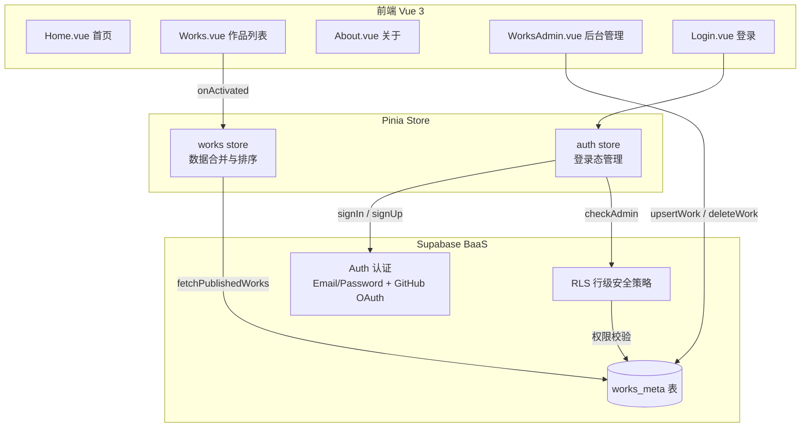
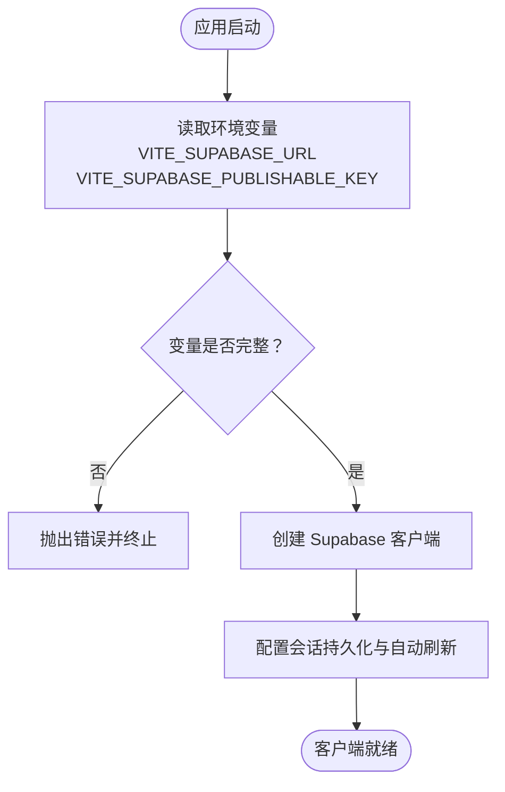
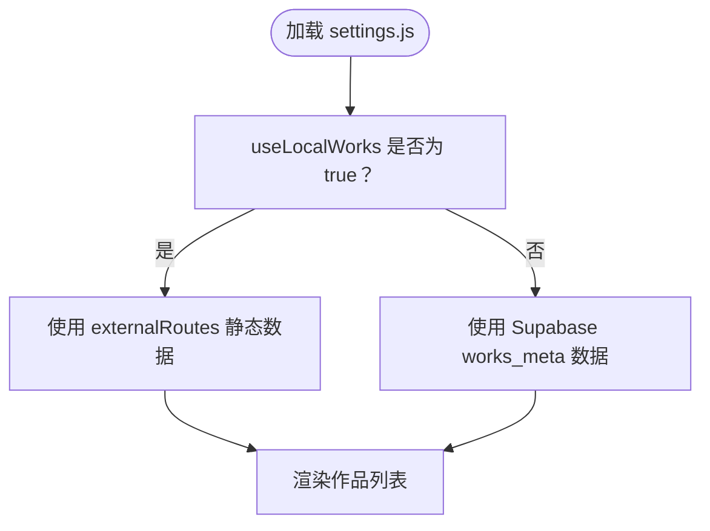
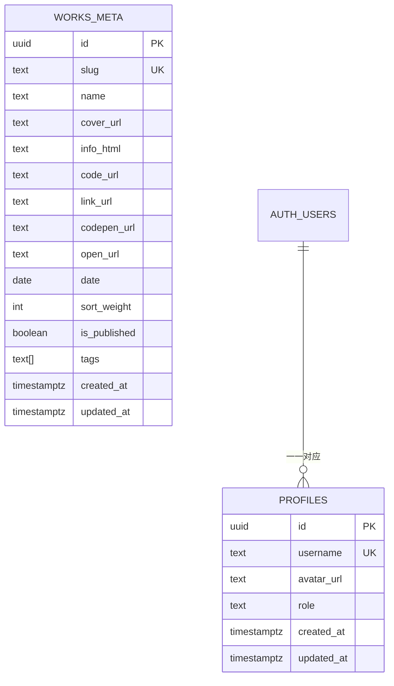
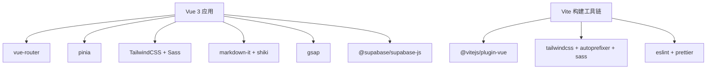

# 快速开始

<cite>
**本文引用的文件**   
- [README.md](file://README.md)
- [package.json](file://package.json)
- [src/lib/supabase.js](file://src/lib/supabase.js)
- [src/settings.js](file://src/settings.js)
- [sql/001-rbac-setup.sql](file://sql/001-rbac-setup.sql)
- [sql/002-works-meta.sql](file://sql/002-works-meta.sql)
</cite>

## 目录
1. [简介](#简介)
2. [环境准备](#环境准备)
3. [克隆与安装依赖](#克隆与安装依赖)
4. [环境变量配置](#环境变量配置)
5. [Supabase 后端初始化](#supabase-后端初始化)
6. [启动开发服务器](#启动开发服务器)
7. [本地静态数据模式（可选）](#本地静态数据模式可选)
8. [常见问题与故障排除](#常见问题与故障排除)
9. [构建与部署](#构建与部署)
10. [架构概览](#架构概览)
11. [详细组件分析](#详细组件分析)
12. [依赖关系分析](#依赖关系分析)
13. [性能与优化建议](#性能与优化建议)
14. [结论](#结论)

## 简介
本项目是一个基于 Vue 3 + Vite + TailwindCSS + Supabase 的个人作品展示站点。前端负责页面渲染、路由与交互，Supabase 提供用户认证、数据库与行级安全策略；项目支持在线管理作品元数据，也支持本地静态数据调试。

本快速开始指南的目标是：帮助你在最短时间内完成环境准备、项目克隆、依赖安装、环境变量配置、Supabase 后端初始化，并成功运行开发服务器。

## 环境准备
- Node.js 版本要求：>= 16.0.0
- 包管理器：npm（也可使用 yarn/pnpm，但请确保与仓库脚本兼容）

说明：
- 项目的 Node.js 版本约束来自工程配置中的 engines 字段。
- 开发脚本通过 Vite 启动开发服务器。

**章节来源**
- [package.json:37-39](file://package.json#L37-L39)
- [package.json:5-10](file://package.json#L5-L10)

## 克隆与安装依赖
步骤：
1. 将项目克隆到本地。
2. 进入项目根目录。
3. 安装依赖：
   - npm：`npm install`
   - yarn：`yarn install`
   - pnpm：`pnpm install`

说明：
- 项目根目录包含 package-lock.json，推荐使用 npm 以获得一致的依赖解析结果。
- 安装完成后，可执行 `npm run dev` 启动开发服务器。

**章节来源**
- [package.json:5-10](file://package.json#L5-L10)

## 环境变量配置
你需要在根目录创建 `.env.local` 文件，并填入 Supabase 项目凭证：
- VITE_SUPABASE_URL
- VITE_SUPABASE_PUBLISHABLE_KEY

注意：
- 如果缺少上述任意一个环境变量，应用会在初始化时抛出错误，阻止启动。
- 该文件不应提交到 Git，用于存放敏感信息。

参考路径：
- 环境变量读取与校验逻辑位于 Supabase 客户端初始化文件中。

**章节来源**
- [src/lib/supabase.js:3-8](file://src/lib/supabase.js#L3-L8)
- [README.md:73-80](file://README.md#L73-L80)

## Supabase 后端初始化
### 1. 创建 Supabase 项目
- 登录 Supabase，新建项目。
- 记录项目 URL 和 anon/public 密钥，用于后续环境变量配置。

### 2. 执行数据库初始化脚本
按顺序执行以下 SQL 脚本（建议在 Supabase SQL Editor 中执行）：
1. RBAC 初始化（profiles 表、触发器、RLS、管理员提升函数等）
   - 文件：[sql/001-rbac-setup.sql](file://sql/001-rbac-setup.sql)
2. 作品元数据表（works_meta）、索引、RLS 策略
   - 文件：[sql/002-works-meta.sql](file://sql/002-works-meta.sql)

说明：
- RBAC 脚本会创建 profiles 表、自动建 profile 的触发器、updated_at 更新函数、RLS 策略以及 is_admin 判断函数。
- works_meta 脚本会创建作品元数据表、启用 RLS、定义匿名/已登录/管理员权限策略，并建立常用查询索引。

### 3. 设置首个管理员
- 在执行完 RBAC 脚本后，使用 service_role 调用 bootstrap_first_admin 函数，将你的邮箱对应的用户设置为管理员。
- 该函数仅允许 service_role 调用，普通 anon/authenticated 无法执行。

参考路径：
- RBAC 初始化与管理员提升函数定义见 [sql/001-rbac-setup.sql](file://sql/001-rbac-setup.sql)
- works_meta 表结构与 RLS 策略见 [sql/002-works-meta.sql](file://sql/002-works-meta.sql)

**章节来源**
- [sql/001-rbac-setup.sql:1-128](file://sql/001-rbac-setup.sql#L1-L128)
- [sql/002-works-meta.sql:1-76](file://sql/002-works-meta.sql#L1-L76)

## 启动开发服务器
步骤：
1. 确认 .env.local 已正确配置。
2. 执行：
   - npm：`npm run dev`
   - yarn：`yarn dev`
   - pnpm：`pnpm dev`

说明：
- 开发服务器默认监听主机地址，便于局域网访问。
- 若出现端口占用或网络问题，可在 vite.config.js 中调整 host/port（如需要）。

**章节来源**
- [package.json:5-10](file://package.json#L5-L10)

## 本地静态数据模式（可选）
如果你暂时不想连接 Supabase，可以启用本地静态数据模式进行前端调试：
- 打开 src/settings.js，将 useLocalWorks 改为 true。
- 此时作品列表将直接读取 externalRoutes 中的静态数据，不再请求 Supabase。

注意：
- 此模式适合本地调试，上线前务必改回 false，以使用线上数据源。

**章节来源**
- [src/settings.js:1-8](file://src/settings.js#L1-L8)

## 常见问题与故障排除
- 启动时报错“缺少环境变量”
  - 现象：应用初始化时抛出错误，提示缺少 VITE_SUPABASE_URL 或 VITE_SUPABASE_PUBLISHABLE_KEY。
  - 解决：检查根目录是否存在 .env.local，并确保两个变量均已填写且值正确。
  - 参考：[src/lib/supabase.js:3-8](file://src/lib/supabase.js#L3-L8)

- 登录后无法访问后台管理页
  - 现象：进入 /admin/works 被重定向到 /login。
  - 原因：未登录或当前用户不是管理员。
  - 解决：
    - 确保已在 Supabase 中注册账号并完成邮箱验证。
    - 使用 service_role 调用 bootstrap_first_admin 将你的用户设为管理员。
    - 重新登录并刷新页面。
  - 参考：RBAC 管理员提升函数见 [sql/001-rbac-setup.sql:94-121](file://sql/001-rbac-setup.sql#L94-L121)

- 作品列表为空或无数据
  - 可能原因：
    - Supabase 中尚未插入作品数据。
    - 作品记录的 is_published 为 false。
    - RLS 策略限制导致匿名用户无法读取。
  - 解决：
    - 在 Supabase 中插入作品记录，并确保 is_published=true。
    - 如需本地调试，可将 settings.js 中的 useLocalWorks 设为 true。
  - 参考：works_meta 表结构与 RLS 策略见 [sql/002-works-meta.sql:7-70](file://sql/002-works-meta.sql#L7-L70)

- 构建失败或依赖版本不匹配
  - 现象：npm/yarn 安装或构建时报错。
  - 解决：
    - 升级 Node.js 至 >= 16.0.0。
    - 清理 node_modules 后重新安装依赖。
    - 使用 npm ci 或 yarn install --frozen-lockfile 保证依赖一致性。
  - 参考：Node.js 版本约束见 [package.json:37-39](file://package.json#L37-L39)

**章节来源**
- [src/lib/supabase.js:3-8](file://src/lib/supabase.js#L3-L8)
- [sql/001-rbac-setup.sql:94-121](file://sql/001-rbac-setup.sql#L94-L121)
- [sql/002-works-meta.sql:7-70](file://sql/002-works-meta.sql#L7-L70)
- [package.json:37-39](file://package.json#L37-L39)

## 构建与部署
- 构建命令：
  - npm：`npm run build`
  - yarn：`yarn build`
  - pnpm：`pnpm build`
- 预览构建产物：
  - npm：`npm run preview`
  - yarn：`yarn preview`
  - pnpm：`pnpm preview`

说明：
- 项目已配置 GitHub Actions，推送到 main 分支后会自动构建并部署到 GitHub Pages。
- 构建输出目录由 Vite 默认配置决定，可根据需要自定义。

**章节来源**
- [package.json:5-10](file://package.json#L5-L10)
- [README.md:236-243](file://README.md#L236-L243)

## 架构概览
前端采用 Vue 3 + Vite，状态管理使用 Pinia，样式使用 TailwindCSS，后端通过 Supabase 提供认证与数据库能力。作品列表由本地组件与 Supabase 数据源合并而成，并通过 RLS 控制读写权限。

**图表来源**
- [README.md:39-67](file://README.md#L39-L67)

## 详细组件分析
### Supabase 客户端初始化
- 作用：从环境变量读取 Supabase URL 与 Publishable Key，创建客户端实例，并开启会话持久化与自动刷新。
- 关键点：
  - 若环境变量缺失，直接抛出错误，阻止应用继续运行。
  - 启用 detectSessionInUrl，支持通过 URL 参数恢复会话（常用于 OAuth 回调）。

**图表来源**
- [src/lib/supabase.js:3-16](file://src/lib/supabase.js#L3-L16)

**章节来源**
- [src/lib/supabase.js:1-17](file://src/lib/supabase.js#L1-L17)

### 本地静态数据模式
- 作用：在本地调试时，直接使用 settings.js 中的 externalRoutes 作为作品数据源，无需连接 Supabase。
- 关键点：
  - useLocalWorks=false 时走线上数据源（Supabase）。
  - useLocalWorks=true 时走本地静态数据，适合离线调试。

**图表来源**
- [src/settings.js:1-8](file://src/settings.js#L1-L8)

**章节来源**
- [src/settings.js:1-288](file://src/settings.js#L1-L288)

### 数据库表结构与权限模型
- works_meta 表：存储作品的运营态字段（标题、封面、链接、标签、排序权重、发布日期、是否发布等）。
- RBAC：profiles 表与 auth.users 对应，维护角色（user/admin），并提供 is_admin 判断函数与管理员提升函数。
- RLS：匿名用户仅能读取已发布且未隐藏的记录；已登录用户可读所有记录；管理员可增删改查。

**图表来源**
- [sql/001-rbac-setup.sql:8-16](file://sql/001-rbac-setup.sql#L8-L16)
- [sql/002-works-meta.sql:7-23](file://sql/002-works-meta.sql#L7-L23)

**章节来源**
- [sql/001-rbac-setup.sql:1-128](file://sql/001-rbac-setup.sql#L1-L128)
- [sql/002-works-meta.sql:1-76](file://sql/002-works-meta.sql#L1-L76)

## 依赖关系分析
- 运行时依赖：
  - @supabase/supabase-js：Supabase 客户端 SDK。
  - vue、vue-router：Vue 3 框架与路由。
  - pinia：状态管理。
  - markdown-it、shiki：Markdown 解析与代码高亮。
  - gsap、animejs（通过 lucide-vue-next 等）：动画与图标。
- 开发依赖：
  - vite、@vitejs/plugin-vue：构建与 Vue 插件。
  - tailwindcss、autoprefixer、sass：样式处理。
  - eslint、prettier：代码规范与格式化。

**图表来源**
- [package.json:12-35](file://package.json#L12-L35)

**章节来源**
- [package.json:12-35](file://package.json#L12-L35)

## 性能与优化建议
- 图片资源：
  - 建议使用 CDN 或 Supabase Storage 托管封面图，减少首屏加载时间。
- 数据加载：
  - 对 works_meta 查询增加合适的索引（脚本已包含常用索引）。
  - 分页或懒加载大量作品时，考虑按需拉取。
- 构建优化：
  - 使用 Vite 的代码分割与按需引入特性，减少打包体积。
  - 压缩静态资源与启用 Gzip/Brotli（取决于部署平台）。

[本节为通用建议，不涉及具体文件分析]

## 结论
按照本快速开始指南，你可以在最短时间内完成环境准备、项目克隆、依赖安装、环境变量配置与 Supabase 后端初始化，并成功运行开发服务器。若遇到环境问题或权限问题，请参考常见问题与故障排除部分；如需进一步定制，可结合 README 中的架构说明与组件分析进行深入探索。