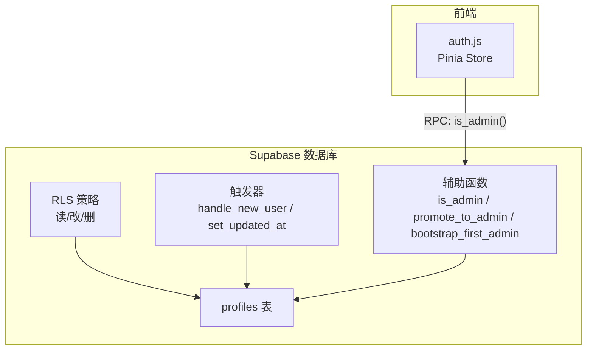
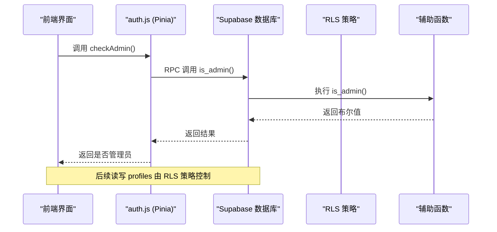
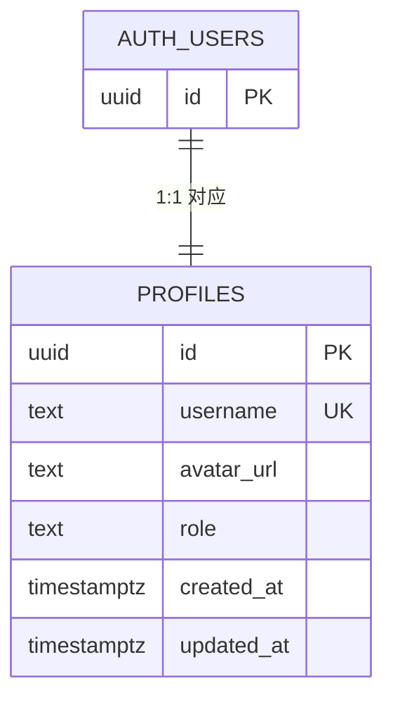
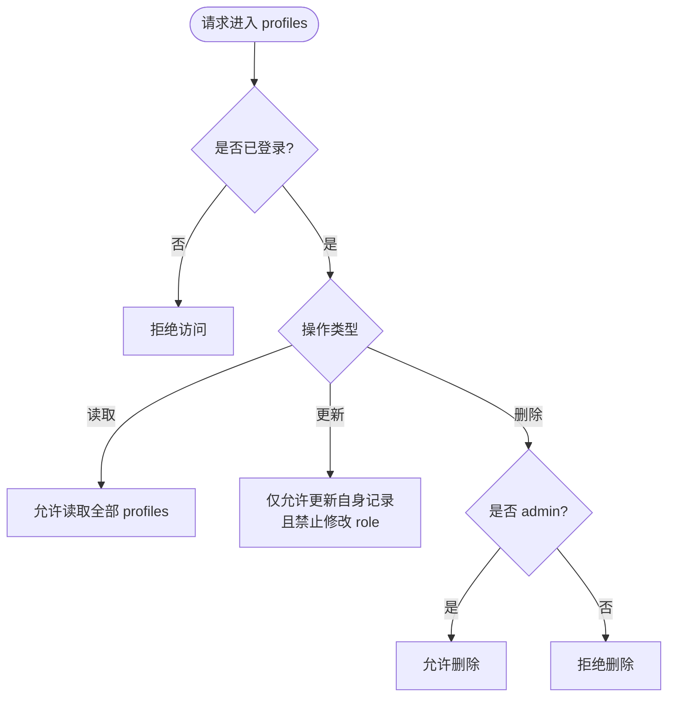
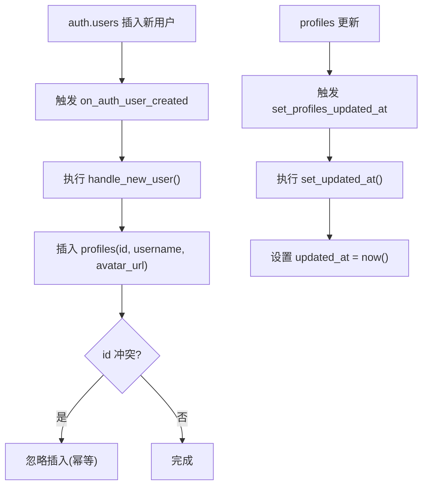
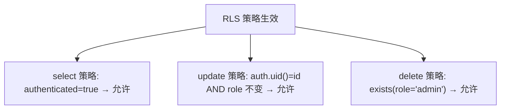
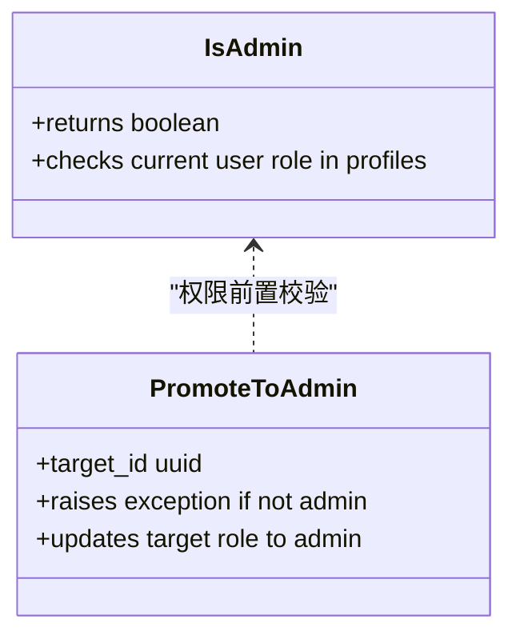
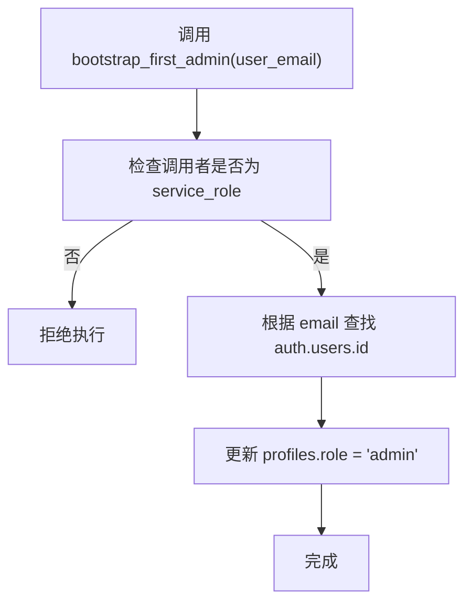
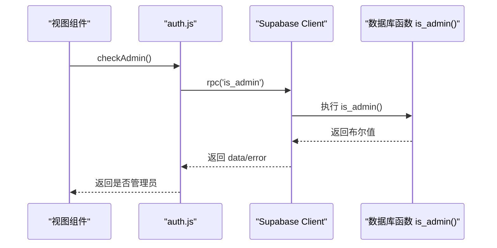
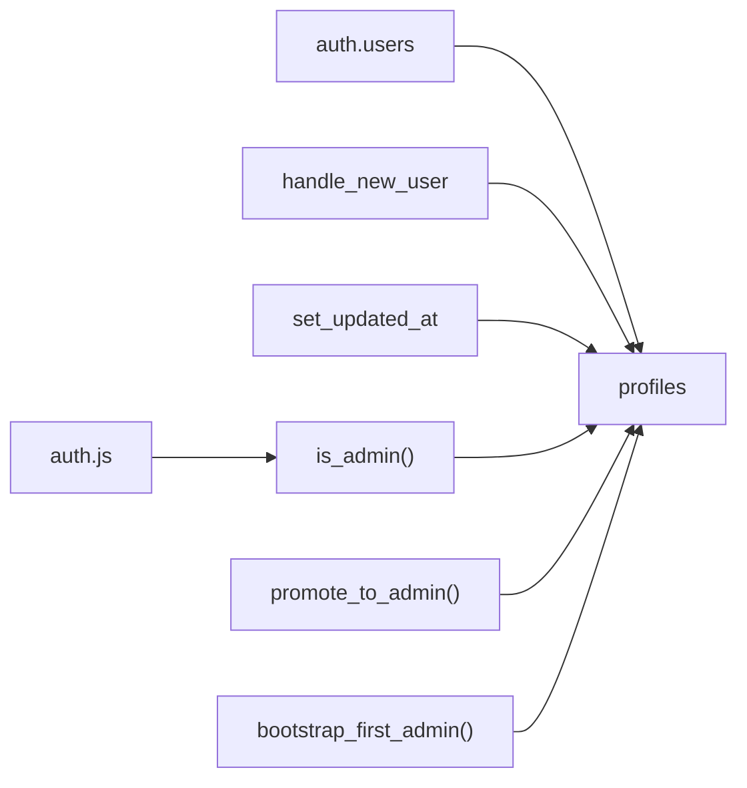

# RBAC 权限模型

<cite>
**本文引用的文件**   
- [sql/001-rbac-setup.sql](file://sql/001-rbac-setup.sql)
- [src/stores/auth.js](file://src/stores/auth.js)
- [README.md](file://README.md)
- [sql/002b-works-meta-comments.sql](file://sql/002b-works-meta-comments.sql)
</cite>

## 目录
1. [简介](#简介)
2. [项目结构](#项目结构)
3. [核心组件](#核心组件)
4. [架构总览](#架构总览)
5. [详细组件分析](#详细组件分析)
6. [依赖关系分析](#依赖关系分析)
7. [性能与一致性](#性能与一致性)
8. [故障排查指南](#故障排查指南)
9. [结论](#结论)
10. [附录：字段与策略速查](#附录字段与策略速查)

## 简介
本技术文档围绕基于角色的访问控制（RBAC）权限模型展开，聚焦 Supabase Postgres 中的 profiles 表、触发器、RLS（行级安全）策略以及管理员提升流程。目标是帮助开发者理解并正确使用该权限体系，包括用户角色差异、自动资料创建机制、更新时间戳、读取/更新/删除的权限规则，以及 is_admin()、promote_to_admin()、bootstrap_first_admin() 等辅助函数的作用与安全注意事项。

## 项目结构
本项目将 RBAC 相关数据库逻辑集中在 SQL 脚本中，前端通过 Pinia store 调用后端函数进行权限判断。关键路径如下：
- 数据库层：sql/001-rbac-setup.sql 定义 profiles 表、触发器、RLS 策略与辅助函数
- 前端层：src/stores/auth.js 提供 checkAdmin() 调用 is_admin() RPC
- 文档与注释：README.md 对 RLS 策略做高层说明；sql/002b-works-meta-comments.sql 为 profiles 表字段添加注释

**图表来源**
- [sql/001-rbac-setup.sql:8-16](file://sql/001-rbac-setup.sql#L8-L16)
- [sql/001-rbac-setup.sql:18-53](file://sql/001-rbac-setup.sql#L18-L53)
- [sql/001-rbac-setup.sql:55-82](file://sql/001-rbac-setup.sql#L55-L82)
- [sql/001-rbac-setup.sql:84-121](file://sql/001-rbac-setup.sql#L84-L121)
- [src/stores/auth.js:59-66](file://src/stores/auth.js#L59-L66)

**章节来源**
- [sql/001-rbac-setup.sql:1-128](file://sql/001-rbac-setup.sql#L1-L128)
- [src/stores/auth.js:1-82](file://src/stores/auth.js#L1-L82)
- [README.md:133-156](file://README.md#L133-L156)
- [sql/002b-works-meta-comments.sql:6-16](file://sql/002b-works-meta-comments.sql#L6-L16)

## 核心组件
- profiles 表：存储用户档案与角色信息，与 auth.users 一一对应
- 触发器：
  - handle_new_user：注册时自动创建 profile
  - set_updated_at：更新记录时自动刷新 updated_at
- RLS 策略：
  - 已登录用户可读取所有 profiles
  - 用户只能更新自己的资料，且不能自改 role
  - 仅 admin 可删除 profiles
- 辅助函数：
  - is_admin()：判断当前用户是否为 admin
  - promote_to_admin(target_id)：现有 admin 提升目标用户为 admin
  - bootstrap_first_admin(user_email)：初始化首个管理员（仅限 service_role）

**章节来源**
- [sql/001-rbac-setup.sql:8-16](file://sql/001-rbac-setup.sql#L8-L16)
- [sql/001-rbac-setup.sql:18-53](file://sql/001-rbac-setup.sql#L18-L53)
- [sql/001-rbac-setup.sql:55-82](file://sql/001-rbac-setup.sql#L55-L82)
- [sql/001-rbac-setup.sql:84-121](file://sql/001-rbac-setup.sql#L84-L121)

## 架构总览
下图展示从前端到数据库的权限验证与数据访问流程：

**图表来源**
- [src/stores/auth.js:59-66](file://src/stores/auth.js#L59-L66)
- [sql/001-rbac-setup.sql:84-92](file://sql/001-rbac-setup.sql#L84-L92)

## 详细组件分析

### profiles 表结构设计
- id：uuid，主键，外键关联 auth.users，级联删除
- username：text，唯一约束
- avatar_url：text，可选
- role：text，非空，默认 'user'，检查约束仅允许 'user' 或 'admin'
- created_at：timestamptz，非空，默认当前时间
- updated_at：timestamptz，非空，默认当前时间，由触发器在更新时刷新

**图表来源**
- [sql/001-rbac-setup.sql:8-16](file://sql/001-rbac-setup.sql#L8-L16)

**章节来源**
- [sql/001-rbac-setup.sql:8-16](file://sql/001-rbac-setup.sql#L8-L16)
- [sql/002b-works-meta-comments.sql:6-16](file://sql/002b-works-meta-comments.sql#L6-L16)

### 用户角色系统与权限差异
- 角色类型：'user'（普通用户）、'admin'（管理员）
- 权限差异：
  - 读取：任何已登录用户均可读取所有 profiles
  - 更新：仅能更新自己的资料，且不允许修改 role（防止越权）
  - 删除：仅 admin 可删除 profiles

**图表来源**
- [sql/001-rbac-setup.sql:55-82](file://sql/001-rbac-setup.sql#L55-L82)

**章节来源**
- [sql/001-rbac-setup.sql:55-82](file://sql/001-rbac-setup.sql#L55-L82)

### 触发器：handle_new_user 与 set_updated_at
- handle_new_user：
  - 在 auth.users 插入后触发
  - 自动向 profiles 插入 id、username、avatar_url
  - username 优先取 raw_user_meta_data.user_name/full_name，否则取邮箱前缀
  - 使用 on conflict do nothing 保证幂等
- set_updated_at：
  - 在 profiles 更新前触发
  - 将 updated_at 设置为当前时间

**图表来源**
- [sql/001-rbac-setup.sql:18-53](file://sql/001-rbac-setup.sql#L18-L53)

**章节来源**
- [sql/001-rbac-setup.sql:18-53](file://sql/001-rbac-setup.sql#L18-L53)

### RLS（行级安全）策略详解
- 启用 RLS：
  - alter table public.profiles enable row level security;
  - force row level security;
- 策略定义：
  - 读取策略：authenticated 用户可 select 所有 profiles
  - 更新策略：authenticated 用户仅能 update 自己记录，with check 确保 role 不变
  - 删除策略：authenticated 用户仅当自身 role='admin' 时可 delete

**图表来源**
- [sql/001-rbac-setup.sql:55-82](file://sql/001-rbac-setup.sql#L55-L82)

**章节来源**
- [sql/001-rbac-setup.sql:55-82](file://sql/001-rbac-setup.sql#L55-L82)

### 辅助函数：is_admin() 与 promote_to_admin()
- is_admin()：
  - 返回布尔值，判断当前用户是否在 profiles 中 role='admin'
  - 其他表的 RLS 策略可复用此函数进行权限校验
- promote_to_admin(target_id)：
  - 仅允许现有 admin 调用
  - 若调用者不是 admin，抛出异常
  - 将目标用户的 role 更新为 'admin'

**图表来源**
- [sql/001-rbac-setup.sql:84-104](file://sql/001-rbac-setup.sql#L84-L104)

**章节来源**
- [sql/001-rbac-setup.sql:84-104](file://sql/001-rbac-setup.sql#L84-L104)

### 初始管理员设置：bootstrap_first_admin()
- 目的：在项目首次部署后，将指定邮箱对应的用户提升为第一个管理员
- 安全性：
  - 函数以 security definer 运行
  - revoke execute from public, authenticated
  - grant execute only to service_role
- 使用场景：
  - 仅在受信任环境（如 CI/CD 或管理后台服务）中以 service_role 调用
  - 避免客户端直接调用导致权限滥用

**图表来源**
- [sql/001-rbac-setup.sql:106-121](file://sql/001-rbac-setup.sql#L106-L121)

**章节来源**
- [sql/001-rbac-setup.sql:106-121](file://sql/001-rbac-setup.sql#L106-L121)

### 前端权限校验：checkAdmin()
- 通过 supabase.rpc('is_admin') 调用后端函数
- 返回布尔值用于前端路由守卫或功能开关
- 错误处理：捕获 error 并输出日志，默认返回 false

**图表来源**
- [src/stores/auth.js:59-66](file://src/stores/auth.js#L59-L66)
- [sql/001-rbac-setup.sql:84-92](file://sql/001-rbac-setup.sql#L84-L92)

**章节来源**
- [src/stores/auth.js:59-66](file://src/stores/auth.js#L59-L66)

## 依赖关系分析
- 表与函数依赖：
  - profiles 表依赖 auth.users（外键）
  - 触发器依赖 handle_new_user 与 set_updated_at
  - RLS 策略依赖 is_admin()
  - promote_to_admin 与 bootstrap_first_admin 依赖 profiles.role 字段
- 前端依赖：
  - auth.js 依赖 supabase.rpc('is_admin')

**图表来源**
- [sql/001-rbac-setup.sql:8-16](file://sql/001-rbac-setup.sql#L8-L16)
- [sql/001-rbac-setup.sql:18-53](file://sql/001-rbac-setup.sql#L18-L53)
- [sql/001-rbac-setup.sql:84-121](file://sql/001-rbac-setup.sql#L84-L121)
- [src/stores/auth.js:59-66](file://src/stores/auth.js#L59-L66)

**章节来源**
- [sql/001-rbac-setup.sql:8-121](file://sql/001-rbac-setup.sql#L8-L121)
- [src/stores/auth.js:59-66](file://src/stores/auth.js#L59-L66)

## 性能与一致性
- 触发器开销：
  - handle_new_user 在用户注册时执行一次插入，影响极小
  - set_updated_at 在每次更新时赋值 now()，开销可忽略
- RLS 策略：
  - 读取策略简单条件 true，性能良好
  - 更新策略包含身份校验与角色一致性检查，需确保索引合理（id 为主键）
  - 删除策略通过 exists 子查询检查 role，建议在 profiles.id 与 profiles.role 上建立合适索引以提升查询效率
- 幂等性：
  - handle_new_user 使用 on conflict do nothing，避免重复注册造成数据不一致

[本节为通用指导，不直接分析具体文件]

## 故障排查指南
- 无法读取 profiles：
  - 确认用户已登录（authenticated）
  - 检查 RLS 策略是否启用
- 无法更新个人资料：
  - 确认更新的是自己的记录（auth.uid() = id）
  - 确认未尝试修改 role 字段
- 无法删除 profiles：
  - 确认当前用户 role='admin'
- 无法调用 bootstrap_first_admin：
  - 确认以 service_role 调用
  - 检查 revoke/grant 是否正确配置
- 前端 checkAdmin 返回 false：
  - 检查 is_admin() 函数是否存在并可执行
  - 查看控制台错误日志

**章节来源**
- [sql/001-rbac-setup.sql:55-82](file://sql/001-rbac-setup.sql#L55-L82)
- [sql/001-rbac-setup.sql:106-121](file://sql/001-rbac-setup.sql#L106-L121)
- [src/stores/auth.js:59-66](file://src/stores/auth.js#L59-L66)

## 结论
该 RBAC 模型通过 profiles 表集中管理用户角色，结合触发器实现自动化资料创建与时间戳维护，并通过 RLS 策略严格限制数据的读取、更新与删除权限。辅助函数 is_admin()、promote_to_admin() 与 bootstrap_first_admin() 提供了灵活的权限判断与管理能力，同时通过严格的权限控制保障系统安全。前端通过 checkAdmin() 与后端函数协作，实现页面级权限控制。整体设计简洁、可扩展，适合中小型项目的权限管理需求。

[本节为总结性内容，不直接分析具体文件]

## 附录：字段与策略速查
- profiles 关键字段：
  - id：uuid，主键，外键至 auth.users
  - username：text，唯一
  - avatar_url：text，可选
  - role：text，默认 'user'，仅允许 'user'/'admin'
  - created_at：timestamptz，默认 now()
  - updated_at：timestamptz，默认 now()，由触发器更新
- RLS 策略要点：
  - 读取：authenticated 可读取全部
  - 更新：仅本人，且不可改 role
  - 删除：仅 admin
- 辅助函数：
  - is_admin()：返回布尔
  - promote_to_admin(target_id)：仅 admin 可调用
  - bootstrap_first_admin(user_email)：仅 service_role 可调用

**章节来源**
- [sql/001-rbac-setup.sql:8-16](file://sql/001-rbac-setup.sql#L8-L16)
- [sql/001-rbac-setup.sql:55-82](file://sql/001-rbac-setup.sql#L55-L82)
- [sql/001-rbac-setup.sql:84-121](file://sql/001-rbac-setup.sql#L84-L121)