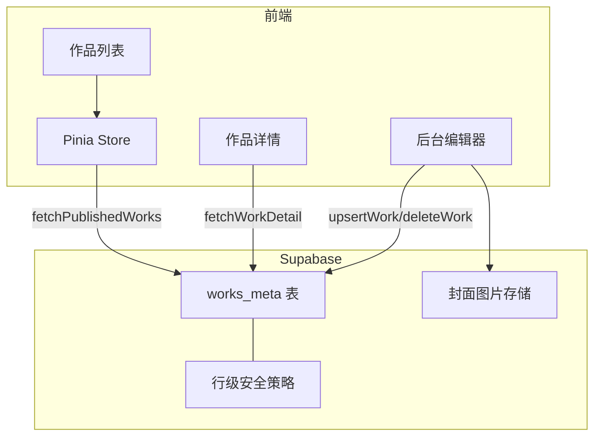
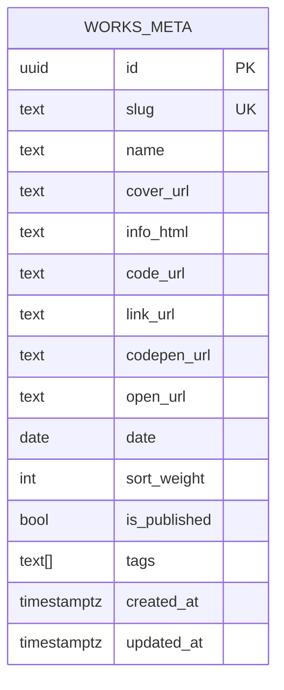
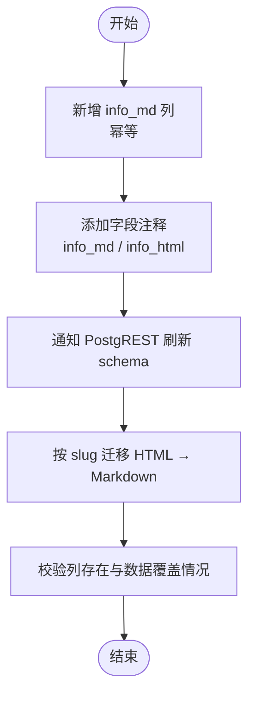
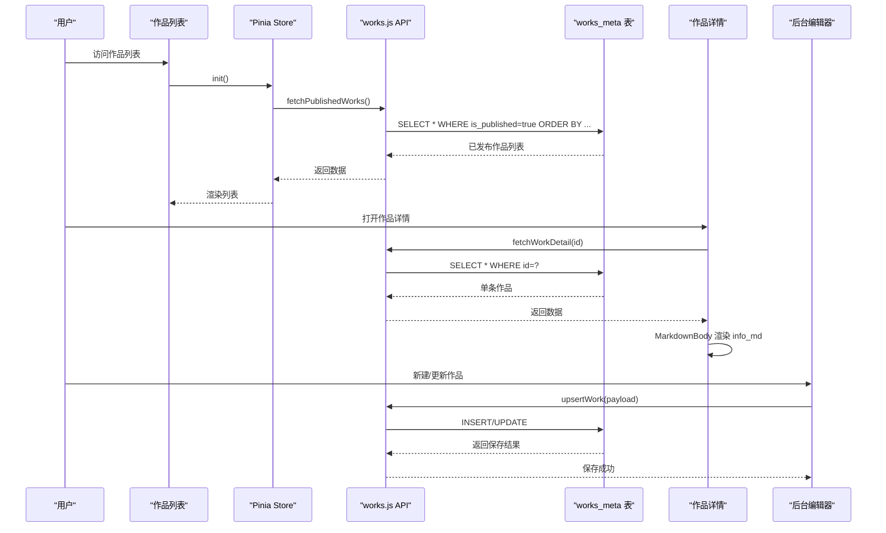
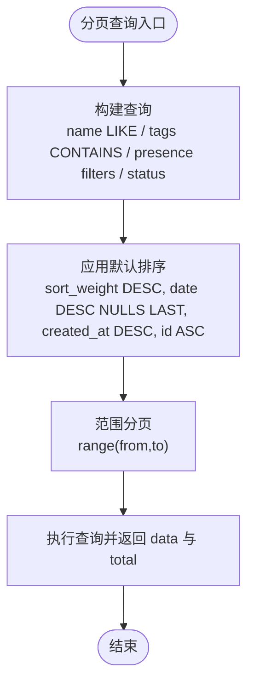
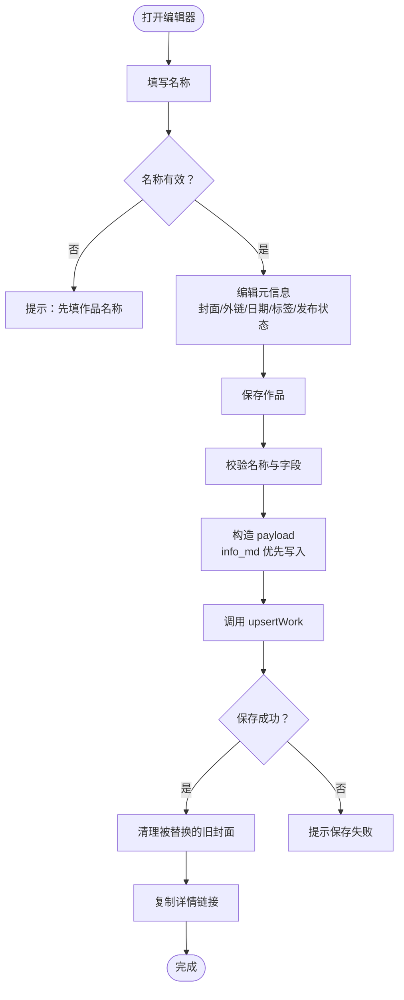
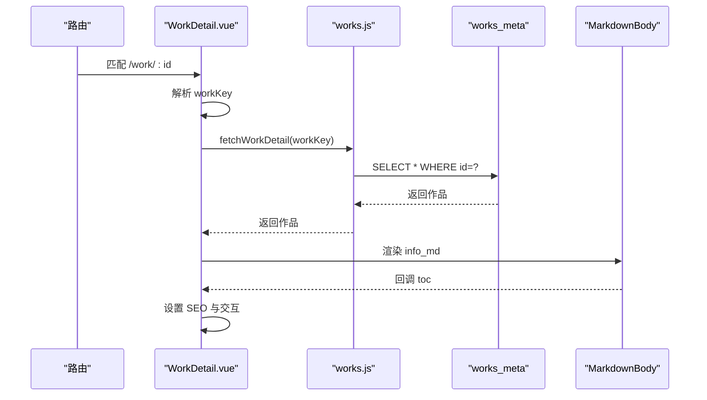
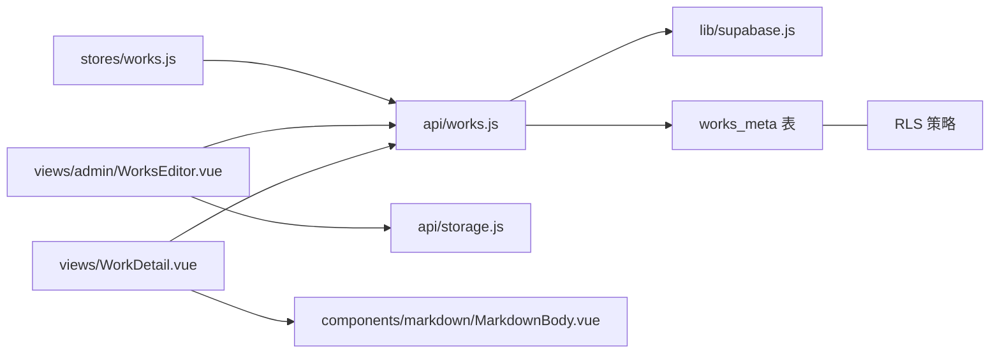

# 作品数据结构

<cite>
**本文引用的文件**   
- [sql/002-works-meta.sql](file://sql/002-works-meta.sql)
- [sql/002b-works-meta-comments.sql](file://sql/002b-works-meta-comments.sql)
- [sql/003-seed-works-meta.sql](file://sql/003-seed-works-meta.sql)
- [sql/004-works-info-md.sql](file://sql/004-works-info-md.sql)
- [sql/005-migrate-info-md.sql](file://sql/005-migrate-info-md.sql)
- [src/api/works.js](file://src/api/works.js)
- [src/stores/works.js](file://src/stores/works.js)
- [src/views/admin/WorksEditor.vue](file://src/views/admin/WorksEditor.vue)
- [src/views/WorkDetail.vue](file://src/views/WorkDetail.vue)
- [README.md](file://README.md)
</cite>

## 目录
1. [引言](#引言)
2. [项目结构](#项目结构)
3. [核心数据模型](#核心数据模型)
4. [架构总览](#架构总览)
5. [详细组件分析](#详细组件分析)
6. [依赖关系分析](#依赖关系分析)
7. [性能与查询优化](#性能与查询优化)
8. [导入导出与迁移策略](#导入导出与迁移策略)
9. [故障排查指南](#故障排查指南)
10. [结论](#结论)

## 引言
本文围绕“作品数据模型”展开，重点说明 `works_meta` 表的结构设计、字段语义、约束与索引策略；解释 `info_md` Markdown 正文的存储方式及其与元数据的关系；梳理作品的业务规则、状态管理、版本迁移和数据完整性约束；并给出分类标签、关联资源扩展字段的演进建议、查询优化方案以及导入导出和迁移策略。文档同时结合前端 API、Store、后台编辑器和详情页渲染流程，帮助读者从系统层面理解作品数据的完整生命周期。

## 项目结构
本项目采用 Vue 3 + Supabase 的前后端分离模式：数据库层由 SQL 脚本定义，后端通过 Supabase 提供认证、数据库访问与行级安全（RLS），前端通过 API 封装调用数据库接口，并在 Store 中合并本地静态数据与线上数据。

图表来源
- [src/api/works.js:45-67](file://src/api/works.js#L45-L67)
- [src/stores/works.js:12-25](file://src/stores/works.js#L12-L25)
- [src/views/admin/WorksEditor.vue:516-566](file://src/views/admin/WorksEditor.vue#L516-L566)
- [src/views/WorkDetail.vue:68-93](file://src/views/WorkDetail.vue#L68-L93)

章节来源
- [README.md:37-67](file://README.md#L37-L67)

## 核心数据模型
### works_meta 表结构与字段语义
`works_meta` 是作品元数据主表，承载作品的展示标题、封面、外链、排序权重、发布日期、标签、发布状态和时间戳等运营态字段。其核心字段如下：

- id：UUID 主键，自动生成，用于详情页路由标识。
- slug：唯一字符串，作为路由标识，需与前端路由 path 一致才能关联到对应演示组件或外部链接。
- name：显示标题，用于卡片和详情页标题。
- cover_url：封面图 URL，支持外链或后续迁移至 Supabase Storage。
- info_html：历史 HTML 正文，已废弃但保留为回滚备份。
- code_url：GitHub 代码地址。
- link_url：文章或外部链接地址。
- codepen_url：CodePen 在线代码地址。
- open_url：直接打开的外部 demo 或线上站点地址。
- date：发布日期，用于排序和卡片日期显示。
- sort_weight：排序权重，数值越大越靠前。
- is_published：是否发布，控制匿名用户可见性。
- tags：文本数组，用于分类标签筛选。
- created_at / updated_at：创建时间和更新时间，updated_at 由触发器自动更新。

此外，表启用了行级安全（RLS）策略，限制匿名用户仅能读取已发布记录，登录用户可读取全部记录，管理员可增删改。

图表来源
- [sql/002-works-meta.sql:7-23](file://sql/002-works-meta.sql#L7-L23)
- [sql/002b-works-meta-comments.sql:18-50](file://sql/002b-works-meta-comments.sql#L18-L50)

章节来源
- [sql/002-works-meta.sql:7-23](file://sql/002-works-meta.sql#L7-L23)
- [sql/002b-works-meta-comments.sql:18-50](file://sql/002b-works-meta-comments.sql#L18-L50)

### info_md 列与 Markdown 内容存储
`info_md` 是在 `works_meta` 表中新增的 Markdown 正文列，用于替代已废弃的 `info_html`。该列类型为文本，注释明确其为详情页唯一渲染来源，使用 markdown-it 渲染，开启换行处理。迁移脚本 `005-migrate-info-md.sql` 将历史 HTML 正文转换为 Markdown，并逐条按 slug 回填。

- 新增列：幂等执行，已有列时跳过。
- 注释：标注 info_md 用途及 info_html 废弃状态。
- 迁移：按 slug 精确更新，保留 info_html 作为回滚备份。
- 校验：提供统计查询以确认列添加成功和数据迁移情况。

图表来源
- [sql/004-works-info-md.sql:14-28](file://sql/004-works-info-md.sql#L14-L28)
- [sql/004-works-info-md.sql:30-41](file://sql/004-works-info-md.sql#L30-L41)
- [sql/005-migrate-info-md.sql:21-27](file://sql/005-migrate-info-md.sql#L21-L27)

章节来源
- [sql/004-works-info-md.sql:14-28](file://sql/004-works-info-md.sql#L14-L28)
- [sql/004-works-info-md.sql:30-41](file://sql/004-works-info-md.sql#L30-L41)
- [sql/005-migrate-info-md.sql:21-27](file://sql/005-migrate-info-md.sql#L21-L27)

## 架构总览
作品数据在前端通过 Pinia Store 统一加载，公开页面读取已发布作品，后台管理读取全部作品并进行增删改。详情页根据路由参数获取单条作品，并使用 MarkdownBody 组件渲染 info_md。封面图片上传与删除通过 Supabase Storage 完成，删除作品时会尝试清理旧封面。

图表来源
- [src/stores/works.js:12-25](file://src/stores/works.js#L12-L25)
- [src/api/works.js:45-67](file://src/api/works.js#L45-L67)
- [src/api/works.js:169-195](file://src/api/works.js#L169-L195)
- [src/views/WorkDetail.vue:68-93](file://src/views/WorkDetail.vue#L68-L93)
- [src/views/admin/WorksEditor.vue:516-566](file://src/views/admin/WorksEditor.vue#L516-L566)

## 详细组件分析
### 作品列表与分页查询
API 提供已发布作品列表、全量作品列表、分页查询、统计信息、单条查询、新增/更新、批量排序更新和删除等功能。默认排序遵循权重降序、日期降序、创建时间降序、id 升序，确保分页稳定。

- 已发布列表：过滤 is_published=true，供公开页面使用。
- 全量列表：供后台管理使用。
- 分页查询：支持搜索 name、多选标签 AND 过滤、封面/日期/外链配置状态筛选、发布/草稿状态筛选。
- 统计信息：轻量字段聚合，计算总数、已发布数、有封面数、有外链数。
- 单条查询：按 id 查询，非 UUID 直接视为不存在以避免类型错误。
- 新增/更新：无 id 插入时自动分配 sort_weight；有 id 则更新。
- 批量排序：拖拽排序后批量更新 sort_weight。
- 删除：先删记录再尝试清理封面文件。

图表来源
- [src/api/works.js:115-140](file://src/api/works.js#L115-L140)
- [src/api/works.js:25-38](file://src/api/works.js#L25-L38)

章节来源
- [src/api/works.js:45-67](file://src/api/works.js#L45-L67)
- [src/api/works.js:115-140](file://src/api/works.js#L115-L140)
- [src/api/works.js:146-162](file://src/api/works.js#L146-L162)
- [src/api/works.js:169-195](file://src/api/works.js#L169-L195)
- [src/api/works.js:203-232](file://src/api/works.js#L203-L232)
- [src/api/works.js:240-249](file://src/api/works.js#L240-L249)
- [src/api/works.js:256-267](file://src/api/works.js#L256-L267)

### 后台编辑器与表单验证
后台编辑器负责作品元数据与 Markdown 正文的编辑、预览、封面上传、标签管理和发布状态切换。关键逻辑包括：

- 名称必填：未填写名称时提示并阻止保存。
- Markdown 正文：info_md 为空且存在 info_html 时提示先运行迁移脚本。
- 封面上传：支持点击选择与拖拽上传，上传成功后替换旧封面并记录待清理 URL。
- 标签管理：支持逗号分隔输入、去重、退格删除。
- 发布状态：开关控制 is_published，影响前台可见性。
- 保存流程：构造 payload，调用 upsertWork，成功后关闭弹框、清理旧封面、复制详情链接。

图表来源
- [src/views/admin/WorksEditor.vue:476-485](file://src/views/admin/WorksEditor.vue#L476-L485)
- [src/views/admin/WorksEditor.vue:516-566](file://src/views/admin/WorksEditor.vue#L516-L566)
- [src/views/admin/WorksEditor.vue:344-363](file://src/views/admin/WorksEditor.vue#L344-L363)
- [src/views/admin/WorksEditor.vue:388-402](file://src/views/admin/WorksEditor.vue#L388-L402)

章节来源
- [src/views/admin/WorksEditor.vue:318-331](file://src/views/admin/WorksEditor.vue#L318-L331)
- [src/views/admin/WorksEditor.vue:476-485](file://src/views/admin/WorksEditor.vue#L476-L485)
- [src/views/admin/WorksEditor.vue:516-566](file://src/views/admin/WorksEditor.vue#L516-L566)

### 详情页渲染与 Markdown 正文
详情页根据路由参数解析作品 key，调用 API 获取单条作品，然后使用 MarkdownBody 组件渲染 info_md。若作品不存在，显示 404 页面并提供返回按钮。

- 路由参数解码：兼容路径含斜杠的情况。
- 外链打开：优先使用 open_url。
- 目录生成：MarkdownBody 渲染完成后回调 toc 列表。
- SEO 设置：动态设置页面标题与描述。

图表来源
- [src/views/WorkDetail.vue:40-51](file://src/views/WorkDetail.vue#L40-L51)
- [src/views/WorkDetail.vue:68-93](file://src/views/WorkDetail.vue#L68-L93)
- [src/views/WorkDetail.vue:295-297](file://src/views/WorkDetail.vue#L295-L297)

章节来源
- [src/views/WorkDetail.vue:40-51](file://src/views/WorkDetail.vue#L40-L51)
- [src/views/WorkDetail.vue:68-93](file://src/views/WorkDetail.vue#L68-L93)
- [src/views/WorkDetail.vue:295-297](file://src/views/WorkDetail.vue#L295-L297)

## 依赖关系分析
- 前端 Store 依赖 API 封装，API 封装依赖 Supabase 客户端。
- 后台编辑器依赖 API 的 upsertWork 与 storage 的 uploadCover/deleteCoverByUrl。
- 详情页依赖 API 的 fetchWorkDetail 与 MarkdownBody 组件。
- 数据库层依赖 RLS 策略与触发器自动更新时间戳。

图表来源
- [src/stores/works.js:1-28](file://src/stores/works.js#L1-L28)
- [src/api/works.js:1-12](file://src/api/works.js#L1-L12)
- [src/views/admin/WorksEditor.vue:288-294](file://src/views/admin/WorksEditor.vue#L288-L294)
- [src/views/WorkDetail.vue:1-16](file://src/views/WorkDetail.vue#L1-L16)

章节来源
- [src/stores/works.js:1-28](file://src/stores/works.js#L1-L28)
- [src/api/works.js:1-12](file://src/api/works.js#L1-L12)
- [src/views/admin/WorksEditor.vue:288-294](file://src/views/admin/WorksEditor.vue#L288-L294)
- [src/views/WorkDetail.vue:1-16](file://src/views/WorkDetail.vue#L1-L16)

## 性能与查询优化
### 索引策略
- 默认排序索引：基于 sort_weight DESC、date DESC NULLS LAST、created_at DESC，提升列表页与分页查询性能。
- slug 唯一索引：针对已发布记录的 slug 查找，加速按 slug 定位作品。

建议：
- 对 tags 数组进行 GIN 索引以提升 contains 查询性能。
- 对 name 字段建立全文检索索引（如 pg_trgm）以优化模糊搜索。
- 对 cover_url 与外链字段建立选择性索引，便于统计与筛选。

章节来源
- [sql/002-works-meta.sql:66-70](file://sql/002-works-meta.sql#L66-L70)
- [sql/002b-works-meta-comments.sql:52-56](file://sql/002b-works-meta-comments.sql#L52-L56)

### 查询优化建议
- 列表页使用默认排序与分页，避免 OFFSET 深翻页导致的性能问题。
- 统计接口只选择轻量字段，减少数据传输。
- 搜索与标签筛选在服务端完成，避免前端二次过滤。
- 详情页按需加载，避免一次性拉取大量正文内容。

章节来源
- [src/api/works.js:25-38](file://src/api/works.js#L25-L38)
- [src/api/works.js:146-162](file://src/api/works.js#L146-L162)
- [src/api/works.js:115-140](file://src/api/works.js#L115-L140)

## 导入导出与迁移策略
### 初始数据导入
初始数据通过 `003-seed-works-meta.sql` 导入，包含多条作品的 slug、name、cover_url、info_html、外链、date、sort_weight、is_published 与 tags。导入前按 slug 清理已有记录，防止重复。

章节来源
- [sql/003-seed-works-meta.sql:7-63](file://sql/003-seed-works-meta.sql#L7-L63)
- [sql/003-seed-works-meta.sql:63-284](file://sql/003-seed-works-meta.sql#L63-L284)

### Markdown 正文迁移
迁移脚本 `005-migrate-info-md.sql` 将 info_html 转换为 info_md，转换规则包括行内代码、链接、加粗、换行与转义字符处理。每条记录按 slug 精确更新，保留 info_html 作为回滚备份。

章节来源
- [sql/005-migrate-info-md.sql:1-19](file://sql/005-migrate-info-md.sql#L1-L19)
- [sql/005-migrate-info-md.sql:21-27](file://sql/005-migrate-info-md.sql#L21-L27)

### 导出格式建议
- 元数据导出：JSON 或 CSV，包含 id、slug、name、cover_url、code_url、link_url、codepen_url、open_url、date、sort_weight、is_published、tags、created_at、updated_at。
- 正文导出：info_md 单独导出为 Markdown 文件，文件名与 slug 对应，便于版本管理与离线编辑。
- 封面导出：按作品 id 下载封面图片，命名规则 works/<id>.<ext>。

[本节为通用建议，不直接分析具体文件]

## 故障排查指南
### 常见问题与处理
- 详情页无法加载：检查路由参数是否为合法 UUID，非 UUID 会被视为不存在。
- 列表页重复或漏行：确认默认排序包含唯一列 id，避免并列行顺序不确定。
- 保存失败：检查名称是否为空、RLS 权限是否满足管理员条件。
- 封面删除失败：删除作品后尝试清理封面，失败仅告警不影响删除结果。
- Markdown 正文为空：若仅有 info_html，提示先运行迁移脚本。

章节来源
- [src/api/works.js:169-195](file://src/api/works.js#L169-L195)
- [src/api/works.js:256-267](file://src/api/works.js#L256-L267)
- [src/views/admin/WorksEditor.vue:476-485](file://src/views/admin/WorksEditor.vue#L476-L485)
- [src/views/admin/WorksEditor.vue:452-465](file://src/views/admin/WorksEditor.vue#L452-L465)

## 结论
`works_meta` 表作为作品数据的核心载体，提供了完整的元数据字段、严格的 RLS 安全策略与合理的索引设计。`info_md` 列的引入使 Markdown 成为详情页的唯一渲染来源，配合迁移脚本实现平滑过渡。前端 API、Store、编辑器与详情页共同构成了作品数据的完整生命周期，从创建、编辑、发布到展示与分享。通过合理的索引与查询优化，系统在数据量增长时仍能保持良好性能。未来可扩展标签规范化、外链校验、正文版本控制与更完善的导入导出工具，进一步提升数据质量与运维效率。