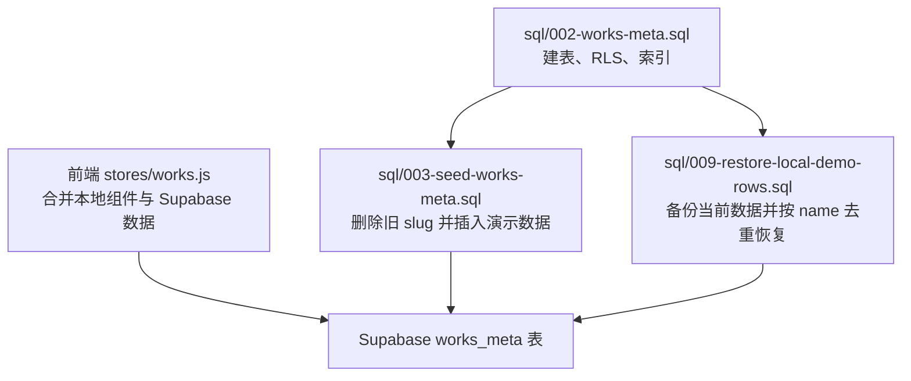
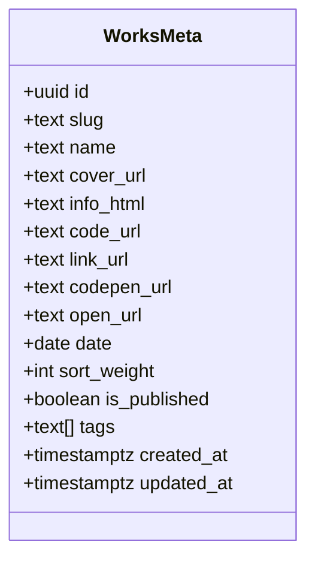
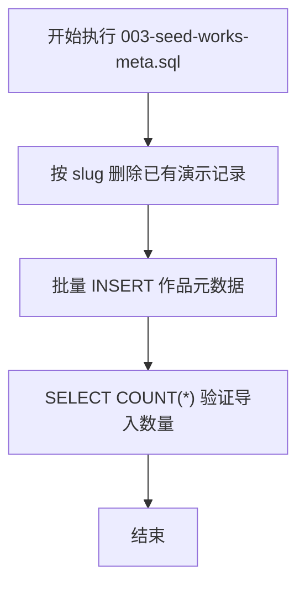
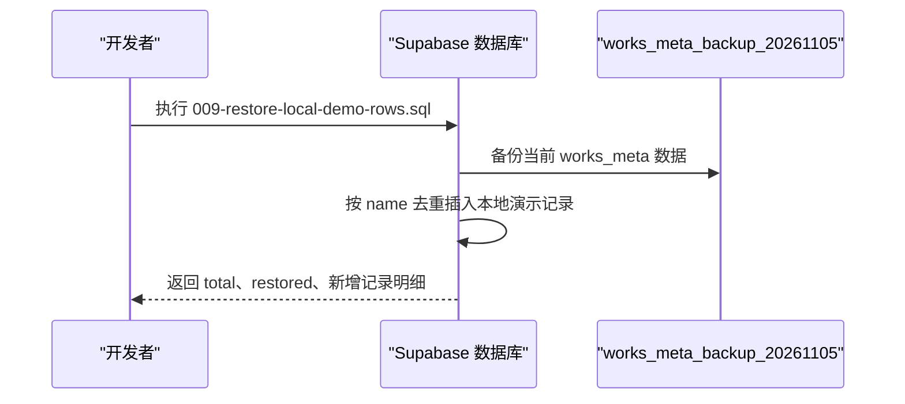
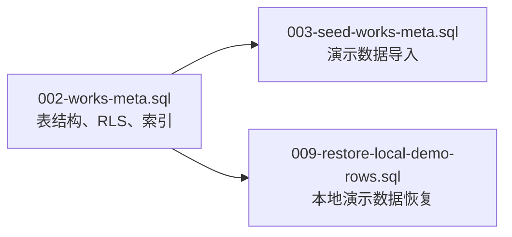
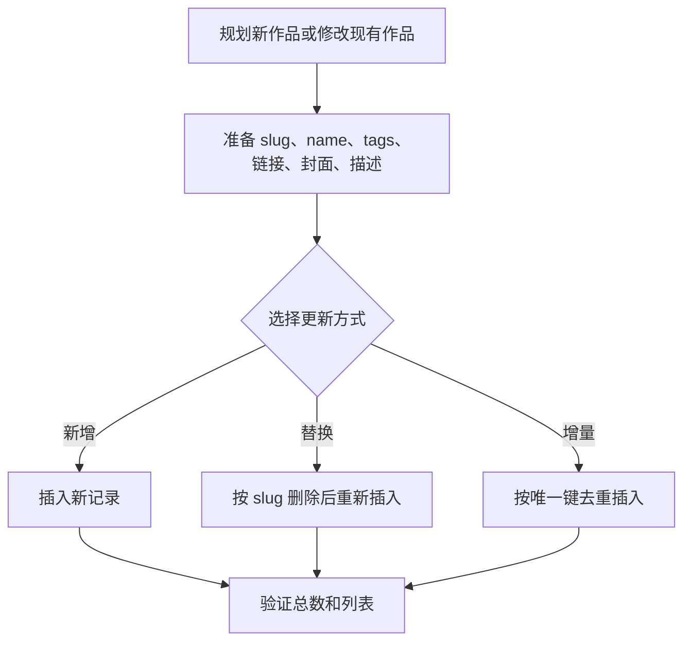

# 初始数据脚本

<cite>
**本文引用的文件**   
- [README.md](file://README.md)
- [002-works-meta.sql](file://sql/002-works-meta.sql)
- [003-seed-works-meta.sql](file://sql/003-seed-works-meta.sql)
- [009-restore-local-demo-rows.sql](file://sql/009-restore-local-demo-rows.sql)
</cite>

## 目录
1. [引言](#引言)
2. [项目结构与数据脚本总览](#项目结构与数据脚本总览)
3. [种子数据的作用与用途](#种子数据的作用与用途)
4. [works_meta 表结构与元数据含义](#works_meta-表结构与元数据含义)
5. [works_meta 种子数据结构与内容说明](#works_meta-种子数据结构与内容说明)
6. [本地演示数据恢复脚本使用方法](#本地演示数据恢复脚本使用方法)
7. [数据脚本执行顺序与依赖关系](#数据脚本执行顺序与依赖关系)
8. [版本管理与部署指导](#版本管理与部署指导)
9. [数据备份与恢复最佳实践](#数据备份与恢复最佳实践)
10. [自定义与扩展现有种子数据](#自定义与扩展现有种子数据)
11. [常见问题排查](#常见问题排查)
12. [结论](#结论)

## 引言
本文件面向需要初始化、维护或迁移作品展示站点数据库的开发者与维护者，重点说明 `sql` 目录中的初始数据脚本。文档会解释：
- 为什么需要种子数据；
- `works_meta` 表如何承载作品的运营态元数据；
- 如何导入演示数据；
- 如何恢复误删的本地演示记录；
- 脚本之间的执行顺序和依赖；
- 如何在版本控制中管理这些脚本；
- 如何进行安全的数据备份与恢复；
- 如何扩展新的种子数据。

## 项目结构与数据脚本总览
仓库采用前端工程结构，数据库相关脚本集中在 `sql` 目录。与初始数据直接相关的核心脚本包括：
- `002-works-meta.sql`：创建 `works_meta` 表、触发器、行级安全策略和索引；
- `003-seed-works-meta.sql`：清理并批量插入 `works_meta` 的演示元数据；
- `009-restore-local-demo-rows.sql`：在特定历史问题后，按名称去重恢复本地演示作品记录。

**图表来源**
- [002-works-meta.sql:1-76](file://sql/002-works-meta.sql#L1-L76)
- [003-seed-works-meta.sql:1-284](file://sql/003-seed-works-meta.sql#L1-L284)
- [009-restore-local-demo-rows.sql:1-371](file://sql/009-restore-local-demo-rows.sql#L1-L371)

**章节来源**
- [README.md:37-67](file://README.md#L37-L67)
- [README.md:115-132](file://README.md#L115-L132)

## 种子数据的作用与用途
种子数据在本项目中有三个主要作用：

1. **演示数据准备**  
   通过 `003-seed-works-meta.sql` 向 `works_meta` 表注入大量示例作品，使站点在首次部署后就能展示丰富的动画、CSS、GSAP、SVG、Three.js 等效果。

2. **测试数据准备**  
   种子数据包含多种标签、封面图、外部链接、发布日期和排序权重，可用于验证列表渲染、搜索、排序、发布状态过滤、后台管理等功能。

3. **本地开发体验保障**  
   当线上迁移脚本或清理逻辑导致本地演示数据丢失时，`009-restore-local-demo-rows.sql` 可以安全恢复本地演示记录，避免每次重新搭建环境都手动录入。

从整体架构看，前端会通过 Supabase 读取已发布的 `works_meta` 记录，并与本地组件数据合并，最终生成作品列表。因此，种子数据直接影响前台展示内容和后台管理体验。

**章节来源**
- [README.md:8-8](file://README.md#L8-L8)
- [README.md:82-113](file://README.md#L82-L113)
- [003-seed-works-meta.sql:1-5](file://sql/003-seed-works-meta.sql#L1-L5)
- [009-restore-local-demo-rows.sql:1-21](file://sql/009-restore-local-demo-rows.sql#L1-L21)

## works_meta 表结构与元数据含义
`works_meta` 是作品展示站点的核心运营数据表。它把原本可能放在前端配置中的作品信息迁移到数据库，便于后台管理和动态更新。

| 字段 | 类型 | 含义 |
| --- | --- | --- |
| `id` | uuid | 主键，详情页路由使用 |
| `slug` | text | 路由标识，用于区分不同作品 |
| `name` | text | 作品显示标题 |
| `cover_url` | text | 封面图地址 |
| `info_html` | text | 富文本介绍（HTML） |
| `code_url` | text | GitHub 代码地址 |
| `link_url` | text | 文章或外部链接地址 |
| `codepen_url` | text | CodePen 在线代码地址 |
| `open_url` | text | 直接打开的外部 demo 地址 |
| `date` | date | 发布日期 |
| `sort_weight` | int | 排序权重，越大越靠前 |
| `is_published` | boolean | 是否发布 |
| `tags` | text[] | 分类标签数组 |
| `created_at` | timestamptz | 创建时间 |
| `updated_at` | timestamptz | 更新时间，由触发器自动维护 |

此外，该表还启用了行级安全策略：
- 匿名用户只能查询已发布的记录；
- 已登录用户可读取所有记录；
- 管理员才能进行新增、修改、删除操作。

同时创建了常用查询索引，例如按排序权重、日期和 slug 优化查询性能。

**图表来源**
- [002-works-meta.sql:7-23](file://sql/002-works-meta.sql#L7-L23)
- [002-works-meta.sql:31-70](file://sql/002-works-meta.sql#L31-L70)

**章节来源**
- [002-works-meta.sql:1-76](file://sql/002-works-meta.sql#L1-L76)
- [README.md:115-132](file://README.md#L115-L132)

## works_meta 种子数据结构与内容说明
`003-seed-works-meta.sql` 是主要的种子数据脚本。它的核心流程是：
1. 先按 `slug` 删除已有演示记录，防止重复导入；
2. 批量插入约 53 条作品元数据；
3. 最后统计总数用于验证导入结果。

每条种子记录通常包含以下信息：
- `slug`：以 `/anime/`、`/cssHtml/`、`/gsap/`、`/other/`、`/svg/`、`/three/` 等前缀组织；
- `name`：作品标题；
- `cover_url`：封面图 URL；
- `info_html`：HTML 形式的作品介绍，包含知识点说明、实现思路、参考链接等；
- `code_url` / `link_url` / `codepen_url` / `open_url`：不同场景的外部链接；
- `date`：发布日期；
- `sort_weight`：排序权重；
- `is_published`：是否发布；
- `tags`：标签数组，如 `anime`、`cssHtml`、`gsap`、`scrollTrigger`、`svg`、`filter`、`three`、`webgl` 等。

从内容上看，种子数据覆盖多个技术方向：
- **anime 系列**：文字切割、波浪文字、礼花彩带等动画效果；
- **cssHtml 系列**：磨砂玻璃、碰撞检测、mask 遮罩、tailwindcss 使用、背景网格、文字进度等；
- **gsap 系列**：Draggable、ScrollTrigger、视差、数字加载、探照灯、水滴按钮、视觉差等；
- **other 系列**：Canvas 波浪、粒子浮层、Slidev、富文本编辑器、抽奖、拖拽滑块、鼠标交互、音频播放等；
- **svg 系列**：文字环绕、波纹、褶皱纸张、粘性小球、运动模糊等；
- **three/webgl 系列**：置换贴图实现的玻璃效果切换。

**图表来源**
- [003-seed-works-meta.sql:7-62](file://sql/003-seed-works-meta.sql#L7-L62)
- [003-seed-works-meta.sql:63-284](file://sql/003-seed-works-meta.sql#L63-L284)

**章节来源**
- [003-seed-works-meta.sql:1-284](file://sql/003-seed-works-meta.sql#L1-L284)

## 本地演示数据恢复脚本使用方法
`009-restore-local-demo-rows.sql` 是为修复历史问题而设计的恢复脚本。其背景是：某个清理脚本误删了本地 demo 作品记录，导致数据库中只剩少量记录。该脚本的目标是恢复本地演示数据，同时保证：
- 幂等：按 `name` 去重，重复执行不会产生重复行；
- 可回滚：执行前先备份当前数据到 `works_meta_backup_20261105`；
- 不影响现有记录：只做新增，不更新已有行。

### 推荐操作流程
1. 在 Supabase Dashboard 的 SQL Editor 中打开 `009-restore-local-demo-rows.sql`；
2. 整段执行；
3. 查看脚本末尾的校验结果：
   - `total`：恢复后的总记录数；
   - `restored`：本次新增的记录数；
   - 新增记录的 `name`、`date`、`tags` 列表。

### 注意事项
- 恢复后的部分记录没有 `open_url`，因此前台列表中的“打开内容”图标可能不会出现；
- 如果后续需要回滚，可以通过对比备份表删除新增记录；
- 该脚本不会覆盖已经存在的同名作品。

**图表来源**
- [009-restore-local-demo-rows.sql:23-36](file://sql/009-restore-local-demo-rows.sql#L23-L36)
- [009-restore-local-demo-rows.sql:27-360](file://sql/009-restore-local-demo-rows.sql#L27-L360)
- [009-restore-local-demo-rows.sql:362-371](file://sql/009-restore-local-demo-rows.sql#L362-L371)

**章节来源**
- [009-restore-local-demo-rows.sql:1-371](file://sql/009-restore-local-demo-rows.sql#L1-L371)

## 数据脚本执行顺序与依赖关系
数据脚本之间存在明确的依赖关系，建议按编号顺序执行：

1. **先执行结构脚本**  
   `002-works-meta.sql` 必须最先执行，因为它负责：
   - 创建 `works_meta` 表；
   - 设置 `updated_at` 自动更新触发器；
   - 启用并配置行级安全策略；
   - 创建常用索引。

2. **再执行种子数据脚本**  
   `003-seed-works-meta.sql` 依赖 `works_meta` 表存在，否则会因表不存在而失败。

3. **按需执行恢复脚本**  
   `009-restore-local-demo-rows.sql` 也依赖 `works_meta` 表存在，并且会在执行时创建备份表。

**图表来源**
- [002-works-meta.sql:1-76](file://sql/002-works-meta.sql#L1-L76)
- [003-seed-works-meta.sql:1-5](file://sql/003-seed-works-meta.sql#L1-L5)
- [009-restore-local-demo-rows.sql:1-21](file://sql/009-restore-local-demo-rows.sql#L1-L21)

**章节来源**
- [002-works-meta.sql:1-76](file://sql/002-works-meta.sql#L1-L76)
- [003-seed-works-meta.sql:1-284](file://sql/003-seed-works-meta.sql#L1-L284)
- [009-restore-local-demo-rows.sql:1-371](file://sql/009-restore-local-demo-rows.sql#L1-L371)

## 版本管理与部署指导
### 版本管理建议
- 将 `sql` 目录视为数据库迁移和种子数据的版本化资产；
- 保持脚本文件名编号递增，体现执行顺序；
- 对破坏性变更（如清空数据、删除列）增加注释说明原因和影响；
- 对恢复类脚本明确标注幂等性和回滚方式；
- 在提交记录中说明新增了哪些演示作品、修正了哪些字段或链接。

### 部署指导
- 新环境部署时，优先执行 `002-works-meta.sql`；
- 如果需要演示数据，再执行 `003-seed-works-meta.sql`；
- 如果发现本地演示数据缺失，再执行 `009-restore-local-demo-rows.sql`；
- 生产环境应谨慎执行含 `DELETE` 或全量重建逻辑的脚本；
- 建议在 Supabase Dashboard 的 SQL Editor 中逐段执行，确认结果后再继续。

### 与前端的关系
前端通过 Supabase 读取 `works_meta` 表，并将数据库数据与本地组件数据合并。因此，数据库脚本变更后，前端无需重新构建即可看到新的作品元数据，但可能需要刷新页面或重新进入列表页。

**章节来源**
- [README.md:82-113](file://README.md#L82-L113)
- [README.md:191-210](file://README.md#L191-L210)

## 数据备份与恢复最佳实践
### 备份策略
- 在执行任何可能影响数据的脚本前，先备份 `works_meta` 表；
- 可使用类似 `CREATE TABLE works_meta_backup AS SELECT * FROM works_meta;` 的方式保存快照；
- 对于重要环境，建议定期导出完整数据库或使用 Supabase 提供的备份能力；
- 对恢复类脚本，应保留备份表名和时间戳，便于定位问题。

### 恢复策略
- 优先使用幂等脚本，避免重复执行造成数据不一致；
- 恢复时先查看受影响行数，确认是否符合预期；
- 如果恢复后出现异常，可通过备份表比对差异；
- 对误删场景，应先恢复结构，再恢复数据，最后验证索引和权限。

### 安全建议
- 非管理员账号不应拥有删除或修改 `works_meta` 的权限；
- 生产环境执行脚本前应先在预发环境验证；
- 涉及外部链接、图片地址的种子数据，应定期巡检可用性；
- 对敏感信息（如内部链接、密钥）不要放入种子数据。

**章节来源**
- [009-restore-local-demo-rows.sql:23-36](file://sql/009-restore-local-demo-rows.sql#L23-L36)
- [009-restore-local-demo-rows.sql:362-371](file://sql/009-restore-local-demo-rows.sql#L362-L371)

## 自定义与扩展现有种子数据
如果你需要新增作品或调整现有演示数据，可以参考以下方法：

### 新增一条作品种子记录
1. 确定作品的 `slug`、`name`、`tags`；
2. 填写封面图、HTML 描述、外部链接；
3. 设置发布日期和排序权重；
4. 将 `is_published` 设为 `true`，以便前台可见；
5. 在合适的种子脚本中添加 `INSERT` 语句；
6. 执行脚本后检查总数和列表是否正常。

### 调整现有种子数据
- 如果希望覆盖式更新，可以先按 `slug` 删除对应记录，再重新插入；
- 如果希望只新增未存在的记录，可以使用按 `name` 或 `slug` 的去重逻辑；
- 修改 `info_html` 时注意 HTML 转义和链接有效性；
- 修改 `tags` 时注意标签一致性，便于筛选和统计。

### 扩展标签体系
- 可在 `tags` 数组中加入新标签，如 `vue`、`react`、`performance` 等；
- 前端若按标签筛选，需确保前端筛选逻辑支持新标签；
- 建议统一标签命名规范，避免同义标签分散。

### 与外部数据源配合
- 如果作品来自 CodePen、掘金、GitHub 或其他平台，应在 `codepen_url`、`link_url`、`code_url` 中补充真实地址；
- 如果作品有独立演示地址，应填写 `open_url`；
- 如果封面图资源迁移到 Supabase Storage，应同步更新 `cover_url`。

**图表来源**
- [003-seed-works-meta.sql:7-62](file://sql/003-seed-works-meta.sql#L7-L62)
- [003-seed-works-meta.sql:63-284](file://sql/003-seed-works-meta.sql#L63-L284)

**章节来源**
- [003-seed-works-meta.sql:1-284](file://sql/003-seed-works-meta.sql#L1-L284)

## 常见问题排查
### 执行 003-seed-works-meta.sql 时报表不存在
- 原因：未先执行 `002-works-meta.sql`；
- 解决：先执行建表脚本，再执行种子数据脚本。

### 执行后作品数量不符合预期
- 原因：之前已有部分 slug 被其他脚本处理过；
- 解决：检查是否重复执行，或是否存在脏数据；
- 建议：先按 slug 清理，再重新导入。

### 恢复脚本执行后仍有缺失记录
- 原因：恢复脚本按 `name` 去重，已存在的同名记录不会被覆盖；
- 解决：检查是否已有同名记录，必要时先清理或改名；
- 建议：结合备份表比对差异。

### 前台看不到新增作品
- 原因：`is_published` 为 `false`；
- 解决：将 `is_published` 设为 `true`；
- 注意：匿名用户只能看到已发布且未被隐藏的作品。

### 封面图或外链失效
- 原因：外部资源地址变更或删除；
- 解决：更新 `cover_url`、`code_url`、`link_url`、`codepen_url`、`open_url`；
- 建议：定期巡检种子数据中的外部链接。

**章节来源**
- [002-works-meta.sql:31-70](file://sql/002-works-meta.sql#L31-L70)
- [003-seed-works-meta.sql:7-62](file://sql/003-seed-works-meta.sql#L7-L62)
- [009-restore-local-demo-rows.sql:27-360](file://sql/009-restore-local-demo-rows.sql#L27-L360)

## 结论
本项目通过 `sql` 目录中的结构化脚本，实现了作品元数据的标准化存储、演示数据的一键初始化和本地环境的快速恢复。`002-works-meta.sql` 提供表结构和权限基础，`003-seed-works-meta.sql` 提供丰富的演示内容，`009-restore-local-demo-rows.sql` 提供安全的恢复能力。

在实际使用中，建议：
- 严格按编号顺序执行脚本；
- 变更前先备份；
- 使用幂等逻辑避免重复数据；
- 保持种子数据与前端展示逻辑一致；
- 对外部链接和资源地址进行定期维护。

这样既能保证本地开发和演示体验，也能在生产环境中安全、可控地管理作品数据。