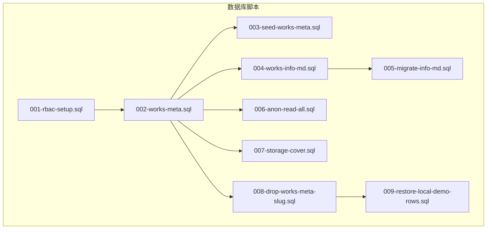
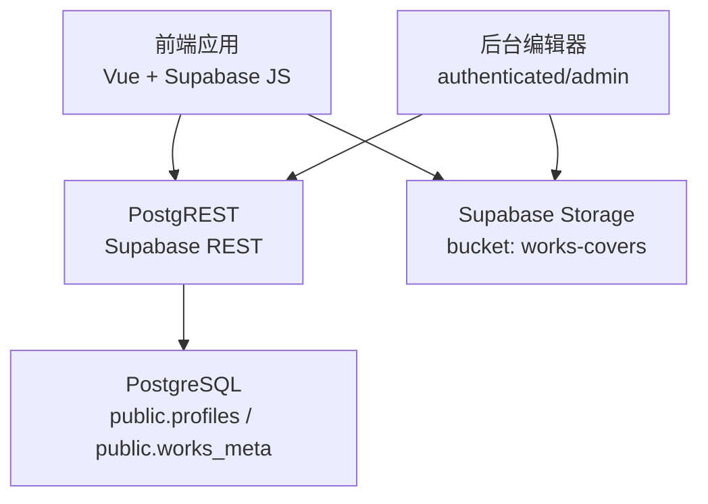
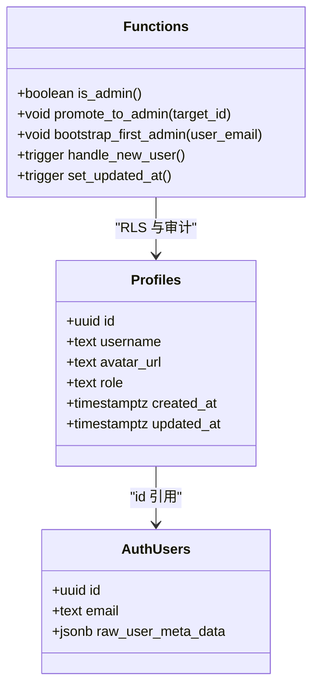
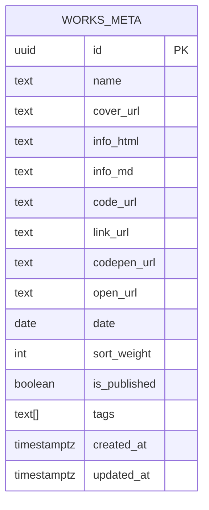
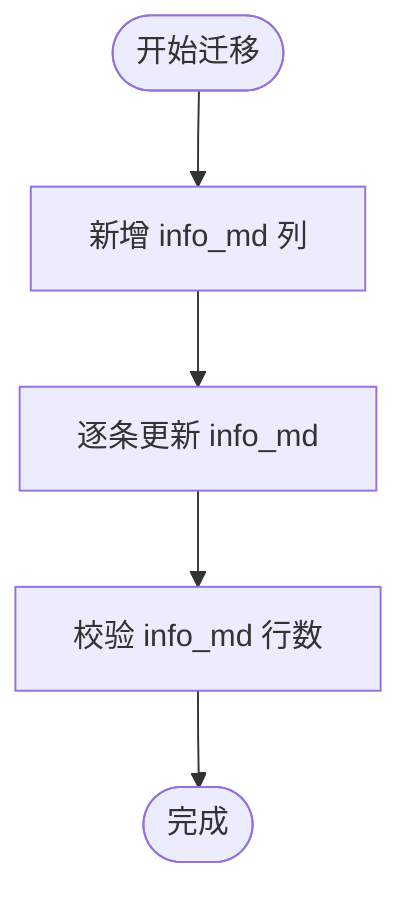
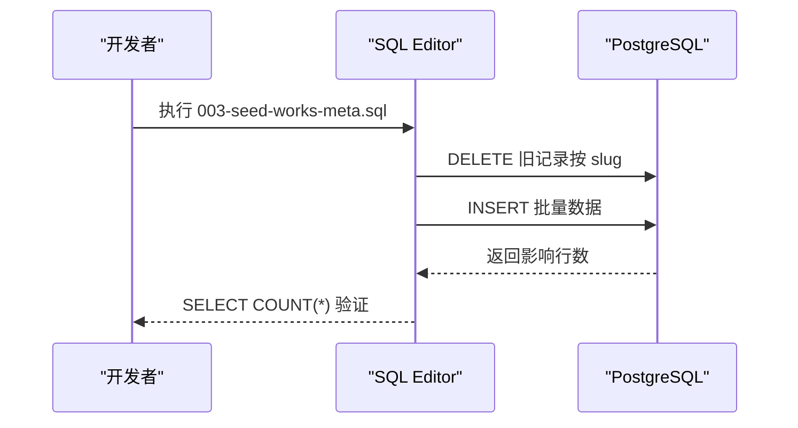
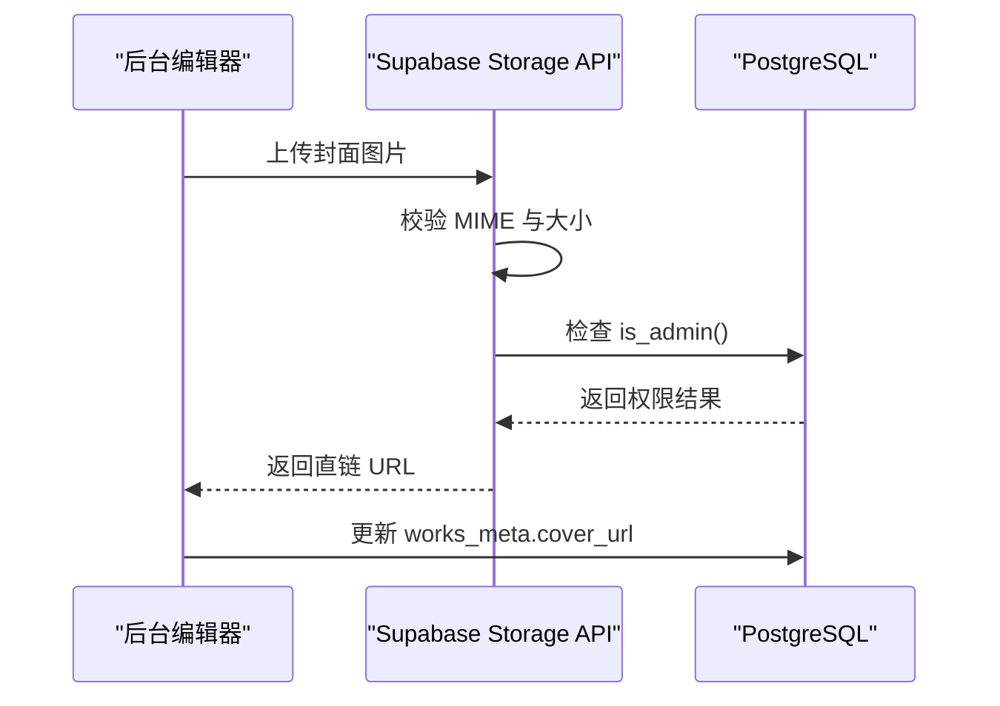
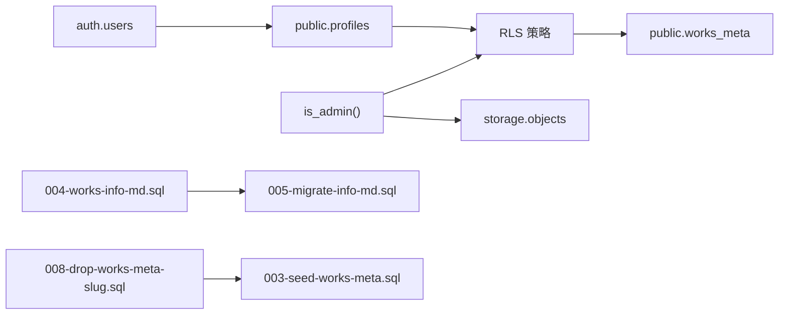
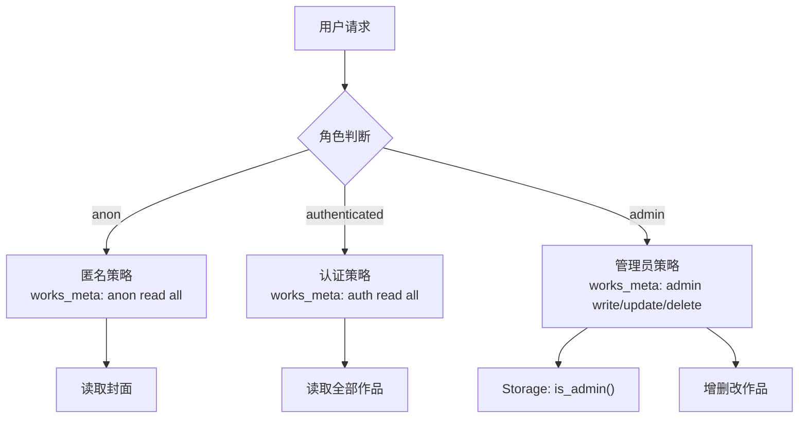

# 数据库设计

<cite>
**本文引用的文件**   
- [sql/001-rbac-setup.sql](file://sql/001-rbac-setup.sql)
- [sql/002-works-meta.sql](file://sql/002-works-meta.sql)
- [sql/003-seed-works-meta.sql](file://sql/003-seed-works-meta.sql)
- [sql/004-works-info-md.sql](file://sql/004-works-info-md.sql)
- [sql/005-migrate-info-md.sql](file://sql/005-migrate-info-md.sql)
- [sql/006-anon-read-all.sql](file://sql/006-anon-read-all.sql)
- [sql/007-storage-cover.sql](file://sql/007-storage-cover.sql)
- [sql/008-drop-works-meta-slug.sql](file://sql/008-drop-works-meta-slug.sql)
- [sql/009-restore-local-demo-rows.sql](file://sql/009-restore-local-demo-rows.sql)
</cite>

## 目录
1. [引言](#引言)
2. [项目结构](#项目结构)
3. [核心组件](#核心组件)
4. [架构总览](#架构总览)
5. [详细组件分析](#详细组件分析)
6. [依赖关系分析](#依赖关系分析)
7. [性能与查询优化](#性能与查询优化)
8. [安全策略与访问控制](#安全策略与访问控制)
9. [数据迁移与版本管理](#数据迁移与版本管理)
10. [备份恢复方案](#备份恢复方案)
11. [故障排查指南](#故障排查指南)
12. [结论](#结论)

## 引言
本技术文档面向 sunwenxu1997.github.io 的数据库设计与运维，聚焦以下目标：
- RBAC 权限模型：用户、角色、管理员提升与行级安全策略。
- 作品元数据表 works_meta：字段定义、约束、索引、RLS 策略与业务规则。
- 作品信息表演进：从 HTML 正文 info_html 到 Markdown 正文 info_md 的迁移路径。
- 初始数据与种子数据：seed 脚本结构与幂等性说明。
- 数据安全策略、访问控制与存储封面上传。
- 数据迁移与版本管理最佳实践。
- 性能优化与查询优化建议。

## 项目结构
数据库相关脚本集中在 sql 目录，按版本号顺序组织，体现清晰的迁移历史：
- 001：RBAC 初始化（profiles 表、触发器、RLS、admin 函数）。
- 002：作品元数据表 works_meta 建表、RLS、索引。
- 003：作品元数据种子数据导入。
- 004：新增 info_md 列并注释。
- 005：将 info_html 转写为 info_md。
- 006：放开匿名读取草稿（凭链接可见）。
- 007：Supabase Storage 封面 bucket 与策略。
- 008：删除 slug 列及关联索引/约束。
- 009：恢复本地 demo 误删记录。

**图表来源**
- [sql/001-rbac-setup.sql:1-128](file://sql/001-rbac-setup.sql#L1-L128)
- [sql/002-works-meta.sql:1-76](file://sql/002-works-meta.sql#L1-L76)
- [sql/003-seed-works-meta.sql:1-284](file://sql/003-seed-works-meta.sql#L1-L284)
- [sql/004-works-info-md.sql:1-41](file://sql/004-works-info-md.sql#L1-L41)
- [sql/005-migrate-info-md.sql:1-570](file://sql/005-migrate-info-md.sql#L1-L570)
- [sql/006-anon-read-all.sql:1-33](file://sql/006-anon-read-all.sql#L1-L33)
- [sql/007-storage-cover.sql:1-87](file://sql/007-storage-cover.sql#L1-L87)
- [sql/008-drop-works-meta-slug.sql:1-31](file://sql/008-drop-works-meta-slug.sql#L1-L31)
- [sql/009-restore-local-demo-rows.sql:1-371](file://sql/009-restore-local-demo-rows.sql#L1-L371)

**章节来源**
- [sql/001-rbac-setup.sql:1-128](file://sql/001-rbac-setup.sql#L1-L128)
- [sql/002-works-meta.sql:1-76](file://sql/002-works-meta.sql#L1-L76)

## 核心组件
- profiles 表：与 auth.users 一一对应，维护 username、avatar_url、role 等运营态属性。
- works_meta 表：作品元数据，包含 slug（已删除）、name、cover_url、info_html、info_md、code_url、link_url、codepen_url、open_url、date、sort_weight、is_published、tags、created_at、updated_at。
- Supabase Storage：bucket works-covers，用于封面图片上传与公开读取。
- RLS 策略：基于角色的细粒度访问控制，区分 anon、authenticated、admin。
- 辅助函数：is_admin()、promote_to_admin()、bootstrap_first_admin()、handle_new_user()、set_updated_at()。

**章节来源**
- [sql/001-rbac-setup.sql:8-16](file://sql/001-rbac-setup.sql#L8-L16)
- [sql/002-works-meta.sql:7-23](file://sql/002-works-meta.sql#L7-L23)
- [sql/007-storage-cover.sql:34-46](file://sql/007-storage-cover.sql#L34-L46)

## 架构总览
系统通过 Supabase Postgres 提供 REST API，前端通过 anon/publishable key 访问公开资源，后台通过 authenticated/admin 进行内容编辑；封面图片存储在 Supabase Storage 中，由 admin 上传，前台匿名可读取。

**图表来源**
- [sql/001-rbac-setup.sql:85-121](file://sql/001-rbac-setup.sql#L85-L121)
- [sql/002-works-meta.sql:31-70](file://sql/002-works-meta.sql#L31-L70)
- [sql/007-storage-cover.sql:48-75](file://sql/007-storage-cover.sql#L48-L75)

## 详细组件分析

### RBAC 权限模型
- profiles 表主键 id 外键引用 auth.users，确保用户身份一致性。
- role 字段限制为 user 或 admin，默认 user。
- 触发器 handle_new_user：注册时自动插入 profile，username 优先取 raw_user_meta_data.user_name/full_name，否则取 email 前缀。
- updated_at 自动更新触发器 set_updated_at。
- RLS 策略：
  - 任何已登录用户可读所有 profiles。
  - 用户只能更新自己的 profile，且不能自改 role 为 admin。
  - 仅 admin 可删除 profiles。
- 辅助函数：
  - is_admin()：判断当前用户是否为 admin。
  - promote_to_admin(target_id)：仅现有 admin 可调用，提升目标用户为 admin。
  - bootstrap_first_admin(user_email)：仅 service_role 可执行，用于首次管理员引导。

**图表来源**
- [sql/001-rbac-setup.sql:8-16](file://sql/001-rbac-setup.sql#L8-L16)
- [sql/001-rbac-setup.sql:18-53](file://sql/001-rbac-setup.sql#L18-L53)
- [sql/001-rbac-setup.sql:55-82](file://sql/001-rbac-setup.sql#L55-L82)
- [sql/001-rbac-setup.sql:85-121](file://sql/001-rbac-setup.sql#L85-L121)

**章节来源**
- [sql/001-rbac-setup.sql:8-16](file://sql/001-rbac-setup.sql#L8-L16)
- [sql/001-rbac-setup.sql:18-53](file://sql/001-rbac-setup.sql#L18-L53)
- [sql/001-rbac-setup.sql:55-82](file://sql/001-rbac-setup.sql#L55-L82)
- [sql/001-rbac-setup.sql:85-121](file://sql/001-rbac-setup.sql#L85-L121)

### 作品元数据表 works_meta
- 主键 id：uuid，默认 gen_random_uuid()。
- slug：曾作为路由标识，唯一索引，已在 008 删除。
- name：显示标题，必填。
- cover_url：封面图 URL，后续迁至 Supabase Storage。
- info_html：历史富文本介绍（HTML），已废弃但保留回滚。
- info_md：Markdown 正文，详情页唯一渲染来源。
- code_url、link_url、codepen_url、open_url：外部链接地址。
- date：发布日期。
- sort_weight：排序权重，越大越靠前。
- is_published：是否发布。
- tags：分类标签数组 text[]。
- created_at、updated_at：时间戳，updated_at 自动更新。

**图表来源**
- [sql/002-works-meta.sql:7-23](file://sql/002-works-meta.sql#L7-L23)
- [sql/004-works-info-md.sql:17-23](file://sql/004-works-info-md.sql#L17-L23)
- [sql/008-drop-works-meta-slug.sql:18-23](file://sql/008-drop-works-meta-slug.sql#L18-L23)

**章节来源**
- [sql/002-works-meta.sql:7-23](file://sql/002-works-meta.sql#L7-L23)
- [sql/004-works-info-md.sql:17-23](file://sql/004-works-info-md.sql#L17-L23)
- [sql/008-drop-works-meta-slug.sql:18-23](file://sql/008-drop-works-meta-slug.sql#L18-L23)

### 作品信息表演进：HTML 到 Markdown
- 004：新增 info_md 列，注释说明其为 Markdown 正文，html:false / breaks:true。
- 005：批量 update 将 info_html 内容转写为 info_md，保留 info_html 作为回滚备份。
- 转换规则：行内代码、链接、加粗、换行、转义字符处理，去除行首空白避免误判代码块。

**图表来源**
- [sql/004-works-info-md.sql:17-23](file://sql/004-works-info-md.sql#L17-L23)
- [sql/005-migrate-info-md.sql:23-563](file://sql/005-migrate-info-md.sql#L23-L563)

**章节来源**
- [sql/004-works-info-md.sql:17-23](file://sql/004-works-info-md.sql#L17-L23)
- [sql/005-migrate-info-md.sql:23-563](file://sql/005-migrate-info-md.sql#L23-L563)

### 初始数据与种子数据
- 003-seed-works-meta.sql：从本地 .vue 元数据提取约 53 条记录，按 slug 清理后批量插入。
- 字段包括 slug、name、cover_url、info_html、code_url、link_url、codepen_url、open_url、date、sort_weight、is_published、tags。
- 验证语句统计 total 行数。

**图表来源**
- [sql/003-seed-works-meta.sql:7-63](file://sql/003-seed-works-meta.sql#L7-L63)
- [sql/003-seed-works-meta.sql:283-284](file://sql/003-seed-works-meta.sql#L283-L284)

**章节来源**
- [sql/003-seed-works-meta.sql:7-63](file://sql/003-seed-works-meta.sql#L7-L63)
- [sql/003-seed-works-meta.sql:283-284](file://sql/003-seed-works-meta.sql#L283-L284)

### 封面存储与上传流程
- 007：创建 bucket works-covers，public=true，允许 jpg/png/webp/gif，文件大小上限 10MB。
- RLS 策略：
  - 公开读取：anon/authenticated 可 select。
  - 写入操作：仅 authenticated 且 is_admin() 可 insert/update/delete。
- 前端通过 src/api/storage.js 上传封面，getPublicUrl() 回填 cover_url。

**图表来源**
- [sql/007-storage-cover.sql:34-46](file://sql/007-storage-cover.sql#L34-L46)
- [sql/007-storage-cover.sql:48-75](file://sql/007-storage-cover.sql#L48-L75)

**章节来源**
- [sql/007-storage-cover.sql:34-46](file://sql/007-storage-cover.sql#L34-L46)
- [sql/007-storage-cover.sql:48-75](file://sql/007-storage-cover.sql#L48-L75)

## 依赖关系分析
- RBAC 依赖 auth.users 与 profiles 表，RLS 策略依赖 is_admin() 函数。
- works_meta 依赖 profiles.role 进行权限控制。
- Storage bucket 依赖 is_admin() 进行写入权限控制。
- 迁移脚本存在顺序依赖：004 必须在 005 之前执行；008 删除 slug 后不再重跑 003 seed。

**图表来源**
- [sql/001-rbac-setup.sql:85-121](file://sql/001-rbac-setup.sql#L85-L121)
- [sql/002-works-meta.sql:31-70](file://sql/002-works-meta.sql#L31-L70)
- [sql/007-storage-cover.sql:48-75](file://sql/007-storage-cover.sql#L48-L75)
- [sql/004-works-info-md.sql:1-12](file://sql/004-works-info-md.sql#L1-L12)
- [sql/008-drop-works-meta-slug.sql:1-8](file://sql/008-drop-works-meta-slug.sql#L1-L8)

**章节来源**
- [sql/001-rbac-setup.sql:85-121](file://sql/001-rbac-setup.sql#L85-L121)
- [sql/002-works-meta.sql:31-70](file://sql/002-works-meta.sql#L31-L70)
- [sql/007-storage-cover.sql:48-75](file://sql/007-storage-cover.sql#L48-L75)
- [sql/004-works-info-md.sql:1-12](file://sql/004-works-info-md.sql#L1-L12)
- [sql/008-drop-works-meta-slug.sql:1-8](file://sql/008-drop-works-meta-slug.sql#L1-L8)

## 性能与查询优化
- 索引策略：
  - idx_works_meta_sort：按 sort_weight desc、date desc nulls last、created_at desc 排序，优化列表页展示。
  - idx_works_meta_slug：针对 slug 的唯一索引（已随 008 删除）。
- 查询优化建议：
  - 列表查询使用 is_published=true 过滤，结合 sort_weight/date/created_at 索引。
  - 详情查询使用 id（uuid）主键，避免 slug 查找。
  - 标签筛选可使用 PostgreSQL 的 array 操作符，必要时考虑 gin 索引。
- 存储优化：
  - 封面图片建议使用 CDN 缓存，减少数据库压力。
  - 大体积 GIF 注意文件大小限制与带宽成本。

**章节来源**
- [sql/002-works-meta.sql:66-70](file://sql/002-works-meta.sql#L66-L70)
- [sql/007-storage-cover.sql:15-18](file://sql/007-storage-cover.sql#L15-L18)

## 安全策略与访问控制
- profiles RLS：
  - 已登录用户可读所有 profiles。
  - 用户仅能更新自身 profile，禁止自改 role。
  - 仅 admin 可删除 profiles。
- works_meta RLS：
  - 匿名仅读已发布记录（006 改为匿名可读全部，草稿凭链接可见）。
  - 已登录用户可读所有记录（便于后台管理）。
  - 仅 admin 可增删改。
- Storage RLS：
  - 公开读取 bucket 中的封面。
  - 仅 admin 可上传、覆盖、删除封面。

**图表来源**
- [sql/001-rbac-setup.sql:55-82](file://sql/001-rbac-setup.sql#L55-L82)
- [sql/002-works-meta.sql:31-70](file://sql/002-works-meta.sql#L31-L70)
- [sql/006-anon-read-all.sql:25-32](file://sql/006-anon-read-all.sql#L25-L32)
- [sql/007-storage-cover.sql:48-75](file://sql/007-storage-cover.sql#L48-L75)

**章节来源**
- [sql/001-rbac-setup.sql:55-82](file://sql/001-rbac-setup.sql#L55-L82)
- [sql/002-works-meta.sql:31-70](file://sql/002-works-meta.sql#L31-L70)
- [sql/006-anon-read-all.sql:25-32](file://sql/006-anon-read-all.sql#L25-L32)
- [sql/007-storage-cover.sql:48-75](file://sql/007-storage-cover.sql#L48-L75)

## 数据迁移与版本管理
- 迁移顺序：
  - 001 → 002 → 003 → 004 → 005 → 006 → 007 → 008 → 009。
- 幂等性：
  - 多数脚本支持重复执行（drop if exists + create）。
  - 003 seed 按 slug 清理后插入，避免重复。
  - 009 按 name 去重插入，不影响已有记录。
- 回滚策略：
  - 005 保留 info_html，可随时回滚。
  - 009 创建备份表 works_meta_backup_20261105，便于对照恢复。
- 注意事项：
  - 004 必须在 005 之前执行。
  - 008 删除 slug 后不再重跑 003 seed。
  - 006 修改匿名策略，影响草稿链接可见性。

**章节来源**
- [sql/004-works-info-md.sql:1-12](file://sql/004-works-info-md.sql#L1-L12)
- [sql/005-migrate-info-md.sql:1-19](file://sql/005-migrate-info-md.sql#L1-L19)
- [sql/008-drop-works-meta-slug.sql:1-8](file://sql/008-drop-works-meta-slug.sql#L1-L8)
- [sql/009-restore-local-demo-rows.sql:1-21](file://sql/009-restore-local-demo-rows.sql#L1-L21)

## 备份恢复方案
- 备份策略：
  - 使用 Supabase Dashboard 导出全量数据。
  - 关键迁移前创建快照表（如 009 的 works_meta_backup_20261105）。
- 恢复策略：
  - 对比备份表差异，选择性删除恢复的记录。
  - 利用 005 的 info_html 回滚 Markdown 正文。
- 自动化建议：
  - 定期任务备份数据库与 Storage。
  - 迁移脚本纳入 CI/CD，执行前后校验。

**章节来源**
- [sql/009-restore-local-demo-rows.sql:23-25](file://sql/009-restore-local-demo-rows.sql#L23-L25)
- [sql/009-restore-local-demo-rows.sql:362-370](file://sql/009-restore-local-demo-rows.sql#L362-L370)

## 故障排查指南
- 常见问题：
  - 匿名无法读取草稿：检查 006 策略是否生效。
  - 封面上传失败：确认 is_admin() 与 MIME 类型限制。
  - 详情页面 404：slug 已删除，改用 id 路由。
- 诊断步骤：
  - 查看 pg_policies 确认 RLS 策略。
  - 检查 storage.buckets 配置与 allowed_mime_types。
  - 验证 works_meta 列是否存在（information_schema.columns）。

**章节来源**
- [sql/006-anon-read-all.sql:1-23](file://sql/006-anon-read-all.sql#L1-L23)
- [sql/007-storage-cover.sql:77-86](file://sql/007-storage-cover.sql#L77-L86)
- [sql/008-drop-works-meta-slug.sql:25-30](file://sql/008-drop-works-meta-slug.sql#L25-L30)

## 结论
本数据库设计以 RBAC 为核心，结合 RLS 实现细粒度访问控制；works_meta 表承载作品元数据与信息正文，经历从 HTML 到 Markdown 的平滑迁移；Seed 数据与迁移脚本保证可重复性与可回滚性；Storage 封面上传与公开读取满足前台展示需求。建议在后续迭代中持续优化索引、监控查询性能，并完善备份恢复自动化流程。