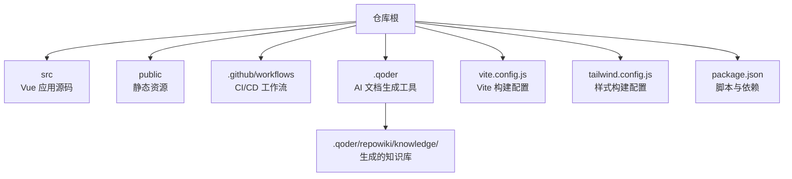
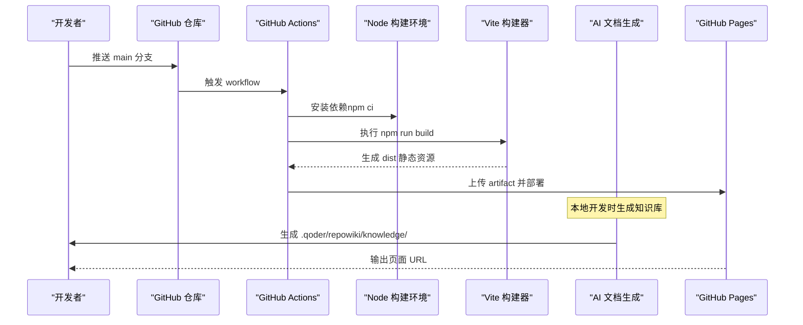
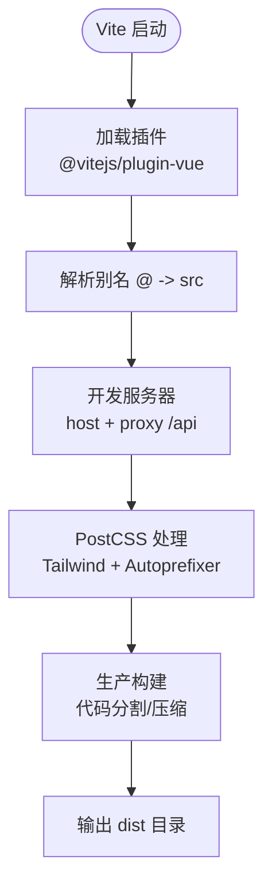
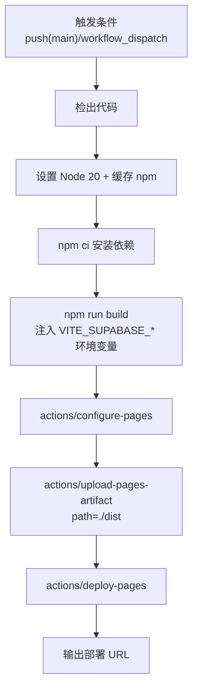
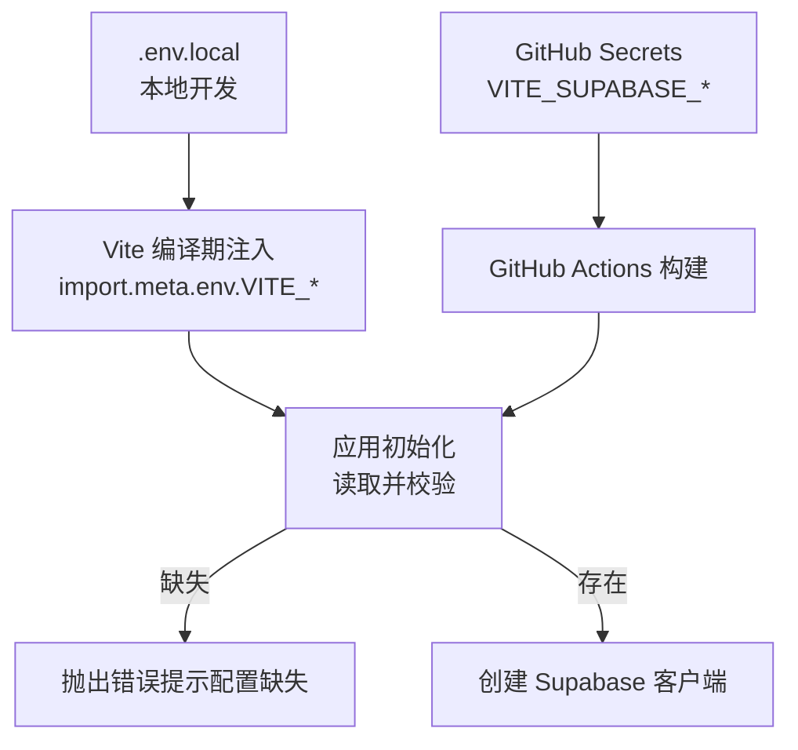
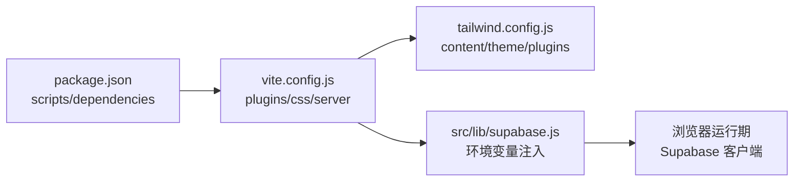
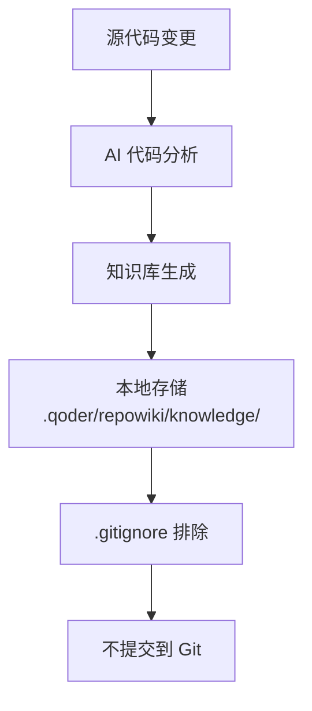

# 构建与部署

<cite>
**本文引用的文件**   
- [package.json](file://package.json)
- [vite.config.js](file://vite.config.js)
- [.github/workflows/main.yml](file://.github/workflows/main.yml)
- [tailwind.config.js](file://tailwind.config.js)
- [src/lib/supabase.js](file://src/lib/supabase.js)
- [README.md](file://README.md)
- [.gitignore](file://.gitignore)
</cite>

## 更新摘要
**变更内容**   
- 新增 AI 驱动文档生成工具的集成说明
- 更新 .gitignore 配置以排除 .qoder/repowiki/knowledge/ 目录
- 添加 AI 文档生成工具的工作流程说明
- 扩展构建配置以支持知识基自动生成功能

## 目录
1. [简介](#简介)
2. [项目结构](#项目结构)
3. [核心组件](#核心组件)
4. [架构总览](#架构总览)
5. [详细组件分析](#详细组件分析)
6. [依赖关系分析](#依赖关系分析)
7. [性能优化与缓存策略](#性能优化与缓存策略)
8. [AI 文档生成工具集成](#ai-文档生成工具集成)
9. [故障排除指南](#故障排除指南)
10. [结论](#结论)
11. [附录：环境变量与脚本速查](#附录环境变量与脚本速查)

## 简介
本技术文档面向 sunwenxu1997.github.io 的构建与部署，覆盖以下主题：
- Vite 构建配置（开发环境、生产打包、代码分割）
- GitHub Actions CI/CD 流水线与自动化部署
- 环境变量管理、构建脚本使用与发布最佳实践
- 性能优化、缓存策略与部署效果监控
- AI 驱动的文档生成工具集成
- 多平台适配方案与常见问题排查

该项目基于 Vue 3 + Vite + TailwindCSS，并通过 Supabase 提供认证与数据能力；最终产物为静态站点，托管于 GitHub Pages。同时集成了 AI 驱动的文档生成工具，用于从代码分析中自动生成知识库。

## 项目结构
仓库采用"功能域 + 工具库"的组织方式：
- src：前端源码（视图、组件、路由、状态、工具等）
- public：静态资源
- scripts：扩展脚本（当前为空）
- .github/workflows：GitHub Actions 工作流
- .qoder：AI 文档生成工具配置（包含知识库生成逻辑）
- 根级配置文件：Vite、Tailwind、ESLint、Prettier、TypeScript 等

图表来源
- [vite.config.js:1-31](file://vite.config.js#L1-L31)
- [tailwind.config.js:1-54](file://tailwind.config.js#L1-L54)
- [package.json:1-41](file://package.json#L1-L41)
- [.gitignore:23](file://.gitignore#L23)

章节来源
- [package.json:1-41](file://package.json#L1-L41)
- [vite.config.js:1-31](file://vite.config.js#L1-L31)
- [tailwind.config.js:1-54](file://tailwind.config.js#L1-L54)
- [.gitignore:23](file://.gitignore#L23)

## 核心组件
- 构建系统：Vite 4.x，插件 @vitejs/plugin-vue，PostCSS（Tailwind + Autoprefixer）
- 运行时：Vue 3、Pinia、Vue Router
- 后端/BaaS：Supabase（认证与数据库）
- AI 文档生成：Qoder Repowiki 工具，用于自动生成代码知识库
- 部署：GitHub Actions 自动构建并部署到 GitHub Pages

章节来源
- [README.md:12-25](file://README.md#L12-L25)
- [package.json:12-35](file://package.json#L12-L35)

## 架构总览
下图展示从代码提交到线上发布的端到端流程，以及关键构建产物与运行期依赖。

图表来源
- [.github/workflows/main.yml:1-55](file://.github/workflows/main.yml#L1-L55)
- [package.json:5-10](file://package.json#L5-L10)

## 详细组件分析

### Vite 构建配置
- 插件与别名
  - 启用 Vue 插件
  - 设置 @ 指向 src 目录，便于路径导入
- 开发服务器
  - 开启 host 模式（由脚本传入）
  - 代理 /api 到本地后端 http://localhost:9090，并重写路径前缀
- CSS 处理
  - PostCSS 集成 Tailwind 与 Autoprefixer
- 生产构建
  - 默认启用代码分割与压缩
  - 通过 import.meta.env 注入环境变量

图表来源
- [vite.config.js:1-31](file://vite.config.js#L1-L31)

章节来源
- [vite.config.js:1-31](file://vite.config.js#L1-L31)

### GitHub Actions CI/CD 流水线
- 触发条件
  - push 到 main 分支
  - 手动触发 workflow_dispatch
- 权限与并发
  - 读取仓库内容、写入 Pages、ID Token
  - 同一 group 下并发任务取消进行中任务
- 构建步骤
  - 检出代码
  - 设置 Node 20 并缓存 npm
  - 安装依赖（npm ci）
  - 构建（npm run build），注入 Supabase 环境变量
  - 配置 Pages、上传 artifact、部署到 GitHub Pages

图表来源
- [.github/workflows/main.yml:1-55](file://.github/workflows/main.yml#L1-L55)

章节来源
- [.github/workflows/main.yml:1-55](file://.github/workflows/main.yml#L1-L55)

### 环境变量管理
- 客户端可见变量
  - VITE_SUPABASE_URL
  - VITE_SUPABASE_PUBLISHABLE_KEY
- 使用位置
  - 应用初始化时读取并校验，缺失则抛出错误
- 本地开发
  - 在 .env.local 中配置（不提交到 Git）
- 构建与部署
  - 通过 GitHub Actions secrets 注入环境变量

图表来源
- [src/lib/supabase.js:1-16](file://src/lib/supabase.js#L1-L16)
- [.github/workflows/main.yml:36-41](file://.github/workflows/main.yml#L36-L41)
- [README.md:73-80](file://README.md#L73-L80)

章节来源
- [src/lib/supabase.js:1-16](file://src/lib/supabase.js#L1-L16)
- [.github/workflows/main.yml:36-41](file://.github/workflows/main.yml#L36-L41)
- [README.md:73-80](file://README.md#L73-L80)

### 构建脚本与发布流程
- 常用脚本
  - dev：启动开发服务器（host 模式）
  - build：生产构建
  - preview：预览构建产物
  - lint/format：代码检查与格式化
- 推荐发布流程
  - 本地完成开发与自测
  - 提交 main 分支，触发 GitHub Actions
  - 查看 Actions 日志定位问题
  - 访问 GitHub Pages 验证上线效果

章节来源
- [package.json:5-10](file://package.json#L5-L10)
- [README.md:213-243](file://README.md#L213-L243)

### 样式与资源构建
- Tailwind 配置
  - important 作用域限定至 #app
  - 关闭 preflight 避免与第三方 UI 冲突
  - content 白名单仅扫描必要文件，减小构建体积
- PostCSS
  - 集成 Tailwind 与 Autoprefixer
- 静态资源
  - public 下的资源直接复制到 dist

章节来源
- [tailwind.config.js:1-54](file://tailwind.config.js#L1-L54)
- [vite.config.js:25-29](file://vite.config.js#L25-L29)

## 依赖关系分析
- 构建链
  - package.json 脚本调用 Vite
  - Vite 加载 Vue 插件与 PostCSS 插件
  - Tailwind 根据 content 白名单生成样式
- 运行期依赖
  - Vue、Pinia、Vue Router
  - Supabase JS SDK（通过环境变量初始化）

图表来源
- [package.json:12-35](file://package.json#L12-L35)
- [vite.config.js:1-31](file://vite.config.js#L1-L31)
- [tailwind.config.js:1-54](file://tailwind.config.js#L1-L54)
- [src/lib/supabase.js:1-16](file://src/lib/supabase.js#L1-L16)

章节来源
- [package.json:12-35](file://package.json#L12-L35)
- [vite.config.js:1-31](file://vite.config.js#L1-L31)
- [tailwind.config.js:1-54](file://tailwind.config.js#L1-L54)
- [src/lib/supabase.js:1-16](file://src/lib/supabase.js#L1-L16)

## 性能优化与缓存策略
- 代码分割
  - Vite 默认按路由/动态导入进行代码分割，建议将大型第三方库按需引入或懒加载
- 资源缓存
  - 静态资源文件名包含哈希，浏览器可长期缓存
  - 建议在 CDN/边缘节点开启强缓存（如 Cache-Control: immutable）
- 构建体积
  - Tailwind content 白名单已缩小扫描范围
  - 可通过 tree-shaking 与按需引入减少包体
- 网络优化
  - 启用 Gzip/Brotli 压缩（GitHub Pages 默认支持）
  - 图片使用现代格式（WebP/AVIF）与响应式尺寸
- 监控与度量
  - 使用 Lighthouse 评估性能指标（FCP/LCP/CLS/TBT/INP）
  - 结合 Sentry/Plausible 等埋点监控用户行为与错误

[本节为通用指导，无需特定文件引用]

## AI 文档生成工具集成

### Qoder Repowiki 工具概述
项目集成了 Qoder Repowiki AI 驱动的文档生成工具，该工具能够：
- 自动分析代码结构和依赖关系
- 生成结构化的知识库文档
- 维护代码变更时的文档同步
- 提供智能的代码解释和注释生成

### 知识库目录结构
- `.qoder/repowiki/knowledge/`：存储生成的知识库文件
- 该目录被添加到 `.gitignore` 中，避免将生成的临时文件提交到版本控制
- 知识库文件在本地开发环境中自动生成和维护

### 工作流程

图表来源
- [.gitignore:23](file://.gitignore#L23)

### 配置与管理
- 知识库生成过程完全自动化
- 生成的文件不会污染版本控制系统
- 支持增量更新，只重新分析变更的代码部分
- 提供命令行接口进行手动触发和调试

### 最佳实践
- 定期清理过期的知识库文件
- 在团队协作中保持知识库的一致性
- 结合代码审查流程确保文档质量
- 利用 AI 生成的文档作为开发参考

章节来源
- [.gitignore:23](file://.gitignore#L23)

## 故障排除指南
- 构建失败
  - 检查 Node 版本是否满足要求（>=16，Actions 使用 20）
  - 清理 node_modules 后重新安装（npm ci）
  - 查看 Actions 日志中的具体报错信息
- 环境变量缺失
  - 本地：确认 .env.local 存在且包含 VITE_SUPABASE_URL 与 VITE_SUPABASE_PUBLISHABLE_KEY
  - 线上：确认 GitHub Secrets 已配置对应密钥
  - 应用启动时会校验并抛错，需优先修复
- 代理异常（开发）
  - 确认本地后端服务在 http://localhost:9090 运行
  - 检查代理重写规则是否正确
- 样式异常
  - 检查 Tailwind content 白名单是否包含新增组件路径
  - 注意 important 作用域与第三方 UI 的优先级冲突
- 部署失败
  - 检查 actions/upload-pages-artifact 与 actions/deploy-pages 的版本与权限
  - 确保 dist 目录存在且包含构建产物
- AI 文档生成问题
  - 确认 .qoder 目录权限正确
  - 检查是否有足够的磁盘空间存储生成的知识库
  - 清理 .qoder/repowiki/knowledge/ 目录后重新生成

章节来源
- [src/lib/supabase.js:6-8](file://src/lib/supabase.js#L6-L8)
- [.github/workflows/main.yml:27-55](file://.github/workflows/main.yml#L27-L55)
- [tailwind.config.js:14-26](file://tailwind.config.js#L14-L26)
- [vite.config.js:15-23](file://vite.config.js#L15-L23)
- [.gitignore:23](file://.gitignore#L23)

## 结论
本项目以 Vite 为核心构建工具，配合 GitHub Actions 实现一键构建与部署到 GitHub Pages。通过合理的环境变量管理、Tailwind 白名单与 PostCSS 管线，保证了开发体验与构建效率。在生产环境中，应关注代码分割、资源缓存与性能指标，持续优化用户体验与稳定性。

新增的 AI 文档生成工具进一步提升了项目的可维护性和文档质量，通过自动化的知识库生成减少了人工维护成本，同时保持了版本控制的简洁性。

[本节为总结性内容，无需特定文件引用]

## 附录：环境变量与脚本速查
- 环境变量
  - VITE_SUPABASE_URL
  - VITE_SUPABASE_PUBLISHABLE_KEY
- 脚本命令
  - npm run dev
  - npm run build
  - npm run preview
  - npm run lint
  - npm run format
- AI 文档相关
  - 本地自动生成的知识库位于 .qoder/repowiki/knowledge/
  - 知识库文件被 .gitignore 排除，不会提交到版本控制

章节来源
- [README.md:73-80](file://README.md#L73-L80)
- [package.json:5-10](file://package.json#L5-L10)
- [.gitignore:23](file://.gitignore#L23)