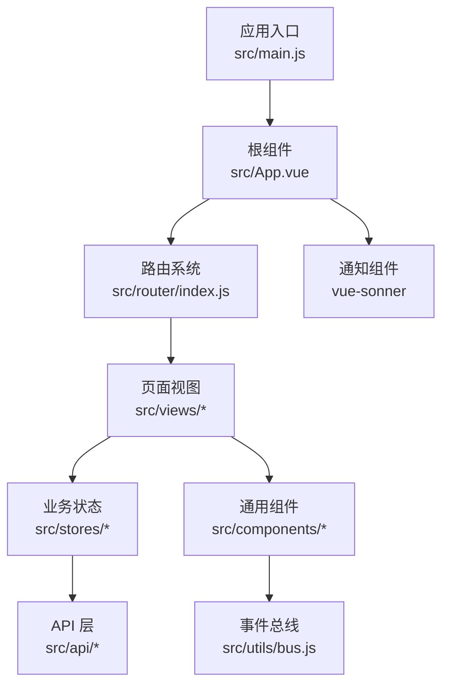
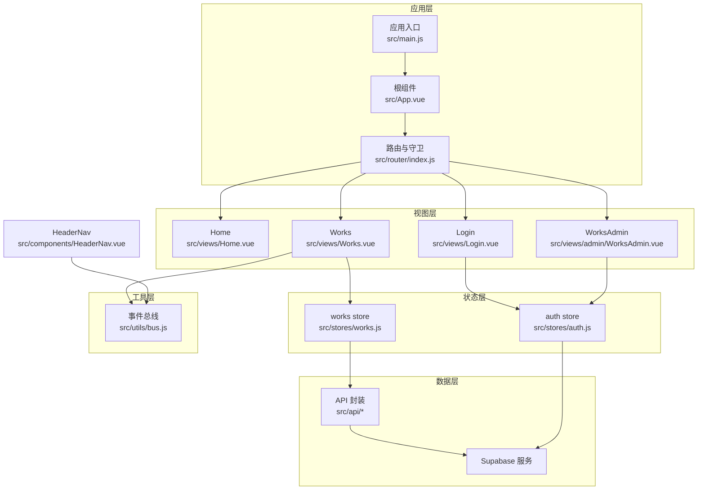
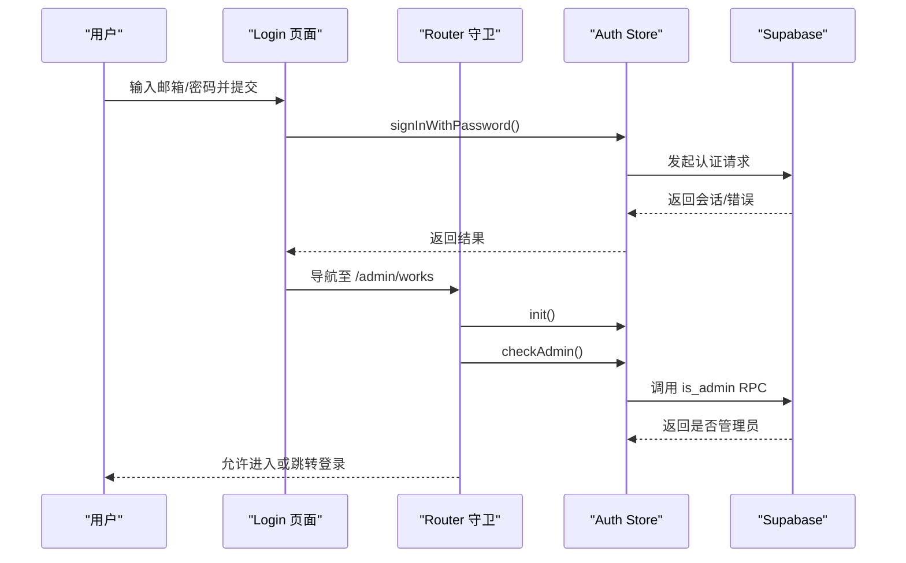
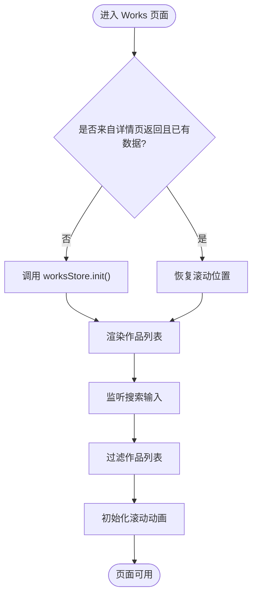
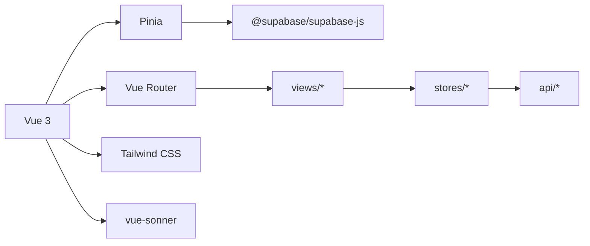

# 前端架构设计

<cite>
**本文引用的文件**   
- [src/main.js](file://src/main.js)
- [src/App.vue](file://src/App.vue)
- [src/router/index.js](file://src/router/index.js)
- [src/stores/auth.js](file://src/stores/auth.js)
- [src/stores/works.js](file://src/stores/works.js)
- [src/views/Home.vue](file://src/views/Home.vue)
- [src/views/Works.vue](file://src/views/Works.vue)
- [src/views/Login.vue](file://src/views/Login.vue)
- [src/views/admin/WorksAdmin.vue](file://src/views/admin/WorksAdmin.vue)
- [src/components/HeaderNav.vue](file://src/components/HeaderNav.vue)
- [src/utils/bus.js](file://src/utils/bus.js)
- [package.json](file://package.json)
</cite>

## 目录
1. [引言](#引言)
2. [项目结构](#项目结构)
3. [核心组件与分层](#核心组件与分层)
4. [架构总览](#架构总览)
5. [详细组件分析](#详细组件分析)
6. [依赖关系分析](#依赖关系分析)
7. [性能与体验优化](#性能与体验优化)
8. [故障排查指南](#故障排查指南)
9. [结论](#结论)

## 引言
本文件面向 sunwenxu1997.github.io 的前端架构，重点说明以下方面：
- Vue 3 组合式 API 的使用模式与最佳实践
- 组件组织与分层策略
- Pinia 状态管理设计，包括认证状态与作品数据
- Vue Router 路由配置、守卫、权限控制与页面缓存
- 组件通信模式：props、事件总线与适用场景
- 响应式设计与移动端适配方案
- 前端架构图与关键数据流向图

该文档以仓库实际代码为依据，避免臆测未实现的能力。

## 项目结构
项目采用基于功能分层的典型 Vue 3 + Vite 工程结构：
- src/api：后端接口封装（Supabase）
- src/assets：全局样式与 Markdown 样式
- src/components：可复用 UI 组件与图标
- src/lib：第三方 SDK 初始化（如 Supabase）
- src/router：路由定义与守卫
- src/stores：Pinia 状态模块
- src/utils：工具函数、事件总线、加载动画等
- src/views：页面级视图组件
- src/settings：站点配置常量

图表来源
- [src/main.js:16-39](file://src/main.js#L16-L39)
- [src/App.vue:1-26](file://src/App.vue#L1-L26)
- [src/router/index.js:1-73](file://src/router/index.js#L1-L73)

章节来源
- [src/main.js:1-40](file://src/main.js#L1-L40)
- [package.json:1-41](file://package.json#L1-L41)

## 核心组件与分层
### 应用启动与首屏体验
- 在应用入口中创建 Vue 应用、注册 Pinia 与 Router，并统一处理首屏加载流程：等待路由就绪、字体加载、首屏图片加载后挂载 DOM，最后结束遮罩。
- 使用 Hash 历史模式，便于静态托管部署。

章节来源
- [src/main.js:6-39](file://src/main.js#L6-L39)

### 根布局与页面缓存
- 根组件通过 RouterView 渲染页面，并使用 keep-alive 对标记了 keepAlive 的路由进行缓存。
- 通过读取路由元信息动态计算需要缓存的页面名称列表，保持声明式与集中化。

章节来源
- [src/App.vue:1-26](file://src/App.vue#L1-L26)
- [src/router/index.js:1-48](file://src/router/index.js#L1-L48)

### 路由与权限控制
- 路由采用懒加载，减少初始包体积。
- 为需要管理员权限的页面设置 requiresAdmin 元字段，并在 beforeEach 守卫中校验登录态与管理员身份；未授权时跳转登录页并提示。
- 支持 404 兜底路由。

章节来源
- [src/router/index.js:1-73](file://src/router/index.js#L1-L73)

### 认证状态管理（Pinia）
- auth store 维护用户对象、会话与加载状态，提供初始化、OAuth 登录、邮箱密码登录、注册、登出、管理员检查等方法。
- 订阅 Supabase 认证状态变化，自动同步 user/session。

章节来源
- [src/stores/auth.js:1-82](file://src/stores/auth.js#L1-L82)

### 作品数据管理（Pinia）
- works store 维护作品列表、加载与错误状态，提供 init 方法根据 settings.useLocalWorks 切换本地静态数据或远程接口。
- 对外暴露 loading/error 供视图展示骨架与错误提示。

章节来源
- [src/stores/works.js:1-29](file://src/stores/works.js#L1-L29)

### 页面与通用组件
- Home：首页视觉与鼠标动效，结合 GSAP 与 SVG 滤镜。
- Works：作品列表，支持搜索、视图切换、滚动动画、keep-alive 下滚动位置恢复。
- Login：邮箱密码登录表单，调用 auth store 完成登录并跳转后台。
- AdminWorks：后台主容器，包含侧边抽屉、统计面板、编辑器与列表子组件。
- HeaderNav：顶部导航，含移动端菜单、搜索输入与跨组件搜索广播。

章节来源
- [src/views/Home.vue:1-86](file://src/views/Home.vue#L1-L86)
- [src/views/Works.vue:1-394](file://src/views/Works.vue#L1-L394)
- [src/views/Login.vue:1-339](file://src/views/Login.vue#L1-L339)
- [src/views/admin/WorksAdmin.vue:1-263](file://src/views/admin/WorksAdmin.vue#L1-L263)
- [src/components/HeaderNav.vue:1-235](file://src/components/HeaderNav.vue#L1-L235)

## 架构总览
下图展示了从入口到页面、状态、API 的整体交互关系，以及关键的外部依赖。

图表来源
- [src/main.js:16-39](file://src/main.js#L16-L39)
- [src/App.vue:1-26](file://src/App.vue#L1-L26)
- [src/router/index.js:1-73](file://src/router/index.js#L1-L73)
- [src/stores/auth.js:1-82](file://src/stores/auth.js#L1-L82)
- [src/stores/works.js:1-29](file://src/stores/works.js#L1-L29)
- [src/views/Works.vue:1-394](file://src/views/Works.vue#L1-L394)
- [src/views/Login.vue:1-339](file://src/views/Login.vue#L1-L339)
- [src/views/admin/WorksAdmin.vue:1-263](file://src/views/admin/WorksAdmin.vue#L1-L263)
- [src/components/HeaderNav.vue:1-235](file://src/components/HeaderNav.vue#L1-L235)
- [src/utils/bus.js:1-15](file://src/utils/bus.js#L1-L15)

## 详细组件分析

### 认证流程与权限控制
- 登录流程：Login 页面提交邮箱密码，调用 auth store 的登录方法，成功后跳转到后台管理页。
- 权限控制：访问 /admin/works 前，路由守卫先初始化认证状态，再校验 isAuthenticated 与 checkAdmin；不满足则跳转登录并提示。
- 会话同步：auth store 订阅 Supabase 认证状态变化，自动更新 user/session，保证多标签页与外部回调后的状态一致性。

图表来源
- [src/views/Login.vue:122-143](file://src/views/Login.vue#L122-L143)
- [src/stores/auth.js:37-43](file://src/stores/auth.js#L37-L43)
- [src/stores/auth.js:59-66](file://src/stores/auth.js#L59-L66)
- [src/router/index.js:51-70](file://src/router/index.js#L51-L70)

章节来源
- [src/views/Login.vue:95-143](file://src/views/Login.vue#L95-L143)
- [src/stores/auth.js:1-82](file://src/stores/auth.js#L1-L82)
- [src/router/index.js:51-70](file://src/router/index.js#L51-L70)

### 作品列表与详情导航
- 数据来源：works store.init 根据 settings.useLocalWorks 决定走本地静态数据还是远程接口。
- 列表交互：支持搜索过滤、视图切换（list/grid）、滚动入场动画、回到顶部、聊天机器人入口。
- 详情页跳转：点击封面或标题跳转到 /work/:id，外部链接在新窗口打开。
- 缓存与滚动：Works 页面开启 keepAlive，onActivated 中恢复滚动位置并重建 ScrollTrigger；离开时保存滚动位置。

图表来源
- [src/views/Works.vue:47-70](file://src/views/Works.vue#L47-L70)
- [src/views/Works.vue:115-149](file://src/views/Works.vue#L115-L149)
- [src/stores/works.js:12-25](file://src/stores/works.js#L12-L25)

章节来源
- [src/views/Works.vue:1-394](file://src/views/Works.vue#L1-L394)
- [src/stores/works.js:1-29](file://src/stores/works.js#L1-L29)

### 后台管理主容器
- 角色与统计：显示当前管理员头像、邮箱、作品统计卡片。
- 编辑与列表：通过 v-show 切换编辑器与列表，分别维护各自滚动位置，避免切回时丢失。
- 操作反馈：保存、发布/取消发布、删除等操作通过 toast 提示，并局部刷新列表与统计，避免整页重拉。

章节来源
- [src/views/admin/WorksAdmin.vue:1-263](file://src/views/admin/WorksAdmin.vue#L1-L263)

### 顶部导航与搜索广播
- 导航逻辑：根据当前路由决定是否显示导航，移动端支持抽屉菜单与滚动锁定。
- 搜索广播：HeaderNav 中的搜索输入通过事件总线向 Works 页面广播 searchInput 事件，Works 页面订阅并更新本地搜索值。

章节来源
- [src/components/HeaderNav.vue:1-235](file://src/components/HeaderNav.vue#L1-L235)
- [src/utils/bus.js:1-15](file://src/utils/bus.js#L1-L15)
- [src/views/Works.vue:47-50](file://src/views/Works.vue#L47-L50)

## 依赖关系分析
- 运行时依赖：Vue 3、Vue Router、Pinia、Supabase JS、GSAP、Tailwind CSS、Markdown-it、Shiki、Mitt、Lucide 图标、vue-sonner。
- 构建工具：Vite，ESLint/Prettier 规范。

图表来源
- [package.json:12-23](file://package.json#L12-L23)
- [src/main.js:6-11](file://src/main.js#L6-L11)

章节来源
- [package.json:1-41](file://package.json#L1-L41)

## 性能与体验优化
- 首屏加载优化：
  - 等待路由 chunk 加载完成后再继续后续资源加载，避免白屏时间过长。
  - 等待字体与首屏图片加载完成后才结束遮罩，提升感知速度。
- 路由懒加载：所有页面组件按需引入，减小初始包体。
- 页面缓存：对高频访问的列表页启用 keep-alive，减少重复渲染与请求。
- 滚动与动画：
  - 在 onActivated 中恢复滚动位置并重建 ScrollTrigger，避免 keep-alive 导致的状态错乱。
  - 列表项进入视口时依次淡入，提升浏览体验。
- 视图模式持久化：将列表视图模式保存到 localStorage，提升用户习惯一致性。

章节来源
- [src/main.js:16-39](file://src/main.js#L16-L39)
- [src/App.vue:8-21](file://src/App.vue#L8-L21)
- [src/views/Works.vue:47-70](file://src/views/Works.vue#L47-L70)
- [src/views/Works.vue:118-128](file://src/views/Works.vue#L118-L128)

## 故障排查指南
- 无法进入后台管理页：
  - 检查路由守卫是否正确初始化认证状态并校验管理员权限。
  - 确认 Supabase is_admin RPC 是否正常返回。
- 登录后仍被跳转：
  - 检查 auth store 的 session/user 是否已正确同步。
  - 确认 signOut 后是否清空了本地状态。
- 列表页返回后滚动位置丢失：
  - 确认 onActivated/onDeactivated 中滚动位置保存与恢复逻辑是否执行。
  - 检查 keep-alive 的 include 列表是否包含该路由 name。
- 搜索无效果：
  - 检查 HeaderNav 是否通过事件总线发出 searchInput 事件。
  - 检查 Works 页面是否正确订阅并更新搜索值。

章节来源
- [src/router/index.js:51-70](file://src/router/index.js#L51-L70)
- [src/stores/auth.js:12-27](file://src/stores/auth.js#L12-L27)
- [src/stores/auth.js:50-57](file://src/stores/auth.js#L50-L57)
- [src/views/Works.vue:47-70](file://src/views/Works.vue#L47-L70)
- [src/components/HeaderNav.vue:119-128](file://src/components/HeaderNav.vue#L119-L128)
- [src/utils/bus.js:6-14](file://src/utils/bus.js#L6-L14)

## 结论
本项目采用清晰的三层架构：视图层负责交互与展示，状态层通过 Pinia 统一管理认证与作品数据，数据层通过 API 封装与 Supabase 交互。路由守卫承担权限控制，keep-alive 与滚动位置恢复保障用户体验。组件间通信以 props 为主，辅以事件总线解决跨层级非父子通信。整体结构简洁、职责明确，适合持续迭代与维护。