# 数据流模式

<cite>
**本文引用的文件**   
- [src/main.js](file://src/main.js)
- [src/lib/supabase.js](file://src/lib/supabase.js)
- [src/settings.js](file://src/settings.js)
- [src/api/works.js](file://src/api/works.js)
- [src/api/works.local.js](file://src/api/works.local.js)
- [src/api/storage.js](file://src/api/storage.js)
- [src/stores/auth.js](file://src/stores/auth.js)
- [src/stores/works.js](file://src/stores/works.js)
- [src/utils/bus.js](file://src/utils/bus.js)
- [src/views/Home.vue](file://src/views/Home.vue)
- [src/views/Works.vue](file://src/views/Works.vue)
- [src/views/WorkDetail.vue](file://src/views/WorkDetail.vue)
</cite>

## 目录
1. [引言](#引言)
2. [项目结构与数据层边界](#项目结构与数据层边界)
3. [核心数据流](#核心数据流)
4. [架构总览](#架构总览)
5. [关键组件与模块分析](#关键组件与模块分析)
6. [依赖关系分析](#依赖关系分析)
7. [性能与缓存策略](#性能与缓存策略)
8. [错误处理机制](#错误处理机制)
9. [常见问题排查](#常见问题排查)
10. [结论](#结论)

## 引言
本文面向 sunwenxu1997.github.io 项目的数据流模式，重点说明：
- 前端数据从路由、视图到状态管理、API 层、Supabase 客户端的完整流向。
- 异步数据处理模式：请求生命周期、加载态、错误态、空值处理。
- Supabase 客户端封装方式与数据获取策略（公开列表、详情、后台分页、存储上传）。
- 组件间通信模式，尤其是 mitt 事件总线的使用场景。
- 错误处理机制与当前缓存策略。
- 配套的数据流向图和处理流程图，帮助快速理解系统行为。

## 项目结构与数据层边界
项目采用“视图 → Pinia Store → API 封装 → Supabase 客户端”的分层结构：
- 视图层负责用户交互、页面渲染和轻量本地状态。
- Pinia Store 负责跨组件共享数据和统一初始化逻辑。
- API 层封装数据库表操作、Storage 操作和本地静态数据源。
- Supabase 客户端集中配置，提供认证、数据库和存储访问能力。
- settings 提供站点级开关，例如是否使用本地静态作品数据。

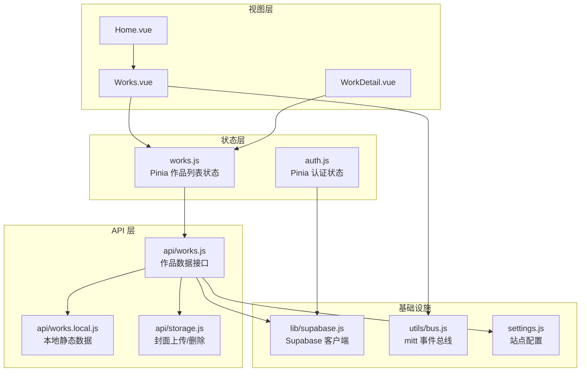

**图表来源**
- [src/views/Works.vue:1-394](file://src/views/Works.vue#L1-L394)
- [src/views/WorkDetail.vue:1-340](file://src/views/WorkDetail.vue#L1-L340)
- [src/stores/works.js:1-29](file://src/stores/works.js#L1-L29)
- [src/stores/auth.js:1-82](file://src/stores/auth.js#L1-L82)
- [src/api/works.js:1-267](file://src/api/works.js#L1-L267)
- [src/api/works.local.js:1-59](file://src/api/works.local.js#L1-L59)
- [src/api/storage.js:1-100](file://src/api/storage.js#L1-L100)
- [src/lib/supabase.js:1-17](file://src/lib/supabase.js#L1-L17)
- [src/utils/bus.js:1-15](file://src/utils/bus.js#L1-L15)
- [src/settings.js:1-288](file://src/settings.js#L1-L288)

**章节来源**
- [src/main.js:1-40](file://src/main.js#L1-L40)
- [src/settings.js:1-288](file://src/settings.js#L1-L288)

## 核心数据流
整体数据流遵循以下路径：
1. 应用启动时，main.js 初始化 Vue、Pinia、Router，并等待路由、字体、首屏图片就绪后挂载应用。
2. 视图层根据路由和用户操作触发数据加载：
   - 作品列表页通过 Pinia store 调用 API 获取已发布作品。
   - 详情页根据路由参数获取单条作品详情。
3. API 层根据 settings.useLocalWorks 决定走本地静态数据还是 Supabase 数据库。
4. 认证相关状态由 auth store 管理，基于 Supabase 会话和权限判断。
5. 组件间通信通过 mitt 事件总线传递搜索输入等轻量事件。

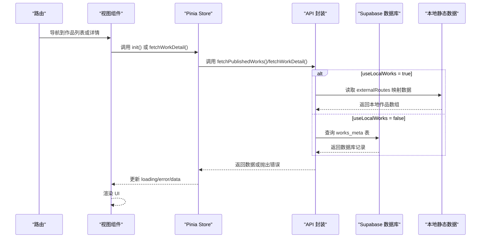

**图表来源**
- [src/main.js:16-39](file://src/main.js#L16-L39)
- [src/views/Works.vue:47-63](file://src/views/Works.vue#L47-L63)
- [src/views/WorkDetail.vue:68-93](file://src/views/WorkDetail.vue#L68-L93)
- [src/stores/works.js:12-25](file://src/stores/works.js#L12-L25)
- [src/api/works.js:45-55](file://src/api/works.js#L45-L55)
- [src/api/works.js:186-195](file://src/api/works.js#L186-L195)
- [src/api/works.local.js:53-58](file://src/api/works.local.js#L53-L58)

**章节来源**
- [src/main.js:16-39](file://src/main.js#L16-L39)
- [src/stores/works.js:12-25](file://src/stores/works.js#L12-L25)
- [src/api/works.js:45-55](file://src/api/works.js#L45-L55)
- [src/api/works.js:186-195](file://src/api/works.js#L186-L195)
- [src/api/works.local.js:53-58](file://src/api/works.local.js#L53-L58)

## 架构总览
系统采用分层架构，职责清晰：
- 视图层：用户界面与交互，包含动画、滚动、搜索、外链跳转等。
- 状态层：Pinia 管理全局状态（认证、作品列表），提供统一的初始化与订阅能力。
- API 层：封装数据库 CRUD、Storage 上传、本地静态数据映射。
- 基础设施：Supabase 客户端、事件总线、站点配置。

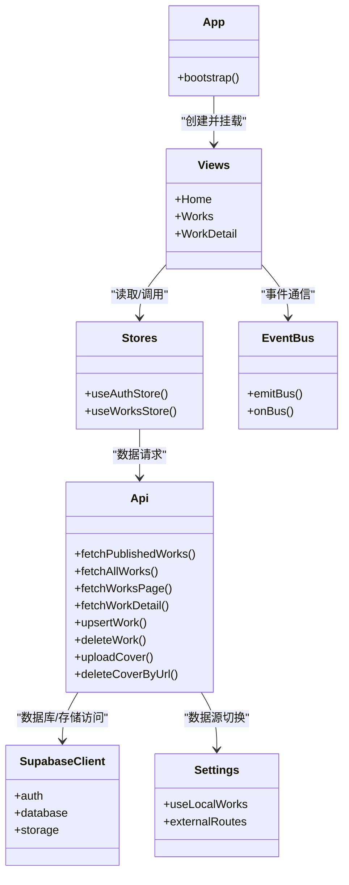

**图表来源**
- [src/main.js:16-39](file://src/main.js#L16-L39)
- [src/views/Works.vue:1-394](file://src/views/Works.vue#L1-L394)
- [src/views/WorkDetail.vue:1-340](file://src/views/WorkDetail.vue#L1-L340)
- [src/stores/auth.js:1-82](file://src/stores/auth.js#L1-L82)
- [src/stores/works.js:1-29](file://src/stores/works.js#L1-L29)
- [src/api/works.js:1-267](file://src/api/works.js#L1-L267)
- [src/api/storage.js:1-100](file://src/api/storage.js#L1-L100)
- [src/utils/bus.js:1-15](file://src/utils/bus.js#L1-L15)
- [src/settings.js:1-288](file://src/settings.js#L1-L288)

## 关键组件与模块分析

### Supabase 客户端封装
- 通过环境变量注入 Supabase URL 与可发布密钥。
- 若缺少必要环境变量，直接抛出错误，避免运行时静默失败。
- 启用会话持久化、自动刷新令牌、URL 中检测会话。

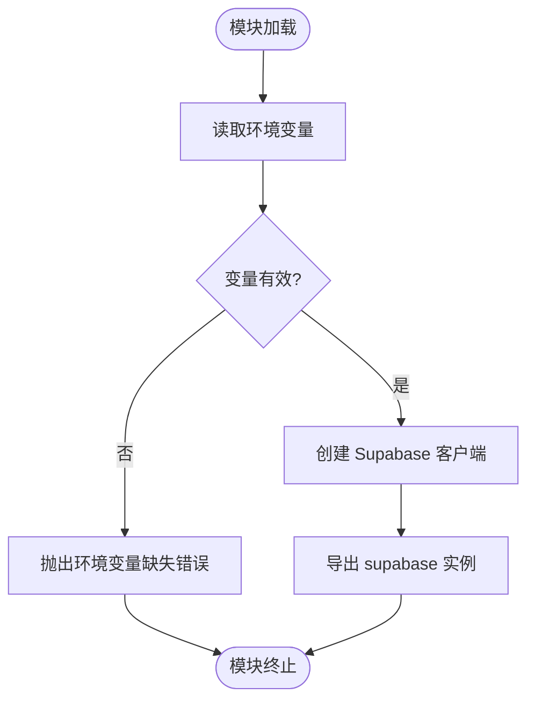

**图表来源**
- [src/lib/supabase.js:1-17](file://src/lib/supabase.js#L1-L17)

**章节来源**
- [src/lib/supabase.js:1-17](file://src/lib/supabase.js#L1-L17)

### 作品数据 API
- 公开接口：获取已发布作品列表，RLS 自动过滤 is_published=true。
- 后台接口：获取全部作品、分页查询、统计信息、增删改。
- 详情接口：按 id 查询单条作品；当 useLocalWorks=true 时走本地静态数据。
- 排序策略：sort_weight DESC → date DESC → created_at DESC → id ASC，保证分页稳定。
- 字段存在性筛选：支持封面、日期、外链字段的 filled/empty 条件。
- 存储关联：删除作品时尝试清理对应封面文件，但文件删除失败不影响主流程。

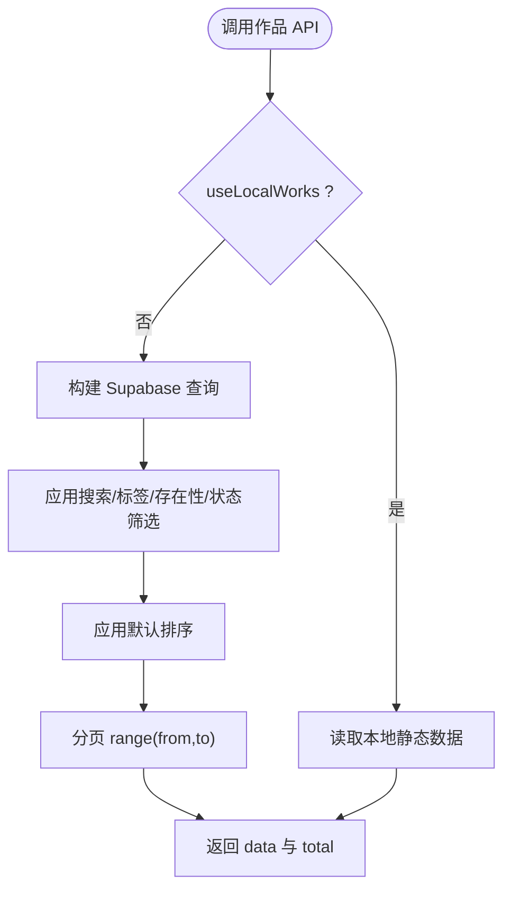

**图表来源**
- [src/api/works.js:115-140](file://src/api/works.js#L115-L140)
- [src/api/works.js:186-195](file://src/api/works.js#L186-L195)
- [src/api/works.js:256-266](file://src/api/works.js#L256-L266)

**章节来源**
- [src/api/works.js:1-267](file://src/api/works.js#L1-L267)

### 本地静态数据源
- 将 settings.externalRoutes 映射为 works_meta 结构，确保与数据库返回字段一致。
- 过滤隐藏项并按 sort_weight/date 排序，模拟服务端行为。
- 适用于本地调试，无需网络请求即可渲染作品列表。

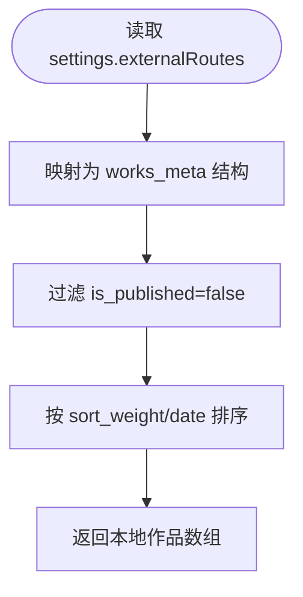

**图表来源**
- [src/api/works.local.js:23-40](file://src/api/works.local.js#L23-L40)
- [src/api/works.local.js:53-58](file://src/api/works.local.js#L53-L58)

**章节来源**
- [src/api/works.local.js:1-59](file://src/api/works.local.js#L1-L59)
- [src/settings.js:1-288](file://src/settings.js#L1-L288)

### 封面存储 API
- 上传前进行类型与体积校验，区分 GIF 与普通图片上限。
- 生成带时间戳与随机串的对象路径，避免覆盖并利于长缓存。
- 上传成功后返回公开访问 URL；删除旧封面时忽略非本 bucket 的 URL，失败仅告警。

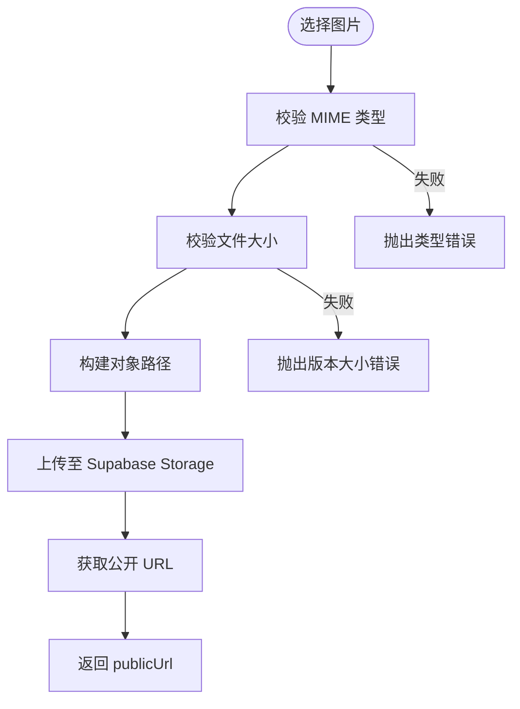

**图表来源**
- [src/api/storage.js:62-83](file://src/api/storage.js#L62-L83)
- [src/api/storage.js:90-99](file://src/api/storage.js#L90-L99)

**章节来源**
- [src/api/storage.js:1-100](file://src/api/storage.js#L1-L100)

### Pinia 状态管理
- 认证状态：维护 user/session/loading，监听 Supabase 认证状态变化，提供登录、注册、登出、管理员检查等方法。
- 作品状态：维护 works/loading/error，init 方法根据 settings.useLocalWorks 选择数据源，统一错误处理与加载态控制。

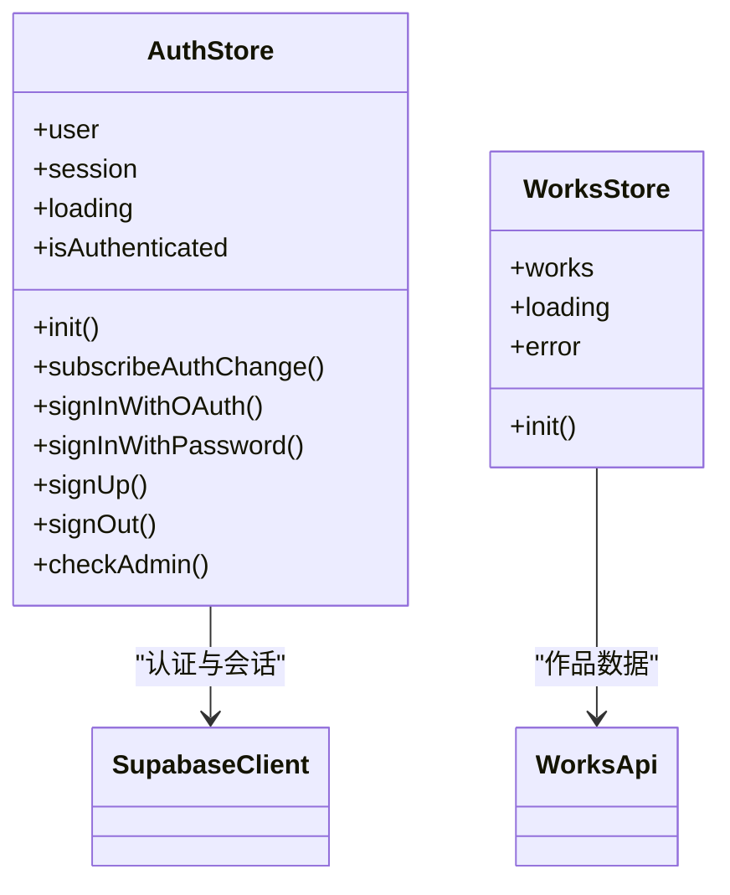

**图表来源**
- [src/stores/auth.js:1-82](file://src/stores/auth.js#L1-L82)
- [src/stores/works.js:1-29](file://src/stores/works.js#L1-L29)

**章节来源**
- [src/stores/auth.js:1-82](file://src/stores/auth.js#L1-L82)
- [src/stores/works.js:1-29](file://src/stores/works.js#L1-L29)

### 组件间通信：mitt 事件总线
- 在 Works.vue 中订阅 searchInput 事件，接收 SearchButton 的搜索输入。
- onBus 在订阅前先移除旧监听，避免重复绑定。
- emitBus/onBus 提供轻量跨组件通信，适合简单的事件广播。

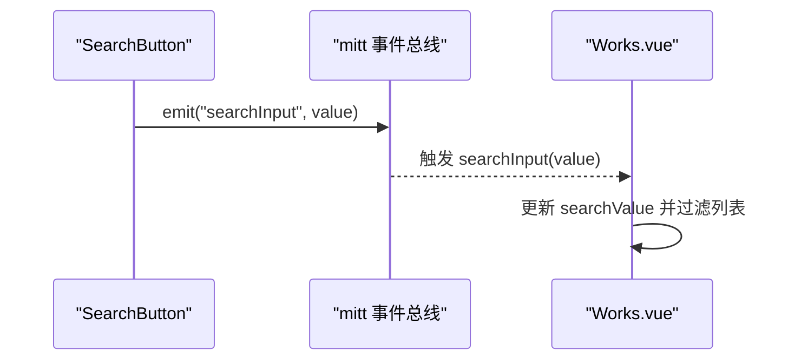

**图表来源**
- [src/utils/bus.js:1-15](file://src/utils/bus.js#L1-L15)
- [src/views/Works.vue:47-50](file://src/views/Works.vue#L47-L50)
- [src/views/Works.vue:115-117](file://src/views/Works.vue#L115-L117)

**章节来源**
- [src/utils/bus.js:1-15](file://src/utils/bus.js#L1-L15)
- [src/views/Works.vue:47-50](file://src/views/Works.vue#L47-L50)
- [src/views/Works.vue:115-117](file://src/views/Works.vue#L115-L117)

### 详情页数据加载流程
- 根据路由参数计算 workKey，兼容 /external/<name> 等含斜杠的 ID。
- 优先复用 worksStore.works 列表，若无则先加载列表再加载详情。
- 加载失败时捕获错误并将 work 置空，展示 404 视觉效果。
- 成功加载后设置文档标题与 meta description，并播放悬浮操作条入场动画。

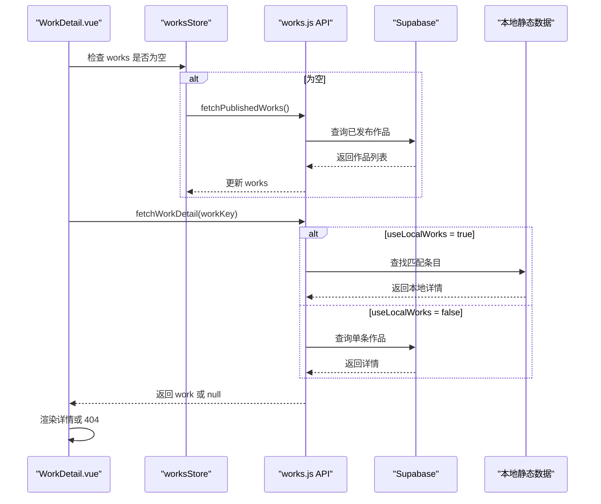

**图表来源**
- [src/views/WorkDetail.vue:68-93](file://src/views/WorkDetail.vue#L68-L93)
- [src/views/WorkDetail.vue:153-161](file://src/views/WorkDetail.vue#L153-L161)
- [src/api/works.js:186-195](file://src/api/works.js#L186-L195)

**章节来源**
- [src/views/WorkDetail.vue:1-340](file://src/views/WorkDetail.vue#L1-L340)
- [src/api/works.js:186-195](file://src/api/works.js#L186-L195)

## 依赖关系分析
- 视图对 Store 的依赖：
  - Works.vue 依赖 worksStore 获取作品列表，并通过 mitt 事件总线接收搜索输入。
  - WorkDetail.vue 依赖 worksStore 获取上下篇导航数据，同时独立加载详情。
- Store 对 API 的依赖：
  - worksStore 依赖 works.js 的 fetchPublishedWorks 与 works.local.js 的本地数据。
  - authStore 依赖 supabase 客户端进行认证与会话管理。
- API 对基础设施的依赖：
  - works.js 依赖 supabase 客户端与 settings 配置。
  - storage.js 依赖 supabase 客户端进行存储上传与删除。

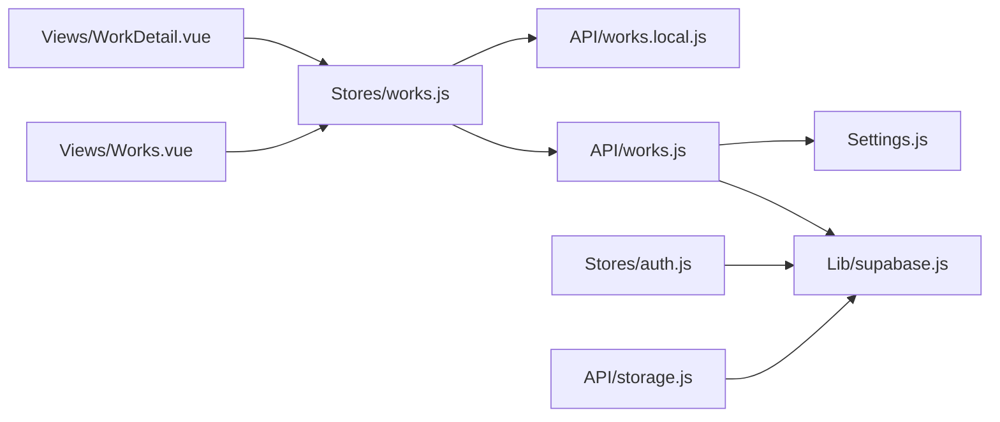

**图表来源**
- [src/views/Works.vue:1-394](file://src/views/Works.vue#L1-L394)
- [src/views/WorkDetail.vue:1-340](file://src/views/WorkDetail.vue#L1-L340)
- [src/stores/works.js:1-29](file://src/stores/works.js#L1-L29)
- [src/stores/auth.js:1-82](file://src/stores/auth.js#L1-L82)
- [src/api/works.js:1-267](file://src/api/works.js#L1-L267)
- [src/api/works.local.js:1-59](file://src/api/works.local.js#L1-L59)
- [src/api/storage.js:1-100](file://src/api/storage.js#L1-L100)
- [src/lib/supabase.js:1-17](file://src/lib/supabase.js#L1-L17)
- [src/settings.js:1-288](file://src/settings.js#L1-L288)

**章节来源**
- [src/views/Works.vue:1-394](file://src/views/Works.vue#L1-L394)
- [src/views/WorkDetail.vue:1-340](file://src/views/WorkDetail.vue#L1-L340)
- [src/stores/works.js:1-29](file://src/stores/works.js#L1-L29)
- [src/stores/auth.js:1-82](file://src/stores/auth.js#L1-L82)
- [src/api/works.js:1-267](file://src/api/works.js#L1-L267)
- [src/api/works.local.js:1-59](file://src/api/works.local.js#L1-L59)
- [src/api/storage.js:1-100](file://src/api/storage.js#L1-L100)
- [src/lib/supabase.js:1-17](file://src/lib/supabase.js#L1-L17)
- [src/settings.js:1-288](file://src/settings.js#L1-L288)

## 性能与缓存策略
- 首屏优化：main.js 等待路由 chunk、字体、首屏图片加载完成后再挂载应用，提升首帧体验。
- 图片懒加载：作品封面使用 loading="lazy"，减少初始带宽压力。
- 静态资源缓存：封面上传时使用 cacheControl=31536000，配合唯一对象路径实现长期缓存。
- 列表滚动动画：使用 GSAP ScrollTrigger，进入视口时触发淡入动画，离开时销毁监听，避免内存泄漏。
- 视图模式缓存：localStorage 记住列表视图模式，减少用户重复选择成本。
- 路由缓存：keep-alive 下保留列表滚动位置，返回时恢复滚动偏移，避免重复请求。

[本节为通用性能建议，不直接分析具体代码文件]

## 错误处理机制
- 环境变量缺失：supabase.js 在缺少必要环境变量时直接抛出错误，便于早期发现配置问题。
- API 层错误：works.js 在数据库查询失败时抛出错误，供上层捕获。
- Store 层错误：worksStore.init 捕获异常，记录日志并设置 error 状态，同时将 works 置空，避免渲染脏数据。
- 详情页错误：WorkDetail.vue 捕获 fetchWorkDetail 异常，将 work 置空并展示 404 视觉效果。
- 存储删除容错：storage.js 删除旧封面失败仅输出警告，不影响主流程（如删除作品）继续执行。

**章节来源**
- [src/lib/supabase.js:6-8](file://src/lib/supabase.js#L6-L8)
- [src/stores/works.js:18-21](file://src/stores/works.js#L18-L21)
- [src/views/WorkDetail.vue:75-82](file://src/views/WorkDetail.vue#L75-L82)
- [src/api/storage.js:97-99](file://src/api/storage.js#L97-L99)

## 常见问题排查
- 环境变量未配置：
  - 现象：应用启动时报环境变量缺失错误。
  - 排查：检查 VITE_SUPABASE_URL 与 VITE_SUPABASE_PUBLISHABLE_KEY 是否正确注入。
- 作品列表为空：
  - 现象：Works.vue 无数据展示。
  - 排查：确认 settings.useLocalWorks 与 Supabase RLS 策略；检查 fetchPublishedWorks 是否返回数据。
- 详情页 404：
  - 现象：WorkDetail.vue 显示 404。
  - 排查：检查路由参数 id 是否合法；确认 fetchWorkDetail 是否能找到对应记录。
- 搜索无效：
  - 现象：SearchButton 输入后列表不更新。
  - 排查：确认 mitt 事件总线是否正确订阅 searchInput 事件；检查 searchValue 是否更新。
- 封面上传失败：
  - 现象：storage.js 抛出类型或体积错误。
  - 排查：检查文件 MIME 类型与大小是否符合 COVER_ALLOWED_TYPES 与 COVER_MAX_SIZE/Cover_GIF_MAX_SIZE。

**章节来源**
- [src/lib/supabase.js:6-8](file://src/lib/supabase.js#L6-L8)
- [src/stores/works.js:18-21](file://src/stores/works.js#L18-L21)
- [src/views/WorkDetail.vue:75-82](file://src/views/WorkDetail.vue#L75-L82)
- [src/views/Works.vue:47-50](file://src/views/Works.vue#L47-L50)
- [src/api/storage.js:62-83](file://src/api/storage.js#L62-L83)

## 结论
sunwenxu1997.github.io 的数据流模式以清晰的层次划分与明确的职责边界为基础：
- 视图层专注交互与渲染，Pinia Store 统一管理状态，API 层封装数据访问，Supabase 客户端提供基础设施。
- 异步数据处理贯穿请求生命周期，结合加载态、错误态与空值处理，保障用户体验与稳定性。
- 本地静态数据源与 Supabase 数据源通过 settings 开关无缝切换，便于开发与调试。
- mitt 事件总线用于轻量组件通信，适合简单场景；复杂状态仍推荐通过 Pinia 管理。
- 错误处理机制覆盖环境变量、API、Store、视图与存储层，具备较好的健壮性。
- 缓存策略涵盖首屏优化、图片懒加载、静态资源缓存与视图模式记忆，提升性能与可用性。