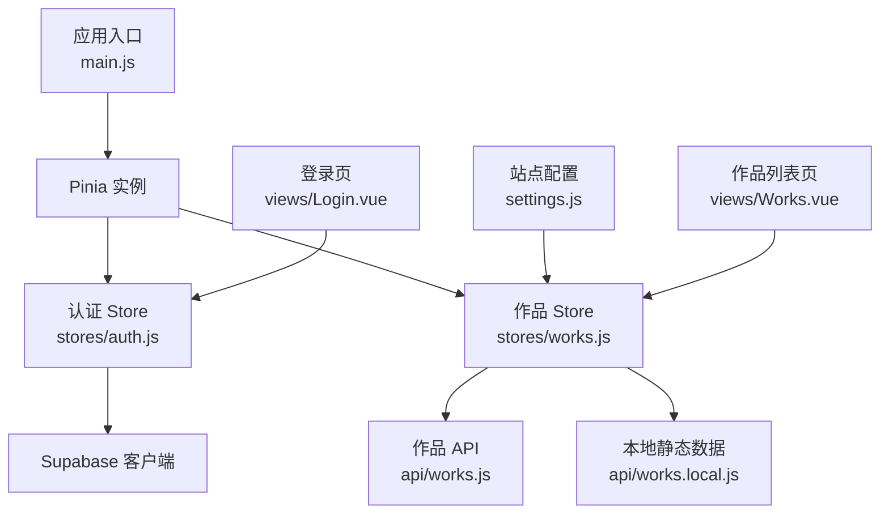
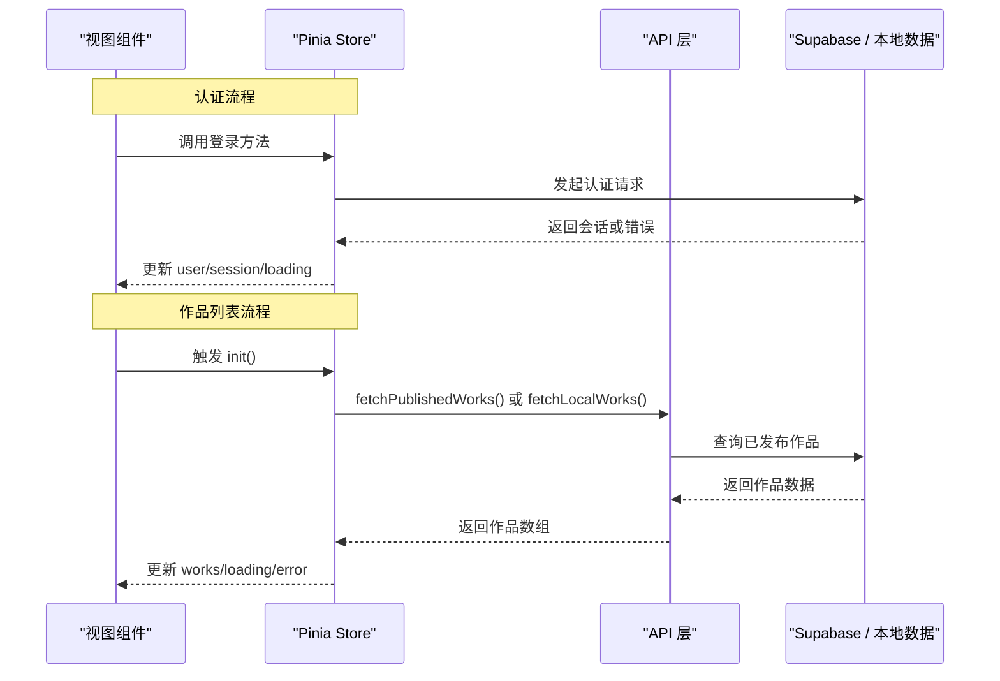
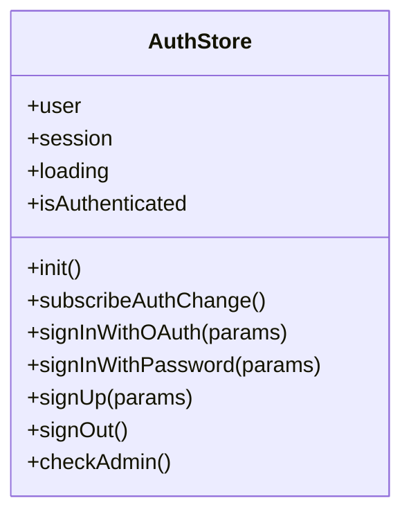
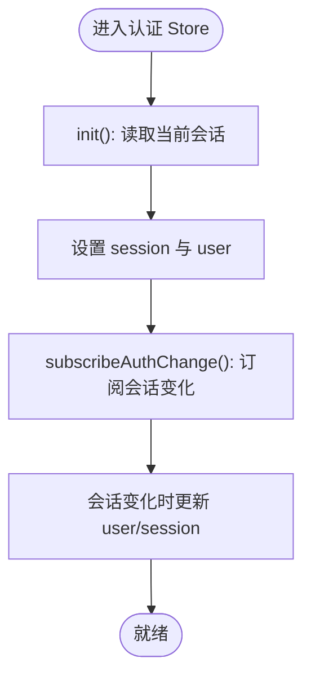
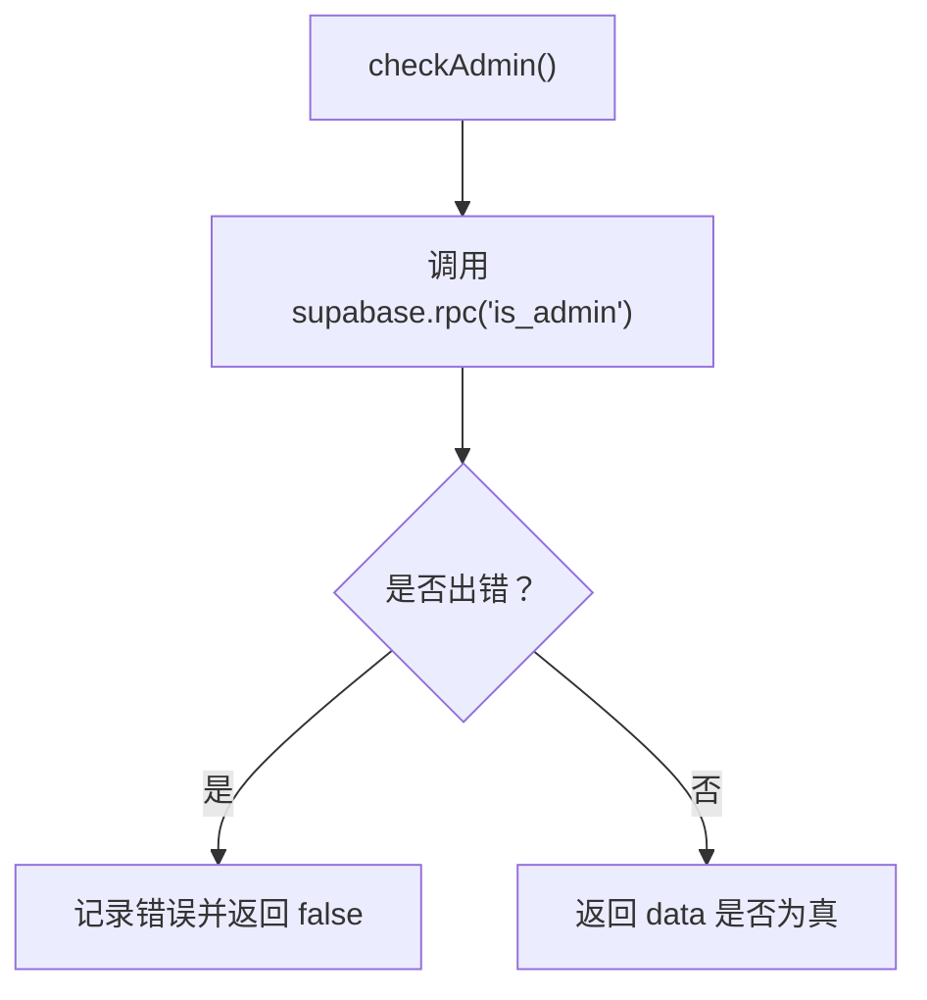
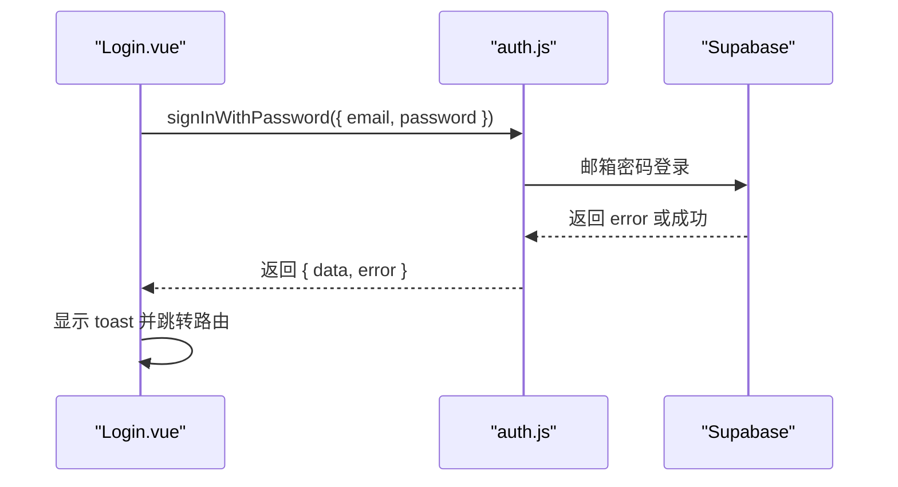
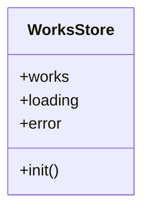
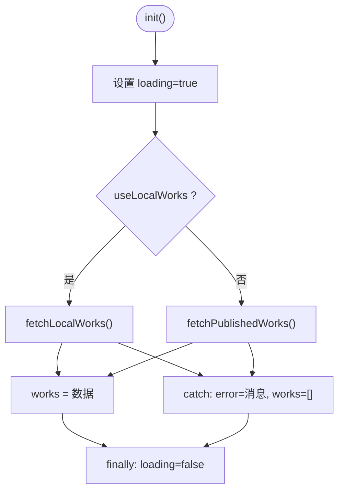
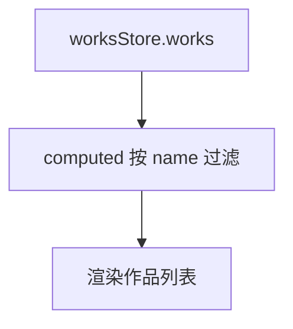
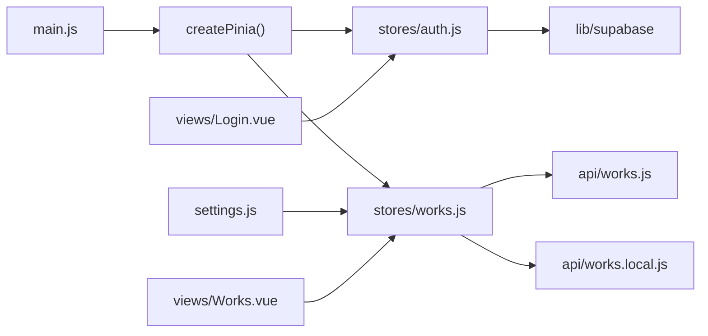

# 状态管理设计

<cite>
**本文引用的文件**   
- [src/stores/auth.js](file://src/stores/auth.js)
- [src/stores/works.js](file://src/stores/works.js)
- [src/api/works.js](file://src/api/works.js)
- [src/api/works.local.js](file://src/api/works.local.js)
- [src/settings.js](file://src/settings.js)
- [src/main.js](file://src/main.js)
- [package.json](file://package.json)
- [src/views/Login.vue](file://src/views/Login.vue)
- [src/views/Works.vue](file://src/views/Works.vue)
</cite>

## 目录
1. [引言](#引言)
2. [项目结构](#项目结构)
3. [核心组件](#核心组件)
4. [架构总览](#架构总览)
5. [详细组件分析](#详细组件分析)
6. [依赖关系分析](#依赖关系分析)
7. [性能与可扩展性](#性能与可扩展性)
8. [故障排查指南](#故障排查指南)
9. [结论](#结论)
10. [附录：最佳实践清单](#附录最佳实践清单)

## 引言
本设计文档聚焦 sunwenxu1997.github.io 项目的状态管理方案，围绕 Pinia 的 Store 架构展开，重点说明以下目标：
- 认证状态管理模块 auth.js：用户登录状态、权限校验与会话同步。
- 作品数据管理模块 works.js：作品列表状态、搜索过滤与异步数据加载。
- 状态持久化策略与数据同步机制。
- 状态流向图与可落地的最佳实践建议。

该项目使用 Vue 3 + Vite + Pinia，认证与数据库访问通过 Supabase SDK 完成；作品数据支持线上数据库与本地静态数据两种数据源切换。

## 项目结构
从状态管理视角，仓库中与状态相关的关键位置如下：
- 应用入口初始化 Pinia：[src/main.js](file://src/main.js)
- 认证 Store：[src/stores/auth.js](file://src/stores/auth.js)
- 作品 Store：[src/stores/works.js](file://src/stores/works.js)
- 作品 API（Supabase）：[src/api/works.js](file://src/api/works.js)
- 本地静态作品数据适配层：[src/api/works.local.js](file://src/api/works.local.js)
- 站点配置与数据源开关：[src/settings.js](file://src/settings.js)
- 登录页面调用认证 Store：[src/views/Login.vue](file://src/views/Login.vue)
- 作品列表页消费作品 Store：[src/views/Works.vue](file://src/views/Works.vue)

**图表来源**
- [src/main.js:6-22](file://src/main.js#L6-L22)
- [src/stores/auth.js:1-82](file://src/stores/auth.js#L1-L82)
- [src/stores/works.js:1-29](file://src/stores/works.js#L1-L29)
- [src/api/works.js:1-267](file://src/api/works.js#L1-L267)
- [src/api/works.local.js:1-59](file://src/api/works.local.js#L1-L59)
- [src/settings.js:1-288](file://src/settings.js#L1-L288)
- [src/views/Login.vue:95-144](file://src/views/Login.vue#L95-L144)
- [src/views/Works.vue:1-153](file://src/views/Works.vue#L1-L153)

**章节来源**
- [src/main.js:6-22](file://src/main.js#L6-L22)
- [package.json:12-23](file://package.json#L12-L23)

## 核心组件
本项目采用基于 Composition API 的 Pinia Store 模式：
- 每个业务域一个 Store，暴露响应式状态与方法。
- 视图组件通过 useXxxStore() 获取 Store 实例并消费状态。
- 异步数据请求下沉到 API 层，Store 负责状态编排与错误处理。
- 配置项集中放在 settings.js，作为数据源与站点元信息的统一入口。

关键职责划分：
- auth.js：维护用户会话、登录态、管理员权限判断，订阅 Supabase 认证状态变化。
- works.js：维护作品列表、加载状态与错误信息，根据配置选择本地或远程数据源。
- api/works.js：封装 Supabase 查询、分页、筛选、统计、增删改等能力。
- api/works.local.js：将 settings.externalRoutes 映射为 works_meta 结构，提供等价的数据接口。
- views/Login.vue：调用认证 Store 完成邮箱密码登录流程。
- views/Works.vue：消费作品 Store，实现前端搜索与展示。

**章节来源**
- [src/stores/auth.js:1-82](file://src/stores/auth.js#L1-L82)
- [src/stores/works.js:1-29](file://src/stores/works.js#L1-L29)
- [src/api/works.js:1-267](file://src/api/works.js#L1-L267)
- [src/api/works.local.js:1-59](file://src/api/works.local.js#L1-L59)
- [src/views/Login.vue:95-144](file://src/views/Login.vue#L95-L144)
- [src/views/Works.vue:1-153](file://src/views/Works.vue#L1-L153)

## 架构总览
下图展示了认证与作品两个 Store 在应用中的整体交互关系，包括视图、Store、API 与外部服务。

**图表来源**
- [src/views/Login.vue:122-143](file://src/views/Login.vue#L122-L143)
- [src/stores/auth.js:29-57](file://src/stores/auth.js#L29-L57)
- [src/stores/works.js:12-25](file://src/stores/works.js#L12-L25)
- [src/api/works.js:45-55](file://src/api/works.js#L45-L55)
- [src/api/works.local.js:53-58](file://src/api/works.local.js#L53-L58)

## 详细组件分析

### 认证状态管理模块 auth.js
auth.js 是认证领域的主 Store，负责：
- 维护 user、session、loading 三个核心状态。
- 提供 isAuthenticated 计算属性，用于快速判断是否已登录。
- 初始化时读取当前会话，并在认证状态变化时自动同步。
- 封装 OAuth、邮箱密码登录、注册、登出等方法。
- 通过 RPC 调用 is_admin 判断管理员权限。

**图表来源**
- [src/stores/auth.js:5-80](file://src/stores/auth.js#L5-L80)

#### 登录状态与会话管理
- 初始化流程：设置 loading，调用 Supabase 获取当前 session，填充 user 和 session，最后关闭 loading。
- 会话监听：订阅 onAuthStateChange，当会话变化时自动更新 user 与 session。
- 登出逻辑：调用 Supabase 登出后清空 store 中的 session 与 user。

**图表来源**
- [src/stores/auth.js:12-27](file://src/stores/auth.js#L12-L27)

#### 权限验证
- checkAdmin 调用 Supabase RPC is_admin，返回布尔值表示是否为管理员。
- 失败时记录错误日志并返回 false，避免阻断其他流程。

**图表来源**
- [src/stores/auth.js:59-66](file://src/stores/auth.js#L59-L66)

#### 登录流程时序
Login.vue 调用 authStore.signInWithPassword，成功后跳转到后台作品管理页。

**图表来源**
- [src/views/Login.vue:122-143](file://src/views/Login.vue#L122-L143)
- [src/stores/auth.js:37-43](file://src/stores/auth.js#L37-L43)

**章节来源**
- [src/stores/auth.js:1-82](file://src/stores/auth.js#L1-L82)
- [src/views/Login.vue:95-144](file://src/views/Login.vue#L95-L144)

### 作品数据管理模块 works.js
works.js 是作品领域的主 Store，负责：
- 维护 works、loading、error 三个核心状态。
- 根据 settings.useLocalWorks 决定数据来源：本地静态数据或 Supabase。
- 提供 init() 方法统一加载作品列表，包含错误捕获与 loading 控制。

**图表来源**
- [src/stores/works.js:7-27](file://src/stores/works.js#L7-L27)

#### 数据源切换与加载流程
- 当 settings.useLocalWorks 为 true 时，直接读取本地静态数据。
- 否则调用 Supabase 获取已发布作品列表。
- 加载过程中设置 loading=true，完成后置为 false；异常时记录 error 并将 works 置空。

**图表来源**
- [src/stores/works.js:12-25](file://src/stores/works.js#L12-L25)
- [src/settings.js:1-8](file://src/settings.js#L1-L8)

#### 前端搜索与过滤
- Works.vue 中通过 computed 对 worksStore.works 进行前端关键词过滤。
- 该过滤仅作用于名称字段，且发生在数据已经加载到前端之后。

**图表来源**
- [src/views/Works.vue:31-35](file://src/views/Works.vue#L31-L35)

**章节来源**
- [src/stores/works.js:1-29](file://src/stores/works.js#L1-L29)
- [src/api/works.js:45-55](file://src/api/works.js#L45-L55)
- [src/api/works.local.js:53-58](file://src/api/works.local.js#L53-L58)
- [src/settings.js:1-8](file://src/settings.js#L1-L8)
- [src/views/Works.vue:31-35](file://src/views/Works.vue#L31-L35)

### 状态持久化策略与数据同步机制
当前实现中：
- 认证状态由 Supabase 客户端管理，Store 通过 getSession 与 onAuthStateChange 同步到 Pinia。
- 作品数据未做跨页面持久化缓存；Works.vue 在 keep-alive 场景下复用组件状态，但滚动位置需要自行保存。
- 用户偏好如作品视图模式保存在 localStorage，不属于 Store 状态。

建议补充的持久化策略：
- 认证状态：若需离线可用，可在安全前提下将 session 摘要持久化到 localStorage，并在应用启动时恢复。
- 作品列表：对热点作品列表增加短期内存缓存，结合路由守卫决定是否刷新。
- 用户偏好：将 viewMode 等用户偏好纳入 Store，统一管理并持久化到 localStorage。

注意：当前代码未实现上述增强，以上为扩展建议。

**章节来源**
- [src/stores/auth.js:12-27](file://src/stores/auth.js#L12-L27)
- [src/views/Works.vue:42-70](file://src/views/Works.vue#L42-L70)
- [src/views/Works.vue:118-128](file://src/views/Works.vue#L118-L128)

## 依赖关系分析
Pinia 与应用入口、Store 与 API、视图与 Store 之间的依赖关系如下：

**图表来源**
- [src/main.js:6-22](file://src/main.js#L6-L22)
- [src/stores/auth.js:1-82](file://src/stores/auth.js#L1-L82)
- [src/stores/works.js:1-29](file://src/stores/works.js#L1-L29)
- [src/api/works.js:1-267](file://src/api/works.js#L1-L267)
- [src/api/works.local.js:1-59](file://src/api/works.local.js#L1-L59)
- [src/settings.js:1-288](file://src/settings.js#L1-L288)
- [src/views/Login.vue:95-144](file://src/views/Login.vue#L95-L144)
- [src/views/Works.vue:1-153](file://src/views/Works.vue#L1-L153)

**章节来源**
- [package.json:12-23](file://package.json#L12-L23)
- [src/main.js:6-22](file://src/main.js#L6-L22)

## 性能与可扩展性
- 认证状态同步：onAuthStateChange 会持续监听会话变化，应避免重复订阅；建议在 Store 初始化时只订阅一次。
- 作品列表加载：init() 每次都会重新赋值 works，适合小数据集；若数据量增长，应考虑分页与增量更新。
- 前端搜索：当前为全量过滤，适合小规模数据；大数据集应优先服务端搜索。
- 数据源切换：useLocalWorks 便于本地调试，上线前务必确认默认值为 false。
- 动画与滚动：Works.vue 大量使用 GSAP ScrollTrigger，组件销毁时需清理，避免内存泄漏。

优化建议：
- 为 worksStore.init() 增加去重与缓存键，避免频繁重复请求。
- 将用户偏好（viewMode）纳入 Store，并提供统一的持久化方法。
- 为认证 Store 增加 token 过期检测与自动刷新逻辑。

**章节来源**
- [src/stores/works.js:12-25](file://src/stores/works.js#L12-L25)
- [src/views/Works.vue:64-70](file://src/views/Works.vue#L64-L70)
- [src/views/Works.vue:118-128](file://src/views/Works.vue#L118-L128)
- [src/settings.js:1-8](file://src/settings.js#L1-L8)

## 故障排查指南
常见问题与定位思路：
- 登录后页面未跳转：检查 Login.vue 中 toast 与 router.push 的执行路径，以及 authStore.signInWithPassword 返回的 error。
- 作品列表为空：检查 worksStore.init() 的 loading/error 状态，确认 settings.useLocalWorks 的值与数据源是否匹配。
- 搜索无结果：确认 searchValue 是否正确传递到 computed 过滤逻辑，并检查 worksStore.works 是否已加载。
- 管理员权限判断失败：查看 authStore.checkAdmin 的错误日志，确认 Supabase RPC is_admin 是否配置正确。

**章节来源**
- [src/views/Login.vue:122-143](file://src/views/Login.vue#L122-L143)
- [src/stores/works.js:12-25](file://src/stores/works.js#L12-L25)
- [src/views/Works.vue:31-35](file://src/views/Works.vue#L31-L35)
- [src/stores/auth.js:59-66](file://src/stores/auth.js#L59-L66)

## 结论
本项目采用 Pinia 的 Store 模式组织状态，认证与作品两个 Store 职责清晰，API 层与配置层解耦良好。认证状态通过 Supabase 会话机制同步，作品数据支持本地与远程双数据源。当前实现简洁实用，适合中小型项目；随着数据规模增长，建议引入更完善的缓存、分页与持久化策略，以提升用户体验与可维护性。

## 附录最佳实践清单
- 单一职责：每个 Store 只管理一个业务域的状态与方法。
- 异步边界：所有网络请求集中在 API 层，Store 只做状态编排。
- 错误处理：异步方法统一捕获错误，并更新 error 状态供 UI 展示。
- 配置驱动：数据源与站点元信息集中在 settings.js，避免硬编码。
- 副作用清理：组件销毁时清理事件监听与动画资源，防止内存泄漏。
- 可观测性：关键流程添加日志与 toast，便于问题定位。
- 渐进增强：先保证基础功能稳定，再逐步加入缓存、分页与持久化。