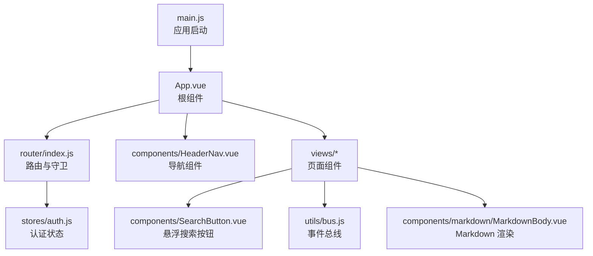
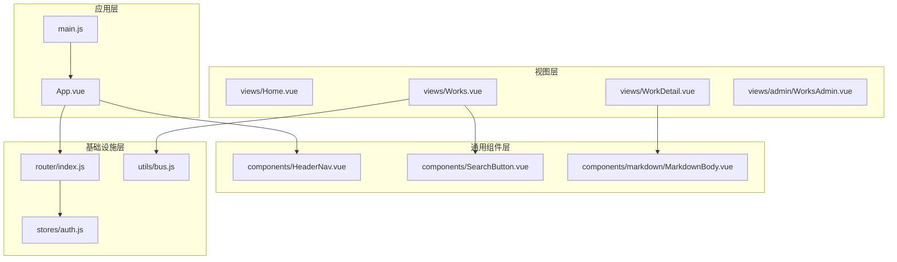
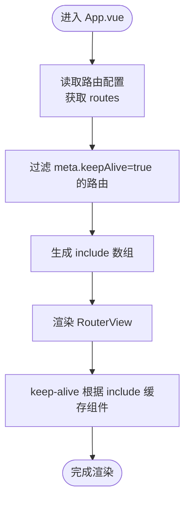
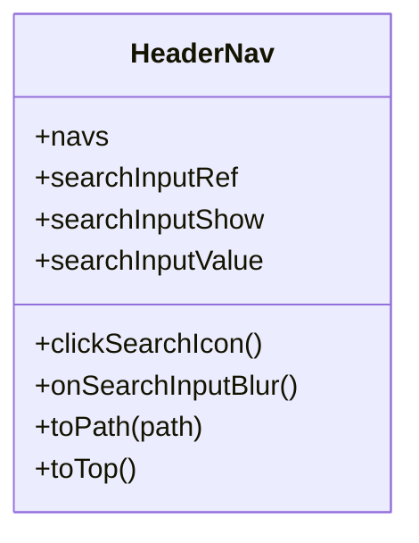
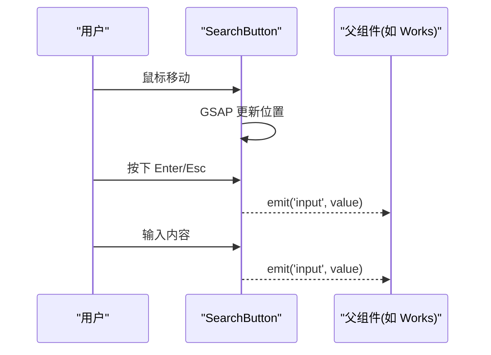
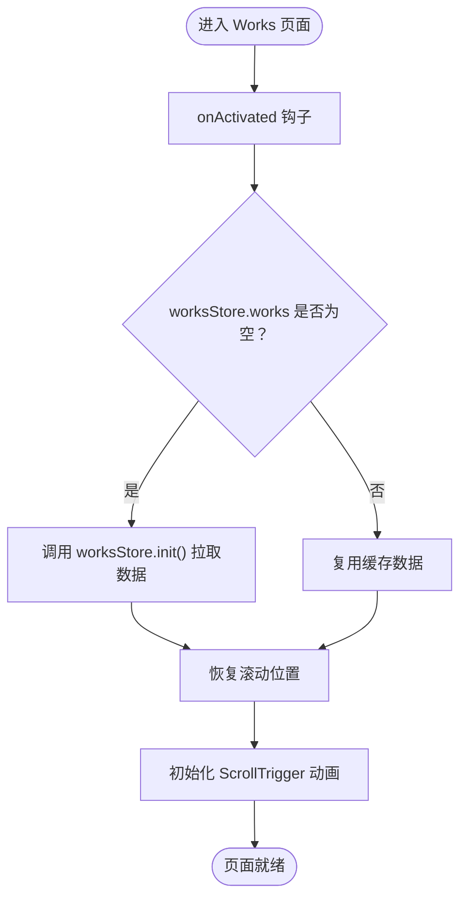
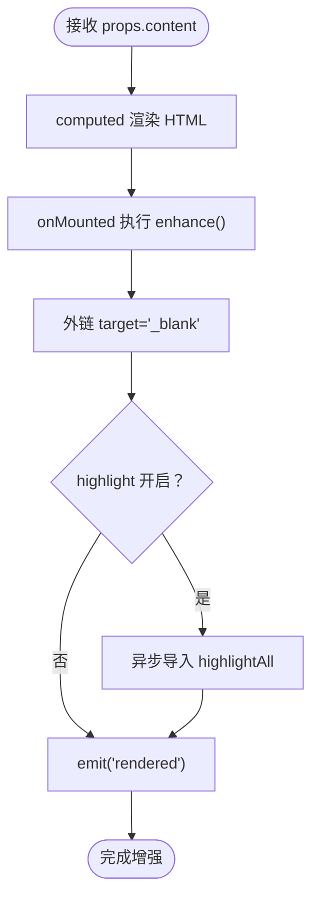
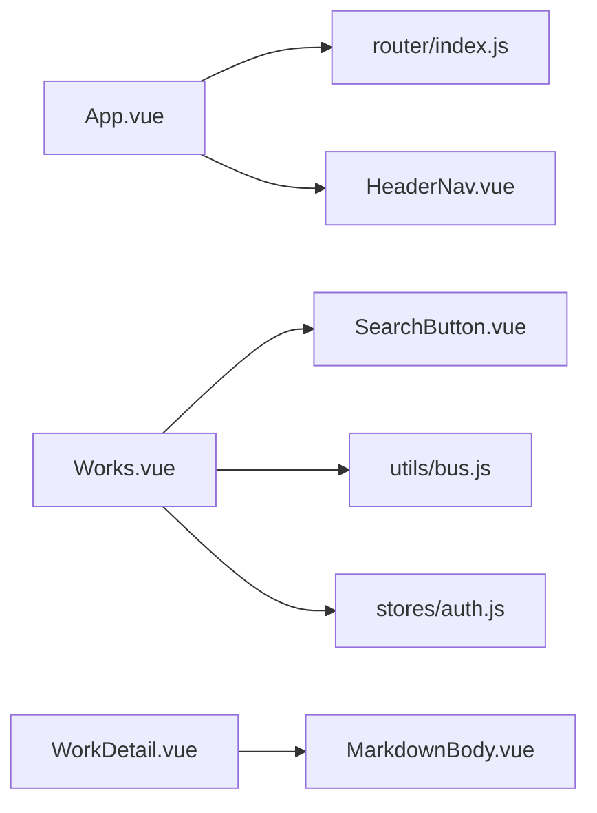

# 组件架构设计

<cite>
**本文引用的文件**   
- [src/App.vue](file://src/App.vue)
- [src/main.js](file://src/main.js)
- [src/router/index.js](file://src/router/index.js)
- [src/components/HeaderNav.vue](file://src/components/HeaderNav.vue)
- [src/components/SearchButton.vue](file://src/components/SearchButton.vue)
- [src/utils/bus.js](file://src/utils/bus.js)
- [src/stores/auth.js](file://src/stores/auth.js)
- [src/views/Home.vue](file://src/views/Home.vue)
- [src/views/Works.vue](file://src/views/Works.vue)
- [src/components/markdown/MarkdownBody.vue](file://src/components/markdown/MarkdownBody.vue)
</cite>

## 目录
1. [引言](#引言)
2. [项目结构](#项目结构)
3. [核心组件](#核心组件)
4. [架构总览](#架构总览)
5. [详细组件分析](#详细组件分析)
6. [依赖关系分析](#依赖关系分析)
7. [性能与可维护性](#性能与可维护性)
8. [故障排查指南](#故障排查指南)
9. [结论](#结论)

## 引言
本文件面向 sunwenxu1997.github.io 项目的组件架构设计，聚焦 Vue 3 组合式 API 的使用模式、组件分层策略、根组件 App.vue 的路由缓存与全局集成、通用组件（HeaderNav、SearchButton）的设计模式、组件间通信方式（props、事件、事件总线）、以及组件生命周期管理策略。文档同时提供架构图、类图、时序图和流程图，帮助读者快速理解系统结构与关键流程。

## 项目结构
项目采用按功能域划分的目录组织：
- src/components：通用 UI 组件与图标
- src/views：页面级视图组件
- src/router：路由配置与守卫
- src/stores：Pinia 状态管理
- src/utils：工具函数与事件总线
- src/lib：第三方服务封装
- src/assets：样式资源

图表来源
- [src/main.js:16-39](file://src/main.js#L16-L39)
- [src/App.vue:1-25](file://src/App.vue#L1-L25)
- [src/router/index.js:1-72](file://src/router/index.js#L1-L72)
- [src/components/HeaderNav.vue:1-235](file://src/components/HeaderNav.vue#L1-L235)
- [src/components/SearchButton.vue:1-124](file://src/components/SearchButton.vue#L1-L124)
- [src/utils/bus.js:1-15](file://src/utils/bus.js#L1-L15)
- [src/stores/auth.js:1-82](file://src/stores/auth.js#L1-L82)
- [src/components/markdown/MarkdownBody.vue:1-57](file://src/components/markdown/MarkdownBody.vue#L1-L57)

章节来源
- [src/main.js:1-39](file://src/main.js#L1-L39)
- [src/App.vue:1-25](file://src/App.vue#L1-L25)
- [src/router/index.js:1-72](file://src/router/index.js#L1-L72)

## 核心组件
- App.vue：根容器，集成 Toaster 通知、HeaderNav 导航、KeepAlive 路由缓存。
- HeaderNav.vue：顶部导航栏，包含移动端菜单、搜索输入、社交链接与管理员入口。
- SearchButton.vue：桌面端悬浮跟随鼠标的搜索按钮，支持键盘交互与动画。
- MarkdownBody.vue：Markdown 正文渲染组件，统一外链处理与代码高亮增强。
- 路由与守卫：集中定义路由、懒加载、标题元信息与管理员权限校验。
- 认证状态：Pinia store 封装 Supabase 认证能力，提供登录、登出、管理员检查等。

章节来源
- [src/App.vue:1-25](file://src/App.vue#L1-L25)
- [src/components/HeaderNav.vue:1-235](file://src/components/HeaderNav.vue#L1-L235)
- [src/components/SearchButton.vue:1-124](file://src/components/SearchButton.vue#L1-L124)
- [src/components/markdown/MarkdownBody.vue:1-57](file://src/components/markdown/MarkdownBody.vue#L1-L57)
- [src/router/index.js:1-72](file://src/router/index.js#L1-L72)
- [src/stores/auth.js:1-82](file://src/stores/auth.js#L1-L82)

## 架构总览
整体架构遵循“根组件 + 页面视图 + 通用组件 + 状态管理 + 路由”的分层模式。App.vue 作为根容器负责全局 UI 与路由缓存；页面视图承载业务逻辑；通用组件提供可复用的 UI 能力；Pinia store 管理跨组件状态；路由负责导航与权限控制。

图表来源
- [src/main.js:16-39](file://src/main.js#L16-L39)
- [src/App.vue:1-25](file://src/App.vue#L1-L25)
- [src/router/index.js:1-72](file://src/router/index.js#L1-L72)
- [src/components/HeaderNav.vue:1-235](file://src/components/HeaderNav.vue#L1-L235)
- [src/components/SearchButton.vue:1-124](file://src/components/SearchButton.vue#L1-L124)
- [src/components/markdown/MarkdownBody.vue:1-57](file://src/components/markdown/MarkdownBody.vue#L1-L57)
- [src/stores/auth.js:1-82](file://src/stores/auth.js#L1-L82)

## 详细组件分析

### 根组件 App.vue 与路由缓存机制
- 职责：挂载全局通知、导航、路由视图，并基于路由 meta.keepAlive 启用 KeepAlive 缓存。
- 实现要点：
  - 通过 computed 动态读取 router.options.routes，筛选出需要缓存的 route name 列表。
  - 使用 keep-alive :include 精确缓存指定路由对应的组件实例，避免全量缓存带来的内存压力。
  - 与 RouterView 配合，确保被缓存的页面在切换时保留状态。

图表来源
- [src/App.vue:1-25](file://src/App.vue#L1-L25)
- [src/router/index.js:1-72](file://src/router/index.js#L1-L72)

章节来源
- [src/App.vue:1-25](file://src/App.vue#L1-L25)
- [src/router/index.js:10-17](file://src/router/index.js#L10-L17)

### 通用组件：HeaderNav 导航组件
- 职责：提供站点导航、移动端菜单、搜索输入、社交链接与管理入口。
- 关键特性：
  - 响应式显示：仅在首页与特定导航路径下展示。
  - 移动端交互：点击汉堡菜单展开全屏菜单，滚动监听关闭菜单。
  - 搜索联动：通过事件总线发布 searchInput 事件，供其他组件订阅。
  - 管理员入口：底部链接跳转后台管理页。

图表来源
- [src/components/HeaderNav.vue:1-235](file://src/components/HeaderNav.vue#L1-L235)

章节来源
- [src/components/HeaderNav.vue:1-235](file://src/components/HeaderNav.vue#L1-L235)

### 通用组件：SearchButton 悬浮搜索按钮
- 职责：桌面端提供跟随鼠标的搜索按钮，支持长按触发、键盘回车/Esc 提交、输入防抖。
- 关键特性：
  - 自定义光标体验：隐藏默认光标，使用 GSAP 驱动按钮跟随鼠标移动。
  - 生命周期管理：在 onMounted/onActivated 添加监听，在 onUnmounted/onDeactivated 移除监听，避免内存泄漏。
  - 事件发射：通过 input 和 search 事件向父组件传递查询值。

图表来源
- [src/components/SearchButton.vue:1-124](file://src/components/SearchButton.vue#L1-L124)

章节来源
- [src/components/SearchButton.vue:1-124](file://src/components/SearchButton.vue#L1-L124)

### 页面组件：Home 与 Works
- Home.vue：首屏视觉与动效，监听鼠标移动驱动图层位移。
- Works.vue：作品列表与详情跳转，结合 Pinia works store、GSAP ScrollTrigger 动画、视图模式切换（list/grid）、滚动位置记忆与 keep-alive 复用。

图表来源
- [src/views/Works.vue:47-63](file://src/views/Works.vue#L47-L63)
- [src/views/Works.vue:115-149](file://src/views/Works.vue#L115-L149)

章节来源
- [src/views/Home.vue:1-86](file://src/views/Home.vue#L1-L86)
- [src/views/Works.vue:1-394](file://src/views/Works.vue#L1-L394)

### Markdown 正文渲染组件：MarkdownBody
- 职责：将 Markdown 字符串渲染为 HTML，外链统一新窗口打开，按需异步加载代码高亮。
- 关键特性：
  - 计算属性产出 HTML，watch 监听 content/highlight 变化后重新增强 DOM。
  - 暴露 rendered 事件，返回目录结构（TOC），便于侧边导航或目录生成。

图表来源
- [src/components/markdown/MarkdownBody.vue:1-57](file://src/components/markdown/MarkdownBody.vue#L1-L57)

章节来源
- [src/components/markdown/MarkdownBody.vue:1-57](file://src/components/markdown/MarkdownBody.vue#L1-L57)

## 依赖关系分析
- 组件耦合：
  - App.vue 依赖 router 与 HeaderNav，并通过 keep-alive 管理页面组件缓存。
  - Works.vue 依赖 SearchButton、bus 事件总线、Pinia works store、GSAP 动画库。
  - HeaderNav.vue 通过 bus 发布搜索输入事件，解耦具体搜索逻辑。
- 外部依赖：
  - vue-router：路由与导航守卫。
  - pinia：状态管理（auth）。
  - gsap：动画效果。
  - supabase：认证与后端交互（通过 stores/auth.js）。
  - vue-sonner：全局通知。

图表来源
- [src/App.vue:1-25](file://src/App.vue#L1-L25)
- [src/router/index.js:1-72](file://src/router/index.js#L1-L72)
- [src/components/HeaderNav.vue:1-235](file://src/components/HeaderNav.vue#L1-L235)
- [src/components/SearchButton.vue:1-124](file://src/components/SearchButton.vue#L1-L124)
- [src/utils/bus.js:1-15](file://src/utils/bus.js#L1-L15)
- [src/stores/auth.js:1-82](file://src/stores/auth.js#L1-L82)
- [src/components/markdown/MarkdownBody.vue:1-57](file://src/components/markdown/MarkdownBody.vue#L1-L57)

章节来源
- [src/App.vue:1-25](file://src/App.vue#L1-L25)
- [src/router/index.js:1-72](file://src/router/index.js#L1-L72)
- [src/components/HeaderNav.vue:1-235](file://src/components/HeaderNav.vue#L1-L235)
- [src/components/SearchButton.vue:1-124](file://src/components/SearchButton.vue#L1-L124)
- [src/utils/bus.js:1-15](file://src/utils/bus.js#L1-L15)
- [src/stores/auth.js:1-82](file://src/stores/auth.js#L1-L82)
- [src/components/markdown/MarkdownBody.vue:1-57](file://src/components/markdown/MarkdownBody.vue#L1-L57)

## 性能与可维护性
- 路由懒加载：所有页面组件均使用动态 import，减少首屏体积。
- KeepAlive 精准缓存：仅缓存标记了 meta.keepAlive 的路由，降低内存占用。
- 动画优化：GSAP ScrollTrigger 在 onActivated 注册，onDeactivated 清理，避免重复绑定与内存泄漏。
- 事件总线：使用 mitt 封装，避免组件间强耦合，适合小范围跨组件通信。
- 首屏加载：main.js 中顺序等待路由 chunk、字体、首屏图片，完成后淡出遮罩，提升感知性能。

[本节为通用建议，不直接分析具体文件]

## 故障排查指南
- 路由守卫未生效：
  - 确认 router.beforeEach 已安装且 use(router) 在 bootstrap 中正确调用。
  - 检查 authStore.init() 是否成功获取 session。
- 管理员权限异常：
  - 检查 checkAdmin RPC 调用结果与错误日志。
  - 未授权时会被重定向到 /login。
- 搜索无响应：
  - 确认 HeaderNav 的 searchInput 事件已通过 bus 发出。
  - 确认 Works.vue 在 onActivated 中订阅了 searchInput 事件。
- 动画错乱或卡顿：
  - 检查 ScrollTrigger.killAll() 是否在视图切换或离开页面时被调用。
  - 确认 onActivated 中重建了必要的动画与滚动监听。
- 首屏白屏或长时间遮罩：
  - 检查 loading.waitRoute/waitFonts/waitImages 的执行顺序与超时情况。
  - 确认首屏图片路径与网络可达。

章节来源
- [src/router/index.js:51-70](file://src/router/index.js#L51-L70)
- [src/stores/auth.js:59-66](file://src/stores/auth.js#L59-L66)
- [src/components/HeaderNav.vue:119-128](file://src/components/HeaderNav.vue#L119-L128)
- [src/views/Works.vue:47-70](file://src/views/Works.vue#L47-L70)
- [src/main.js:16-39](file://src/main.js#L16-L39)

## 结论
本项目以 App.vue 为根容器，结合路由懒加载与 KeepAlive 精准缓存，构建了清晰的分层架构。通用组件 HeaderNav 与 SearchButton 提供了可复用的导航与搜索能力，并通过事件总线与 props/事件进行松耦合通信。页面组件 Works 与 Home 展示了丰富的交互与动画效果，同时注重生命周期管理与性能优化。整体方案在保证用户体验的同时，具备良好的可维护性与扩展性。