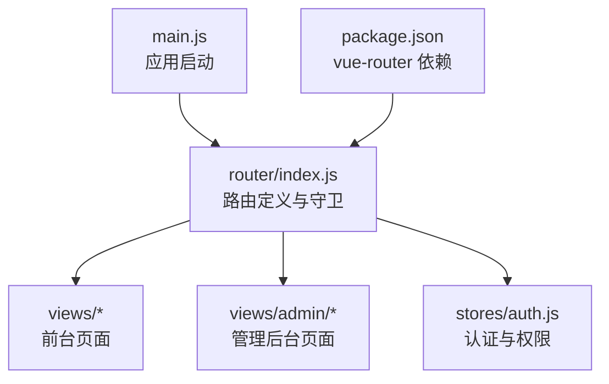
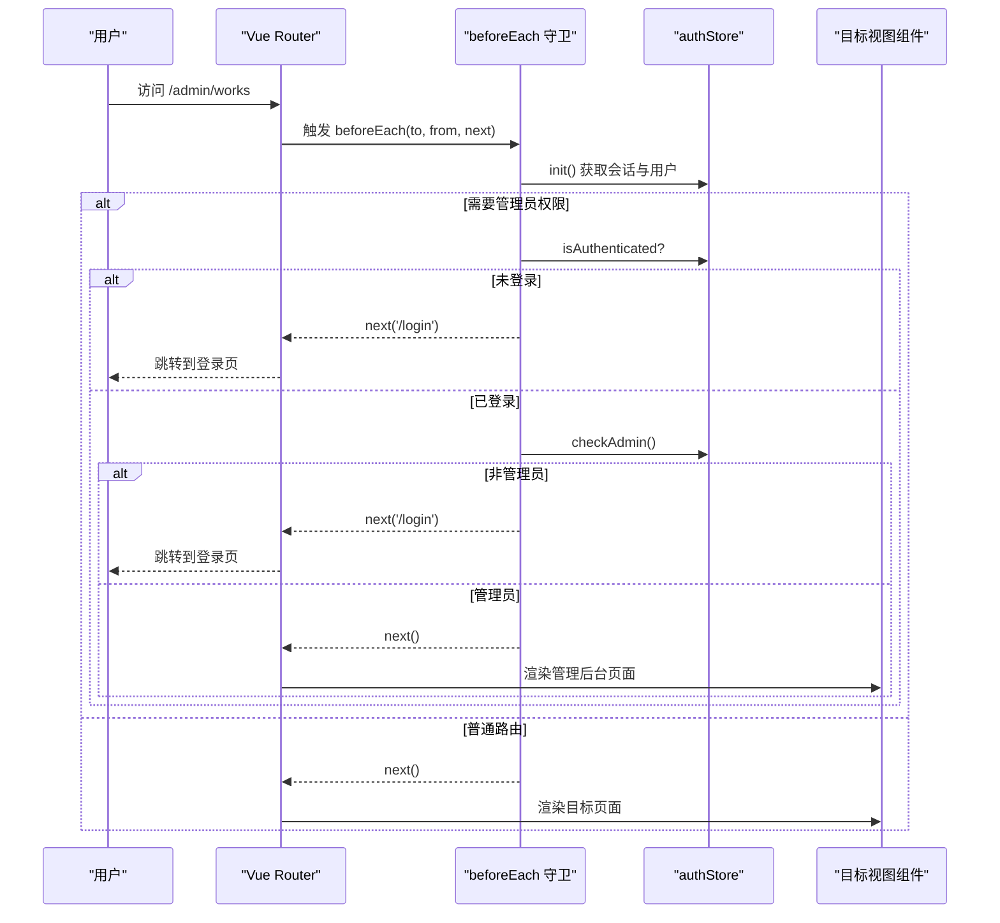
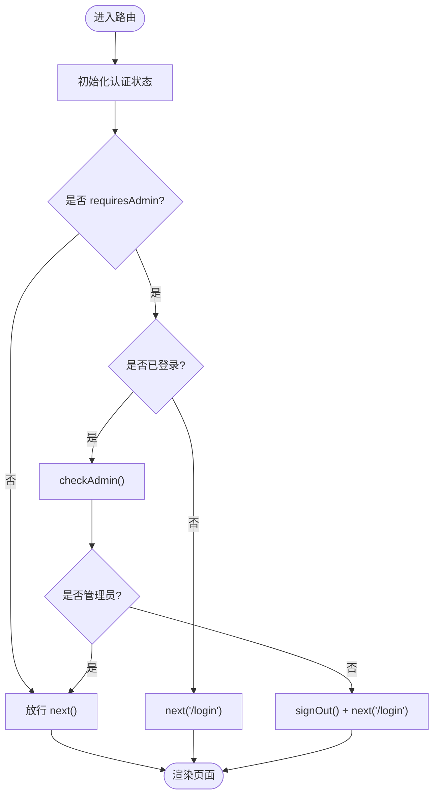
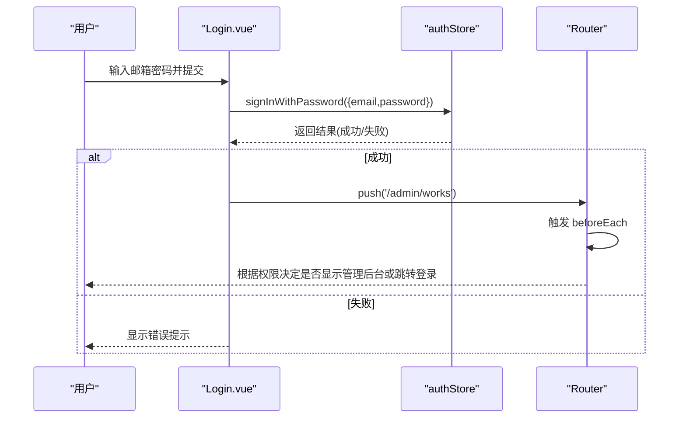
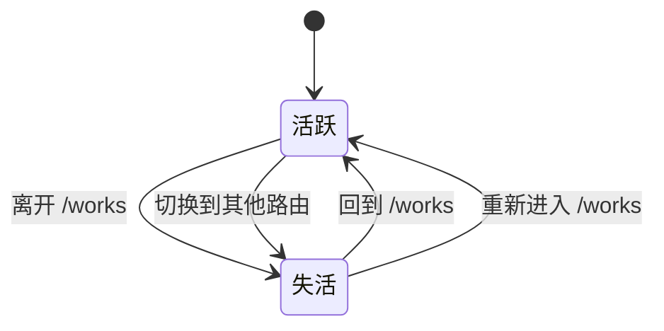
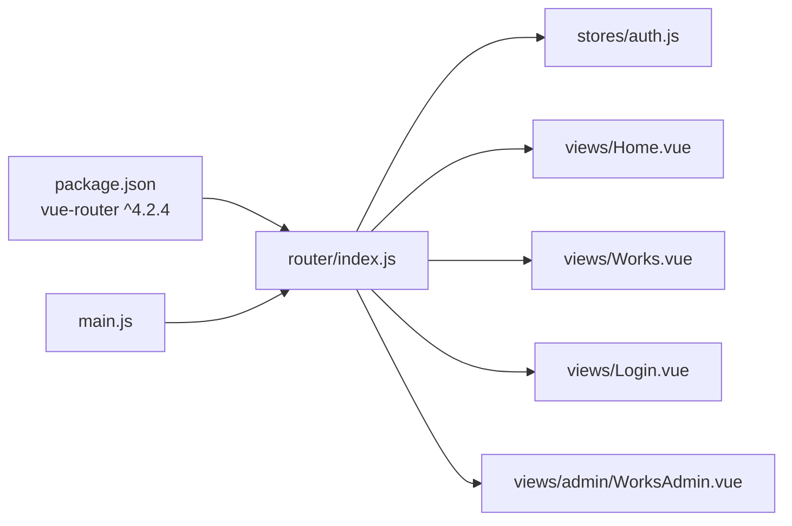

# 路由设计

<cite>
**本文引用的文件**   
- [src/router/index.js](file://src/router/index.js)
- [src/stores/auth.js](file://src/stores/auth.js)
- [src/main.js](file://src/main.js)
- [package.json](file://package.json)
- [src/views/Login.vue](file://src/views/Login.vue)
- [src/views/Home.vue](file://src/views/Home.vue)
- [src/views/Works.vue](file://src/views/Works.vue)
- [src/views/admin/WorksAdmin.vue](file://src/views/admin/WorksAdmin.vue)
</cite>

## 目录
1. [引言](#引言)
2. [项目结构](#项目结构)
3. [核心组件](#核心组件)
4. [架构总览](#架构总览)
5. [详细组件分析](#详细组件分析)
6. [依赖关系分析](#依赖关系分析)
7. [性能与缓存策略](#性能与缓存策略)
8. [故障排查指南](#故障排查指南)
9. [结论](#结论)

## 引言
本文件为 sunwenxu1997.github.io 项目的路由设计文档，聚焦 Vue Router 配置、路由守卫、权限控制、页面缓存、懒加载与代码分割。目标是帮助开发者快速理解：
- 如何注册路由与使用 Hash 模式
- 如何通过路由元信息实现管理员权限保护
- 如何使用 keep-alive 进行页面级缓存与滚动位置恢复
- 如何通过动态导入实现路由懒加载与按需打包
- 如何在登录页与管理后台之间完成受控跳转

## 项目结构
本项目采用基于功能的路由组织方式：
- 前台页面位于 views 根目录
- 管理后台页面位于 views/admin 子目录
- 路由定义集中在 router/index.js
- 认证状态与权限判断集中在 stores/auth.js
- 应用启动与路由初始化在 main.js

**图表来源**
- [src/main.js:16-33](file://src/main.js#L16-L33)
- [src/router/index.js:1-49](file://src/router/index.js#L1-L49)
- [package.json:12-23](file://package.json#L12-L23)

**章节来源**
- [src/main.js:16-33](file://src/main.js#L16-L33)
- [src/router/index.js:1-49](file://src/router/index.js#L1-L49)
- [package.json:12-23](file://package.json#L12-L23)

## 核心组件
- 路由入口与历史模式
  - 使用 createWebHashHistory，适配 GitHub Pages 等静态托管场景
  - 通过 BASE_URL 注入基础路径
- 路由表
  - 首页、作品列表、关于、登录、作品详情、404
  - 管理后台作品列表路由标记 requiresAdmin
- 路由守卫
  - beforeEach 中初始化认证状态
  - 对 requiresAdmin 路由进行登录态与管理员角色校验
- 认证状态与权限
  - Pinia store 封装 Supabase Auth
  - checkAdmin 调用 is_admin RPC 判定管理员身份
- 懒加载与代码分割
  - 所有路由组件均使用动态 import
- 页面缓存
  - 作品列表路由 meta.keepAlive=true，配合 keep-alive 缓存组件实例与滚动位置

**章节来源**
- [src/router/index.js:1-73](file://src/router/index.js#L1-L73)
- [src/stores/auth.js:1-82](file://src/stores/auth.js#L1-L82)
- [package.json:12-23](file://package.json#L12-L23)

## 架构总览
下图展示从浏览器导航到路由守卫再到页面渲染的完整流程，以及权限校验的关键分支。

**图表来源**
- [src/router/index.js:51-70](file://src/router/index.js#L51-L70)
- [src/stores/auth.js:12-66](file://src/stores/auth.js#L12-L66)

## 详细组件分析

### 路由配置与映射表
- 历史模式：Hash 模式，适合静态站点托管
- 路由元信息：title 用于页面标题；keepAlive 用于页面缓存；requiresAdmin 用于权限控制
- 动态参数：/work/:id(.*) 支持任意 id 格式
- 通配符：/:pathMatch(.*)* 作为 404 兜底

| 路径 | 名称 | 组件 | 元信息 | 说明 |
|---|---|---|---|---|
| / | Home | Home.vue | title=首页 | 首页入口 |
| /works | Works | Works.vue | title=作品, keepAlive=true | 作品列表，启用缓存 |
| /about | About | About.vue | title=关于 | 关于页面 |
| /login | Login | Login.vue | title=登录 | 登录页 |
| /admin/works | AdminWorks | admin/WorksAdmin.vue | title=作品管理, requiresAdmin=true | 管理后台，需管理员权限 |
| /work/:id(.*) | WorkDetail | WorkDetail.vue | title=作品详情 | 作品详情页 |
| /:pathMatch(.*)* | 404 | 404.vue | title=404 | 未匹配路由 |

**章节来源**
- [src/router/index.js:4-49](file://src/router/index.js#L4-L49)

### 路由守卫与权限控制
- 初始化认证状态：每次进入路由前调用 authStore.init()，确保 session 与 user 最新
- 管理员保护：
  - 若 to.meta.requiresAdmin 为真，则检查 isAuthenticated
  - 未登录直接重定向到 /login
  - 已登录但非管理员时提示并退出登录，再重定向到 /login
- 普通路由：直接放行

**图表来源**
- [src/router/index.js:51-70](file://src/router/index.js#L51-L70)
- [src/stores/auth.js:12-66](file://src/stores/auth.js#L12-L66)

**章节来源**
- [src/router/index.js:51-70](file://src/router/index.js#L51-L70)
- [src/stores/auth.js:12-66](file://src/stores/auth.js#L12-L66)

### 登录流程与跳转
- 登录页表单提交后调用 authStore.signInWithPassword
- 成功后 toast 提示并跳转到 /admin/works
- 由于 /admin/works 设置了 requiresAdmin，若当前用户不是管理员，将被守卫拦截并再次重定向到 /login

**图表来源**
- [src/views/Login.vue:122-143](file://src/views/Login.vue#L122-L143)
- [src/router/index.js:51-70](file://src/router/index.js#L51-L70)

**章节来源**
- [src/views/Login.vue:122-143](file://src/views/Login.vue#L122-L143)
- [src/router/index.js:51-70](file://src/router/index.js#L51-L70)

### 页面缓存策略（keep-alive）
- 作品列表路由设置 meta.keepAlive=true，表示该页面可被缓存
- 在父容器中使用 <keep-alive> 包裹 <router-view> 时，离开页面会保留组件实例与 DOM 状态
- Works.vue 内部还自行维护 window 滚动位置，避免 keep-alive 仅缓存组件状态而丢失滚动位置的问题
- 从作品详情页返回列表时，优先复用缓存数据，减少重复请求

**图表来源**
- [src/router/index.js:13-17](file://src/router/index.js#L13-L17)
- [src/views/Works.vue:42-70](file://src/views/Works.vue#L42-L70)

**章节来源**
- [src/router/index.js:13-17](file://src/router/index.js#L13-L17)
- [src/views/Works.vue:42-70](file://src/views/Works.vue#L42-L70)

### 懒加载与代码分割
- 所有路由组件均采用动态 import，例如：
  - Home.vue、Works.vue、About.vue、Login.vue、WorkDetail.vue、404.vue、admin/WorksAdmin.vue
- 好处：
  - 首屏只加载必要路由，减小初始包体积
  - 各页面独立 chunk，提升并行加载效率
- 建议：
  - 将高频访问且体积较大的页面单独拆分
  - 对公共组件提取为共享模块，避免重复打包

**章节来源**
- [src/router/index.js:6-47](file://src/router/index.js#L6-L47)

### 管理后台页面
- WorksAdmin.vue 提供编辑与列表两个标签页
- 通过路由守卫限制只有管理员可访问
- 页面内包含统计、资料、退出登录等功能

**章节来源**
- [src/views/admin/WorksAdmin.vue:1-263](file://src/views/admin/WorksAdmin.vue#L1-L263)

## 依赖关系分析
- vue-router 版本：^4.2.4
- 应用启动顺序：
  1. 创建 Vue 应用
  2. 安装 Pinia
  3. 安装 Router
  4. 等待路由就绪、字体与首屏图片加载完成后挂载

**图表来源**
- [package.json:12-23](file://package.json#L12-L23)
- [src/main.js:16-33](file://src/main.js#L16-L33)
- [src/router/index.js:1-49](file://src/router/index.js#L1-L49)

**章节来源**
- [package.json:12-23](file://package.json#L12-L23)
- [src/main.js:16-33](file://src/main.js#L16-L33)
- [src/router/index.js:1-49](file://src/router/index.js#L1-L49)

## 性能与缓存策略
- 路由懒加载
  - 所有页面组件动态导入，降低首屏体积
- 页面缓存
  - 作品列表开启 keepAlive，减少二次进入时的渲染与请求开销
  - 滚动位置在组件生命周期中手动保存与恢复，保证用户体验
- 首屏优化
  - main.js 中按序等待路由 chunk、字体与首屏图片，避免闪烁与布局抖动
- 建议
  - 对大体积页面继续拆分与预取
  - 合理使用 keep-alive，避免过多页面同时缓存导致内存占用过高
  - 对频繁切换的页面启用缓存，对一次性页面关闭缓存

[本节为通用性能建议，不直接分析具体文件]

## 故障排查指南
- 无法进入管理后台
  - 确认是否已登录
  - 确认 checkAdmin 是否返回 true
  - 检查 is_admin 函数与数据库权限配置
- 登录后仍被重定向到登录页
  - 检查路由守卫中对 requiresAdmin 的判断逻辑
  - 确认 signOut 后是否正确清理了本地状态
- 列表页滚动位置丢失
  - 确认 keepAlive 是否生效
  - 检查 onActivated/onDeactivated 中滚动位置的保存与恢复逻辑
- 首屏加载异常
  - 检查 main.js 中的 waitRoute/waitFonts/waitImages 调用顺序
  - 确认首屏图片资源路径正确

**章节来源**
- [src/router/index.js:51-70](file://src/router/index.js#L51-L70)
- [src/stores/auth.js:59-66](file://src/stores/auth.js#L59-L66)
- [src/views/Works.vue:42-70](file://src/views/Works.vue#L42-L70)
- [src/main.js:16-33](file://src/main.js#L16-L33)

## 结论
本项目通过 Vue Router 的 Hash 模式、动态导入与路由守卫实现了清晰的路由结构与严格的管理员权限控制。结合 keep-alive 与滚动位置管理，显著提升了页面切换体验与性能。建议在后续迭代中持续优化懒加载粒度与缓存范围，并根据业务增长扩展更细粒度的权限模型与路由元信息。