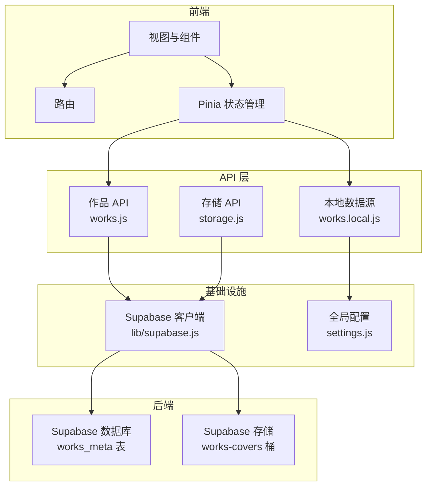
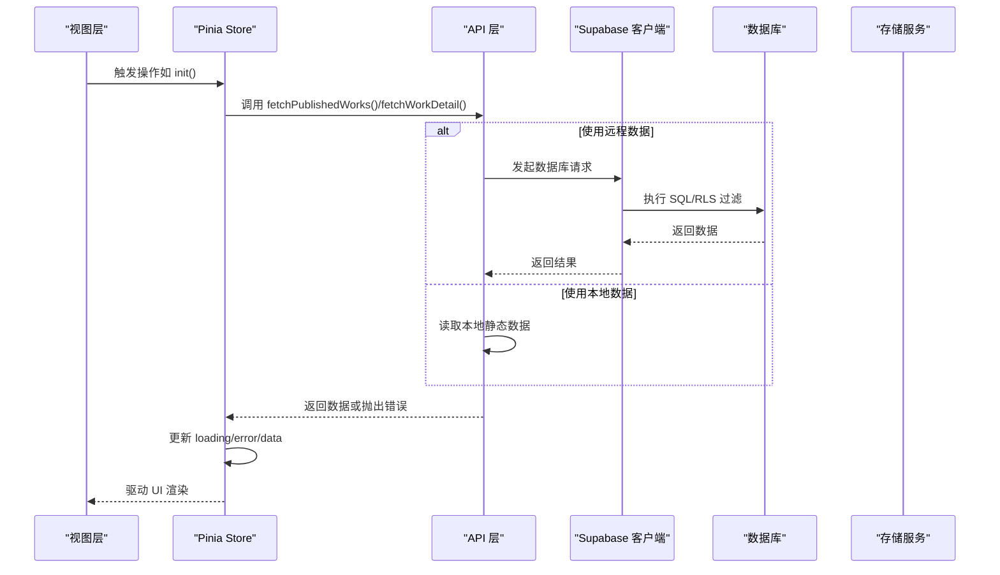
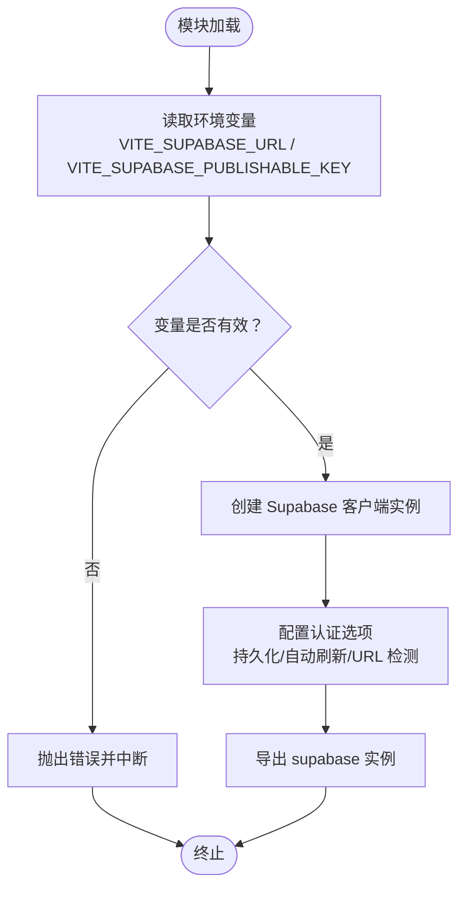
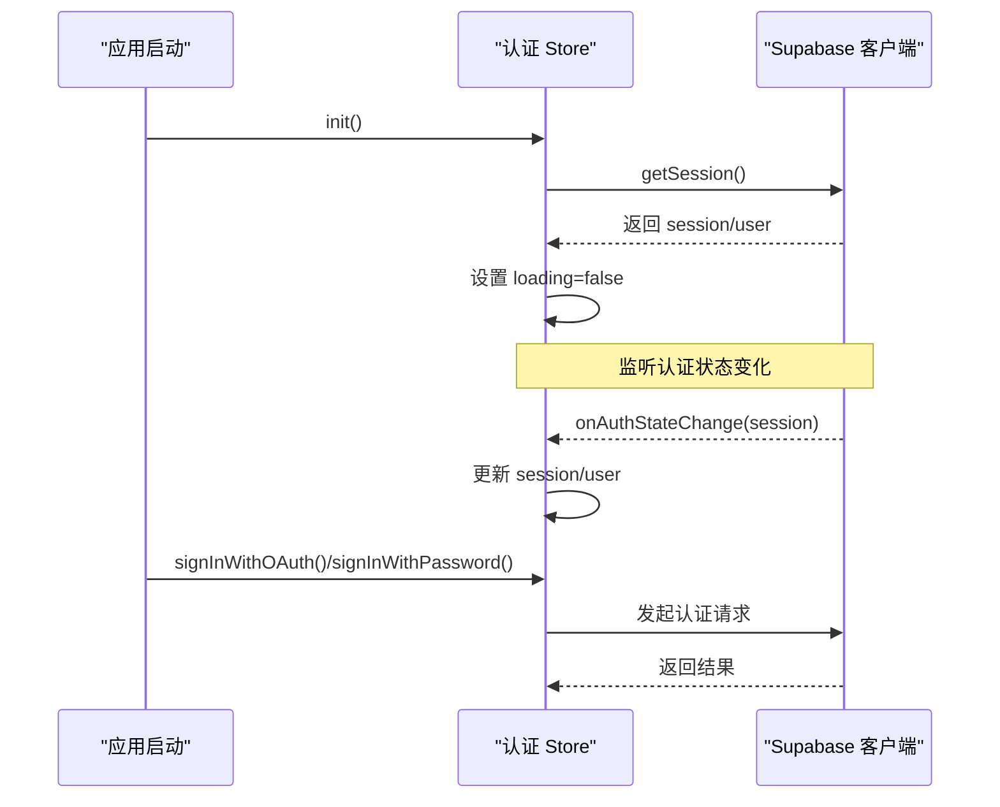
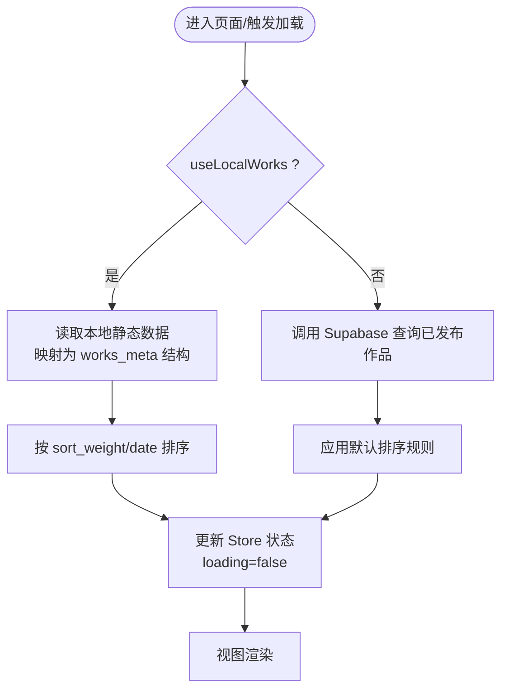
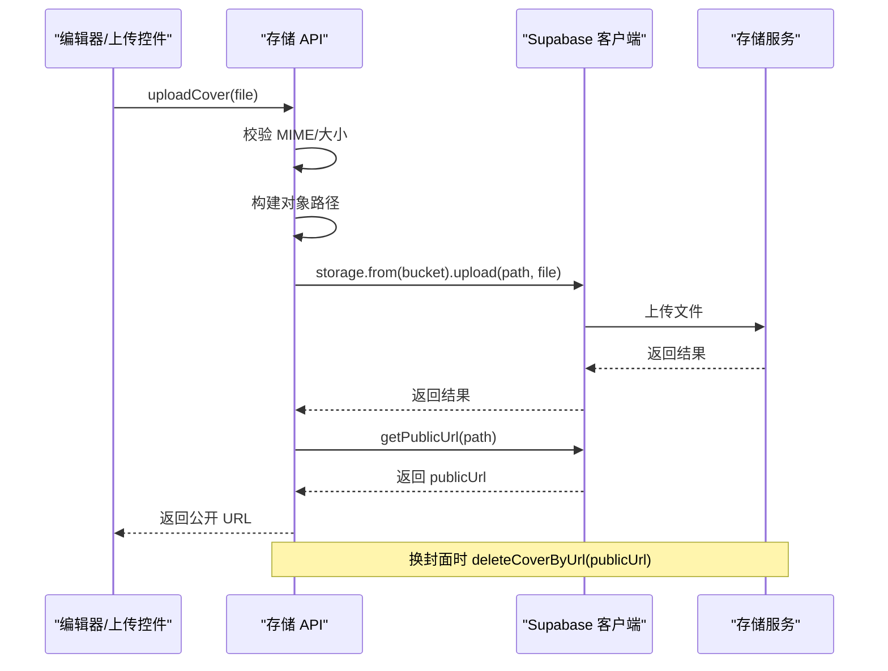
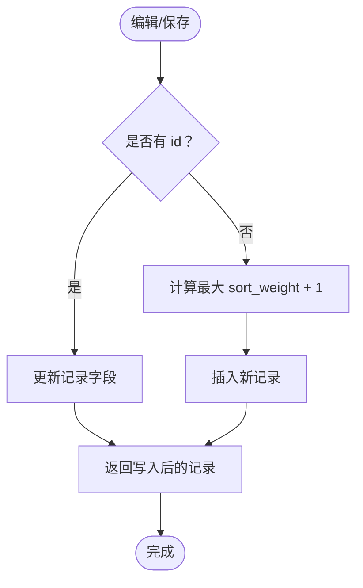
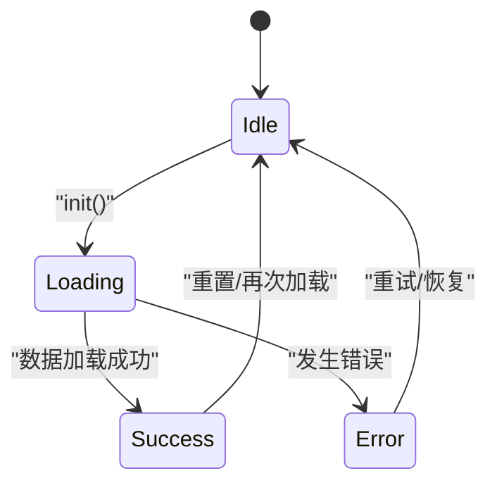
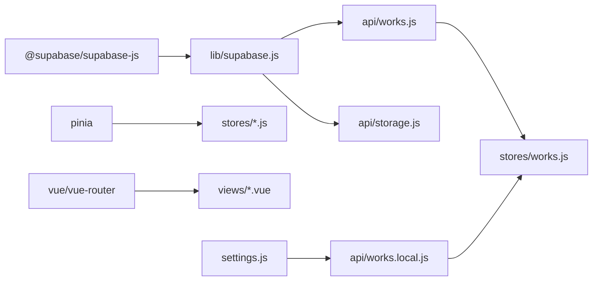

# 数据流设计

<cite>
**本文引用的文件**   
- [src/lib/supabase.js](file://src/lib/supabase.js)
- [src/api/storage.js](file://src/api/storage.js)
- [src/api/works.js](file://src/api/works.js)
- [src/api/works.local.js](file://src/api/works.local.js)
- [src/stores/auth.js](file://src/stores/auth.js)
- [src/stores/works.js](file://src/stores/works.js)
- [src/settings.js](file://src/settings.js)
- [package.json](file://package.json)
</cite>

## 目录
1. [引言](#引言)
2. [项目结构](#项目结构)
3. [核心组件](#核心组件)
4. [架构总览](#架构总览)
5. [详细组件分析](#详细组件分析)
6. [依赖关系分析](#依赖关系分析)
7. [性能与缓存策略](#性能与缓存策略)
8. [故障排查指南](#故障排查指南)
9. [结论](#结论)

## 引言
本文件为 sunwenxu1997.github.io 项目的数据流设计文档，聚焦从用户交互到数据存储的完整生命周期。内容涵盖：
- Supabase 客户端封装与配置（认证、数据库、存储）
- 数据获取策略（懒加载、本地模拟、错误处理）
- 状态同步机制（UI 与数据一致性）
- 本地数据模拟（开发环境离线调试）
- 数据流图与状态转换图，帮助理解数据在系统中的流转过程

## 项目结构
本项目采用“按功能域组织”的结构：
- lib：基础设施（Supabase 客户端）
- api：领域 API（数据库、存储、本地数据源）
- stores：应用状态（Pinia Store）
- settings：全局配置与本地静态数据
- views/components：视图与组件层（消费状态与 API）

**图表来源**
- [src/lib/supabase.js:1-17](file://src/lib/supabase.js#L1-L17)
- [src/api/works.js:1-20](file://src/api/works.js#L1-L20)
- [src/api/storage.js:1-24](file://src/api/storage.js#L1-L24)
- [src/api/works.local.js:1-20](file://src/api/works.local.js#L1-L20)
- [src/stores/works.js:1-10](file://src/stores/works.js#L1-L10)
- [src/settings.js:1-8](file://src/settings.js#L1-L8)

**章节来源**
- [src/lib/supabase.js:1-17](file://src/lib/supabase.js#L1-L17)
- [src/api/works.js:1-20](file://src/api/works.js#L1-L20)
- [src/api/storage.js:1-24](file://src/api/storage.js#L1-L24)
- [src/api/works.local.js:1-20](file://src/api/works.local.js#L1-L20)
- [src/stores/works.js:1-10](file://src/stores/works.js#L1-L10)
- [src/settings.js:1-8](file://src/settings.js#L1-L8)

## 核心组件
- Supabase 客户端封装：统一初始化、环境变量校验、会话持久化与自动刷新。
- 作品 API：对 works_meta 表的查询、分页、筛选、增删改；支持本地数据源切换。
- 存储 API：封面上传、公开 URL 生成、旧图清理；类型与体积前置校验。
- 本地数据源：将 settings.externalRoutes 映射为 works_meta 结构，提供等价的数据接口。
- 认证 Store：会话初始化、监听状态变化、OAuth/密码登录注册、管理员权限检查。
- 作品 Store：列表懒加载、错误处理、本地/远程数据源切换。

**章节来源**
- [src/lib/supabase.js:1-17](file://src/lib/supabase.js#L1-L17)
- [src/api/works.js:1-20](file://src/api/works.js#L1-L20)
- [src/api/storage.js:1-24](file://src/api/storage.js#L1-L24)
- [src/api/works.local.js:1-20](file://src/api/works.local.js#L1-L20)
- [src/stores/auth.js:1-10](file://src/stores/auth.js#L1-L10)
- [src/stores/works.js:1-10](file://src/stores/works.js#L1-L10)

## 架构总览
整体数据流遵循“视图 → Store → API → 基础设施 → 后端”的分层模型：
- 视图触发交互（如打开作品列表、查看详情、上传封面）。
- Store 负责状态管理与副作用（调用 API、处理错误、更新响应式状态）。
- API 层屏蔽底层差异（Supabase 或本地数据），向上暴露统一接口。
- 基础设施层提供 Supabase 客户端能力（认证、数据库、存储）。
- 后端由 Supabase 数据库与存储承担。

**图表来源**
- [src/stores/works.js:12-25](file://src/stores/works.js#L12-L25)
- [src/api/works.js:45-55](file://src/api/works.js#L45-L55)
- [src/api/works.js:186-195](file://src/api/works.js#L186-L195)
- [src/api/works.local.js:53-58](file://src/api/works.local.js#L53-L58)
- [src/lib/supabase.js:10-16](file://src/lib/supabase.js#L10-L16)

## 详细组件分析

### Supabase 客户端封装与配置
- 通过环境变量注入 Supabase 地址与发布密钥，缺失时直接抛错，避免运行时静默失败。
- 启用会话持久化、自动刷新令牌、URL 中检测会话，提升用户体验与安全性。
- 导出单例客户端供 API 层复用，保证连接与配置一致。

**图表来源**
- [src/lib/supabase.js:3-8](file://src/lib/supabase.js#L3-L8)
- [src/lib/supabase.js:10-16](file://src/lib/supabase.js#L10-L16)

**章节来源**
- [src/lib/supabase.js:1-17](file://src/lib/supabase.js#L1-L17)

### 认证流程与会话管理
- 初始化时拉取当前会话并填充 user/session/loading 状态。
- 订阅 auth 状态变化，实时同步 session/user。
- 提供 OAuth、邮箱密码登录/注册、登出方法。
- 通过 RPC 检查管理员权限，用于后台访问控制。

**图表来源**
- [src/stores/auth.js:12-27](file://src/stores/auth.js#L12-L27)
- [src/stores/auth.js:29-57](file://src/stores/auth.js#L29-L57)
- [src/stores/auth.js:59-66](file://src/stores/auth.js#L59-L66)

**章节来源**
- [src/stores/auth.js:1-82](file://src/stores/auth.js#L1-L82)

### 作品数据获取与本地模拟
- 列表获取：
  - 远程模式：调用 Supabase 查询已发布作品，按默认排序规则排序。
  - 本地模式：读取 settings.externalRoutes，映射为 works_meta 结构并排序。
- 详情获取：
  - 远程模式：校验 UUID 后查询单条记录。
  - 本地模式：根据 id 匹配外部路由条目。
- Store 层：
  - 懒加载：仅在需要时调用 init()。
  - 错误处理：捕获异常并记录 error 信息，同时清空数据避免不一致。
  - 数据源切换：依据 settings.useLocalWorks 决定走本地还是远程。

**图表来源**
- [src/stores/works.js:12-25](file://src/stores/works.js#L12-L25)
- [src/api/works.js:45-55](file://src/api/works.js#L45-L55)
- [src/api/works.local.js:53-58](file://src/api/works.local.js#L53-L58)

**章节来源**
- [src/stores/works.js:1-29](file://src/stores/works.js#L1-L29)
- [src/api/works.js:45-55](file://src/api/works.js#L45-L55)
- [src/api/works.js:186-195](file://src/api/works.js#L186-L195)
- [src/api/works.local.js:1-59](file://src/api/works.local.js#L1-L59)
- [src/settings.js:1-8](file://src/settings.js#L1-L8)

### 封面存储与上传流程
- 前端校验：
  - MIME 类型白名单（JPG/PNG/WebP/GIF）。
  - 体积上限：静态图 2MB，GIF 10MB。
- 上传逻辑：
  - 生成对象路径（包含年月与随机串），避免中文文件名问题与覆盖。
  - 设置 cacheControl 以利用 CDN 缓存。
  - 上传成功后获取公开 URL。
- 删除旧图：
  - 从公开 URL 反解对象路径，仅对本 bucket 的文件执行删除。
  - 删除失败仅告警，不影响主流程。

**图表来源**
- [src/api/storage.js:62-83](file://src/api/storage.js#L62-L83)
- [src/api/storage.js:90-99](file://src/api/storage.js#L90-L99)

**章节来源**
- [src/api/storage.js:1-100](file://src/api/storage.js#L1-L100)

### 作品增删改与排序批量更新
- 新增/更新：
  - 有 id 则更新字段；无 id 则新增并自动分配 sort_weight。
- 批量更新权重：
  - 拖拽排序后批量更新 sort_weight，避免全量重排。
- 删除作品：
  - 先删除数据库记录，再尝试清理对应封面文件；文件删除失败仅告警。

**图表来源**
- [src/api/works.js:203-231](file://src/api/works.js#L203-L231)

**章节来源**
- [src/api/works.js:203-231](file://src/api/works.js#L203-L231)
- [src/api/works.js:240-249](file://src/api/works.js#L240-L249)
- [src/api/works.js:256-266](file://src/api/works.js#L256-L266)

### 状态同步机制（UI 与数据一致性）
- 认证状态：
  - 初始化时拉取会话，订阅状态变化实时更新 user/session。
  - 登出后清空状态，确保 UI 不再显示敏感信息。
- 作品列表状态：
  - 加载前设置 loading=true，完成后置 false。
  - 捕获错误并记录 error，避免 UI 展示脏数据。
  - 本地/远程数据源切换透明，UI 无需感知差异。

**图表来源**
- [src/stores/auth.js:12-27](file://src/stores/auth.js#L12-L27)
- [src/stores/works.js:12-25](file://src/stores/works.js#L12-L25)

**章节来源**
- [src/stores/auth.js:12-27](file://src/stores/auth.js#L12-L27)
- [src/stores/works.js:12-25](file://src/stores/works.js#L12-L25)

## 依赖关系分析
- 包依赖：
  - @supabase/supabase-js：Supabase 客户端库。
  - pinia：状态管理。
  - vue/vue-router：前端框架与路由。
- 模块依赖：
  - API 层依赖 Supabase 客户端与全局配置。
  - Store 层依赖 API 层与全局配置。
  - 视图层依赖 Store 层。

**图表来源**
- [package.json:12-23](file://package.json#L12-L23)
- [src/lib/supabase.js:1-17](file://src/lib/supabase.js#L1-L17)
- [src/api/works.js:1-5](file://src/api/works.js#L1-L5)
- [src/api/storage.js:1-2](file://src/api/storage.js#L1-L2)
- [src/api/works.local.js:1-2](file://src/api/works.local.js#L1-L2)
- [src/stores/works.js:1-6](file://src/stores/works.js#L1-L6)

**章节来源**
- [package.json:12-23](file://package.json#L12-L23)
- [src/lib/supabase.js:1-17](file://src/lib/supabase.js#L1-L17)
- [src/api/works.js:1-5](file://src/api/works.js#L1-L5)
- [src/api/storage.js:1-2](file://src/api/storage.js#L1-L2)
- [src/api/works.local.js:1-2](file://src/api/works.local.js#L1-L2)
- [src/stores/works.js:1-6](file://src/stores/works.js#L1-L6)

## 性能与缓存策略
- 图片缓存：
  - 上传封面时设置 cacheControl=31536000，充分利用 CDN 缓存，减少带宽消耗。
- 排序稳定性：
  - 数据库查询使用多列排序（sort_weight、date、created_at、id），避免并列行导致的不稳定顺序。
- 本地模拟：
  - 开发环境可通过 settings.useLocalWorks 切换到本地数据，避免网络依赖，加速迭代。
- 懒加载：
  - Store 的 init() 按需调用，避免不必要的请求。

[本节为通用性能建议，不直接分析具体文件]

## 故障排查指南
- 环境变量缺失：
  - 若未配置 VITE_SUPABASE_URL 或 VITE_SUPABASE_PUBLISHABLE_KEY，客户端初始化会抛错。请检查 .env 或构建环境。
- 认证失败：
  - 检查 OAuth 提供商配置与回调地址；确认 is_admin RPC 是否存在且返回布尔值。
- 上传失败：
  - 检查 MIME 类型与文件大小是否符合限制；确认 Storage RLS 策略允许 admin 写入。
- 数据不一致：
  - 检查 Store 的错误处理分支是否正确记录 error 并清空数据；确认本地/远程数据源切换逻辑正确。

**章节来源**
- [src/lib/supabase.js:6-8](file://src/lib/supabase.js#L6-L8)
- [src/stores/auth.js:59-66](file://src/stores/auth.js#L59-L66)
- [src/api/storage.js:62-83](file://src/api/storage.js#L62-L83)
- [src/stores/works.js:18-22](file://src/stores/works.js#L18-L22)

## 结论
本项目通过清晰的层次划分与统一的 API 抽象，实现了从用户交互到数据存储的完整数据流。Supabase 客户端封装确保了认证、数据库与存储的一致性与可维护性；Store 层负责状态同步与错误处理；本地数据源为开发环境提供了离线调试能力。结合懒加载、缓存与稳定的排序策略，系统在性能与体验上达到了良好平衡。开发者可基于本文档快速定位数据流转路径，并在扩展功能时保持架构一致性。