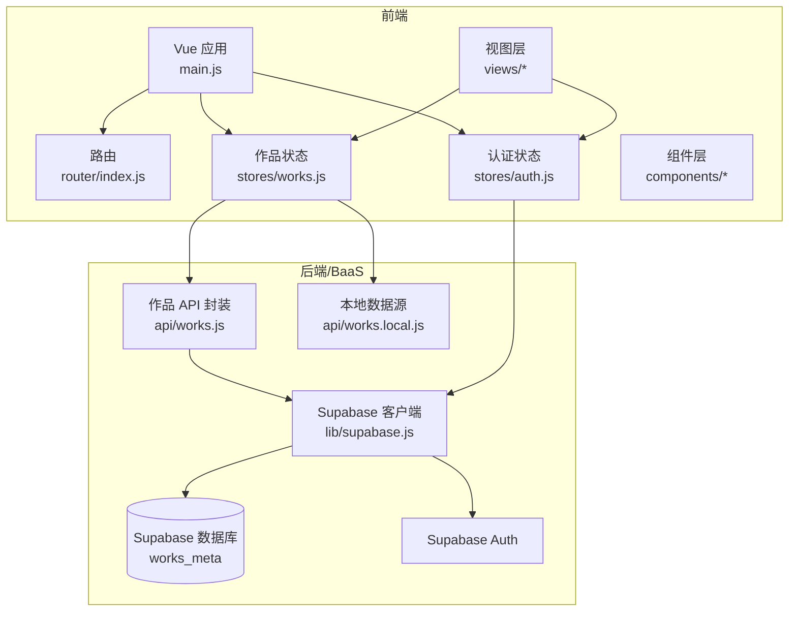
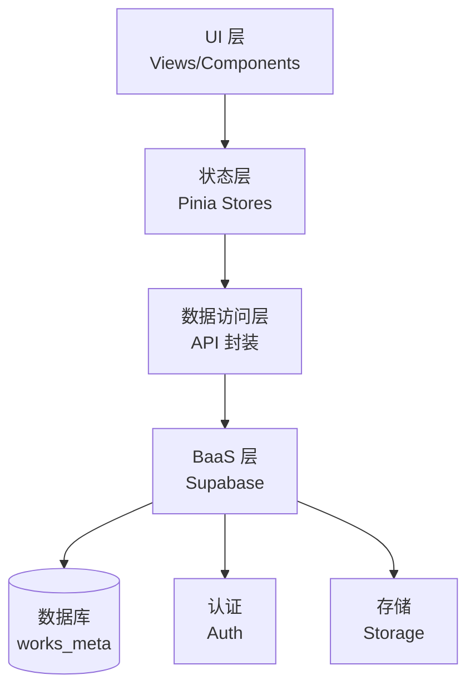
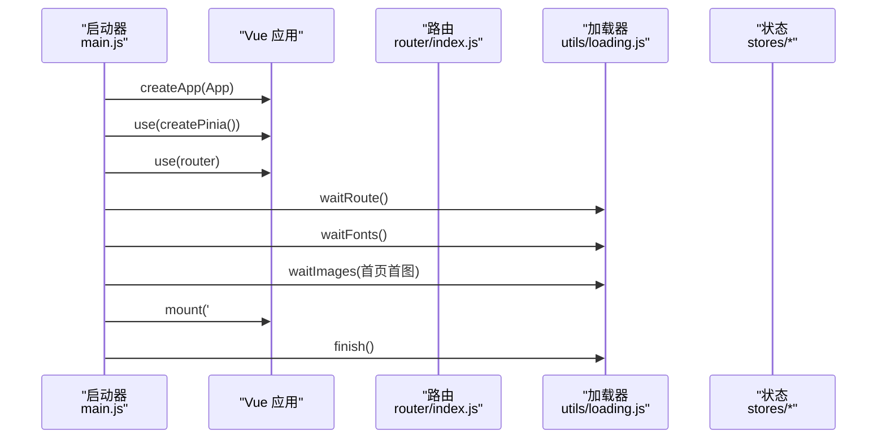
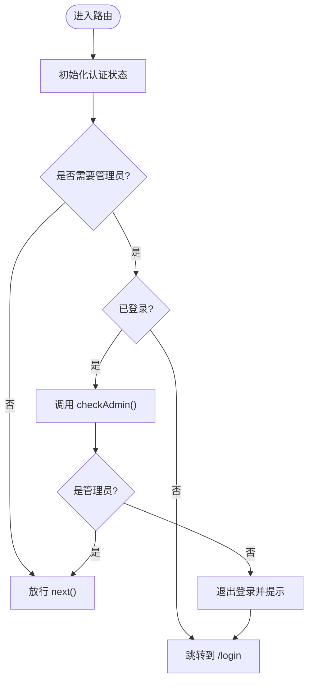
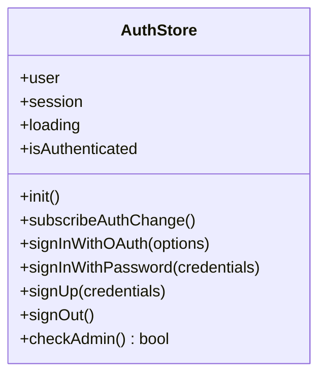
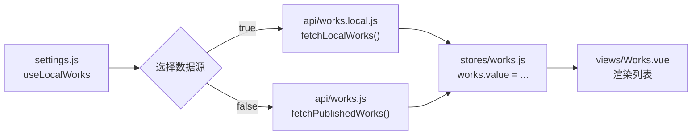
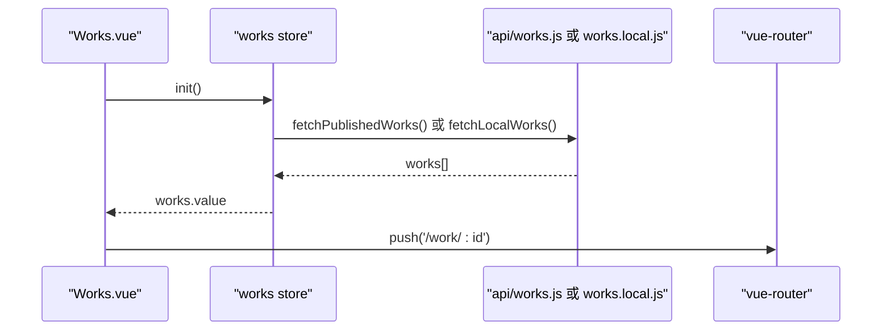
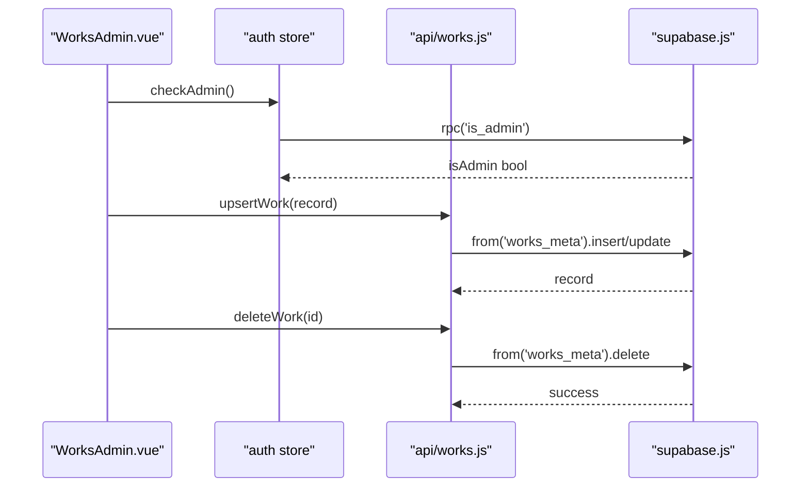
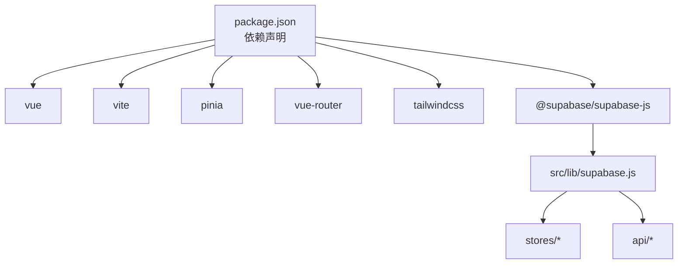
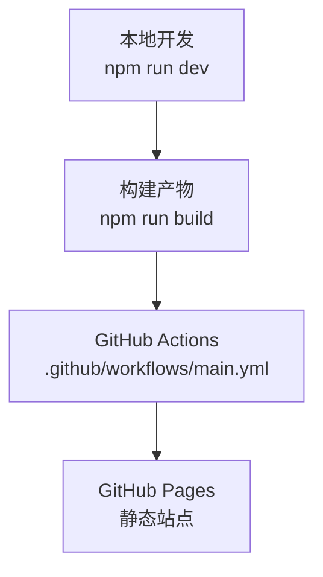

# 整体架构概览

<cite>
**本文引用的文件**   
- [package.json](file://package.json)
- [README.md](file://README.md)
- [vite.config.js](file://vite.config.js)
- [.github/workflows/main.yml](file://.github/workflows/main.yml)
- [src/main.js](file://src/main.js)
- [src/settings.js](file://src/settings.js)
- [src/lib/supabase.js](file://src/lib/supabase.js)
- [src/router/index.js](file://src/router/index.js)
- [src/stores/auth.js](file://src/stores/auth.js)
- [src/stores/works.js](file://src/stores/works.js)
- [src/api/works.js](file://src/api/works.js)
- [src/api/works.local.js](file://src/api/works.local.js)
- [src/views/Works.vue](file://src/views/Works.vue)
- [src/views/admin/WorksAdmin.vue](file://src/views/admin/WorksAdmin.vue)
</cite>

## 目录
1. [引言](#引言)
2. [项目结构](#项目结构)
3. [核心组件](#核心组件)
4. [架构总览](#架构总览)
5. [详细组件分析](#详细组件分析)
6. [依赖关系分析](#依赖关系分析)
7. [性能与构建部署](#性能与构建部署)
8. [故障排查指南](#故障排查指南)
9. [结论](#结论)

## 引言
本项目是一个基于 Vue 3 + Vite + Pinia + Supabase 的个人作品展示与管理站点。前端使用 Vue 3 作为视图框架，Vite 提供开发体验与构建能力；Pinia 管理认证状态与作品数据；Supabase 提供用户认证、数据库与存储等后端能力。项目支持两种数据源：线上通过 Supabase 的 `works_meta` 表维护作品元数据，本地可通过 `settings.js` 中的静态配置进行调试。管理员通过后台页面完成作品的增删改查与排序，普通用户仅能看到已发布且未隐藏的作品。

## 项目结构
仓库采用按功能域划分的目录组织方式：
- `src/views`：页面级视图组件（首页、作品列表、详情、登录、关于、后台管理）。
- `src/components`：可复用 UI 组件与图标。
- `src/stores`：Pinia 状态模块（认证、作品数据）。
- `src/api`：对 Supabase 的封装与本地数据源适配。
- `src/router`：路由定义与守卫逻辑。
- `src/lib`：第三方服务客户端初始化（Supabase）。
- `src/utils`：工具函数（事件总线、加载遮罩、Markdown 渲染等）。
- `public`：静态资源。
- `sql`：数据库表结构与种子数据的迁移脚本。
- `.github/workflows`：GitHub Actions 自动构建与部署到 GitHub Pages。
- `vite.config.js`、`tailwind.config.js`、`package.json`：构建、样式与依赖配置。

**图表来源**
- [src/main.js:16-39](file://src/main.js#L16-L39)
- [src/router/index.js:4-48](file://src/router/index.js#L4-L48)
- [src/stores/works.js:7-27](file://src/stores/works.js#L7-L27)
- [src/stores/auth.js:5-80](file://src/stores/auth.js#L5-L80)
- [src/api/works.js:45-267](file://src/api/works.js#L45-L267)
- [src/api/works.local.js:53-58](file://src/api/works.local.js#L53-L58)
- [src/lib/supabase.js:10-16](file://src/lib/supabase.js#L10-L16)

**章节来源**
- [README.md:158-189](file://README.md#L158-L189)
- [package.json:12-35](file://package.json#L12-L35)

## 核心组件
- 应用入口与启动流程：`src/main.js` 创建 Vue 应用，注册 Pinia 与 Router，等待路由就绪、字体与首屏图片加载完成后挂载 DOM，并关闭加载遮罩。
- 路由系统：`src/router/index.js` 定义主页、作品列表、关于、登录、后台管理与详情页路由，并通过全局守卫校验管理员权限。
- 状态管理：
  - 认证状态：`src/stores/auth.js` 封装登录、登出、会话初始化、管理员权限检查。
  - 作品数据：`src/stores/works.js` 根据 `settings.useLocalWorks` 切换数据源，统一暴露 `init()` 获取作品列表。
- API 层：
  - 线上数据：`src/api/works.js` 封装 `works_meta` 表的查询、分页、统计、新增/更新、删除等操作。
  - 本地数据：`src/api/works.local.js` 将 `settings.externalRoutes` 映射为与数据库一致的字段结构，便于本地调试。
- 视图层：
  - 作品列表：`src/views/Works.vue` 负责展示、搜索、滚动动画与视图模式切换。
  - 后台管理：`src/views/admin/WorksAdmin.vue` 提供编辑、列表、统计与权限控制。

**章节来源**
- [src/main.js:16-39](file://src/main.js#L16-L39)
- [src/router/index.js:4-72](file://src/router/index.js#L4-L72)
- [src/stores/auth.js:5-80](file://src/stores/auth.js#L5-L80)
- [src/stores/works.js:7-27](file://src/stores/works.js#L7-L27)
- [src/api/works.js:45-267](file://src/api/works.js#L45-L267)
- [src/api/works.local.js:22-58](file://src/api/works.local.js#L22-L58)
- [src/views/Works.vue:30-149](file://src/views/Works.vue#L30-L149)
- [src/views/admin/WorksAdmin.vue:115-247](file://src/views/admin/WorksAdmin.vue#L115-L247)

## 架构总览
系统采用“前端单页应用 + BaaS”的分层架构：
- 表现层：Vue 组件负责 UI 与交互。
- 状态层：Pinia 管理认证与会话、作品数据缓存与合并。
- 数据访问层：API 封装屏蔽 Supabase 客户端细节，并提供本地数据源适配。
- 后端层：Supabase 提供认证、数据库与存储。

**图表来源**
- [src/views/Works.vue:30-149](file://src/views/Works.vue#L30-L149)
- [src/stores/works.js:7-27](file://src/stores/works.js#L7-L27)
- [src/api/works.js:45-267](file://src/api/works.js#L45-L267)
- [src/lib/supabase.js:10-16](file://src/lib/supabase.js#L10-L16)

## 详细组件分析

### 应用启动与首屏加载
应用启动时执行以下关键步骤：
1. 引入全局样式与依赖。
2. 创建 Vue 应用实例，安装 Pinia 与 Router。
3. 等待路由 chunk 加载完成、字体加载完成、首屏图片加载完成。
4. 挂载 DOM 并结束加载遮罩。

**图表来源**
- [src/main.js:16-39](file://src/main.js#L16-L39)

**章节来源**
- [src/main.js:16-39](file://src/main.js#L16-L39)

### 路由系统与权限守卫
路由定义了公开页面与需要管理员权限的后台页面。进入需要管理员权限的路由时，会：
1. 初始化认证状态。
2. 判断是否已登录。
3. 调用后端 RPC 检查管理员身份。
4. 未授权则跳转登录页并清除会话。

**图表来源**
- [src/router/index.js:51-70](file://src/router/index.js#L51-L70)
- [src/stores/auth.js:59-66](file://src/stores/auth.js#L59-L66)

**章节来源**
- [src/router/index.js:4-72](file://src/router/index.js#L4-L72)
- [src/stores/auth.js:59-66](file://src/stores/auth.js#L59-L66)

### 认证状态管理
认证状态模块负责：
- 初始化会话与用户信息。
- 监听认证状态变化。
- 提供邮箱密码登录、OAuth 登录、注册、登出方法。
- 调用后端 RPC 检查管理员身份。

**图表来源**
- [src/stores/auth.js:5-80](file://src/stores/auth.js#L5-L80)

**章节来源**
- [src/stores/auth.js:5-80](file://src/stores/auth.js#L5-L80)

### 作品数据流与双数据源
作品数据支持两条路径：
- 线上数据：从 Supabase 的 `works_meta` 表读取已发布记录，并进行排序与过滤。
- 本地数据：从 `settings.externalRoutes` 转换为与数据库一致的结构，用于本地调试。

**图表来源**
- [src/settings.js:1-8](file://src/settings.js#L1-L8)
- [src/api/works.local.js:53-58](file://src/api/works.local.js#L53-L58)
- [src/api/works.js:45-55](file://src/api/works.js#L45-L55)
- [src/stores/works.js:12-25](file://src/stores/works.js#L12-L25)
- [src/views/Works.vue:30-35](file://src/views/Works.vue#L30-L35)

**章节来源**
- [src/settings.js:1-8](file://src/settings.js#L1-L8)
- [src/api/works.local.js:22-58](file://src/api/works.local.js#L22-L58)
- [src/api/works.js:45-55](file://src/api/works.js#L45-L55)
- [src/stores/works.js:12-25](file://src/stores/works.js#L12-L25)
- [src/views/Works.vue:30-35](file://src/views/Works.vue#L30-L35)

### 作品列表与交互
作品列表页面负责：
- 从 Pinia store 获取作品数据。
- 支持关键词搜索。
- 支持列表与平铺视图切换。
- 使用 GSAP ScrollTrigger 实现滚动入场动画。
- 处理外链打开与内部路由跳转。

**图表来源**
- [src/views/Works.vue:30-149](file://src/views/Works.vue#L30-L149)
- [src/stores/works.js:12-25](file://src/stores/works.js#L12-L25)
- [src/api/works.js:45-55](file://src/api/works.js#L45-L55)
- [src/api/works.local.js:53-58](file://src/api/works.local.js#L53-L58)

**章节来源**
- [src/views/Works.vue:30-149](file://src/views/Works.vue#L30-L149)

### 后台管理与数据操作
后台管理页面提供：
- 编辑与新建作品。
- 列表查看、分页、筛选与统计。
- 发布/取消发布、删除作品。
- 管理员权限校验与退出登录。

**图表来源**
- [src/views/admin/WorksAdmin.vue:179-243](file://src/views/admin/WorksAdmin.vue#L179-L243)
- [src/stores/auth.js:59-66](file://src/stores/auth.js#L59-L66)
- [src/api/works.js:203-267](file://src/api/works.js#L203-L267)
- [src/lib/supabase.js:10-16](file://src/lib/supabase.js#L10-L16)

**章节来源**
- [src/views/admin/WorksAdmin.vue:115-247](file://src/views/admin/WorksAdmin.vue#L115-L247)
- [src/api/works.js:203-267](file://src/api/works.js#L203-L267)

## 依赖关系分析
- 前端框架与工具链：
  - Vue 3 作为视图框架。
  - Vite 提供开发与构建。
  - TailwindCSS 与 Sass 提供样式能力。
  - Pinia 管理状态。
  - Vue Router 管理路由。
  - GSAP、lucide-vue-next、markdown-it、shiki 等增强交互与内容渲染。
- 后端集成：
  - Supabase JS 客户端在 `src/lib/supabase.js` 中初始化，依赖环境变量注入 URL 与密钥。
  - 认证与数据库操作通过 `stores/auth.js` 与 `api/works.js` 封装。

**图表来源**
- [package.json:12-35](file://package.json#L12-L35)
- [src/lib/supabase.js:1-16](file://src/lib/supabase.js#L1-L16)

**章节来源**
- [package.json:12-35](file://package.json#L12-L35)
- [src/lib/supabase.js:1-16](file://src/lib/supabase.js#L1-L16)

## 性能与构建部署
- 构建与预览：
  - 开发命令：`npm run dev`（启用 host 模式）。
  - 构建命令：`npm run build`。
  - 预览命令：`npm run preview`。
- Vite 配置要点：
  - 使用 `@vitejs/plugin-vue` 插件。
  - 设置 `@` 别名指向 `src`。
  - 开发服务器代理 `/api` 到本地后端（当前目标为 `http://localhost:9090`）。
  - PostCSS 集成 TailwindCSS 与 Autoprefixer。
- 部署策略：
  - 使用 GitHub Actions 在推送至 `main` 分支时自动构建并部署到 GitHub Pages。
  - 构建环境注入 Supabase 环境变量（URL 与 Publishable Key）。
  - 产物输出目录为 `dist`，通过 `actions/upload-pages-artifact@v3` 上传。

**图表来源**
- [package.json:5-10](file://package.json#L5-L10)
- [vite.config.js:8-29](file://vite.config.js#L8-L29)
- [.github/workflows/main.yml:17-55](file://.github/workflows/main.yml#L17-L55)

**章节来源**
- [package.json:5-10](file://package.json#L5-L10)
- [vite.config.js:8-29](file://vite.config.js#L8-L29)
- [.github/workflows/main.yml:17-55](file://.github/workflows/main.yml#L17-L55)

## 故障排查指南
- 环境变量缺失：
  - 现象：应用启动时报错缺少 `VITE_SUPABASE_URL` 或 `VITE_SUPABASE_PUBLISHABLE_KEY`。
  - 原因：未在 `.env.local` 或 CI 环境中注入 Supabase 凭证。
  - 处理：确保本地 `.env.local` 与 GitHub Secrets 中配置正确。
- 管理员权限失败：
  - 现象：进入后台被重定向到登录页。
  - 原因：未登录或 `is_admin` 返回 false。
  - 处理：确认已登录且后端 RPC `is_admin` 正常返回 true。
- 作品列表为空：
  - 现象：作品列表无数据。
  - 原因：线上数据未发布或本地数据源未开启。
  - 处理：检查 `settings.useLocalWorks` 与 Supabase 中 `is_published=true` 的记录。
- 构建失败：
  - 现象：CI 构建失败或部署失败。
  - 原因：Node 版本不匹配、依赖安装失败、环境变量缺失。
  - 处理：确认 Node 版本满足要求，检查 npm 缓存与 secrets 配置。

**章节来源**
- [src/lib/supabase.js:6-8](file://src/lib/supabase.js#L6-L8)
- [src/router/index.js:51-70](file://src/router/index.js#L51-L70)
- [src/stores/auth.js:59-66](file://src/stores/auth.js#L59-L66)
- [src/stores/works.js:12-25](file://src/stores/works.js#L12-L25)
- [.github/workflows/main.yml:27-40](file://.github/workflows/main.yml#L27-L40)

## 结论
该项目以 Vue 3 + Vite + Pinia + Supabase 为核心技术栈，形成了清晰的前端分层与 BaaS 集成方案。通过 Pinia 管理认证与作品数据，API 层屏蔽 Supabase 细节并提供本地数据源适配，视图层专注于交互与展示。构建与部署流程自动化，适合个人作品集展示与轻量级内容管理场景。若需扩展，可在现有 API 层增加更多业务接口，或在 Pinia 中扩展更多状态模块，保持前后端解耦与职责清晰。