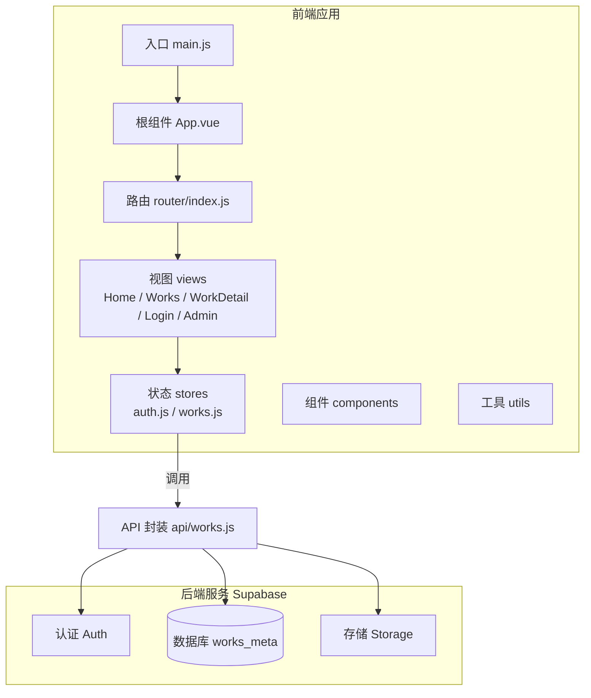
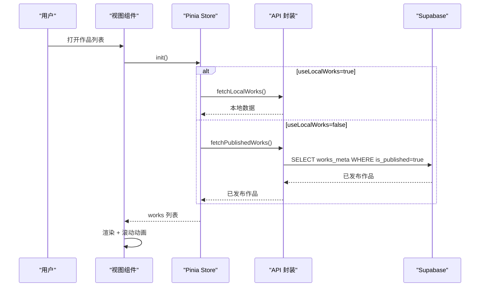
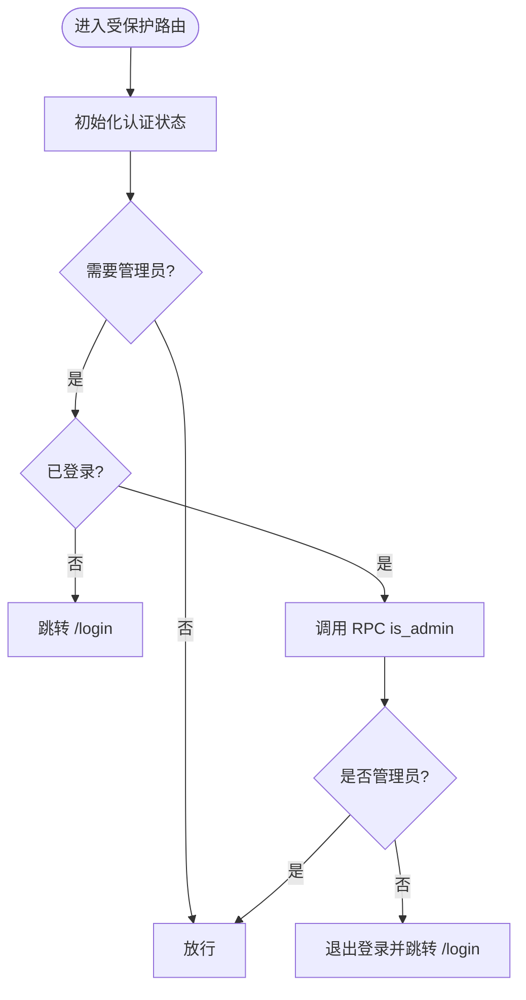
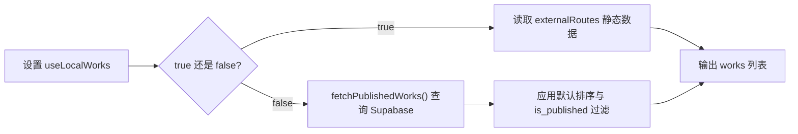
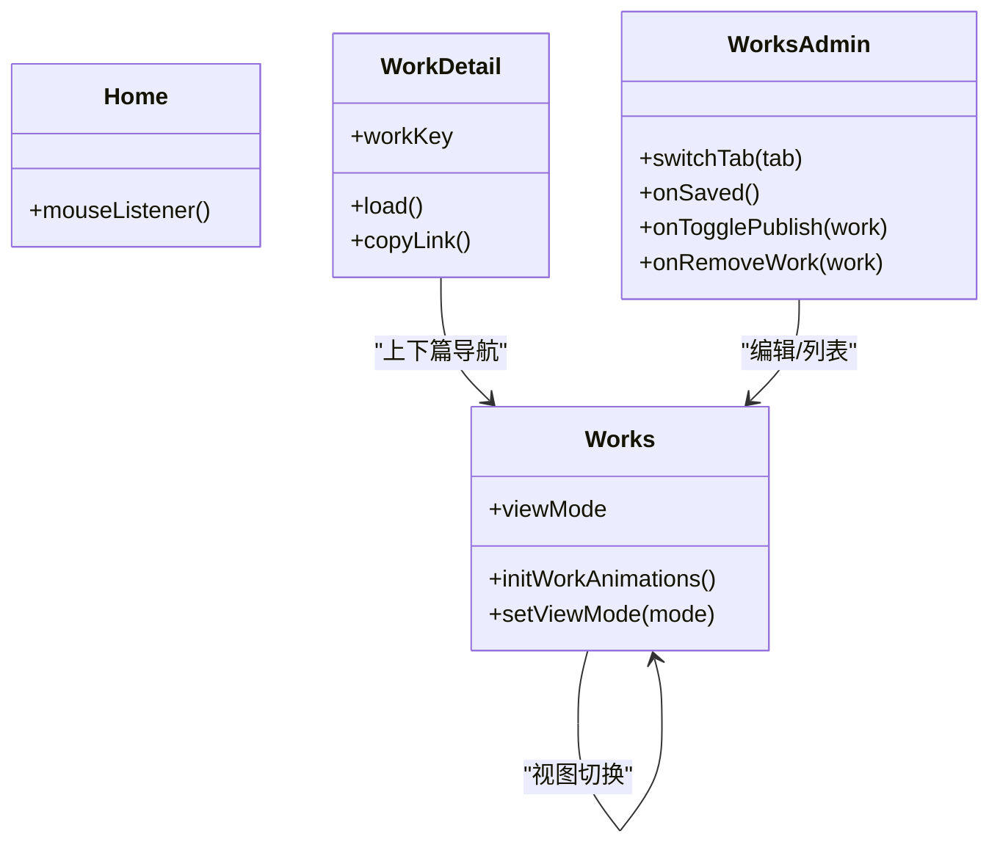
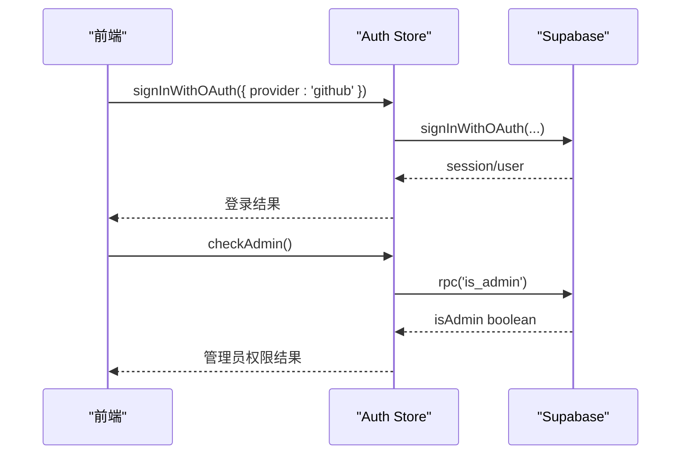
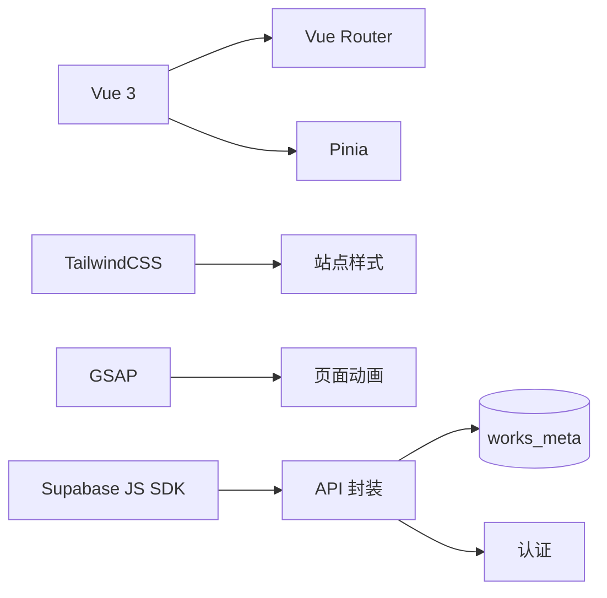

# 架构设计

<cite>
**本文引用的文件**   
- [README.md](file://README.md)
- [package.json](file://package.json)
- [main.js](file://src/main.js)
- [App.vue](file://src/App.vue)
- [router/index.js](file://src/router/index.js)
- [lib/supabase.js](file://src/lib/supabase.js)
- [settings.js](file://src/settings.js)
- [stores/auth.js](file://src/stores/auth.js)
- [stores/works.js](file://src/stores/works.js)
- [api/works.js](file://src/api/works.js)
- [views/Home.vue](file://src/views/Home.vue)
- [views/Works.vue](file://src/views/Works.vue)
- [views/WorkDetail.vue](file://src/views/WorkDetail.vue)
- [views/admin/WorksAdmin.vue](file://src/views/admin/WorksAdmin.vue)
- [tailwind.config.js](file://tailwind.config.js)
</cite>

## 目录
1. [引言](#引言)
2. [项目结构](#项目结构)
3. [核心组件](#核心组件)
4. [架构总览](#架构总览)
5. [详细组件分析](#详细组件分析)
6. [依赖关系分析](#依赖关系分析)
7. [性能与可维护性](#性能与可维护性)
8. [故障排查指南](#故障排查指南)
9. [结论](#结论)

## 引言
本架构设计文档面向 sunwenxu1997.github.io 项目的开发者与维护者，目标是系统化说明前端应用的整体架构、数据流与组件交互模式，并解释技术选型的原因。项目采用 Vue 3 + Vite 构建，使用 TailwindCSS 实现响应式样式，Pinia 管理全局状态，Vue Router 负责路由与权限守卫，Supabase 提供认证、数据库与存储能力。作品数据支持“本地静态数据”和“线上 Supabase 数据”双源切换，便于开发与演示。

## 项目结构
项目采用按功能域划分的目录组织方式：
- src/api：封装 Supabase 数据访问与业务接口
- src/components：通用 UI 组件与图标
- src/lib：第三方客户端初始化（如 Supabase）
- src/router：路由定义与导航守卫
- src/stores：Pinia 状态模块（认证、作品列表）
- src/utils：工具函数（事件总线、动画、加载遮罩等）
- src/views：页面视图（首页、作品列表、详情、登录、后台管理）
- public：静态资源
- sql：数据库表结构与策略脚本
- tailwind.config.js：样式主题与断点配置

图表来源
- [main.js:16-39](file://src/main.js#L16-L39)
- [App.vue:1-26](file://src/App.vue#L1-L26)
- [router/index.js:1-73](file://src/router/index.js#L1-L73)
- [stores/auth.js:1-82](file://src/stores/auth.js#L1-L82)
- [stores/works.js:1-29](file://src/stores/works.js#L1-L29)
- [api/works.js:1-267](file://src/api/works.js#L1-L267)

章节来源
- [README.md:158-189](file://README.md#L158-L189)
- [package.json:12-35](file://package.json#L12-L35)

## 核心组件
- 应用启动与首屏优化
  - 通过 createApp 创建应用实例，注册 Pinia 与 Router，依次等待路由就绪、字体加载与首屏图片加载，完成后挂载到 DOM，最后关闭加载遮罩。
- 根布局与路由缓存
  - 根组件渲染全局通知 Toaster、顶部导航 HeaderNav，并使用 keep-alive 对标记为 keepAlive 的路由进行缓存，提升返回体验。
- 路由与权限守卫
  - 使用 Hash 历史模式；在 beforeEach 中先初始化认证状态，再根据 meta.requiresAdmin 校验管理员权限，未授权跳转登录页。
- 认证状态管理
  - 封装登录态、会话、用户信息、加载状态；提供 OAuth 与邮箱密码登录、登出、管理员权限检查（RPC is_admin）。
- 作品数据状态管理
  - 根据 settings.useLocalWorks 决定读取本地静态数据或 Supabase 已发布作品；统一暴露 init 方法供视图按需刷新。

章节来源
- [main.js:16-39](file://src/main.js#L16-L39)
- [App.vue:1-26](file://src/App.vue#L1-L26)
- [router/index.js:1-73](file://src/router/index.js#L1-L73)
- [stores/auth.js:1-82](file://src/stores/auth.js#L1-L82)
- [stores/works.js:1-29](file://src/stores/works.js#L1-L29)

## 架构总览
系统分为三层：前端展示层（Vue 3 + Tailwind）、状态与路由层（Pinia + Router）、后端 BaaS 层（Supabase）。数据流遵循“视图 → Store → API → Supabase”的单向数据流，同时结合 keep-alive 与滚动位置记忆减少重复请求与提升交互流畅度。

图表来源
- [stores/works.js:12-25](file://src/stores/works.js#L12-L25)
- [api/works.js:45-55](file://src/api/works.js#L45-L55)
- [settings.js:1-8](file://src/settings.js#L1-L8)

## 详细组件分析

### 认证与权限控制
- 认证流程
  - 首次进入路由时调用 authStore.init() 获取当前会话与用户；监听认证状态变化以同步 store。
  - 支持 GitHub OAuth 与邮箱密码登录；登出后清空 session 与 user。
- 管理员权限
  - 通过 supabase.rpc('is_admin') 判断是否为管理员；路由守卫在进入 /admin/works 前校验，失败则提示并跳转登录。
- 安全边界
  - 公开页面仅读已发布作品；后台编辑需登录且具备管理员权限；数据库侧通过 RLS 限制匿名用户的可见范围。

图表来源
- [router/index.js:51-70](file://src/router/index.js#L51-L70)
- [stores/auth.js:59-66](file://src/stores/auth.js#L59-L66)

章节来源
- [router/index.js:1-73](file://src/router/index.js#L1-L73)
- [stores/auth.js:1-82](file://src/stores/auth.js#L1-L82)

### 作品数据流与合并策略
- 数据源选择
  - settings.useLocalWorks 为 true 时直接读取 externalRoutes 静态数据；否则从 Supabase 拉取已发布作品。
- 排序与过滤
  - 服务端默认按 sort_weight DESC、date DESC、created_at DESC、id ASC 排序，避免并列行导致分页不稳定。
  - 公开接口强制 is_published=true；后台列表支持搜索、标签、字段存在性筛选与服务端分页。
- 详情页加载
  - 优先走本地静态数据匹配 id；若开启线上模式，则校验 UUID 合法性后再查询数据库。

图表来源
- [settings.js:1-8](file://src/settings.js#L1-L8)
- [api/works.js:45-55](file://src/api/works.js#L45-L55)
- [api/works.js:25-38](file://src/api/works.js#L25-L38)

章节来源
- [stores/works.js:12-25](file://src/stores/works.js#L12-L25)
- [api/works.js:1-267](file://src/api/works.js#L1-L267)
- [settings.js:1-8](file://src/settings.js#L1-L8)

### 视图与交互
- 首页 Home
  - 使用 GSAP 实现鼠标跟随视差效果；首屏依赖静态图片资源，配合 main.js 的首屏图片等待机制。
- 作品列表 Works
  - 支持列表/平铺两种视图模式，移动端固定竖列；使用 localStorage 记住视图偏好；基于 ScrollTrigger 实现滚动入场动画；集成 SearchButton 实现内容搜索。
  - 通过 onActivated/onDeactivated 管理滚动位置与动画生命周期，避免 keep-alive 下的状态丢失。
- 作品详情 WorkDetail
  - 根据路由参数解析作品 key，优先本地静态数据，其次 Supabase；渲染 Markdown 正文与目录；右侧悬浮操作条（返回、复制链接、外链等）带入场动画；空白区域点击触发礼花动效。
- 后台管理 WorksAdmin
  - 提供编辑器与列表两个 Tab，Tab 切换时保存/恢复滚动位置；统计面板显示总数、已发布、有封面、已配置链接数量；支持发布/取消发布、删除等操作，并局部更新列表状态。

图表来源
- [views/Home.vue:1-86](file://src/views/Home.vue#L1-L86)
- [views/Works.vue:1-394](file://src/views/Works.vue#L1-L394)
- [views/WorkDetail.vue:1-340](file://src/views/WorkDetail.vue#L1-L340)
- [views/admin/WorksAdmin.vue:1-263](file://src/views/admin/WorksAdmin.vue#L1-L263)

章节来源
- [views/Home.vue:1-86](file://src/views/Home.vue#L1-L86)
- [views/Works.vue:1-394](file://src/views/Works.vue#L1-L394)
- [views/WorkDetail.vue:1-340](file://src/views/WorkDetail.vue#L1-L340)
- [views/admin/WorksAdmin.vue:1-263](file://src/views/admin/WorksAdmin.vue#L1-L263)

### Supabase 集成方案
- 客户端初始化
  - 从环境变量读取 URL 与 Publishable Key，启用会话持久化、自动刷新 Token、URL 中检测会话。
- 认证
  - 支持 GitHub OAuth 与邮箱密码登录；鉴权状态变更通过 onAuthStateChange 同步到 store。
- 数据库
  - works_meta 表承载作品元数据；公开接口仅读已发布记录；后台接口支持全量查询、分页、搜索与条件筛选。
- 存储
  - 删除作品时联动清理封面文件；外链封面会被忽略以避免误删。

图表来源
- [lib/supabase.js:1-17](file://src/lib/supabase.js#L1-L17)
- [stores/auth.js:29-66](file://src/stores/auth.js#L29-L66)
- [api/works.js:256-266](file://src/api/works.js#L256-L266)

章节来源
- [lib/supabase.js:1-17](file://src/lib/supabase.js#L1-L17)
- [stores/auth.js:1-82](file://src/stores/auth.js#L1-L82)
- [api/works.js:1-267](file://src/api/works.js#L1-L267)

### 响应式设计与移动端适配
- 断点与布局
  - 自定义 Tailwind 断点 sm/md/lg/xl/2xl；Works 页面在 <640px 强制竖列布局，隐藏视图切换按钮；标题、标签、日期在小屏下对齐封面左缘。
- 交互优化
  - 移动端标签换行展示，避免横向溢出；滚动动画在组件激活时重建，确保进入视口元素正确触发。
- 样式隔离
  - Tailwind important 作用域限定 #app，禁用 preflight 避免与部分 UI 库冲突；后台页面内补充边框重置以保证边框可见。

章节来源
- [tailwind.config.js:1-54](file://tailwind.config.js#L1-L54)
- [views/Works.vue:17-25](file://src/views/Works.vue#L17-L25)
- [views/Works.vue:375-393](file://src/views/Works.vue#L375-L393)
- [views/admin/WorksAdmin.vue:250-262](file://src/views/admin/WorksAdmin.vue#L250-L262)

## 依赖关系分析
- 框架与工具链
  - Vue 3 + Vite 作为构建与运行时基础；TailwindCSS 提供原子化样式；GSAP 与 Anime.js 用于动画；Pinia 管理状态；Vue Router 管理路由；Supabase JS SDK 连接后端。
- 模块耦合
  - 视图层依赖 Store 与 API；Store 依赖 API；API 依赖 lib/supabase；Router 依赖 auth store 进行权限校验。
- 外部依赖
  - markdown-it、shiki 用于 Markdown 渲染与代码高亮；mitt 用于轻量事件总线；vue-sonner 用于通知。

图表来源
- [package.json:12-35](file://package.json#L12-L35)
- [main.js:6-11](file://src/main.js#L6-L11)
- [api/works.js:1-12](file://src/api/works.js#L1-L12)

章节来源
- [package.json:12-35](file://package.json#L12-L35)
- [main.js:6-11](file://src/main.js#L6-L11)

## 性能与可维护性
- 首屏优化
  - 分阶段等待路由 chunk、字体与首屏图片，完成后关闭遮罩，提升感知性能。
- 路由缓存与滚动记忆
  - 对高频访问页面启用 keep-alive；列表页记录滚动位置，避免返回时抖动与重复请求。
- 数据访问优化
  - 公开接口仅查已发布数据；后台分页查询减少传输体积；默认排序保证分页稳定。
- 可维护性
  - 清晰的目录划分与职责分离；API 封装集中处理错误与排序逻辑；设置项集中管理站点信息与外部路由。

章节来源
- [main.js:16-39](file://src/main.js#L16-L39)
- [views/Works.vue:42-70](file://src/views/Works.vue#L42-L70)
- [api/works.js:25-38](file://src/api/works.js#L25-L38)

## 故障排查指南
- 环境变量缺失
  - 若缺少 VITE_SUPABASE_URL 或 VITE_SUPABASE_PUBLISHABLE_KEY，应用启动时会抛出错误；请检查 .env.local 配置。
- 认证失败
  - 检查 OAuth 回调地址与 Supabase 配置；确认 is_admin RPC 是否存在且返回布尔值。
- 作品列表为空
  - 确认 Supabase 中 has_published=true 的记录存在；若 useLocalWorks=true，检查 externalRoutes 配置是否正确。
- 详情页 404
  - 非 UUID 的 id 在线上模式下会被视为不存在；本地模式下需确保 id 与 externalRoutes 中的条目一致。
- 样式异常
  - Tailwind preflight 被禁用，后台页面内已补充边框重置；若仍有问题，检查 content 白名单是否包含对应组件路径。

章节来源
- [lib/supabase.js:6-8](file://src/lib/supabase.js#L6-L8)
- [stores/auth.js:59-66](file://src/stores/auth.js#L59-L66)
- [api/works.js:186-195](file://src/api/works.js#L186-L195)
- [tailwind.config.js:14-26](file://tailwind.config.js#L14-L26)

## 结论
本项目以 Vue 3 + Vite 为核心，结合 TailwindCSS、Pinia、Vue Router 与 Supabase，构建了清晰的前端架构与稳定的数据流。通过 keep-alive、滚动记忆与分阶段首屏加载提升用户体验；通过 API 封装与 RLS 策略保障数据安全与可扩展性。整体设计兼顾了开发效率、可维护性与运行性能，适合个人作品集展示与持续迭代。