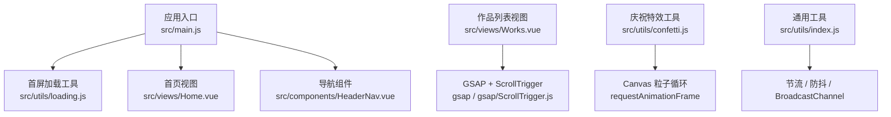
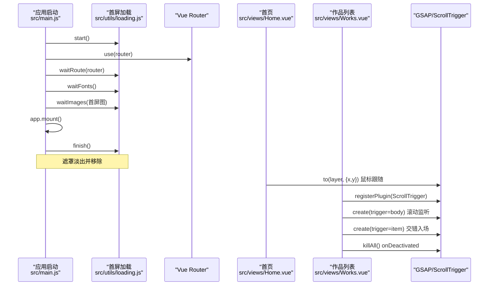
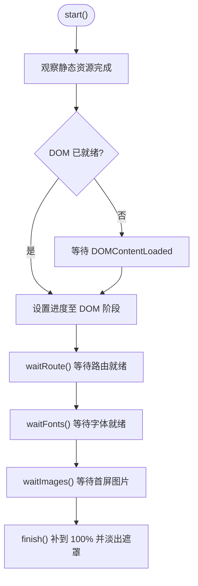
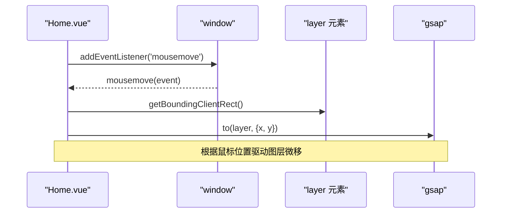
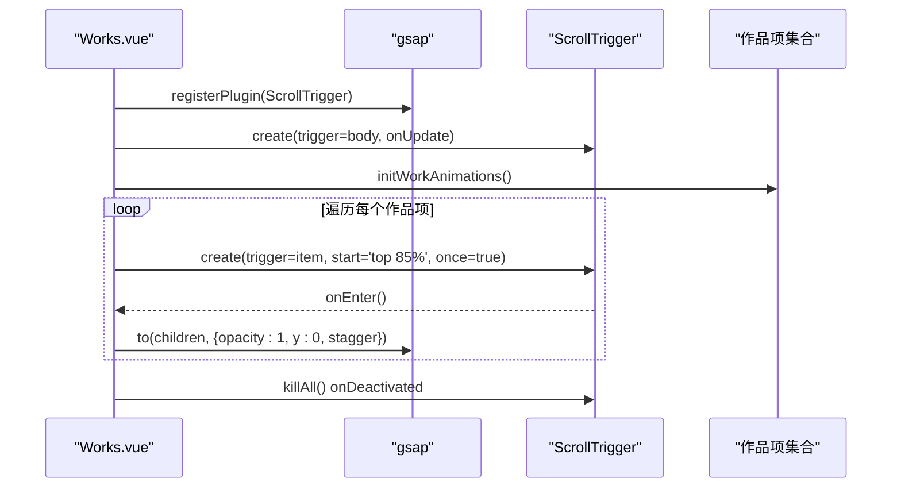
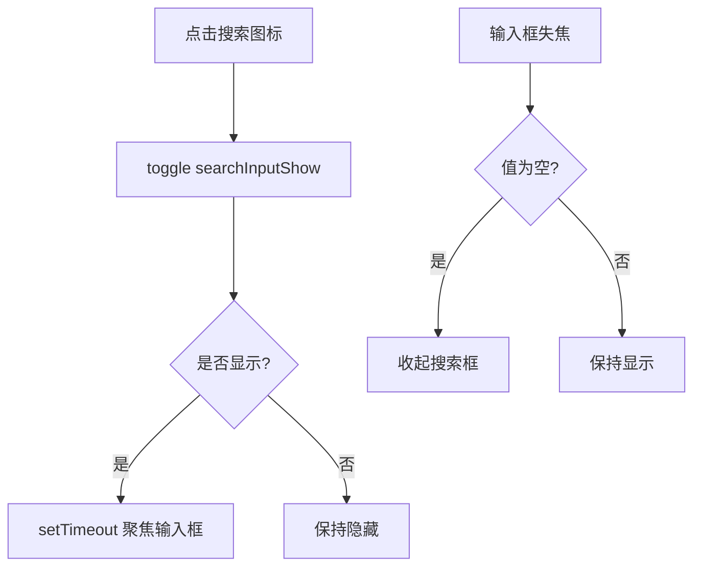
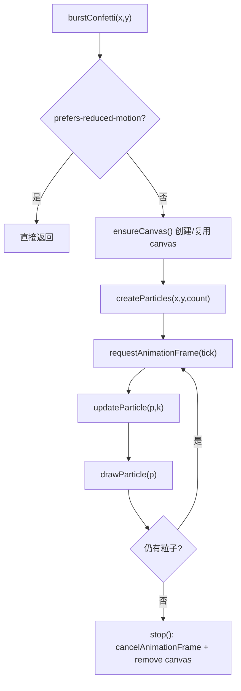
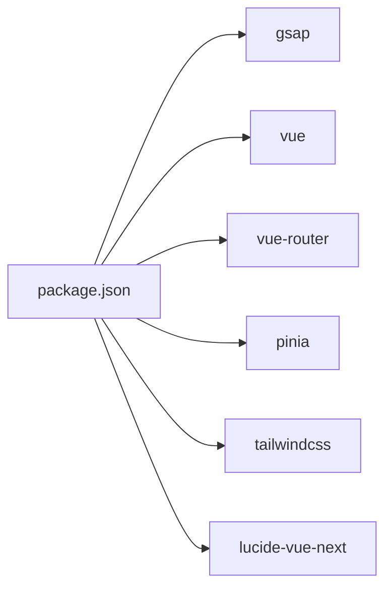

# 动画系统集成

<cite>
**本文引用的文件**   
- [package.json](file://package.json)
- [src/main.js](file://src/main.js)
- [src/utils/loading.js](file://src/utils/loading.js)
- [src/views/Home.vue](file://src/views/Home.vue)
- [src/components/HeaderNav.vue](file://src/components/HeaderNav.vue)
- [src/views/Works.vue](file://src/views/Works.vue)
- [src/utils/confetti.js](file://src/utils/confetti.js)
- [src/utils/index.js](file://src/utils/index.js)
</cite>

## 目录
1. [引言](#引言)
2. [项目结构](#项目结构)
3. [核心组件](#核心组件)
4. [架构总览](#架构总览)
5. [详细组件分析](#详细组件分析)
6. [依赖关系分析](#依赖关系分析)
7. [性能与优化](#性能与优化)
8. [调试与排错](#调试与排错)
9. [结论](#结论)

## 引言
本文件为 sunwenxu1997.github.io 项目的动画系统集成文档，聚焦以下目标：
- GSAP 动画库的集成方式与配置要点。
- ScrollTrigger 滚动动画在作品列表页的实现与生命周期管理。
- 首页首屏加载、鼠标跟随视差与过渡动画的设计说明。
- 工具函数中的动画封装：confetti 庆祝效果与 loading 首屏进度条。
- HeaderNav 组件的微交互动画：菜单展开收起与搜索框动画。
- 动画性能优化策略：请求动画帧使用、节流防抖、内存泄漏防护。
- 动画调试技巧与常见问题解决方案。

## 项目结构
本项目基于 Vue 3 + Vite，动画能力主要由 GSAP 提供；滚动动画通过 ScrollTrigger 插件实现；首屏加载体验由自定义 loading 工具驱动；交互反馈包含原生 Canvas 实现的 confetti 特效。

图表来源
- [src/main.js:16-39](file://src/main.js#L16-L39)
- [src/utils/loading.js:15-22](file://src/utils/loading.js#L15-L22)
- [src/views/Home.vue:1-22](file://src/views/Home.vue#L1-L22)
- [src/components/HeaderNav.vue:1-73](file://src/components/HeaderNav.vue#L1-L73)
- [src/views/Works.vue:11-13](file://src/views/Works.vue#L11-L13)
- [src/utils/confetti.js:1-36](file://src/utils/confetti.js#L1-L36)
- [src/utils/index.js:6-37](file://src/utils/index.js#L6-L37)

章节来源
- [package.json:12-23](file://package.json#L12-L23)
- [src/main.js:16-39](file://src/main.js#L16-L39)

## 核心组件
- 首屏加载工具（loading）：负责 DOM、静态资源、路由、字体、图片等阶段的进度推进与遮罩淡出。
- 首页（Home）：引入 GSAP，实现鼠标跟随视差与 SVG 滤镜组合的首屏视觉。
- 作品列表（Works）：注册并管理 ScrollTrigger，实现元素进入视口时的交错入场动画。
- 导航（HeaderNav）：移动端菜单展开收起、搜索框展开收起的微交互。
- 庆祝特效（confetti）：原生 Canvas 粒子系统，支持减少动态效果偏好。
- 通用工具（index）：节流、防抖、BroadcastChannel 等基础能力。

章节来源
- [src/utils/loading.js:1-207](file://src/utils/loading.js#L1-L207)
- [src/views/Home.vue:1-86](file://src/views/Home.vue#L1-L86)
- [src/views/Works.vue:1-153](file://src/views/Works.vue#L1-L153)
- [src/components/HeaderNav.vue:1-235](file://src/components/HeaderNav.vue#L1-L235)
- [src/utils/confetti.js:1-182](file://src/utils/confetti.js#L1-L182)
- [src/utils/index.js:1-70](file://src/utils/index.js#L1-L70)

## 架构总览
下图展示从应用启动到动画运行的关键路径：main.js 启动 loading，等待路由、字体、图片就绪后挂载应用；Home 页面监听鼠标移动并通过 GSAP 驱动图层位移；Works 页面在激活时注册 ScrollTrigger，并在切换视图或离开时清理实例。

图表来源
- [src/main.js:16-39](file://src/main.js#L16-L39)
- [src/utils/loading.js:95-115](file://src/utils/loading.js#L95-L115)
- [src/views/Home.vue:7-22](file://src/views/Home.vue#L7-L22)
- [src/views/Works.vue:47-70](file://src/views/Works.vue#L47-L70)
- [src/views/Works.vue:77-114](file://src/views/Works.vue#L77-L114)

## 详细组件分析

### 首屏加载工具（loading）
职责与流程：
- 定义阶段里程碑：DOM、ASSETS、ROUTE、FONTS、IMAGES、RENDER。
- 使用 PerformanceObserver 渐进推进静态资源进度。
- 等待路由就绪、字体就绪、首屏图片就绪，最终补到 100% 并淡出遮罩。
- 数字滚动通过 requestAnimationFrame 插值平滑显示。

图表来源
- [src/utils/loading.js:15-22](file://src/utils/loading.js#L15-L22)
- [src/utils/loading.js:69-84](file://src/utils/loading.js#L69-L84)
- [src/utils/loading.js:117-173](file://src/utils/loading.js#L117-L173)
- [src/utils/loading.js:176-198](file://src/utils/loading.js#L176-L198)

章节来源
- [src/utils/loading.js:1-207](file://src/utils/loading.js#L1-L207)
- [src/main.js:16-39](file://src/main.js#L16-L39)

### 首页（Home）与 GSAP 鼠标跟随视差
- 在 mounted 中监听 window.mousemove，计算相对坐标后通过 gsap.to 驱动背景图层位移，形成视差。
- 使用 SVG feImage + feDisplacementMap 叠加位移贴图，增强首屏质感。
- 在 unmounted 中移除事件监听，避免内存泄漏。

图表来源
- [src/views/Home.vue:7-22](file://src/views/Home.vue#L7-L22)
- [src/views/Home.vue:29-34](file://src/views/Home.vue#L29-L34)
- [src/views/Home.vue:51-71](file://src/views/Home.vue#L51-L71)

章节来源
- [src/views/Home.vue:1-86](file://src/views/Home.vue#L1-L86)

### 作品列表（Works）与 ScrollTrigger 滚动动画
- 在 onActivated 中注册 ScrollTrigger 插件，重建滚动监听与每个作品的入场动画。
- 使用 ScrollTrigger.create 监听 body 滚动，记录滚动位置以恢复 keep-alive 后的滚动状态。
- 对每个作品项创建触发器，当进入视口时依次淡入标题、封面与标签。
- 在 onDeactivated 与视图切换时调用 ScrollTrigger.killAll 清理实例，防止重复绑定与内存泄漏。

图表来源
- [src/views/Works.vue:47-70](file://src/views/Works.vue#L47-L70)
- [src/views/Works.vue:77-114](file://src/views/Works.vue#L77-L114)
- [src/views/Works.vue:118-128](file://src/views/Works.vue#L118-L128)

章节来源
- [src/views/Works.vue:1-153](file://src/views/Works.vue#L1-L153)

### 导航组件（HeaderNav）微交互动画
- 移动端汉堡菜单：点击切换 navMobileShow，同时控制 body.overflow 锁定滚动。
- 搜索框展开收起：点击图标切换 searchInputShow，延迟聚焦输入框；失焦且无内容时收起。
- 样式过渡：通过 Tailwind 类名与 CSS transition 实现平滑展开收起。

图表来源
- [src/components/HeaderNav.vue:20-33](file://src/components/HeaderNav.vue#L20-L33)
- [src/components/HeaderNav.vue:40-58](file://src/components/HeaderNav.vue#L40-L58)
- [src/components/HeaderNav.vue:101-140](file://src/components/HeaderNav.vue#L101-L140)

章节来源
- [src/components/HeaderNav.vue:1-235](file://src/components/HeaderNav.vue#L1-L235)

### 庆祝特效（confetti）
- 使用全屏 fixed canvas，pointer-events: none，不拦截交互。
- 首次播放时创建 canvas 并监听 resize，按 DPR 调整尺寸保证清晰度。
- 粒子物理模型：重力、阻力、旋转、抖动、寿命衰减；末段淡出。
- 尊重用户“减少动态效果”偏好，直接跳过播放。
- 粒子清空后自动停止 rAF 循环并移除 canvas，避免内存泄漏。

图表来源
- [src/utils/confetti.js:33-36](file://src/utils/confetti.js#L33-L36)
- [src/utils/confetti.js:38-67](file://src/utils/confetti.js#L38-L67)
- [src/utils/confetti.js:69-94](file://src/utils/confetti.js#L69-L94)
- [src/utils/confetti.js:96-147](file://src/utils/confetti.js#L96-L147)
- [src/utils/confetti.js:149-181](file://src/utils/confetti.js#L149-L181)

章节来源
- [src/utils/confetti.js:1-182](file://src/utils/confetti.js#L1-L182)

### 通用工具（index）
- isMobileDevice：判断移动设备。
- throttle/debounce：节流与防抖，常用于高频事件处理（如滚动、resize）。
- BroadcastChannel：跨窗口消息通道，便于多标签页通信。

章节来源
- [src/utils/index.js:1-70](file://src/utils/index.js#L1-L70)

## 依赖关系分析
- 运行时依赖：
  - gsap：动画引擎。
  - vue、vue-router、pinia：框架与状态路由。
  - lucide-vue-next：图标库。
  - tailwindcss：样式框架。
- 开发依赖：vite、eslint、prettier、sass 等。

图表来源
- [package.json:12-23](file://package.json#L12-L23)

章节来源
- [package.json:1-41](file://package.json#L1-L41)

## 性能与优化
- 请求动画帧（rAF）：
  - loading 的数字滚动使用 rAF 插值，避免频繁重绘导致的卡顿。
  - confetti 使用 rAF 循环渲染粒子，粒子清空后自动取消循环，释放 CPU。
- 节流与防抖：
  - 通用工具提供 throttle/debounce，可用于滚动、resize、鼠标移动等高频事件。
- 减少动态效果：
  - confetti 检测 prefers-reduced-motion，尊重用户偏好，避免不必要的动画开销。
- 内存泄漏防护：
  - Home 页面在 unmounted 移除 mousemove 监听。
  - Works 页面在 onDeactivated 与视图切换时调用 ScrollTrigger.killAll 清理实例。
  - confetti 在粒子结束后移除 canvas 与 resize 监听。
- 首屏加载兜底：
  - loading 各阶段设置超时保护，避免某个请求挂起导致首屏卡死。

章节来源
- [src/utils/loading.js:46-66](file://src/utils/loading.js#L46-L66)
- [src/utils/loading.js:86-93](file://src/utils/loading.js#L86-L93)
- [src/utils/confetti.js:128-147](file://src/utils/confetti.js#L128-L147)
- [src/utils/confetti.js:149-181](file://src/utils/confetti.js#L149-L181)
- [src/views/Home.vue:7-12](file://src/views/Home.vue#L7-L12)
- [src/views/Works.vue:64-70](file://src/views/Works.vue#L64-L70)
- [src/utils/index.js:6-37](file://src/utils/index.js#L6-L37)

## 调试与排错
- 滚动动画未触发：
  - 检查是否在 onActivated 中注册 ScrollTrigger 并重建 body 滚动监听。
  - 确认 trigger 元素存在且可见，start 阈值合理。
- 动画重复执行：
  - 确保在 onDeactivated 或视图切换时调用 ScrollTrigger.killAll。
- 首屏加载卡住：
  - 检查 waitRoute/waitFonts/waitImages 是否被正确调用，确认图片路径有效。
  - 利用 loading 的阶段里程碑定位具体阻塞点。
- 鼠标跟随异常：
  - 确认 mounted/unmounted 中事件监听成对添加与移除。
  - 检查层元素的 getBoundingClientRect 返回值是否有效。
- 庆祝特效不播放：
  - 检查 prefers-reduced-motion 是否开启。
  - 确认 burstConfetti 传入的坐标为有限数值。
- 性能问题：
  - 对高频事件使用节流/防抖。
  - 避免在 rAF 中进行昂贵计算，尽量只更新必要属性。

章节来源
- [src/views/Works.vue:47-70](file://src/views/Works.vue#L47-L70)
- [src/views/Works.vue:77-114](file://src/views/Works.vue#L77-L114)
- [src/utils/loading.js:117-173](file://src/utils/loading.js#L117-L173)
- [src/views/Home.vue:7-22](file://src/views/Home.vue#L7-L22)
- [src/utils/confetti.js:33-36](file://src/utils/confetti.js#L33-L36)
- [src/utils/confetti.js:170-176](file://src/utils/confetti.js#L170-L176)
- [src/utils/index.js:6-37](file://src/utils/index.js#L6-L37)

## 结论
本项目将 GSAP 作为动画核心，结合 ScrollTrigger 实现滚动驱动的入场动画；通过 loading 工具构建稳健的首屏加载体验；使用原生 Canvas 实现轻量庆祝特效；在导航组件中提供流畅的微交互。整体方案注重性能与可维护性：合理使用 rAF、节流防抖、尊重用户偏好、严格的生命周期管理与资源清理，确保动画在不同设备上稳定运行。