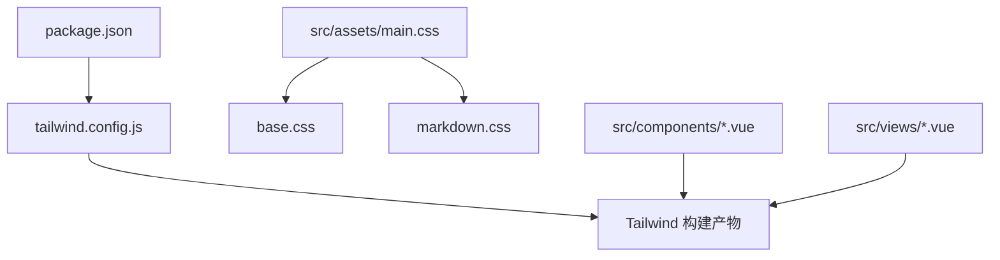
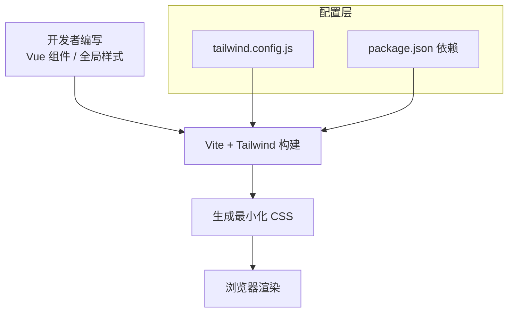
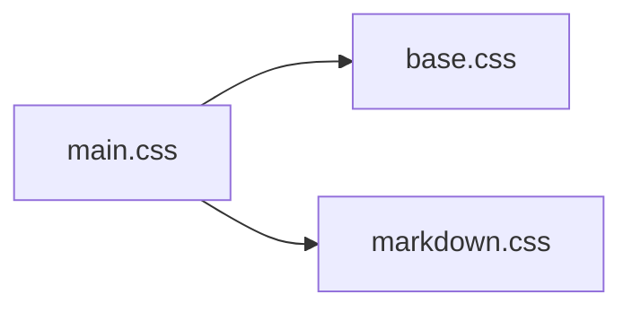
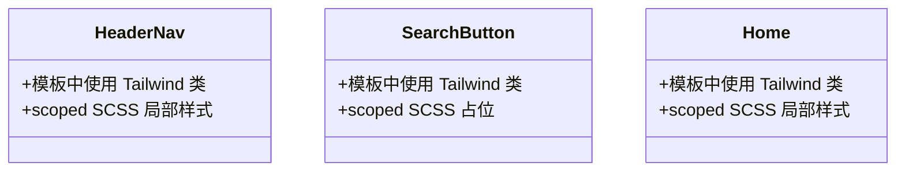
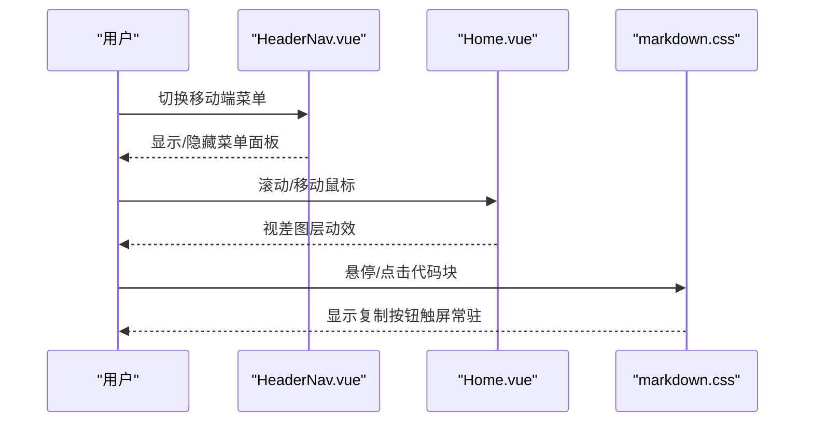
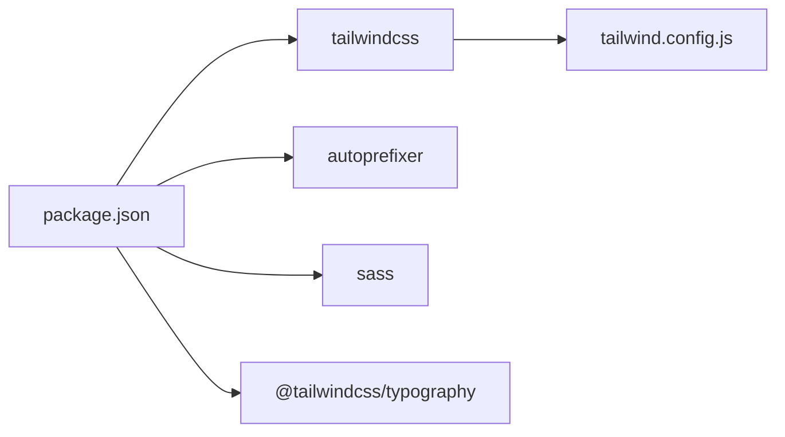

# 样式系统设计

<cite>
**本文引用的文件**   
- [tailwind.config.js](file://tailwind.config.js)
- [package.json](file://package.json)
- [src/assets/main.css](file://src/assets/main.css)
- [src/assets/base.css](file://src/assets/base.css)
- [src/assets/markdown.css](file://src/assets/markdown.css)
- [src/components/HeaderNav.vue](file://src/components/HeaderNav.vue)
- [src/components/SearchButton.vue](file://src/components/SearchButton.vue)
- [src/views/Home.vue](file://src/views/Home.vue)
</cite>

## 目录
1. [引言](#引言)
2. [项目结构](#项目结构)
3. [核心组件](#核心组件)
4. [架构总览](#架构总览)
5. [详细组件分析](#详细组件分析)
6. [依赖关系分析](#依赖关系分析)
7. [性能与优化](#性能与优化)
8. [故障排查指南](#故障排查指南)
9. [结论](#结论)

## 引言
本样式系统设计文档面向 sunwenxu1997.github.io 项目的样式体系，围绕 TailwindCSS 配置、全局样式组织、组件内样式管理、响应式策略、变量与颜色系统、字体规范以及最佳实践进行系统化说明。目标是帮助开发者快速理解并统一维护站点样式，保证可维护性与性能。

## 项目结构
样式相关资源集中在 src/assets 下，并通过 Tailwind 构建工具链在 Vue 单文件组件中按需使用。主要文件职责如下：
- tailwind.config.js：Tailwind 主题、断点、插件与内容扫描范围配置
- package.json：Tailwind、SCSS、Autoprefixer 等样式相关依赖声明
- src/assets/main.css：入口样式，引入 base.css，定义滚动条与通用图标尺寸
- src/assets/base.css：基础重置（html/body 边距）
- src/assets/markdown.css：Markdown 正文排版与代码块样式
- 组件与视图中的 scoped SCSS/CSS：用于局部样式与交互细节

图表来源
- [tailwind.config.js:1-54](file://tailwind.config.js#L1-L54)
- [src/assets/main.css:1-22](file://src/assets/main.css#L1-L22)
- [src/assets/base.css:1-6](file://src/assets/base.css#L1-L6)
- [src/assets/markdown.css:1-230](file://src/assets/markdown.css#L1-L230)
- [package.json:24-35](file://package.json#L24-L35)

章节来源
- [tailwind.config.js:1-54](file://tailwind.config.js#L1-L54)
- [package.json:24-35](file://package.json#L24-L35)
- [src/assets/main.css:1-22](file://src/assets/main.css#L1-L22)
- [src/assets/base.css:1-6](file://src/assets/base.css#L1-L6)
- [src/assets/markdown.css:1-230](file://src/assets/markdown.css#L1-L230)

## 核心组件
本节聚焦样式系统的核心配置与全局样式文件，解释其职责与协作方式。

- Tailwind 配置要点
  - important 作用域限定为 #app，避免与第三方 UI 库冲突
  - 关闭 preflight，由项目自行控制基础重置
  - content 白名单精确扫描关键页面与组件，减少无用 CSS
  - 自定义断点 sm/md/lg/xl/2xl，沿用常见桌面/平板/手机断点
  - 启用 @tailwindcss/typography 插件，配合 Markdown 正文样式

- 全局样式组织
  - main.css 作为入口，导入 base.css，并定义滚动条与通用 .icon 尺寸
  - base.css 仅做 html/body 的 margin/padding 重置
  - markdown.css 专注 Markdown 正文排版与代码块外壳、复制按钮、触屏适配

- 组件内样式
  - HeaderNav.vue 与 SearchButton.vue 使用 <style lang="scss" scoped> 管理局部样式
  - Home.vue 同样采用 scoped SCSS 处理局部视觉效果

章节来源
- [tailwind.config.js:1-54](file://tailwind.config.js#L1-L54)
- [src/assets/main.css:1-22](file://src/assets/main.css#L1-L22)
- [src/assets/base.css:1-6](file://src/assets/base.css#L1-L6)
- [src/assets/markdown.css:1-230](file://src/assets/markdown.css#L1-L230)
- [src/components/HeaderNav.vue:223-235](file://src/components/HeaderNav.vue#L223-L235)
- [src/components/SearchButton.vue:123-124](file://src/components/SearchButton.vue#L123-L124)
- [src/views/Home.vue:74-85](file://src/views/Home.vue#L74-L85)

## 架构总览
下图展示样式从配置到构建再到组件渲染的整体流程。

图表来源
- [tailwind.config.js:1-54](file://tailwind.config.js#L1-L54)
- [package.json:24-35](file://package.json#L24-L35)

## 详细组件分析

### Tailwind 配置与主题策略
- 主题与断点
  - 断点：sm=640px, md=768px, lg=1024px, xl=1280px, 2xl=1536px
  - 通过 screens 扩展断点，便于响应式类名如 sm:bg-*、md:text-* 等
- 优先级与作用域
  - important:'#app' 将 Tailwind 生成的规则提升到 #app 选择器下，降低与第三方 UI 库的特异性冲突
- 预检与重置
  - corePlugins.preflight=false，项目自行控制基础样式（见 base.css）
- 内容扫描
  - content 白名单仅包含必要页面与组件，减少构建产物体积
- 插件
  - 启用 @tailwindcss/typography，配合 markdown.css 对 .prose 进行站点化微调

章节来源
- [tailwind.config.js:1-54](file://tailwind.config.js#L1-L54)

### 全局样式文件职责分工
- main.css
  - 导入 base.css
  - 定义 body 滚动条外观与通用 .icon 尺寸
- base.css
  - 重置 html/body 的 margin/padding
- markdown.css
  - 定义 Markdown 正文容器 .md-body 的变量与排版
  - 代码块外壳 .md-code 及工具栏 .md-code__bar、复制按钮 .md-code__copy
  - 针对无 hover 的触屏设备常驻复制按钮
  - 列表卡片摘要 .md-summary 的多行截断

图表来源
- [src/assets/main.css:1-22](file://src/assets/main.css#L1-L22)
- [src/assets/base.css:1-6](file://src/assets/base.css#L1-L6)
- [src/assets/markdown.css:1-230](file://src/assets/markdown.css#L1-L230)

章节来源
- [src/assets/main.css:1-22](file://src/assets/main.css#L1-L22)
- [src/assets/base.css:1-6](file://src/assets/base.css#L1-L6)
- [src/assets/markdown.css:1-230](file://src/assets/markdown.css#L1-L230)

### 组件内样式管理（scoped CSS 与 SCSS）
- HeaderNav.vue
  - 使用 <style lang="scss" scoped> 定义移动端遮罩、管理员链接等局部样式
  - 大量使用 Tailwind 类名实现布局、间距、颜色与响应式行为
- SearchButton.vue
  - 使用 <style lang="scss" scoped> 占位，当前未定义具体样式
  - 交互逻辑与 GSAP 动画结合，样式以 Tailwind 类为主
- Home.vue
  - 使用 <style lang="scss" scoped> 定义玻璃态遮罩与管理员链接样式

图表来源
- [src/components/HeaderNav.vue:223-235](file://src/components/HeaderNav.vue#L223-L235)
- [src/components/SearchButton.vue:123-124](file://src/components/SearchButton.vue#L123-L124)
- [src/views/Home.vue:74-85](file://src/views/Home.vue#L74-L85)

章节来源
- [src/components/HeaderNav.vue:223-235](file://src/components/HeaderNav.vue#L223-L235)
- [src/components/SearchButton.vue:123-124](file://src/components/SearchButton.vue#L123-L124)
- [src/views/Home.vue:74-85](file://src/views/Home.vue#L74-L85)

### 响应式设计策略
- 断点体系
  - 基于 tailwind.config.js 的 screens 配置，提供 sm/md/lg/xl/2xl 断点
- 导航与布局
  - HeaderNav.vue 在小屏隐藏 PC 菜单，显示汉堡菜单；在大屏固定定位与毛玻璃背景
  - Home.vue 在大屏限制最大宽度与高度，小屏全屏展示
- 触摸交互优化
  - markdown.css 针对无 hover 的设备常驻复制按钮，提升可用性
  - SearchButton.vue 在非移动设备上隐藏默认光标，使用自定义跟随鼠标搜索气泡

图表来源
- [src/components/HeaderNav.vue:74-222](file://src/components/HeaderNav.vue#L74-L222)
- [src/views/Home.vue:24-72](file://src/views/Home.vue#L24-L72)
- [src/assets/markdown.css:211-216](file://src/assets/markdown.css#L211-L216)

章节来源
- [tailwind.config.js:27-50](file://tailwind.config.js#L27-L50)
- [src/components/HeaderNav.vue:74-222](file://src/components/HeaderNav.vue#L74-L222)
- [src/views/Home.vue:24-72](file://src/views/Home.vue#L24-L72)
- [src/assets/markdown.css:211-216](file://src/assets/markdown.css#L211-L216)

### 样式变量、颜色系统与字体规范
- 样式变量
  - markdown.css 使用 CSS 变量定义文本色、标题色、弱化色、边框色，集中管理 Markdown 主题
- 颜色系统
  - 广泛使用 Tailwind 内置色板（stone、slate、red 等），保持视觉一致性
  - 滚动条与代码块外壳使用深色主题色，形成对比层次
- 字体规范
  - 多处使用 Rajdhani 字体族（通过 style 属性或注释引用），强调品牌感
  - 代码区域使用等宽字体栈，确保可读性

章节来源
- [src/assets/markdown.css:7-16](file://src/assets/markdown.css#L7-L16)
- [src/components/HeaderNav.vue:84-87](file://src/components/HeaderNav.vue#L84-L87)
- [src/views/Home.vue:43-45](file://src/views/Home.vue#L43-L45)
- [src/assets/markdown.css:151-157](file://src/assets/markdown.css#L151-L157)

## 依赖关系分析
样式相关的依赖与工具链如下：
- TailwindCSS 与 Autoprefixer：负责原子类生成与浏览器前缀
- @tailwindcss/typography：为 Markdown 正文提供 .prose 基础样式
- Sass：支持组件内 <style lang="scss"> 语法
- Vite：构建与开发服务器

图表来源
- [package.json:24-35](file://package.json#L24-L35)
- [tailwind.config.js:1-54](file://tailwind.config.js#L1-L54)

章节来源
- [package.json:24-35](file://package.json#L24-L35)
- [tailwind.config.js:1-54](file://tailwind.config.js#L1-L54)

## 性能与优化
- 构建产物优化
  - 使用 Tailwind 的 content 白名单，仅扫描必要文件，减少无用 CSS
  - 关闭 preflight，避免重复重置，减小基础样式体积
- 运行时体验
  - 合理使用 backdrop-filter、mask 等效果时注意低端设备的兼容性
  - 代码块外壳与复制按钮仅在需要时渲染，减少 DOM 复杂度
- 可维护性
  - 全局样式尽量收敛至 assets 目录，组件样式使用 scoped 隔离
  - 颜色与字号通过 Tailwind 语义化类名统一管理，避免硬编码

[本节为通用建议，不直接分析具体文件]

## 故障排查指南
- 样式被覆盖或冲突
  - 检查是否启用了第三方 UI 库的 preflight，必要时调整 Tailwind 的 important 作用域
  - 确认组件样式是否使用了 scoped，避免污染全局
- 响应式异常
  - 核对断点是否与 tailwind.config.js 一致，确保类名前缀正确
- Markdown 样式错乱
  - 确认已引入 markdown.css，且 .md-body 容器存在
  - 若使用 .prose，需确保 typography 插件已启用
- 滚动条样式不生效
  - 检查是否在 body 上定义了 ::-webkit-scrollbar 伪元素，并确保未被其他样式覆盖

章节来源
- [tailwind.config.js:5-11](file://tailwind.config.js#L5-L11)
- [src/assets/main.css:7-17](file://src/assets/main.css#L7-L17)
- [src/assets/markdown.css:1-5](file://src/assets/markdown.css#L1-L5)

## 结论
本项目以 Tailwind 为核心，结合 scoped SCSS 与全局样式分层，构建了清晰、可扩展的样式体系。通过精确的内容扫描、合理的断点与主题配置，保证了构建效率与运行体验。建议在后续迭代中持续收敛颜色与字体变量，完善组件样式文档，并关注低端设备的兼容性与性能表现。