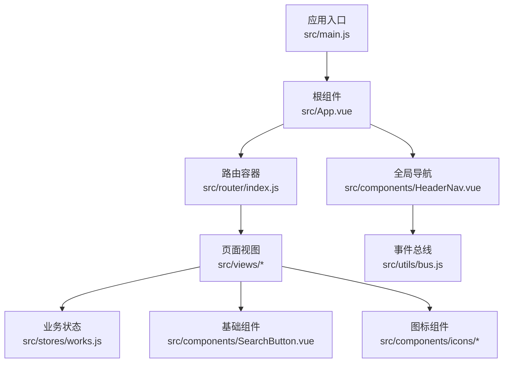
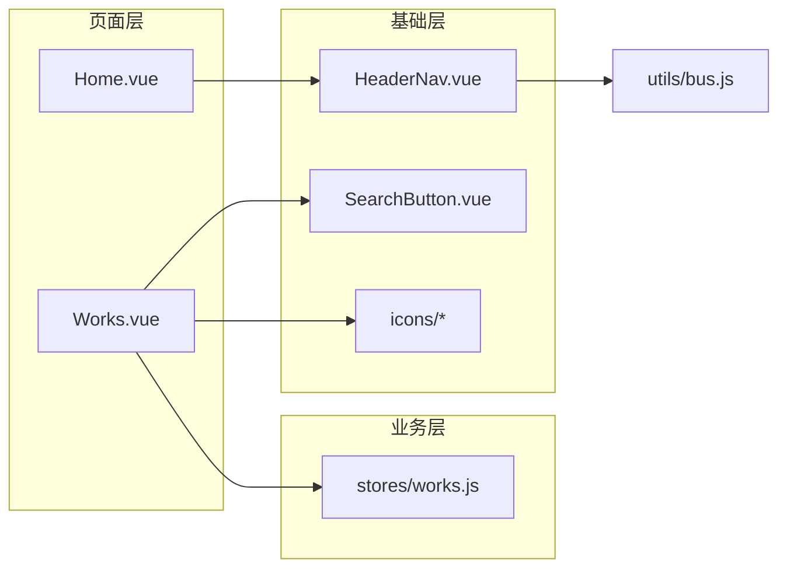
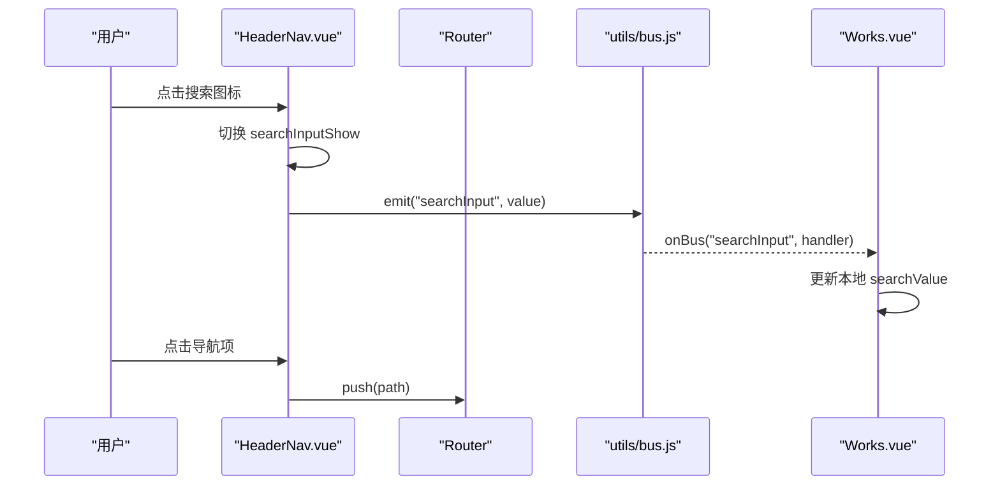
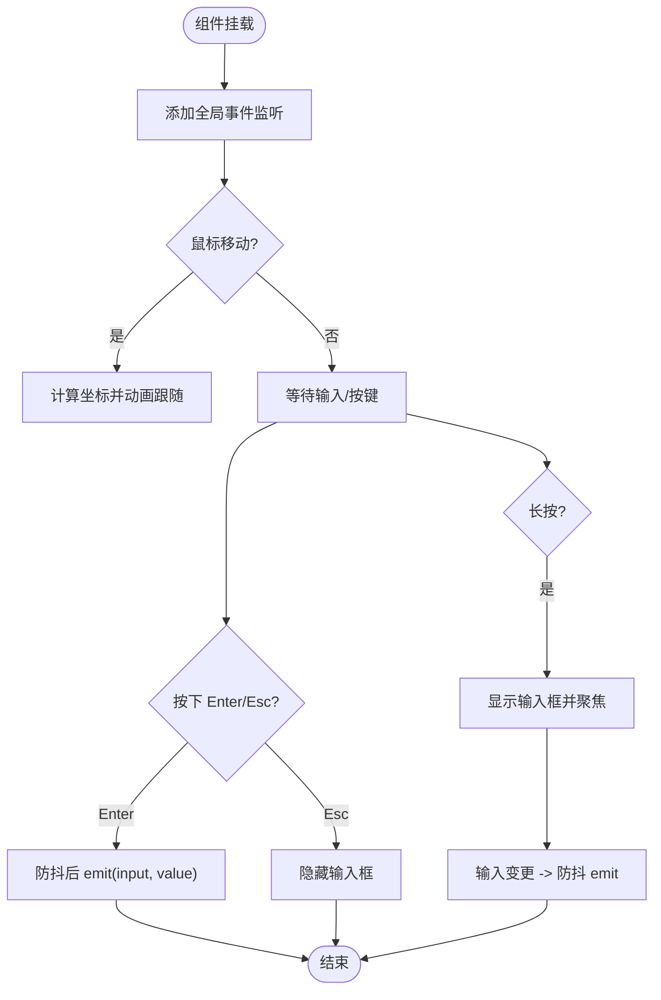
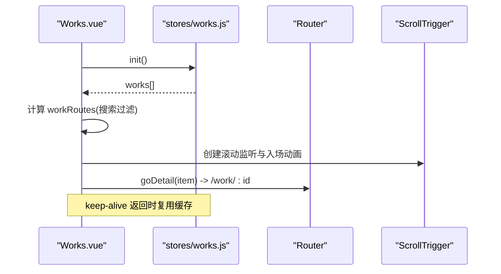
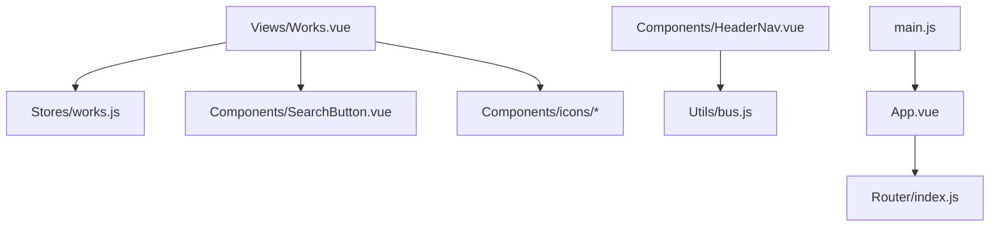

# 组件分层设计

<cite>
**本文引用的文件**   
- [src/main.js](file://src/main.js)
- [src/App.vue](file://src/App.vue)
- [src/router/index.js](file://src/router/index.js)
- [src/components/HeaderNav.vue](file://src/components/HeaderNav.vue)
- [src/components/SearchButton.vue](file://src/components/SearchButton.vue)
- [src/components/icons/github.vue](file://src/components/icons/github.vue)
- [src/components/icons/email.vue](file://src/components/icons/email.vue)
- [src/views/Home.vue](file://src/views/Home.vue)
- [src/views/Works.vue](file://src/views/Works.vue)
- [src/stores/works.js](file://src/stores/works.js)
- [src/utils/bus.js](file://src/utils/bus.js)
</cite>

## 目录
1. [引言](#引言)
2. [项目结构](#项目结构)
3. [核心组件](#核心组件)
4. [架构总览](#架构总览)
5. [详细组件分析](#详细组件分析)
6. [依赖关系分析](#依赖关系分析)
7. [性能与可维护性](#性能与可维护性)
8. [故障排查指南](#故障排查指南)
9. [结论](#结论)

## 引言
本文件为 sunwenxu1997.github.io 项目的“组件分层设计”文档，目标是明确基础组件、业务组件与页面组件的职责边界与设计原则，并以 HeaderNav 导航组件为例说明响应式布局、状态管理与事件处理模式；同时梳理图标组件库的组织方式与复用策略，以及 Home.vue、Works.vue 等页面组件的数据流、生命周期与性能优化实践。文末提供组件层次结构与职责边界的可视化图示，便于团队统一理解与扩展。

## 项目结构
本项目采用 Vue 3 + Vite 的前端工程结构，按功能域组织：
- 应用入口与全局装配：main.js、App.vue
- 路由与权限守卫：router/index.js
- 页面视图：views（Home、Works、About、WorkDetail、Login、404、admin）
- 通用基础组件：components（HeaderNav、SearchButton、icons、markdown）
- 跨页面状态：stores（auth、works）
- 工具与第三方集成：utils（bus、loading、index）、lib（supabase）

图表来源
- [src/main.js:16-39](file://src/main.js#L16-L39)
- [src/App.vue:1-26](file://src/App.vue#L1-L26)
- [src/router/index.js:4-48](file://src/router/index.js#L4-L48)
- [src/components/HeaderNav.vue:1-73](file://src/components/HeaderNav.vue#L1-L73)
- [src/components/SearchButton.vue:1-89](file://src/components/SearchButton.vue#L1-L89)
- [src/stores/works.js:7-28](file://src/stores/works.js#L7-L28)
- [src/utils/bus.js:1-15](file://src/utils/bus.js#L1-L15)

章节来源
- [src/main.js:1-40](file://src/main.js#L1-L40)
- [src/App.vue:1-26](file://src/App.vue#L1-L26)
- [src/router/index.js:1-73](file://src/router/index.js#L1-L73)

## 核心组件
- 基础组件
  - HeaderNav：站点级导航、搜索输入、移动端菜单、外链与版权信息展示。
  - SearchButton：悬浮跟随鼠标的搜索按钮，封装键盘与鼠标交互、防抖输入。
  - icons：SVG 图标组件集合，统一以 .vue 形式暴露，供业务与页面复用。
- 业务组件
  - stores/works：作品列表的加载、缓存与错误状态管理。
- 页面组件
  - Home：首屏视觉层，包含视差动效与 SVG 滤镜。
  - Works：作品列表页，负责数据获取、搜索过滤、视图切换、滚动动画与 keep-alive 状态恢复。

章节来源
- [src/components/HeaderNav.vue:1-235](file://src/components/HeaderNav.vue#L1-L235)
- [src/components/SearchButton.vue:1-124](file://src/components/SearchButton.vue#L1-L124)
- [src/components/icons/github.vue:1-7](file://src/components/icons/github.vue#L1-L7)
- [src/components/icons/email.vue:1-4](file://src/components/icons/email.vue#L1-L4)
- [src/stores/works.js:1-29](file://src/stores/works.js#L1-L29)
- [src/views/Home.vue:1-86](file://src/views/Home.vue#L1-L86)
- [src/views/Works.vue:1-394](file://src/views/Works.vue#L1-L394)

## 架构总览
整体采用“页面组件 → 业务组件/Store → 基础组件/工具”的分层：
- 页面组件负责路由级视图与用户交互编排。
- Store 负责跨页面数据与副作用（如 API 请求）。
- 基础组件提供 UI 能力与通用交互（导航、搜索、图标）。
- 事件总线用于跨组件解耦通信（如搜索词从 HeaderNav 到 Works）。

图表来源
- [src/views/Home.vue:1-86](file://src/views/Home.vue#L1-L86)
- [src/views/Works.vue:1-394](file://src/views/Works.vue#L1-L394)
- [src/stores/works.js:1-29](file://src/stores/works.js#L1-L29)
- [src/components/HeaderNav.vue:1-235](file://src/components/HeaderNav.vue#L1-L235)
- [src/components/SearchButton.vue:1-124](file://src/components/SearchButton.vue#L1-L124)
- [src/utils/bus.js:1-15](file://src/utils/bus.js#L1-L15)

## 详细组件分析

### HeaderNav 导航组件（基础组件）
职责与职责边界
- 导航渲染：根据当前路由决定显示区域与样式。
- 响应式布局：PC 端固定顶部导航，移动端汉堡菜单全屏展开。
- 搜索输入：在移动端提供内联搜索框，通过事件总线将搜索词广播给订阅方。
- 外链与版权：展示邮箱、GitHub 链接与后台入口。
- 滚动回顶：提供平滑回到顶部行为。

关键实现要点
- 响应式控制：使用 computed 判断是否显示导航，watch 监听路由变化关闭移动端菜单并恢复 body 滚动。
- 事件处理：点击导航项调用路由跳转；移动端菜单开关控制 body overflow；搜索输入触发 emitBus('searchInput', value)。
- 样式与可见性：结合 Tailwind 类名与条件 class 实现不同场景下的背景模糊、渐变遮罩与颜色切换。

图表来源
- [src/components/HeaderNav.vue:20-66](file://src/components/HeaderNav.vue#L20-L66)
- [src/utils/bus.js:1-15](file://src/utils/bus.js#L1-L15)
- [src/views/Works.vue:47-50](file://src/views/Works.vue#L47-L50)

章节来源
- [src/components/HeaderNav.vue:1-235](file://src/components/HeaderNav.vue#L1-L235)

### SearchButton 悬浮搜索按钮（基础组件）
职责与职责边界
- 悬浮跟随鼠标移动，提供沉浸式搜索体验。
- 非移动端设备启用自定义光标与交互逻辑。
- 支持长按打开输入框、回车确认、Esc 关闭。
- 对输入进行防抖，避免频繁触发父组件更新。

关键实现要点
- 生命周期：onMounted/onUnmounted 与 onActivated/onDeactivated 配合 keep-alive 正确挂载/移除事件监听。
- 交互：mousemove 驱动位置动画（GSAP），mousedown 延迟打开输入框，keydown 处理回车与 Esc。
- 输出：通过 $emit('input', value) 向父组件传递搜索词。

图表来源
- [src/components/SearchButton.vue:16-89](file://src/components/SearchButton.vue#L16-L89)

章节来源
- [src/components/SearchButton.vue:1-124](file://src/components/SearchButton.vue#L1-L124)

### 图标组件库（基础组件）
组织方式与复用策略
- 每个图标一个 .vue 文件，内部仅包裹 <svg>，对外暴露为可复用组件。
- 通过统一的 class 与尺寸属性（由父组件控制）保持风格一致。
- 在 HeaderNav、Works 等页面中按需引入，减少重复代码。

示例引用
- github.vue：GitHub 品牌图标
- email.vue：邮件图标

章节来源
- [src/components/icons/github.vue:1-7](file://src/components/icons/github.vue#L1-L7)
- [src/components/icons/email.vue:1-4](file://src/components/icons/email.vue#L1-L4)

### Home.vue（页面组件）
职责与职责边界
- 首屏视觉呈现：背景图、磨砂玻璃效果、SVG 滤镜。
- 视差动效：监听 window mousemove，驱动图层位移。
- 生命周期：在 onMounted 注册监听，onUnmounted 清理监听，避免内存泄漏。

性能与优化
- 使用 GSAP 执行轻量动画，避免阻塞主线程。
- 首屏图片预加载由 main.js 控制，确保滤镜资源就绪后再挂载应用。

章节来源
- [src/views/Home.vue:1-86](file://src/views/Home.vue#L1-L86)
- [src/main.js:13-31](file://src/main.js#L13-L31)

### Works.vue（页面组件）
职责与职责边界
- 数据获取：通过 useWorksStore.init() 拉取已发布作品，支持本地静态数据与远程数据两种模式。
- 搜索过滤：基于本地 searchValue 对 works 进行名称过滤。
- 视图切换：list/grid 两种布局，移动端强制 list，桌面端可切换并持久化至 localStorage。
- 滚动与动画：使用 ScrollTrigger 监听滚动，进入视口时触发子元素入场动画；记录滚动位置以支持 keep-alive 返回时恢复。
- 外部链接处理：区分站内路由与外部 URL，分别走 router.push 或 window.open。

数据流与生命周期
- onActivated：重建 ScrollTrigger、恢复滚动位置、初始化动画；若从详情页返回且 store 已有数据则复用缓存。
- onDeactivated：保存滚动位置、注销 Resize/MediaQuery 监听、销毁所有 ScrollTrigger。
- watch(workRoutes)：数据变化后 nextTick 重建动画，保证 DOM 更新后再绑定。

图表来源
- [src/views/Works.vue:30-70](file://src/views/Works.vue#L30-L70)
- [src/stores/works.js:12-25](file://src/stores/works.js#L12-L25)
- [src/views/Works.vue:145-149](file://src/views/Works.vue#L145-L149)

章节来源
- [src/views/Works.vue:1-394](file://src/views/Works.vue#L1-L394)
- [src/stores/works.js:1-29](file://src/stores/works.js#L1-L29)

## 依赖关系分析
- 页面与 Store：Works.vue 依赖 stores/works.js 提供的 works 列表与 init 方法。
- 页面与基础组件：Works.vue 依赖 SearchButton.vue 与 icons/*；HeaderNav.vue 依赖 utils/bus.js 广播搜索词。
- 路由与权限：router/index.js 定义路由与 beforeEach 守卫，结合 auth store 控制管理员访问。
- 应用启动：main.js 顺序等待路由、字体与首屏图片，再挂载 App，保证首帧体验。

图表来源
- [src/views/Works.vue:1-394](file://src/views/Works.vue#L1-L394)
- [src/stores/works.js:1-29](file://src/stores/works.js#L1-L29)
- [src/components/SearchButton.vue:1-124](file://src/components/SearchButton.vue#L1-L124)
- [src/components/HeaderNav.vue:1-235](file://src/components/HeaderNav.vue#L1-L235)
- [src/utils/bus.js:1-15](file://src/utils/bus.js#L1-L15)
- [src/App.vue:1-26](file://src/App.vue#L1-L26)
- [src/router/index.js:1-73](file://src/router/index.js#L1-L73)
- [src/main.js:1-40](file://src/main.js#L1-L40)

章节来源
- [src/router/index.js:51-70](file://src/router/index.js#L51-L70)
- [src/main.js:16-39](file://src/main.js#L16-L39)

## 性能与可维护性
- 首屏优化
  - main.js 中按序等待路由 chunk、字体与首屏图片，再挂载应用，提升首帧稳定性。
  - Home 页面的 SVG 滤镜依赖的图片在启动阶段预加载。
- 列表与动画
  - Works.vue 使用 ScrollTrigger 的 once 与 stagger 控制入场动画，避免重复触发。
  - 切换视图模式时 killAll 并重建 ScrollTrigger，保证动画与滚动监听一致性。
- 状态与缓存
  - 使用 keep-alive 缓存需要保留状态的页面（如 Works），并在 onActivated/onDeactivated 中精确管理副作用。
  - 视图模式选择通过 localStorage 持久化，提升用户体验。
- 事件与内存
  - SearchButton 在 onUnmounted/onDeactivated 中移除全局事件监听，防止内存泄漏。
  - HeaderNav 在路由变化时关闭移动端菜单并恢复 body.overflow，避免滚动冲突。

[本节为通用指导，不直接分析具体文件]

## 故障排查指南
- 搜索无响应
  - 检查 HeaderNav 是否正确 emit('searchInput')，Works 是否 onBus('searchInput', ...)。
  - 确认 SearchButton 的防抖函数是否被正确触发。
- 滚动动画异常
  - 切换视图模式后需重建 ScrollTrigger；离开页面时需 killAll。
  - keep-alive 返回时先恢复滚动位置再初始化动画，避免错过进入视口的判定。
- 移动端菜单无法关闭
  - 检查路由变化时是否重置 navMobileShow 并恢复 body.overflow。
- 首屏白屏或滤镜缺失
  - 确认 main.js 中的 waitImages 是否包含所需图片路径，且路由处于 Home。

章节来源
- [src/components/HeaderNav.vue:40-58](file://src/components/HeaderNav.vue#L40-L58)
- [src/components/SearchButton.vue:48-89](file://src/components/SearchButton.vue#L48-L89)
- [src/views/Works.vue:47-70](file://src/views/Works.vue#L47-L70)
- [src/main.js:24-31](file://src/main.js#L24-L31)

## 结论
本项目通过清晰的分层设计将页面组件、业务组件与基础组件解耦：页面组件专注路由级视图与交互编排，Store 管理跨页面数据，基础组件提供可复用的 UI 与交互能力。HeaderNav 作为基础导航组件，实现了响应式布局、状态管理与事件广播；图标组件以 .vue 形式集中管理，便于统一维护与复用；Works.vue 展示了复杂列表页的数据流、生命周期与性能优化实践。该分层模式有助于团队协作、代码演进与长期可维护性。