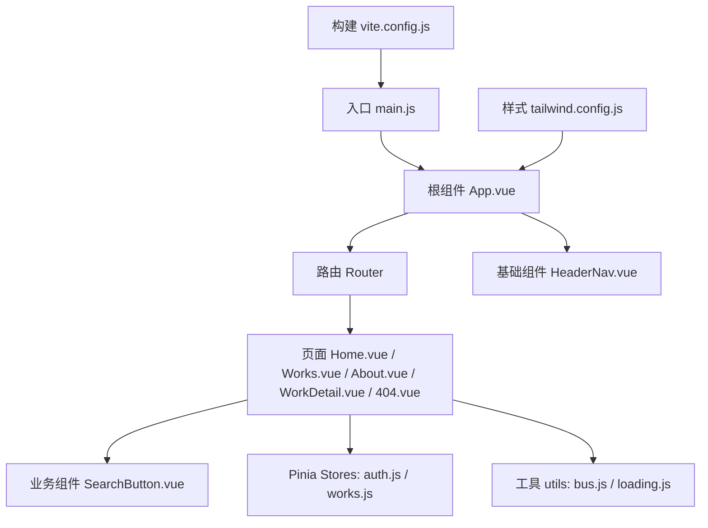
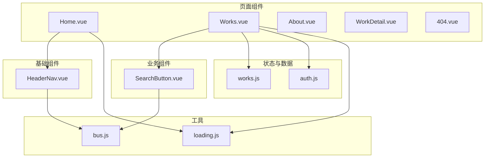
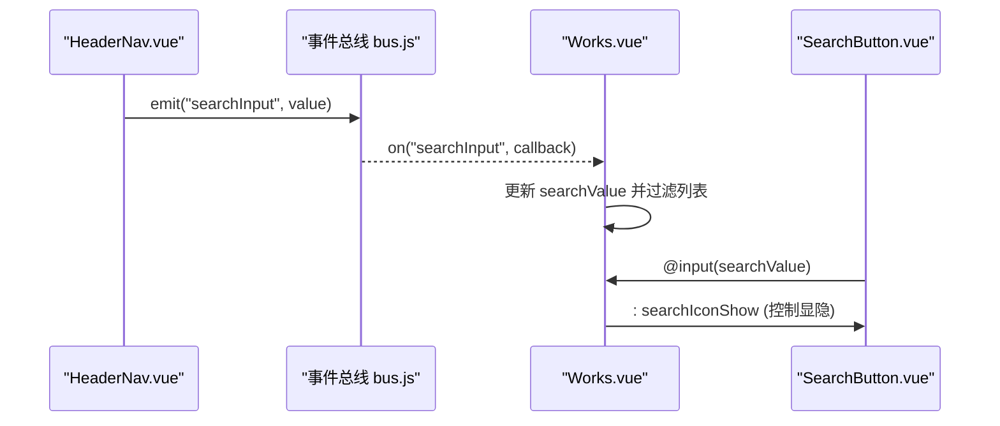
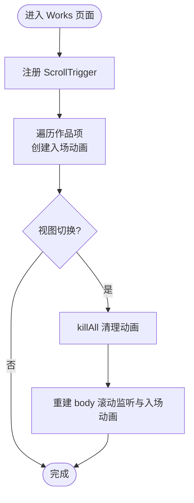
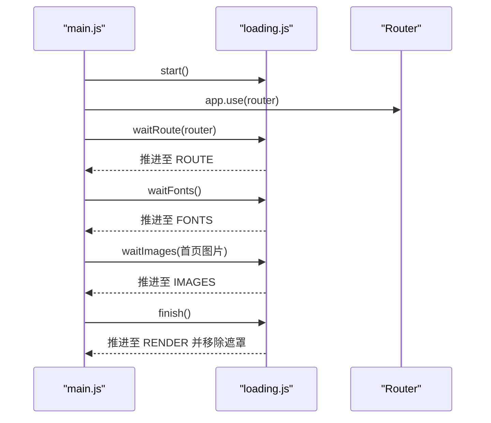
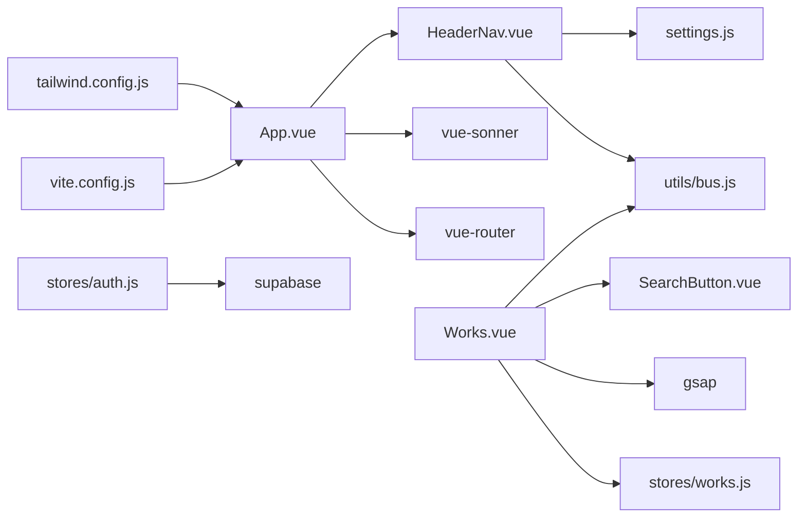

# 组件架构设计

<cite>
**本文引用的文件**   
- [package.json](file://package.json)
- [vite.config.js](file://vite.config.js)
- [tailwind.config.js](file://tailwind.config.js)
- [src/main.js](file://src/main.js)
- [src/App.vue](file://src/App.vue)
- [src/router/index.js](file://src/router/index.js)
- [src/stores/auth.js](file://src/stores/auth.js)
- [src/stores/works.js](file://src/stores/works.js)
- [src/utils/bus.js](file://src/utils/bus.js)
- [src/utils/loading.js](file://src/utils/loading.js)
- [src/settings.js](file://src/settings.js)
- [src/components/HeaderNav.vue](file://src/components/HeaderNav.vue)
- [src/components/SearchButton.vue](file://src/components/SearchButton.vue)
- [src/views/Home.vue](file://src/views/Home.vue)
- [src/views/Works.vue](file://src/views/Works.vue)
</cite>

## 目录
1. [引言](#引言)
2. [项目结构](#项目结构)
3. [核心组件](#核心组件)
4. [架构总览](#架构总览)
5. [详细组件分析](#详细组件分析)
6. [依赖关系分析](#依赖关系分析)
7. [性能与动画优化](#性能与动画优化)
8. [样式系统组织方式](#样式系统组织方式)
9. [故障排查指南](#故障排查指南)
10. [结论](#结论)

## 引言
本文件为 sunwenxu1997.github.io 项目的组件架构设计文档，聚焦以下目标：
- 明确基础组件、业务组件与页面组件的职责边界
- 说明组件复用策略与设计原则（单一职责、可组合性、可测试性）
- 梳理组件通信模式（父子、兄弟、跨层级）
- 描述样式系统（TailwindCSS 配置与自定义样式管理）
- 解释动画系统（GSAP 集成与性能优化）
- 提供组件关系图与依赖关系图

## 项目结构
项目采用 Vue 3 + Vite 的单页应用结构，按“功能域 + 分层”组织：
- 入口与全局：main.js、App.vue、router/index.js
- 视图层（页面组件）：views/*
- 业务组件：components/*（如 HeaderNav、SearchButton）
- 状态与数据：stores/*、api/*、settings.js
- 工具与基础设施：utils/*、lib/*
- 构建与样式：vite.config.js、tailwind.config.js、assets/*

图示来源
- [src/main.js:1-39](file://src/main.js#L1-L39)
- [src/App.vue:1-26](file://src/App.vue#L1-L26)
- [src/router/index.js:1-73](file://src/router/index.js#L1-L73)
- [src/views/Home.vue:1-86](file://src/views/Home.vue#L1-L86)
- [src/views/Works.vue:1-394](file://src/views/Works.vue#L1-L394)
- [src/components/HeaderNav.vue:1-235](file://src/components/HeaderNav.vue#L1-L235)
- [src/components/SearchButton.vue:1-124](file://src/components/SearchButton.vue#L1-L124)
- [vite.config.js:1-31](file://vite.config.js#L1-L31)
- [tailwind.config.js:1-54](file://tailwind.config.js#L1-L54)

章节来源
- [src/main.js:1-39](file://src/main.js#L1-L39)
- [src/App.vue:1-26](file://src/App.vue#L1-L26)
- [src/router/index.js:1-73](file://src/router/index.js#L1-L73)
- [vite.config.js:1-31](file://vite.config.js#L1-L31)
- [tailwind.config.js:1-54](file://tailwind.config.js#L1-L54)

## 核心组件
- 基础组件
  - HeaderNav.vue：站点导航、移动端菜单、搜索入口、外链与版权信息。负责展示与基础交互，通过事件总线向兄弟组件广播搜索输入。
  - SearchButton.vue：悬浮跟随鼠标的搜索按钮，封装键盘与鼠标交互、防抖输入、移动端适配。
- 业务组件
  - 作品列表与筛选逻辑集中在 Works.vue，结合 Pinia 的 works store 获取数据，使用 GSAP ScrollTrigger 实现滚动入场动画。
- 页面组件
  - Home.vue：首屏视觉与 GSAP 鼠标跟随动效。
  - Works.vue：作品列表、视图切换（列表/网格）、搜索过滤、滚动动画。
  - About.vue、WorkDetail.vue、404.vue：内容展示与兜底。
- 状态与数据
  - stores/auth.js：用户认证、会话、管理员权限校验。
  - stores/works.js：作品数据加载（本地静态或 Supabase）。
- 工具与基础设施
  - utils/bus.js：基于 mitt 的事件总线，用于兄弟组件通信。
  - utils/loading.js：首屏进度条，分阶段推进（DOM/资源/路由/字体/图片/渲染）。
  - settings.js：站点配置与静态作品数据开关。

章节来源
- [src/components/HeaderNav.vue:1-235](file://src/components/HeaderNav.vue#L1-L235)
- [src/components/SearchButton.vue:1-124](file://src/components/SearchButton.vue#L1-L124)
- [src/views/Home.vue:1-86](file://src/views/Home.vue#L1-L86)
- [src/views/Works.vue:1-394](file://src/views/Works.vue#L1-L394)
- [src/stores/auth.js:1-82](file://src/stores/auth.js#L1-L82)
- [src/stores/works.js:1-29](file://src/stores/works.js#L1-L29)
- [src/utils/bus.js:1-15](file://src/utils/bus.js#L1-L15)
- [src/utils/loading.js:1-207](file://src/utils/loading.js#L1-L207)
- [src/settings.js:1-288](file://src/settings.js#L1-L288)

## 架构总览
整体采用“页面组件 → 业务组件 → 基础组件”的分层；状态集中到 Pinia Store；跨组件通信以 props/emits 为主，辅以事件总线；动画由 GSAP 驱动；样式以 TailwindCSS 原子类为主，少量 SCSS 局部样式。

图示来源
- [src/views/Home.vue:1-86](file://src/views/Home.vue#L1-L86)
- [src/views/Works.vue:1-394](file://src/views/Works.vue#L1-L394)
- [src/components/HeaderNav.vue:1-235](file://src/components/HeaderNav.vue#L1-L235)
- [src/components/SearchButton.vue:1-124](file://src/components/SearchButton.vue#L1-L124)
- [src/stores/auth.js:1-82](file://src/stores/auth.js#L1-L82)
- [src/stores/works.js:1-29](file://src/stores/works.js#L1-L29)
- [src/utils/bus.js:1-15](file://src/utils/bus.js#L1-L15)
- [src/utils/loading.js:1-207](file://src/utils/loading.js#L1-L207)

## 详细组件分析

### 组件分层与职责
- 基础组件（HeaderNav.vue、SearchButton.vue）
  - 职责：通用 UI 能力与交互（导航、搜索、图标、移动端菜单）
  - 设计原则：单一职责、无业务耦合、可被任意页面复用
  - 通信：props/emits 与事件总线（emitBus/onBus）
- 业务组件（Works.vue 中的列表与动画逻辑）
  - 职责：作品数据展示、视图切换、搜索过滤、滚动动画
  - 设计原则：组合基础组件、消费 Pinia 状态、封装动画生命周期
- 页面组件（Home.vue、About.vue、WorkDetail.vue、404.vue）
  - 职责：路由级页面装配、布局与场景化交互
  - 设计原则：尽量薄，避免承载复杂业务逻辑

章节来源
- [src/components/HeaderNav.vue:1-235](file://src/components/HeaderNav.vue#L1-L235)
- [src/components/SearchButton.vue:1-124](file://src/components/SearchButton.vue#L1-L124)
- [src/views/Works.vue:1-394](file://src/views/Works.vue#L1-L394)
- [src/views/Home.vue:1-86](file://src/views/Home.vue#L1-L86)

### 组件通信模式
- 父子组件通信
  - Props/Emits：SearchButton.vue 通过 props.searchIconShow 控制显示，并通过 input 事件将搜索值回传给父组件 Works.vue。
- 兄弟组件通信
  - 事件总线：HeaderNav.vue 在输入时 emitBus('searchInput', value)，Works.vue 通过 onBus('searchInput', handler) 订阅并更新 searchValue。
- 跨层级通信
  - Pinia Store：Works.vue 通过 useWorksStore() 访问 works 列表与 init 方法，解耦数据源与视图。
  - 路由元信息：App.vue 根据 router.options.routes 中 meta.keepAlive 动态决定 keep-alive 缓存范围。

图示来源
- [src/components/HeaderNav.vue:120-128](file://src/components/HeaderNav.vue#L120-L128)
- [src/utils/bus.js:1-15](file://src/utils/bus.js#L1-L15)
- [src/views/Works.vue:47-50](file://src/views/Works.vue#L47-L50)
- [src/components/SearchButton.vue:86-88](file://src/components/SearchButton.vue#L86-L88)

章节来源
- [src/components/HeaderNav.vue:120-128](file://src/components/HeaderNav.vue#L120-L128)
- [src/components/SearchButton.vue:86-88](file://src/components/SearchButton.vue#L86-L88)
- [src/views/Works.vue:47-50](file://src/views/Works.vue#L47-L50)
- [src/utils/bus.js:1-15](file://src/utils/bus.js#L1-L15)

### 动画系统与 GSAP 集成
- 首页视差跟随
  - Home.vue 监听 mousemove，使用 gsap.to 对图层进行位移，形成视差效果。
- 作品列表滚动入场
  - Works.vue 注册 ScrollTrigger，为每个作品项创建进入动画（淡入+上移），并在视图切换后重建动画。
- 悬浮搜索按钮跟随
  - SearchButton.vue 使用 gsap.to 让按钮跟随鼠标移动，配合缓动函数增强手感。
- 性能优化要点
  - 仅在需要时注册 ScrollTrigger，离开页面时 killAll 清理。
  - 使用 nextTick 确保 DOM 更新后再创建动画。
  - 对高频事件（如输入）使用防抖。

图示来源
- [src/views/Works.vue:47-70](file://src/views/Works.vue#L47-L70)
- [src/views/Works.vue:86-114](file://src/views/Works.vue#L86-L114)
- [src/views/Works.vue:118-128](file://src/views/Works.vue#L118-L128)
- [src/components/SearchButton.vue:72-84](file://src/components/SearchButton.vue#L72-L84)
- [src/views/Home.vue:7-22](file://src/views/Home.vue#L7-L22)

章节来源
- [src/views/Home.vue:7-22](file://src/views/Home.vue#L7-L22)
- [src/views/Works.vue:47-128](file://src/views/Works.vue#L47-L128)
- [src/components/SearchButton.vue:72-84](file://src/components/SearchButton.vue#L72-L84)

### 首屏加载与体验
- 分阶段推进进度条：DOM → 资源 → 路由 → 字体 → 图片 → 渲染
- 关键路径：main.js 依次调用 waitRoute、waitFonts、waitImages，最后 finish 移除遮罩
- 仅首页等待关键图片，其他页面直接放行，减少阻塞

图示来源
- [src/main.js:16-37](file://src/main.js#L16-L37)
- [src/utils/loading.js:95-207](file://src/utils/loading.js#L95-L207)

章节来源
- [src/main.js:16-37](file://src/main.js#L16-L37)
- [src/utils/loading.js:1-207](file://src/utils/loading.js#L1-L207)

## 依赖关系分析
- 运行时依赖
  - Vue 3、Vue Router、Pinia、GSAP、mitt、Supabase SDK、TailwindCSS、Markdown 渲染相关库等
- 模块依赖
  - App.vue 依赖 RouterView、Toaster、HeaderNav
  - Works.vue 依赖 Pinia works store、GSAP、SearchButton、事件总线
  - HeaderNav.vue 依赖事件总线、lucide 图标、settings
  - stores/auth.js 依赖 supabase
  - stores/works.js 依赖 api/works 与 settings

图示来源
- [src/App.vue:1-26](file://src/App.vue#L1-L26)
- [src/views/Works.vue:1-394](file://src/views/Works.vue#L1-L394)
- [src/components/HeaderNav.vue:1-235](file://src/components/HeaderNav.vue#L1-L235)
- [src/stores/works.js:1-29](file://src/stores/works.js#L1-L29)
- [src/stores/auth.js:1-82](file://src/stores/auth.js#L1-L82)
- [src/utils/bus.js:1-15](file://src/utils/bus.js#L1-L15)
- [src/settings.js:1-288](file://src/settings.js#L1-L288)
- [vite.config.js:1-31](file://vite.config.js#L1-L31)
- [tailwind.config.js:1-54](file://tailwind.config.js#L1-L54)

章节来源
- [src/App.vue:1-26](file://src/App.vue#L1-L26)
- [src/views/Works.vue:1-394](file://src/views/Works.vue#L1-L394)
- [src/components/HeaderNav.vue:1-235](file://src/components/HeaderNav.vue#L1-L235)
- [src/stores/works.js:1-29](file://src/stores/works.js#L1-L29)
- [src/stores/auth.js:1-82](file://src/stores/auth.js#L1-L82)
- [src/utils/bus.js:1-15](file://src/utils/bus.js#L1-L15)
- [src/settings.js:1-288](file://src/settings.js#L1-L288)
- [vite.config.js:1-31](file://vite.config.js#L1-L31)
- [tailwind.config.js:1-54](file://tailwind.config.js#L1-L54)

## 性能与动画优化
- 动画性能
  - 按需注册与销毁 ScrollTrigger，避免内存泄漏与重复监听
  - 使用 nextTick 保证 DOM 就绪后再创建动画
  - 对高频输入使用防抖，降低计算开销
- 首屏优化
  - 分阶段推进进度条，避免长时间白屏
  - 仅首页等待关键图片，其他页面快速放行
  - 路由懒加载与 keep-alive 缓存常用页面（如 Works）
- 构建与打包
  - Vite 插件与别名配置简化导入
  - Tailwind content 精确扫描，减少无用 CSS

章节来源
- [src/views/Works.vue:47-128](file://src/views/Works.vue#L47-L128)
- [src/components/SearchButton.vue:86-88](file://src/components/SearchButton.vue#L86-L88)
- [src/main.js:16-37](file://src/main.js#L16-L37)
- [vite.config.js:1-31](file://vite.config.js#L1-L31)
- [tailwind.config.js:14-26](file://tailwind.config.js#L14-L26)

## 样式系统组织方式
- TailwindCSS
  - 通过 vite.config.js 引入 tailwindcss 与 autoprefixer
  - tailwind.config.js 设置 important 作用域、禁用 preflight、定义屏幕断点、启用 typography 插件
  - content 精确指定扫描路径，避免样式污染与体积膨胀
- 自定义样式
  - assets/main.css、markdown.css 作为全局样式入口
  - 组件内使用 scoped SCSS 处理局部样式（如 HeaderNav、Works）
- 主题与扩展
  - 通过 extend 字段可扩展主题变量与颜色体系
  - 使用 lucide-vue-next 图标库统一图标风格

章节来源
- [vite.config.js:25-29](file://vite.config.js#L25-L29)
- [tailwind.config.js:1-54](file://tailwind.config.js#L1-L54)
- [src/components/HeaderNav.vue:223-235](file://src/components/HeaderNav.vue#L223-L235)
- [src/views/Works.vue:329-393](file://src/views/Works.vue#L329-L393)

## 故障排查指南
- 路由守卫导致登录态异常
  - 现象：进入受保护页面被重定向到登录页
  - 排查：检查 router.beforeEach 中对 requiresAdmin 的判断与 checkAdmin 返回值
- 作品列表不刷新
  - 现象：后台修改后返回作品页仍显示旧数据
  - 排查：确认 keep-alive 缓存条件与 fromDetail 判断逻辑，必要时强制刷新 worksStore.init()
- 动画错乱或卡顿
  - 现象：切换视图后动画失效或重复触发
  - 排查：确保在视图切换前 killAll，再重建 body 滚动监听与入场动画
- 首屏卡住
  - 现象：进度条长时间不结束
  - 排查：检查 waitRoute/waitFonts/waitImages 是否超时，确认图片路径与字体加载

章节来源
- [src/router/index.js:51-70](file://src/router/index.js#L51-L70)
- [src/views/Works.vue:47-70](file://src/views/Works.vue#L47-L70)
- [src/views/Works.vue:118-128](file://src/views/Works.vue#L118-L128)
- [src/utils/loading.js:117-173](file://src/utils/loading.js#L117-L173)

## 结论
本项目采用清晰的三层组件架构与集中式状态管理，结合 TailwindCSS 与 GSAP 构建了高性能、可维护的前端体验。通过 props/emits 与事件总线实现松耦合通信，利用 Pinia 解耦数据与视图，借助首屏分阶段加载提升用户体验。建议在后续迭代中继续遵循单一职责与可组合性原则，逐步将更多业务逻辑下沉至 Store 或可复用组件，保持页面组件的简洁与可测试性。