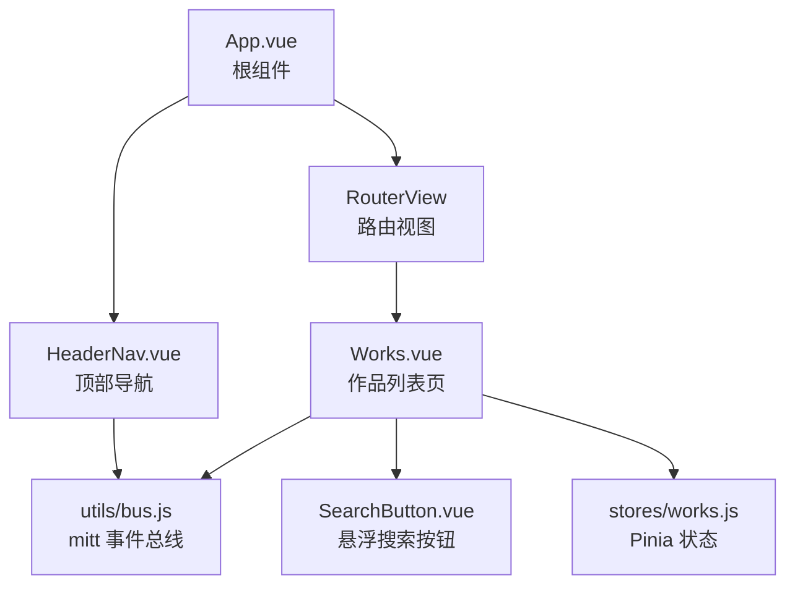
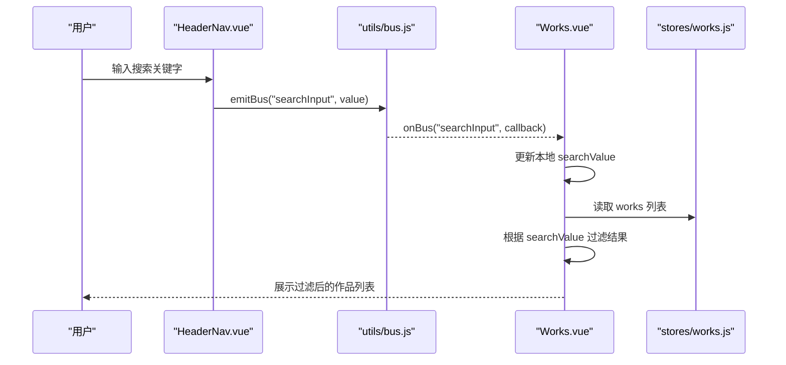
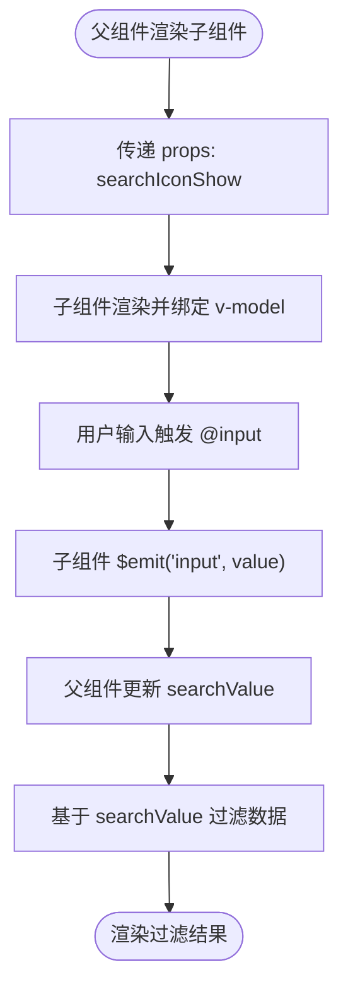
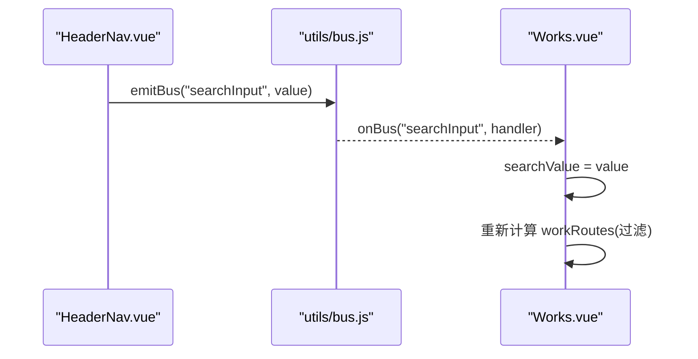
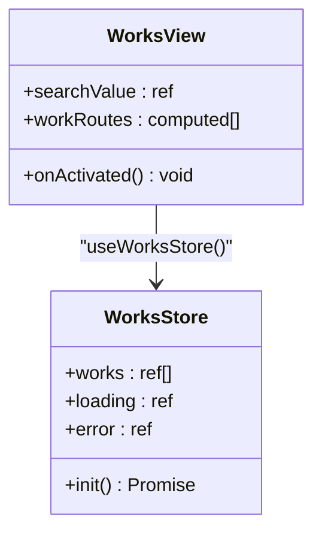
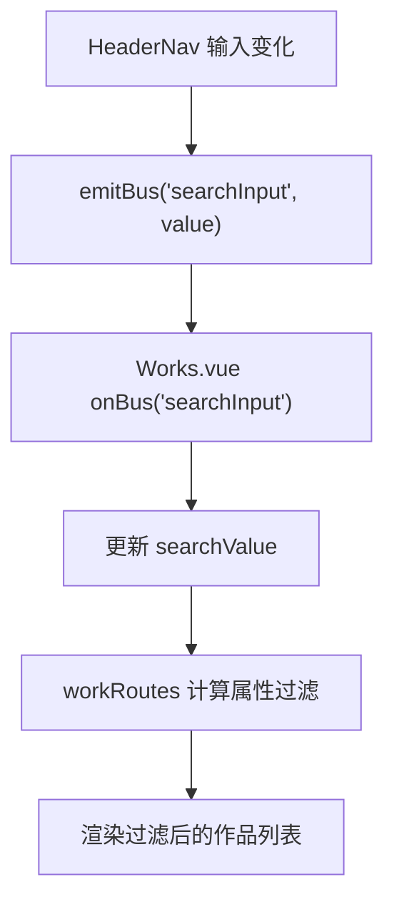
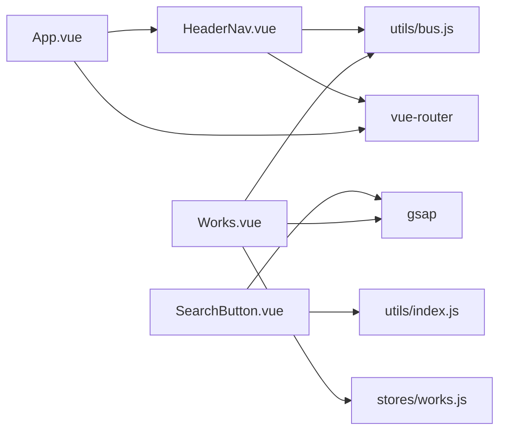

# 组件通信模式

<cite>
**本文引用的文件**   
- [HeaderNav.vue](file://src/components/HeaderNav.vue)
- [SearchButton.vue](file://src/components/SearchButton.vue)
- [bus.js](file://src/utils/bus.js)
- [works.js](file://src/stores/works.js)
- [Works.vue](file://src/views/Works.vue)
- [App.vue](file://src/App.vue)
</cite>

## 目录
1. [引言](#引言)
2. [项目结构](#项目结构)
3. [核心组件与通信入口](#核心组件与通信入口)
4. [架构总览](#架构总览)
5. [详细组件分析](#详细组件分析)
6. [依赖关系分析](#依赖关系分析)
7. [性能与可维护性建议](#性能与可维护性建议)
8. [故障排查指南](#故障排查指南)
9. [结论](#结论)

## 引言
本文面向 sunwenxu1997.github.io 项目的组件通信，聚焦以下目标：
- 父子组件通信：props 传递与事件发射。
- 兄弟组件通信：基于 mitt 的事件总线 emitBus/onBus。
- 跨层级数据共享：Pinia 状态管理在组件间的数据共享。
- HeaderNav 与搜索功能的通信：搜索输入的状态同步路径。
- 提供流程图与常见模式的代码片段路径，帮助快速定位实现位置。

## 项目结构
本项目采用 Vue 3 + Vite 的单页应用结构，关键通信相关目录如下：
- src/components：通用 UI 组件（如导航、搜索按钮）。
- src/utils：工具模块（事件总线封装）。
- src/stores：Pinia 状态管理（作品列表等全局数据）。
- src/views：页面级视图（如作品列表页）。
- src/App.vue：根组件，负责路由缓存与全局布局。

**图表来源**
- [App.vue:1-26](file://src/App.vue#L1-L26)
- [HeaderNav.vue:1-235](file://src/components/HeaderNav.vue#L1-L235)
- [SearchButton.vue:1-124](file://src/components/SearchButton.vue#L1-L124)
- [bus.js:1-15](file://src/utils/bus.js#L1-L15)
- [works.js:1-29](file://src/stores/works.js#L1-L29)
- [Works.vue:1-394](file://src/views/Works.vue#L1-L394)

**章节来源**
- [App.vue:1-26](file://src/App.vue#L1-L26)

## 核心组件与通信入口
- HeaderNav.vue：顶部导航，包含移动端搜索输入框，通过事件总线发出搜索关键词变化。
- SearchButton.vue：悬浮跟随鼠标的搜索按钮，通过 props 控制显示，并通过事件向父组件回传输入值。
- utils/bus.js：对 mitt 的轻量封装，提供 emitBus 和 onBus。
- stores/works.js：Pinia store，提供作品列表、加载状态与错误信息。
- Views/Works.vue：作品列表页，订阅事件总线更新本地搜索词，并消费 Pinia 数据做过滤展示。
- App.vue：根组件，渲染 HeaderNav 并使用 keep-alive 缓存路由组件。

**章节来源**
- [HeaderNav.vue:1-235](file://src/components/HeaderNav.vue#L1-L235)
- [SearchButton.vue:1-124](file://src/components/SearchButton.vue#L1-L124)
- [bus.js:1-15](file://src/utils/bus.js#L1-L15)
- [works.js:1-29](file://src/stores/works.js#L1-L29)
- [Works.vue:1-394](file://src/views/Works.vue#L1-L394)
- [App.vue:1-26](file://src/App.vue#L1-L26)

## 架构总览
下图展示了三种主要通信方式在项目中的落地：
- 父子通信：SearchButton 通过 props 接收 searchIconShow，并通过 input 事件将搜索值回传给 Works.vue。
- 兄弟通信：HeaderNav 与 Works.vue 通过 bus.js 的 emitBus/onBus 进行“搜索输入”事件同步。
- 跨层级共享：Works.vue 使用 Pinia 的 useWorksStore 获取作品数据，并在搜索时基于该数据进行过滤。

**图表来源**
- [HeaderNav.vue:119-128](file://src/components/HeaderNav.vue#L119-L128)
- [bus.js:1-15](file://src/utils/bus.js#L1-L15)
- [Works.vue:47-50](file://src/views/Works.vue#L47-L50)
- [Works.vue:115-117](file://src/views/Works.vue#L115-L117)
- [works.js:7-27](file://src/stores/works.js#L7-L27)

## 详细组件分析

### 父子组件通信：SearchButton 与 Works
- Props 传递：
  - Works.vue 向 SearchButton.vue 传入 searchIconShow，控制悬浮搜索按钮是否显示图标。
- 事件发射：
  - SearchButton.vue 定义 input 事件，在输入变化或按键触发时，将当前搜索值回传给父组件。
  - Works.vue 监听 @input 并将值赋给本地 searchValue，用于过滤作品列表。

**图表来源**
- [SearchButton.vue:7-10](file://src/components/SearchButton.vue#L7-L10)
- [SearchButton.vue:86-88](file://src/components/SearchButton.vue#L86-L88)
- [Works.vue:264-269](file://src/views/Works.vue#L264-L269)
- [Works.vue:115-117](file://src/views/Works.vue#L115-L117)

**章节来源**
- [SearchButton.vue:1-124](file://src/components/SearchButton.vue#L1-L124)
- [Works.vue:264-269](file://src/views/Works.vue#L264-L269)
- [Works.vue:115-117](file://src/views/Works.vue#L115-L117)

### 兄弟组件通信：HeaderNav 与 Works（基于 mitt）
- 发送端：
  - HeaderNav.vue 在搜索输入框的 @input 事件中调用 emitBus('searchInput', value)。
- 接收端：
  - Works.vue 在激活生命周期中注册 onBus('searchInput', callback)，回调函数更新本地 searchValue。
- 注意事项：
  - bus.js 在 onBus 订阅前会先 off 同名事件，避免重复订阅导致多次触发。

**图表来源**
- [HeaderNav.vue:119-128](file://src/components/HeaderNav.vue#L119-L128)
- [bus.js:1-15](file://src/utils/bus.js#L1-L15)
- [Works.vue:47-50](file://src/views/Works.vue#L47-L50)
- [Works.vue:115-117](file://src/views/Works.vue#L115-L117)

**章节来源**
- [HeaderNav.vue:119-128](file://src/components/HeaderNav.vue#L119-L128)
- [bus.js:1-15](file://src/utils/bus.js#L1-L15)
- [Works.vue:47-50](file://src/views/Works.vue#L47-L50)
- [Works.vue:115-117](file://src/views/Works.vue#L115-L117)

### 跨层级数据共享：Pinia 状态管理
- Store 职责：
  - useWorksStore 暴露 works、loading、error 与 init 方法，负责从 API 或本地静态数据加载作品列表。
- 组件使用：
  - Works.vue 在激活时调用 worksStore.init() 拉取数据，并根据 searchValue 过滤后渲染。
- 优势：
  - 多个组件可共享同一份作品数据，避免重复请求；便于统一处理加载与错误状态。

**图表来源**
- [works.js:7-27](file://src/stores/works.js#L7-L27)
- [Works.vue:30-35](file://src/views/Works.vue#L30-L35)
- [Works.vue:47-54](file://src/views/Works.vue#L47-L54)

**章节来源**
- [works.js:1-29](file://src/stores/works.js#L1-L29)
- [Works.vue:30-35](file://src/views/Works.vue#L30-L35)
- [Works.vue:47-54](file://src/views/Works.vue#L47-L54)

### HeaderNav 与搜索功能的状态同步
- HeaderNav 内部维护搜索输入框的显示与值，并在输入变化时通过 emitBus 广播。
- Works 在激活时订阅该事件，更新本地搜索词并触发列表过滤。
- 若需要在其他页面也响应搜索，可在对应页面的激活钩子中订阅同一事件名。

**图表来源**
- [HeaderNav.vue:119-128](file://src/components/HeaderNav.vue#L119-L128)
- [Works.vue:47-50](file://src/views/Works.vue#L47-L50)
- [Works.vue:31-35](file://src/views/Works.vue#L31-L35)

**章节来源**
- [HeaderNav.vue:119-128](file://src/components/HeaderNav.vue#L119-L128)
- [Works.vue:31-35](file://src/views/Works.vue#L31-L35)
- [Works.vue:47-50](file://src/views/Works.vue#L47-L50)

## 依赖关系分析
- HeaderNav.vue 依赖：
  - vue-router（路由跳转）、lucide-vue-next（图标）、settings（站点配置）、utils/bus.js（事件总线）。
- SearchButton.vue 依赖：
  - gsap（动画）、utils/index.js（设备检测与防抖）。
- Works.vue 依赖：
  - stores/works.js（Pinia 状态）、utils/bus.js（事件订阅）、gsap（滚动动画）。
- App.vue 依赖：
  - vue-router（RouterView）、vue-sonner（提示）、components/HeaderNav.vue。

**图表来源**
- [HeaderNav.vue:1-10](file://src/components/HeaderNav.vue#L1-L10)
- [SearchButton.vue:1-10](file://src/components/SearchButton.vue#L1-L10)
- [Works.vue:1-15](file://src/views/Works.vue#L1-L15)
- [App.vue:1-12](file://src/App.vue#L1-L12)

**章节来源**
- [HeaderNav.vue:1-10](file://src/components/HeaderNav.vue#L1-L10)
- [SearchButton.vue:1-10](file://src/components/SearchButton.vue#L1-L10)
- [Works.vue:1-15](file://src/views/Works.vue#L1-L15)
- [App.vue:1-12](file://src/App.vue#L1-L12)

## 性能与可维护性建议
- 事件总线最佳实践：
  - 使用 onBus 前先 off 同名事件，避免重复订阅（已在 bus.js 中实现）。
  - 在组件销毁或失活时移除监听，防止内存泄漏（建议在 onDeactivated/onUnmounted 中清理）。
- 搜索输入优化：
  - 对高频输入使用防抖（SearchButton 已使用 debounce），减少不必要的状态更新。
  - 在大数据量场景下，考虑后端分页或增量过滤。
- Pinia 状态设计：
  - 保持单一数据源，避免多处直接修改同一状态。
  - 将副作用逻辑（如网络请求）集中在 store 的方法中。

[本节为通用建议，不直接分析具体文件]

## 故障排查指南
- 搜索无响应：
  - 检查 HeaderNav 是否正确调用 emitBus('searchInput', value)。
  - 检查 Works.vue 是否在 onActivated 中注册 onBus('searchInput', ...)。
  - 确认 bus.js 的 onBus 是否被正确调用且未重复订阅。
- 悬浮搜索按钮异常：
  - 检查 SearchButton.vue 的 props.searchIconShow 是否按预期切换。
  - 检查键盘事件（Enter/Escape）是否触发 $emit('input', value)。
- Pinia 数据为空：
  - 检查 worksStore.init() 是否被调用，以及 defaultSet.useLocalWorks 的配置是否正确。
  - 查看 loading/error 状态以定位网络或数据解析问题。

**章节来源**
- [HeaderNav.vue:119-128](file://src/components/HeaderNav.vue#L119-L128)
- [Works.vue:47-50](file://src/views/Works.vue#L47-L50)
- [bus.js:1-15](file://src/utils/bus.js#L1-L15)
- [SearchButton.vue:48-63](file://src/components/SearchButton.vue#L48-L63)
- [works.js:12-25](file://src/stores/works.js#L12-L25)

## 结论
本项目通过三种通信模式实现了清晰的组件协作：
- 父子通信：SearchButton 与 Works 之间通过 props 与事件完成双向数据流。
- 兄弟通信：HeaderNav 与 Works 通过 mitt 事件总线解耦，实现搜索状态的跨组件同步。
- 跨层级共享：Pinia 统一管理作品数据，支撑多组件共享与过滤展示。
结合流程图与源码路径，开发者可以快速定位并扩展通信逻辑，同时遵循最佳实践提升可维护性与性能。