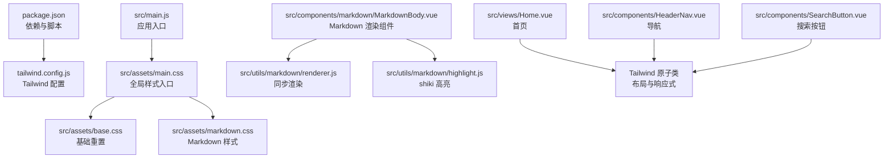
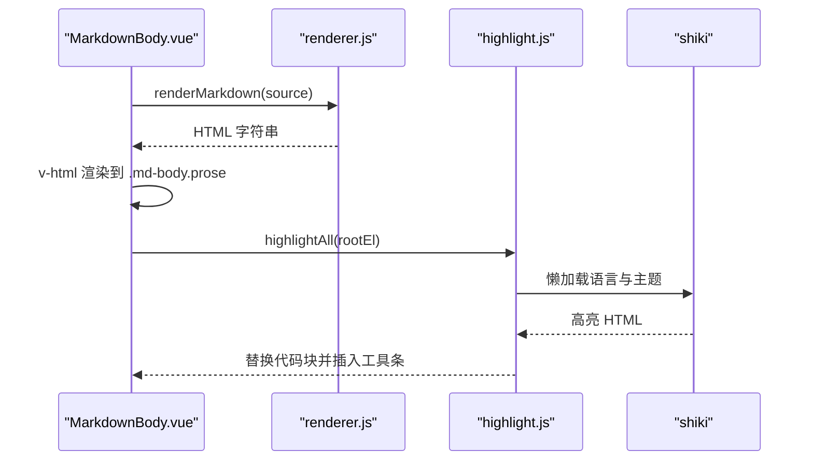
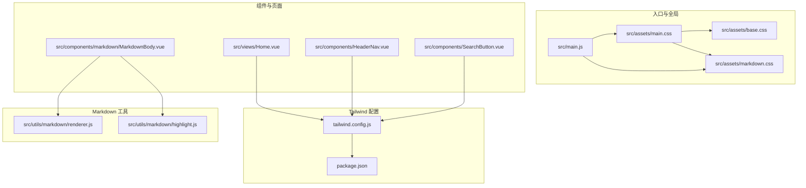
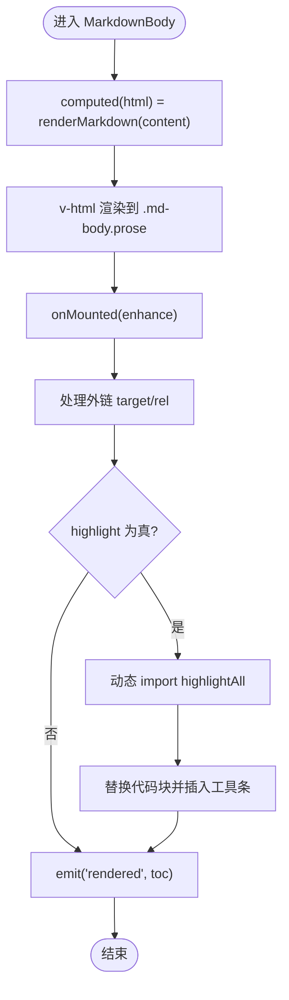
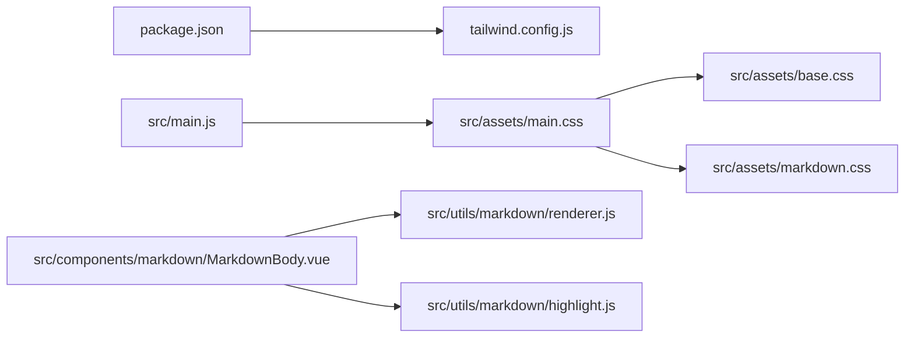

# 样式与主题

<cite>
**本文引用的文件**   
- [tailwind.config.js](file://tailwind.config.js)
- [package.json](file://package.json)
- [src/main.js](file://src/main.js)
- [src/assets/main.css](file://src/assets/main.css)
- [src/assets/base.css](file://src/assets/base.css)
- [src/assets/markdown.css](file://src/assets/markdown.css)
- [src/components/markdown/MarkdownBody.vue](file://src/components/markdown/MarkdownBody.vue)
- [src/utils/markdown/renderer.js](file://src/utils/markdown/renderer.js)
- [src/utils/markdown/highlight.js](file://src/utils/markdown/highlight.js)
- [src/views/Home.vue](file://src/views/Home.vue)
- [src/components/HeaderNav.vue](file://src/components/HeaderNav.vue)
- [src/components/SearchButton.vue](file://src/components/SearchButton.vue)
</cite>

## 目录
1. [简介](#简介)
2. [项目结构](#项目结构)
3. [核心样式体系](#核心样式体系)
4. [架构总览](#架构总览)
5. [详细组件分析](#详细组件分析)
6. [依赖关系分析](#依赖关系分析)
7. [性能与优化](#性能与优化)
8. [故障排查](#故障排查)
9. [结论](#结论)
10. [附录：主题定制指南](#附录主题定制指南)

## 简介
本仓库使用 Vue 3 + Vite + TailwindCSS 构建，样式体系以 TailwindCSS 原子类为主，辅以少量全局 CSS 和 Markdown 专用样式。Tailwind 通过配置启用 Typography 插件，提供 .prose 系列排版能力；同时自定义了屏幕断点、作用域优先级和扫描范围，确保与现有 UI 组件库共存并减少样式冲突。

本项目在样式上的关键设计：
- 使用 TailwindCSS 作为主要样式方案，并通过 tailwind.config.js 控制主题、断点和插件。
- 通过 src/assets 下的分层 CSS 文件组织基础样式、滚动条、图标等全局样式。
- 使用 @tailwindcss/typography 的 prose 类渲染 Markdown 正文，并在 markdown.css 中做站点化微调。
- 代码高亮采用 shiki，按需懒加载语言包，避免首屏体积膨胀。
- 响应式策略基于 Tailwind 的 sm/md/lg/xl/2xl 断点，结合组件内条件类名实现多端适配。

## 项目结构
样式相关的关键文件分布如下：
- 构建与依赖：package.json 定义 TailwindCSS、Autoprefixer、Typo 插件等开发依赖。
- Tailwind 配置：tailwind.config.js 定义 important、corePlugins.preflight、content 扫描路径、screens 断点、plugins。
- 入口样式：src/main.js 引入 Tailwind 样式、全局样式与 Markdown 样式。
- 全局样式：src/assets/base.css、src/assets/main.css、src/assets/markdown.css。
- Markdown 渲染：src/components/markdown/MarkdownBody.vue 负责渲染与增强，src/utils/markdown/renderer.js 负责同步渲染，src/utils/markdown/highlight.js 负责异步高亮。
- 页面与组件样式：Home.vue、HeaderNav.vue、SearchButton.vue 大量使用 Tailwind 原子类进行布局与交互。

图表来源
- [package.json:1-41](file://package.json#L1-L41)
- [tailwind.config.js:1-54](file://tailwind.config.js#L1-L54)
- [src/main.js:1-39](file://src/main.js#L1-L39)
- [src/assets/main.css:1-22](file://src/assets/main.css#L1-L22)
- [src/assets/base.css:1-6](file://src/assets/base.css#L1-L6)
- [src/assets/markdown.css:1-230](file://src/assets/markdown.css#L1-L230)
- [src/components/markdown/MarkdownBody.vue:1-57](file://src/components/markdown/MarkdownBody.vue#L1-L57)
- [src/utils/markdown/renderer.js:1-105](file://src/utils/markdown/renderer.js#L1-L105)
- [src/utils/markdown/highlight.js:1-148](file://src/utils/markdown/highlight.js#L1-L148)
- [src/views/Home.vue:1-86](file://src/views/Home.vue#L1-L86)
- [src/components/HeaderNav.vue:1-235](file://src/components/HeaderNav.vue#L1-L235)
- [src/components/SearchButton.vue:1-124](file://src/components/SearchButton.vue#L1-L124)

章节来源
- [package.json:1-41](file://package.json#L1-L41)
- [tailwind.config.js:1-54](file://tailwind.config.js#L1-L54)
- [src/main.js:1-39](file://src/main.js#L1-L39)

## 核心样式体系
本节从 Tailwind 配置、全局样式分层、Markdown 样式、以及组件中的原子类使用四个维度说明项目的样式体系。

### TailwindCSS 配置与主题
- 优先级与作用域
  - 通过 important 将 Tailwind 工具类的优先级提升到 #app 下，避免与第三方 UI 组件的高特异性选择器冲突。
- 预检样式
  - 关闭 corePlugins.preflight，避免 Tailwind 默认重置与已有组件样式产生覆盖冲突。
- 内容扫描
  - content 明确列出需要扫描的视图与组件路径，减少未用样式生成，提升构建速度。
- 响应式断点
  - 自定义 screens 断点：sm/md/lg/xl/2xl，用于在不同视口下切换布局与视觉。
- 插件
  - 启用 @tailwindcss/typography，为 Markdown 正文提供 .prose 系列排版类。

章节来源
- [tailwind.config.js:1-54](file://tailwind.config.js#L1-L54)

### 全局样式分层
- base.css：最小化的 HTML 元素重置（margin/padding）。
- main.css：导入 base.css，设置 body 基础样式、滚动条外观、通用 .icon 尺寸。
- markdown.css：在 .prose 基础上进行站点化微调，包括颜色变量、标题、链接、引用、列表、表格、行内代码、代码块外壳、复制按钮、摘要文本等。

建议的层级原则：
- 基础层（base.css）：仅包含必要的元素重置。
- 全局层（main.css）：站点级全局样式（滚动条、通用图标、全局容器）。
- 主题层（markdown.css）：针对特定内容区域（如 Markdown）的主题化样式。
- 组件层（各 .vue 组件）：尽量使用 Tailwind 原子类，必要时使用 scoped 样式补充。

章节来源
- [src/assets/base.css:1-6](file://src/assets/base.css#L1-L6)
- [src/assets/main.css:1-22](file://src/assets/main.css#L1-L22)
- [src/assets/markdown.css:1-230](file://src/assets/markdown.css#L1-L230)

### Markdown 内容与渲染优化
- 渲染流程
  - MarkdownBody.vue 使用 renderMarkdown 同步产出 HTML，并将结果注入到带有 md-body 和 prose 类的容器中。
  - 挂载后统一处理外链新窗口打开，并异步加载 highlightAll 对代码块进行高亮。
- 同步渲染内核
  - renderer.js 使用 MarkdownIt，禁用 html 输出以避免 XSS，linkify 自动识别链接，breaks 支持换行。
  - 围栏代码块在同步阶段只输出结构与原始代码，不执行高亮，保证列表页快速渲染。
  - 标题 h2/h3 自动生成 id，便于详情页目录跳转。
- 异步高亮
  - highlight.js 模块懒加载 shiki，按白名单语言动态 import，避免全量打包。
  - 使用 JavaScript 正则引擎，避免额外加载 oniguruma wasm。
  - 为每个代码块生成工具条，显示语言或文件名，并提供复制功能。

图表来源
- [src/components/markdown/MarkdownBody.vue:1-57](file://src/components/markdown/MarkdownBody.vue#L1-L57)
- [src/utils/markdown/renderer.js:1-105](file://src/utils/markdown/renderer.js#L1-L105)
- [src/utils/markdown/highlight.js:1-148](file://src/utils/markdown/highlight.js#L1-L148)

章节来源
- [src/components/markdown/MarkdownBody.vue:1-57](file://src/components/markdown/MarkdownBody.vue#L1-L57)
- [src/utils/markdown/renderer.js:1-105](file://src/utils/markdown/renderer.js#L1-L105)
- [src/utils/markdown/highlight.js:1-148](file://src/utils/markdown/highlight.js#L1-L148)

### 组件中的原子类与响应式策略
- Home.vue
  - 使用 w-screen/h-svh 全屏布局，配合 sm:bg-clip-content、sm:w-[calc(100%-12rem)]、sm:max-w-screen-lg、sm:h-2/3 等断点类实现桌面端卡片布局。
  - 背景图与模糊滤镜通过 Tailwind 的 bg-cover、bg-center、backdrop-blur 等类组合实现。
- HeaderNav.vue
  - 使用 fixed/sm:absolute、z-50、px-12/py-10、sm:px-24 等类实现固定导航与桌面端绝对定位。
  - 移动端菜单通过隐藏/显示逻辑与 Tailwind 类组合实现，如 hidden sm:flex、absolute、w-full h-screen。
  - 搜索输入框在小屏展开时通过 w-20 px-2 与 w-0 p-0 切换宽度。
- SearchButton.vue
  - 悬浮跟随鼠标的搜索按钮在非移动端设备显示，使用 fixed、opacity-0、transition、rounded-full、min-w-[2.5rem] 等类。
  - 根据 props.searchIconShow 切换背景色与混合模式，如 bg-slate-100、bg-red-600 mix-blend-difference。

章节来源
- [src/views/Home.vue:1-86](file://src/views/Home.vue#L1-L86)
- [src/components/HeaderNav.vue:1-235](file://src/components/HeaderNav.vue#L1-L235)
- [src/components/SearchButton.vue:1-124](file://src/components/SearchButton.vue#L1-L124)

## 架构总览
下图展示样式与主题在应用中的整体架构：入口引入 Tailwind 与全局样式，组件通过原子类构建界面，Markdown 内容通过 prose 与 markdown.css 进行排版与站点化定制。

图表来源
- [src/main.js:1-39](file://src/main.js#L1-L39)
- [src/assets/main.css:1-22](file://src/assets/main.css#L1-L22)
- [src/assets/base.css:1-6](file://src/assets/base.css#L1-L6)
- [src/assets/markdown.css:1-230](file://src/assets/markdown.css#L1-L230)
- [tailwind.config.js:1-54](file://tailwind.config.js#L1-L54)
- [package.json:1-41](file://package.json#L1-L41)
- [src/views/Home.vue:1-86](file://src/views/Home.vue#L1-L86)
- [src/components/HeaderNav.vue:1-235](file://src/components/HeaderNav.vue#L1-L235)
- [src/components/SearchButton.vue:1-124](file://src/components/SearchButton.vue#L1-L124)
- [src/components/markdown/MarkdownBody.vue:1-57](file://src/components/markdown/MarkdownBody.vue#L1-L57)
- [src/utils/markdown/renderer.js:1-105](file://src/utils/markdown/renderer.js#L1-L105)
- [src/utils/markdown/highlight.js:1-148](file://src/utils/markdown/highlight.js#L1-L148)

## 详细组件分析

### Markdown 渲染组件 MarkdownBody.vue
职责：
- 接收 content 与 highlight 属性，计算 HTML 并渲染到 .md-body.prose 容器。
- 挂载后统一处理外链行为，并根据 highlight 决定是否异步高亮代码块。
- 收集 h2/h3 的 id 与文本，供外部目录组件使用。

关键点：
- 使用 computed 缓存 HTML 输出，避免重复渲染。
- 使用 nextTick 监听 content 与 highlight 变化，确保 DOM 更新后再增强。
- 外链统一 target="_blank" rel="noopener noreferrer"，提升安全性。

图表来源
- [src/components/markdown/MarkdownBody.vue:1-57](file://src/components/markdown/MarkdownBody.vue#L1-L57)
- [src/utils/markdown/renderer.js:1-105](file://src/utils/markdown/renderer.js#L1-L105)
- [src/utils/markdown/highlight.js:1-148](file://src/utils/markdown/highlight.js#L1-L148)

章节来源
- [src/components/markdown/MarkdownBody.vue:1-57](file://src/components/markdown/MarkdownBody.vue#L1-L57)

### Markdown 同步渲染器 renderer.js
职责：
- 初始化 MarkdownIt，禁用 html 输出，启用 linkify 与 breaks。
- 重写围栏代码块规则，输出带 data-lang 与 data-title 的结构。
- 为 h2/h3 生成 slug 形式的 id，便于目录跳转。
- 提供 extractSummary 方法，抽取纯文本摘要用于列表卡片。

复杂度与性能：
- 同步渲染保证列表页快速展示，避免等待异步高亮。
- 代码块仅在详情或展开时高亮，降低首屏开销。

章节来源
- [src/utils/markdown/renderer.js:1-105](file://src/utils/markdown/renderer.js#L1-L105)

### 代码高亮 highlight.js
职责：
- 懒加载 shiki，按白名单语言动态 import，避免全量打包。
- 使用 createJavaScriptRegexEngine 避免 oniguruma wasm。
- 为每个代码块生成工具条，支持复制与状态反馈。

错误处理：
- 高亮加载失败时保留纯文本，并记录警告日志。
- 不支持的语言仅显示工具条，不报错。

章节来源
- [src/utils/markdown/highlight.js:1-148](file://src/utils/markdown/highlight.js#L1-L148)

### 首页 Home.vue
职责：
- 使用 GSAP 实现图层随鼠标移动效果。
- 使用 Tailwind 原子类实现全屏布局、背景图、模糊遮罩、文字排版与响应式卡片。

响应式要点：
- 小屏全屏，大屏限制宽度与高度，使用 sm: 前缀类控制。
- 背景图与滤镜通过 Tailwind 的 bg-* 与 backdrop-blur 类组合。

章节来源
- [src/views/Home.vue:1-86](file://src/views/Home.vue#L1-L86)

### 导航 HeaderNav.vue
职责：
- 管理导航项、搜索输入框、移动端菜单开关。
- 根据路由决定导航显示与样式，如首页与非首页的颜色差异。
- 使用 Tailwind 原子类实现固定导航、渐变背景、毛玻璃效果、移动端全屏菜单。

响应式要点：
- 小屏隐藏 PC 菜单，显示汉堡菜单与搜索输入框。
- 大屏使用 absolute/fixed 与 backdrop-blur 实现透明导航。

章节来源
- [src/components/HeaderNav.vue:1-235](file://src/components/HeaderNav.vue#L1-L235)

### 搜索按钮 SearchButton.vue
职责：
- 非移动端设备显示悬浮搜索按钮，跟随鼠标移动。
- 长按触发输入框展开，支持回车与 Esc 键操作。
- 使用 Tailwind 原子类实现圆角、透明度、混合模式与过渡动画。

交互要点：
- 使用 GSAP 实现平滑移动与弹性效果。
- 防抖输入事件，减少频繁触发。

章节来源
- [src/components/SearchButton.vue:1-124](file://src/components/SearchButton.vue#L1-L124)

## 依赖关系分析
样式相关的依赖关系如下：
- package.json 声明 TailwindCSS、@tailwindcss/typography、Autoprefixer 等依赖。
- tailwind.config.js 引入 typography 插件，并配置 important、preflight、content、screens。
- src/main.js 引入 Tailwind 样式与全局样式，确保样式生效顺序。
- Markdown 渲染依赖 markdown-it，高亮依赖 shiki，两者均按需加载。

图表来源
- [package.json:1-41](file://package.json#L1-L41)
- [tailwind.config.js:1-54](file://tailwind.config.js#L1-L54)
- [src/main.js:1-39](file://src/main.js#L1-L39)
- [src/assets/main.css:1-22](file://src/assets/main.css#L1-L22)
- [src/assets/base.css:1-6](file://src/assets/base.css#L1-L6)
- [src/assets/markdown.css:1-230](file://src/assets/markdown.css#L1-L230)
- [src/components/markdown/MarkdownBody.vue:1-57](file://src/components/markdown/MarkdownBody.vue#L1-L57)
- [src/utils/markdown/renderer.js:1-105](file://src/utils/markdown/renderer.js#L1-L105)
- [src/utils/markdown/highlight.js:1-148](file://src/utils/markdown/highlight.js#L1-L148)

章节来源
- [package.json:1-41](file://package.json#L1-L41)
- [tailwind.config.js:1-54](file://tailwind.config.js#L1-L54)
- [src/main.js:1-39](file://src/main.js#L1-L39)

## 性能与优化
- 构建优化
  - Tailwind content 精确扫描，减少未用样式生成。
  - 关闭 preflight 避免与第三方组件样式冲突。
  - Autoprefixer 由 Vite 生态自动处理，无需手动维护浏览器前缀。
- 运行时优化
  - Markdown 同步渲染保证列表页快速展示。
  - shiki 高亮按需懒加载，仅打包白名单语言，避免全量 bundle。
  - 使用 JavaScript 正则引擎，避免 oniguruma wasm 加载。
- 样式优化
  - 使用 Tailwind 原子类，减少自定义 CSS 体积。
  - 全局样式集中在 assets 目录，便于维护与复用。
  - Markdown 样式通过 CSS 变量统一管理颜色与边框，便于主题扩展。

[本节为通用指导，不直接分析具体文件]

## 故障排查
常见问题与建议：
- Tailwind 样式与第三方组件冲突
  - 检查 tailwind.config.js 中的 important 与 corePlugins.preflight 配置。
  - 确认 content 扫描路径是否包含所有使用的组件与视图。
- Markdown 样式异常
  - 确认 src/main.js 是否正确引入 markdown.css。
  - 检查 MarkdownBody.vue 是否使用了 .md-body.prose 类。
- 代码高亮失效
  - 检查 highlight.js 是否成功懒加载 shiki。
  - 确认代码块是否带有 data-lang 属性，且语言在白名单中。
- 响应式布局异常
  - 检查组件中是否正确使用 sm/md/lg/xl/2xl 前缀类。
  - 确认 tailwind.config.js 中的 screens 断点是否符合预期。

章节来源
- [tailwind.config.js:1-54](file://tailwind.config.js#L1-L54)
- [src/main.js:1-39](file://src/main.js#L1-L39)
- [src/components/markdown/MarkdownBody.vue:1-57](file://src/components/markdown/MarkdownBody.vue#L1-L57)
- [src/utils/markdown/highlight.js:1-148](file://src/utils/markdown/highlight.js#L1-L148)

## 结论
本项目以 TailwindCSS 为核心样式方案，通过精确配置与分层管理，实现了高效的样式开发与良好的可维护性。Markdown 内容通过 prose 与 markdown.css 完成站点化定制，代码高亮按需加载，兼顾性能与体验。组件广泛使用原子类，结合响应式断点，实现多端适配。建议在后续迭代中继续遵循原子类优先、全局样式最小化、主题变量集中化的原则，以保持样式体系的清晰与可扩展性。

[本节为总结性内容，不直接分析具体文件]

## 附录：主题定制指南
- 自定义颜色系统
  - 在 tailwind.config.js 的 theme.extend 中扩展 colors，例如新增 brand-primary、brand-secondary 等语义化颜色。
  - 在 markdown.css 中使用 CSS 变量统一管理文本、标题、边框等颜色，便于一键换肤。
- 自定义字体
  - 在组件中使用 style 标签引入字体，或在 Tailwind 的 fontFamily 中注册字体族。
  - 注意字体加载时机，避免首屏闪烁。
- 自定义断点
  - 在 tailwind.config.js 的 theme.screens 中调整断点值，匹配业务需求。
  - 在组件中合理使用 sm/md/lg/xl/2xl 前缀类，确保响应式一致性。
- 组件样式规范
  - 优先使用 Tailwind 原子类，避免重复样式。
  - 确需自定义样式时，使用 scoped 样式，并命名空间化类名，避免污染全局。
- Markdown 主题扩展
  - 在 markdown.css 中扩展 .md-body 下的子元素样式，如 blockquote、table、code 等。
  - 保持与 prose 类的兼容性，避免覆盖核心排版规则。

[本节为通用指导，不直接分析具体文件]