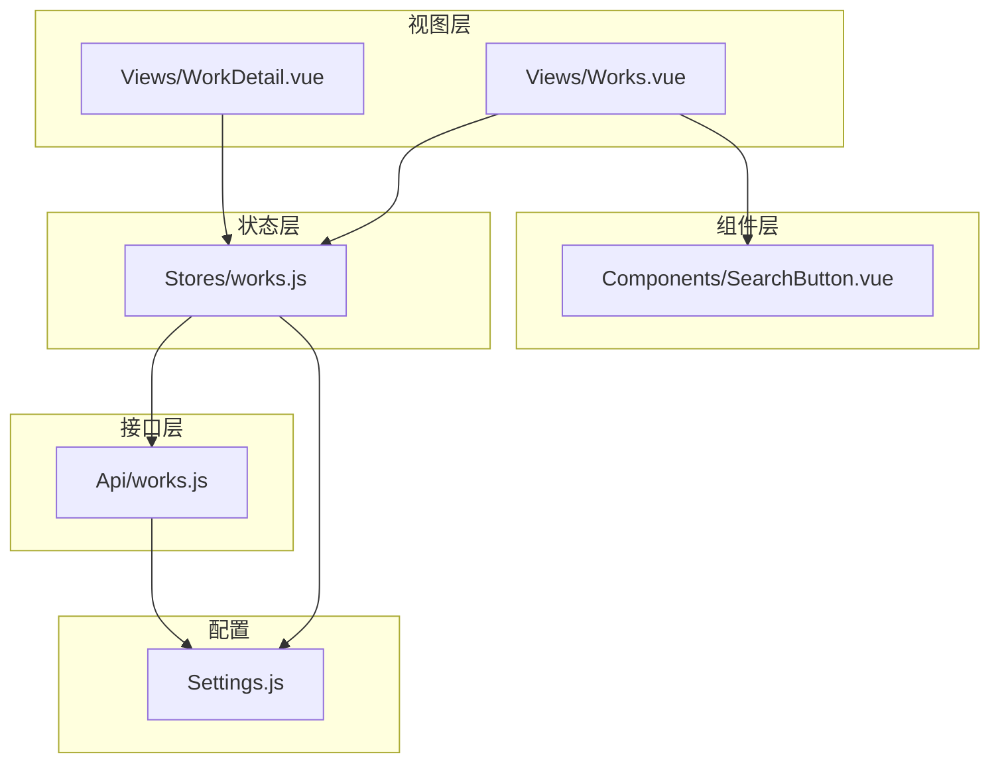
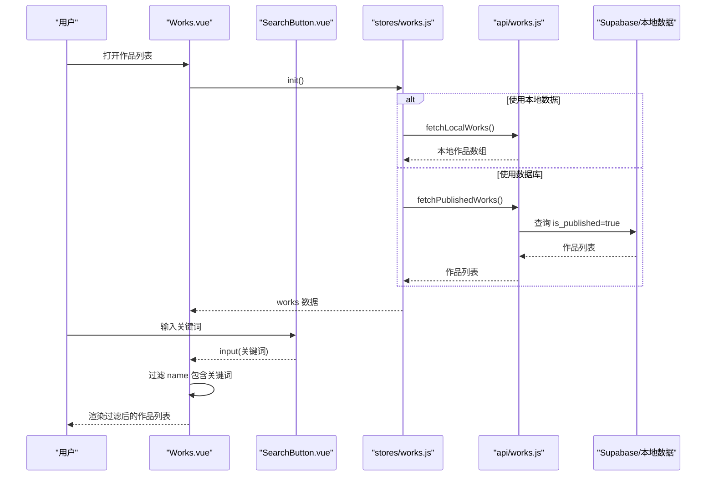
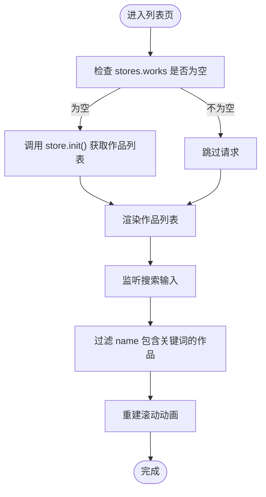
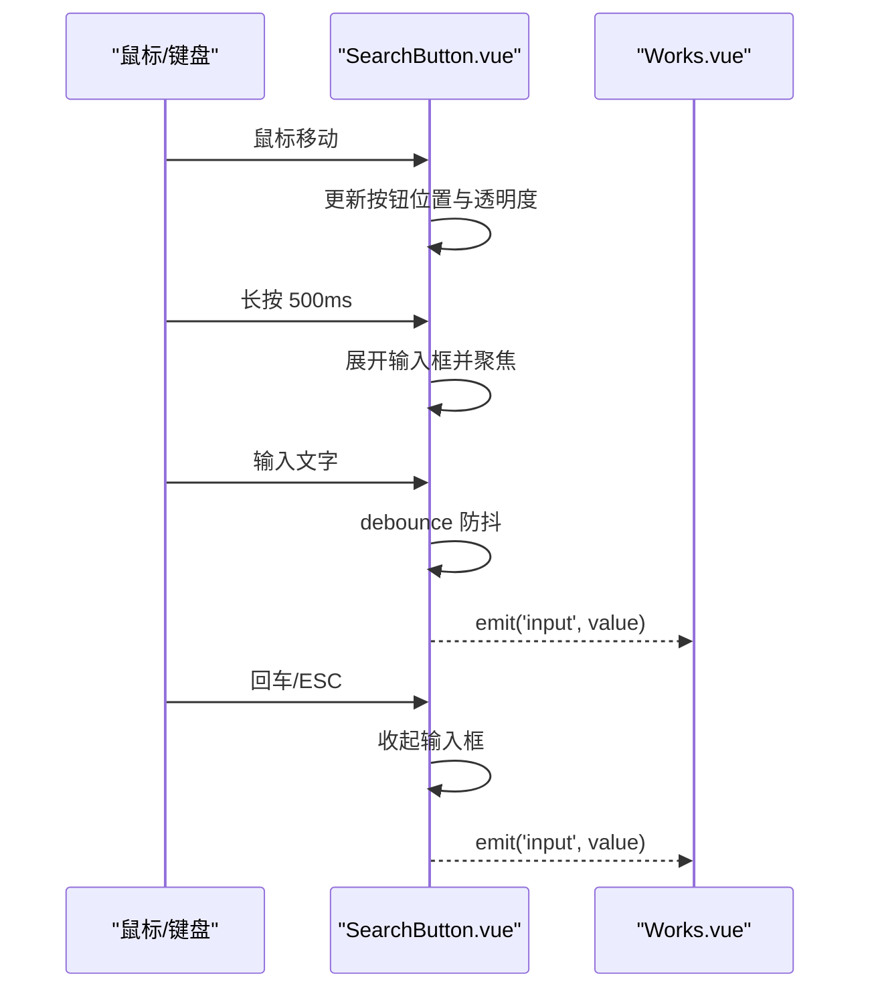
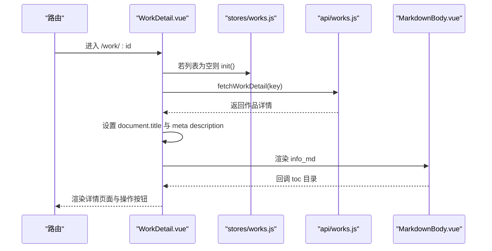
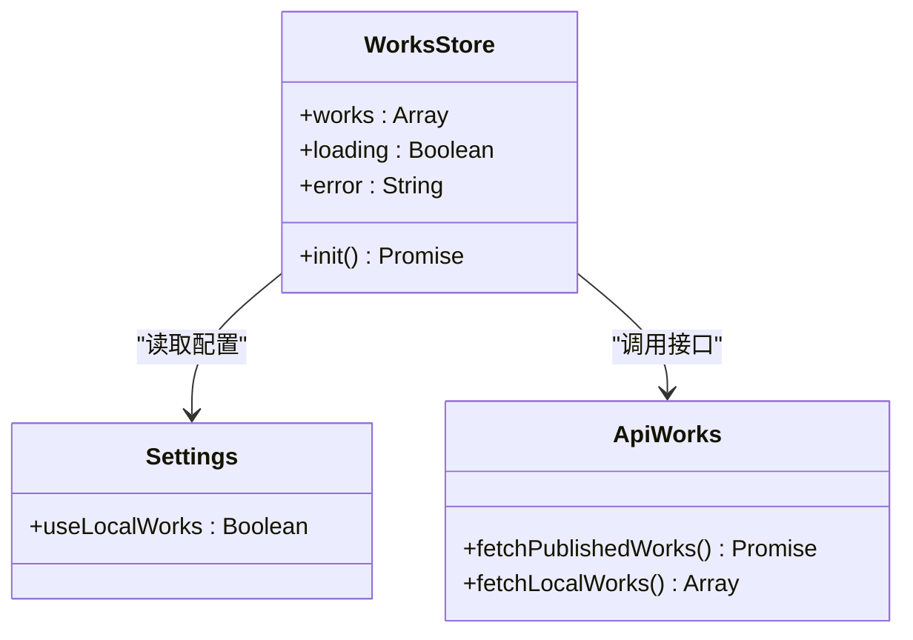
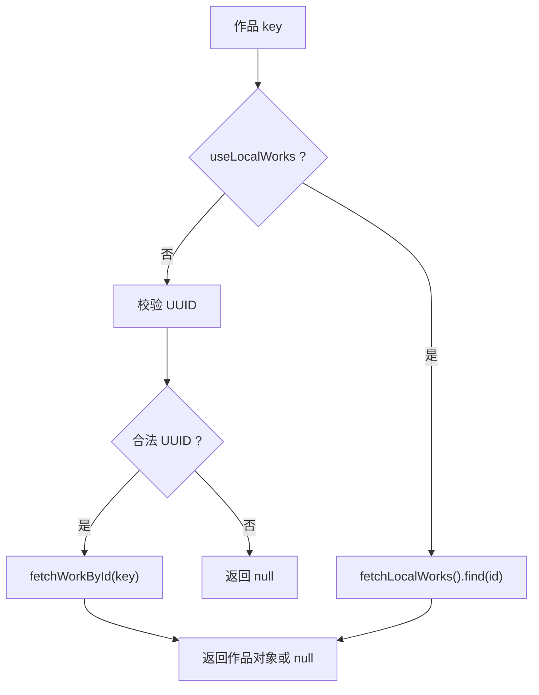
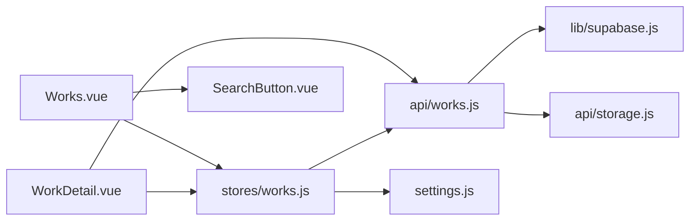

# 作品展示系统

<cite>
**本文引用的文件**   
- [Works.vue](file://src/views/Works.vue)
- [SearchButton.vue](file://src/components/SearchButton.vue)
- [WorkDetail.vue](file://src/views/WorkDetail.vue)
- [works.js（Pinia store）](file://src/stores/works.js)
- [works.js（API 层）](file://src/api/works.js)
- [settings.js（全局配置）](file://src/settings.js)
</cite>

## 目录
1. [简介](#简介)
2. [项目结构](#项目结构)
3. [核心组件与职责](#核心组件与职责)
4. [架构总览](#架构总览)
5. [详细组件分析](#详细组件分析)
6. [依赖关系分析](#依赖关系分析)
7. [性能与体验优化](#性能与体验优化)
8. [常见问题排查](#常见问题排查)
9. [使用示例与配置说明](#使用示例与配置说明)
10. [结论](#结论)

## 简介
本技术文档围绕“作品展示系统”的前端实现展开，重点解释以下能力：
- 作品列表展示：支持竖列与平铺网格两种视图、滚动动画、标签与外链图标。
- 搜索过滤：通过悬浮搜索按钮输入关键词，对作品名称进行前端过滤。
- 详情页面：按路由参数加载单条作品，渲染 Markdown 正文、封面图、目录导航、上下篇跳转、复制链接等。
- 数据状态管理：Pinia store 负责统一获取、缓存作品列表，并处理加载与错误状态。
- 数据源切换：通过全局配置在本地静态数据与 Supabase 数据库之间切换。

该文档既适合初次接触项目的开发者快速上手，也适合需要定制功能的工程师深入理解实现细节。

## 项目结构
作品展示功能主要分布在以下模块：
- 视图层：`Views/Works.vue`、`Views/WorkDetail.vue`
- 交互组件：`Components/SearchButton.vue`
- 状态管理：`Stores/works.js`
- API 层：`Api/works.js`
- 配置中心：`Settings.js`

**图表来源**
- [Works.vue:1-15](file://src/views/Works.vue#L1-L15)
- [WorkDetail.vue:1-16](file://src/views/WorkDetail.vue#L1-L16)
- [SearchButton.vue:1-10](file://src/components/SearchButton.vue#L1-L10)
- [works.js（store）:1-10](file://src/stores/works.js#L1-L10)
- [works.js（API）:1-5](file://src/api/works.js#L1-L5)
- [settings.js:1-8](file://src/settings.js#L1-L8)

**章节来源**
- [Works.vue:1-30](file://src/views/Works.vue#L1-L30)
- [WorkDetail.vue:1-20](file://src/views/WorkDetail.vue#L1-L20)
- [SearchButton.vue:1-15](file://src/components/SearchButton.vue#L1-L15)
- [works.js（store）:1-10](file://src/stores/works.js#L1-L10)
- [works.js（API）:1-30](file://src/api/works.js#L1-L30)
- [settings.js:1-8](file://src/settings.js#L1-L8)

## 核心组件与职责
- `Works.vue`：作品列表页，负责数据初始化、搜索过滤、视图模式切换、滚动动画、卡片点击跳转。
- `SearchButton.vue`：悬浮跟随鼠标的搜索入口，非移动端启用自定义光标与键盘交互，将输入值上抛给父组件。
- `WorkDetail.vue`：作品详情页，负责根据路由参数加载详情、渲染 Markdown、生成目录、提供操作按钮与前后作品导航。
- `stores/works.js`：Pinia store，封装作品列表的获取、缓存、错误处理，并根据配置选择数据源。
- `api/works.js`：Supabase 查询封装，包括已发布列表、分页、详情、统计、增删改等。
- `settings.js`：全局配置，包含是否使用本地静态数据、用户信息、外部作品示例等。

**章节来源**
- [Works.vue:1-30](file://src/views/Works.vue#L1-L30)
- [SearchButton.vue:1-15](file://src/components/SearchButton.vue#L1-L15)
- [WorkDetail.vue:1-20](file://src/views/WorkDetail.vue#L1-L20)
- [works.js（store）:1-29](file://src/stores/works.js#L1-L29)
- [works.js（API）:1-55](file://src/api/works.js#L1-L55)
- [settings.js:1-8](file://src/settings.js#L1-L8)

## 架构总览
作品展示系统采用“视图层 + 组件层 + Pinia 状态层 + API 层 + 配置中心”的分层架构。  
- 视图层只关注 UI 与交互；  
- 组件层封装可复用交互（如悬浮搜索）；  
- 状态层集中管理作品列表数据；  
- API 层屏蔽数据库差异；  
- 配置中心控制数据源与基础信息。

**图表来源**
- [Works.vue:31-35](file://src/views/Works.vue#L31-L35)
- [SearchButton.vue:86-88](file://src/components/SearchButton.vue#L86-L88)
- [works.js（store）:12-25](file://src/stores/works.js#L12-L25)
- [works.js（API）:45-55](file://src/api/works.js#L45-L55)

## 详细组件分析

### Works.vue：作品列表页
- 数据获取：进入激活时调用 store 的 `init()`，若列表为空或从详情页返回则刷新数据。
- 搜索过滤：监听 `searchInput` 事件，计算属性 `workRoutes` 基于 `name` 字段做大小写不敏感匹配。
- 视图模式：支持 `list`（竖列）与 `grid`（平铺网格），移动端固定为 `list`，桌面端可通过按钮切换，选择结果持久化到 `localStorage`。
- 滚动动画：使用 GSAP ScrollTrigger 监听 body 滚动，当作品卡片进入视口时触发子元素依次淡入。
- 布局与响应式：平铺模式下使用 Tailwind 栅格类实现多列布局；标签区域在小屏换行显示。
- 交互行为：封面与标题点击跳转到 `/work/:id`；外链图标在新窗口打开；右上角悬浮按钮支持回到顶部、打开聊天机器人、切换视图。

**图表来源**
- [Works.vue:47-63](file://src/views/Works.vue#L47-L63)
- [Works.vue:31-41](file://src/views/Works.vue#L31-L41)
- [Works.vue:87-114](file://src/views/Works.vue#L87-L114)

**章节来源**
- [Works.vue:16-35](file://src/views/Works.vue#L16-L35)
- [Works.vue:47-70](file://src/views/Works.vue#L47-L70)
- [Works.vue:87-128](file://src/views/Works.vue#L87-L128)
- [Works.vue:154-270](file://src/views/Works.vue#L154-L270)

### SearchButton.vue：悬浮搜索按钮
- 交互模式：非移动端隐藏系统光标，使用自定义浮动圆形按钮跟随鼠标移动；按下 500ms 后展开输入框。
- 键盘支持：回车键提交搜索并收起输入框；Esc 键取消搜索并收起输入框。
- 输入防抖：使用工具函数 `debounce` 节流输入事件，避免频繁向父组件派发。
- 事件通信：通过 `input` 事件将当前输入值上抛给父组件；同时暴露 `search` 事件供扩展。
- 视觉反馈：根据 `searchIconShow` 控制按钮样式与透明度，配合 hover/active 状态增强交互感。

**图表来源**
- [SearchButton.vue:29-47](file://src/components/SearchButton.vue#L29-L47)
- [SearchButton.vue:48-71](file://src/components/SearchButton.vue#L48-L71)
- [SearchButton.vue:72-88](file://src/components/SearchButton.vue#L72-L88)
- [SearchButton.vue:90-121](file://src/components/SearchButton.vue#L90-L121)

**章节来源**
- [SearchButton.vue:1-15](file://src/components/SearchButton.vue#L1-L15)
- [SearchButton.vue:29-88](file://src/components/SearchButton.vue#L29-L88)
- [SearchButton.vue:90-121](file://src/components/SearchButton.vue#L90-L121)

### WorkDetail.vue：作品详情页
- 路由参数解析：从 `route.params.id` 解析作品 key，兼容路径含斜杠的情况，必要时补前导斜杠。
- 数据加载：调用 `fetchWorkDetail(key)` 获取详情；失败时将 `work.value` 置空并显示 404 提示。
- SEO 与标题：成功加载后设置页面标题与描述 meta。
- 内容渲染：通过 `MarkdownBody` 组件渲染 `info_md`，并回调获取目录列表用于左侧导航。
- 媒体展示：封面图懒加载，点击放大预览；支持外链、代码仓库、在线代码、打开内容等按钮。
- 导航与分享：提供上一个/下一个作品跳转、复制链接、返回列表等操作。
- 彩蛋与体验：空白处点击礼花特效，阻止误选文本，右侧悬浮操作条带入场动画。

**图表来源**
- [WorkDetail.vue:40-51](file://src/views/WorkDetail.vue#L40-L51)
- [WorkDetail.vue:68-93](file://src/views/WorkDetail.vue#L68-L93)
- [WorkDetail.vue:153-161](file://src/views/WorkDetail.vue#L153-L161)
- [WorkDetail.vue:268-297](file://src/views/WorkDetail.vue#L268-L297)

**章节来源**
- [WorkDetail.vue:18-28](file://src/views/WorkDetail.vue#L18-L28)
- [WorkDetail.vue:40-66](file://src/views/WorkDetail.vue#L40-L66)
- [WorkDetail.vue:68-119](file://src/views/WorkDetail.vue#L68-L119)
- [WorkDetail.vue:153-161](file://src/views/WorkDetail.vue#L153-L161)
- [WorkDetail.vue:164-339](file://src/views/WorkDetail.vue#L164-L339)

### works store（Pinia）：数据状态管理
- 状态定义：`works`（作品数组）、`loading`（加载中标志）、`error`（错误信息）。
- 初始化逻辑：根据 `settings.useLocalWorks` 决定读取本地静态数据还是调用 `fetchPublishedWorks()`。
- 错误处理：捕获异常并记录日志，同时将 `works` 置空，便于上层组件判断与降级。
- 返回值：暴露 `works`、`loading`、`error`、`init` 供视图层使用。

**图表来源**
- [works.js（store）:1-29](file://src/stores/works.js#L1-L29)
- [settings.js:1-8](file://src/settings.js#L1-L8)
- [works.js（API）:45-55](file://src/api/works.js#L45-L55)

**章节来源**
- [works.js（store）:1-29](file://src/stores/works.js#L1-L29)

### API 层（Supabase 封装）
- 已发布列表：`fetchPublishedWorks()` 查询 `is_published=true` 的记录，RLS 策略保证匿名访问安全。
- 分页查询：`fetchWorksPage()` 支持关键词搜索、标签多选、字段存在性筛选、排序与范围分页。
- 详情查询：`fetchWorkDetail()` 根据 key 查找单条作品，本地模式直接匹配静态数据，数据库模式校验 UUID 后查询。
- 其他能力：统计、新增/更新、批量排序权重更新、删除（连带清理封面文件）。

**图表来源**
- [works.js（API）:186-195](file://src/api/works.js#L186-L195)
- [works.js（API）:169-178](file://src/api/works.js#L169-L178)
- [settings.js:1-8](file://src/settings.js#L1-L8)

**章节来源**
- [works.js（API）:45-55](file://src/api/works.js#L45-L55)
- [works.js（API）:115-140](file://src/api/works.js#L115-L140)
- [works.js（API）:186-195](file://src/api/works.js#L186-L195)

## 依赖关系分析
- `Works.vue` 依赖 `stores/works.js` 获取作品列表，依赖 `SearchButton.vue` 提供搜索交互，依赖 GSAP 与 ScrollTrigger 实现滚动动画。
- `WorkDetail.vue` 依赖 `api/works.js` 获取详情，依赖 `stores/works.js` 获取列表以计算前后作品，依赖 `MarkdownBody.vue` 渲染正文与目录。
- `stores/works.js` 依赖 `api/works.js` 与 `settings.js` 决定数据源。
- `api/works.js` 依赖 `lib/supabase.js` 与 `storage.js` 进行数据库与存储操作。

**图表来源**
- [Works.vue:1-15](file://src/views/Works.vue#L1-L15)
- [WorkDetail.vue:1-16](file://src/views/WorkDetail.vue#L1-L16)
- [works.js（store）:1-5](file://src/stores/works.js#L1-L5)
- [works.js（API）:1-4](file://src/api/works.js#L1-L4)

**章节来源**
- [Works.vue:1-15](file://src/views/Works.vue#L1-L15)
- [WorkDetail.vue:1-16](file://src/views/WorkDetail.vue#L1-L16)
- [works.js（store）:1-5](file://src/stores/works.js#L1-L5)
- [works.js（API）:1-4](file://src/api/works.js#L1-L4)

## 性能与体验优化
- 图片懒加载：封面图使用 `loading="lazy"`，减少首屏带宽压力。
- 滚动动画按需重建：视图模式切换与搜索结果变化后重建 ScrollTrigger，避免重复注册导致内存泄漏。
- 输入防抖：搜索输入使用 `debounce` 降低事件频率，提升性能。
- 条件渲染：仅在桌面端显示悬浮搜索与视图切换按钮，移动端简化交互。
- 骨架屏与占位：详情页加载时显示骨架屏，提升感知速度。
- 平滑滚动与动画：GSAP 与 CSS transition 结合，提供流畅的交互体验。

[本节为通用性能建议，不直接分析具体文件]

## 常见问题排查
- 列表不刷新：确认 `onActivated` 中是否正确调用 `worksStore.init()`，以及从详情页返回时是否复用缓存。
- 搜索无效：检查 `searchValue` 是否被正确绑定到 `SearchButton` 的 `input` 事件，且 `workRoutes` 计算属性是否基于 `name` 过滤。
- 详情页 404：确认路由参数 `id` 是否为有效 UUID（数据库模式）或存在于本地静态数据（本地模式）。
- 动画错乱：视图模式切换后需重建 ScrollTrigger，确保 `killAll()` 与重新创建顺序正确。
- 复制链接失败：浏览器环境不支持剪贴板 API 时会降级提示，引导用户手动复制地址栏链接。

**章节来源**
- [Works.vue:47-70](file://src/views/Works.vue#L47-L70)
- [Works.vue:31-41](file://src/views/Works.vue#L31-L41)
- [WorkDetail.vue:68-93](file://src/views/WorkDetail.vue#L68-L93)
- [WorkDetail.vue:105-112](file://src/views/WorkDetail.vue#L105-L112)

## 使用示例与配置说明

### 配置数据源
- 在 `settings.js` 中设置 `useLocalWorks`：
  - `true`：使用 `externalRoutes` 中的静态作品数据，适合本地调试。
  - `false`：走 Supabase 数据库，线上默认行为。

**章节来源**
- [settings.js:1-8](file://src/settings.js#L1-L8)

### 添加本地静态作品
- 在 `settings.js` 的 `externalRoutes` 中添加条目，每个条目包含 `name` 与 `meta`，`meta` 支持 `date`、`cover`、`link`、`info`、`sort`、`hidden`、`codepen` 等字段。
- 正文 Markdown 支持行内代码、加粗、超链接与围栏代码块。

**章节来源**
- [settings.js:32-31](file://src/settings.js#L32-L31)

### 列表页使用方式
- 引入 `Works.vue` 作为路由视图即可，无需额外配置。
- 如需自定义搜索样式，可在 `SearchButton.vue` 中调整类名与动画参数。

**章节来源**
- [Works.vue:154-270](file://src/views/Works.vue#L154-L270)
- [SearchButton.vue:90-121](file://src/components/SearchButton.vue#L90-L121)

### 详情页使用方式
- 路由规则应包含 `/work/:id`，详情页会自动根据 id 加载数据。
- 如需禁用彩蛋效果，可在 `WorkDetail.vue` 中移除背景点击礼花逻辑。

**章节来源**
- [WorkDetail.vue:18-28](file://src/views/WorkDetail.vue#L18-L28)
- [WorkDetail.vue:120-151](file://src/views/WorkDetail.vue#L120-L151)

## 结论
作品展示系统通过清晰的层次划分与可配置的數據源，实现了稳定的作品列表展示、灵活的搜索过滤与丰富的详情渲染能力。  
- 列表页注重交互体验与动画表现；  
- 详情页注重内容可读性与可操作性；  
- store 与 API 层解耦了数据获取逻辑，便于维护与扩展。  

开发者可根据业务需求调整配置项、扩展搜索维度、优化动画性能，或替换数据源以满足不同部署环境的要求。