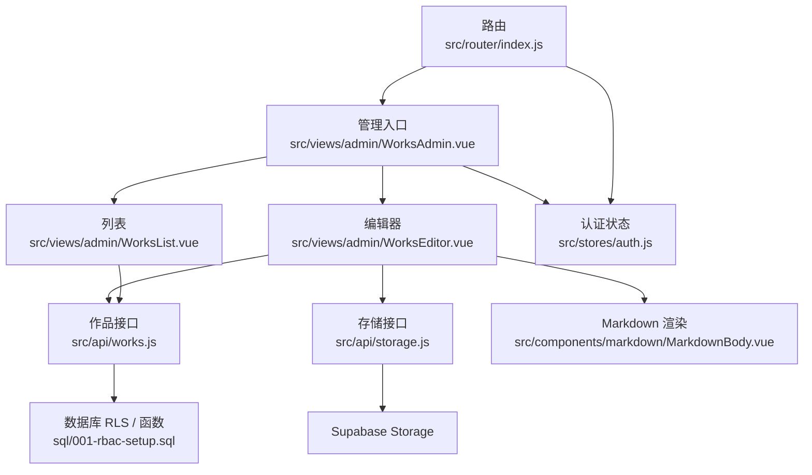
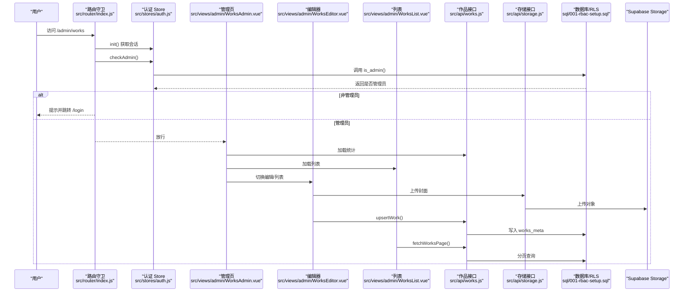
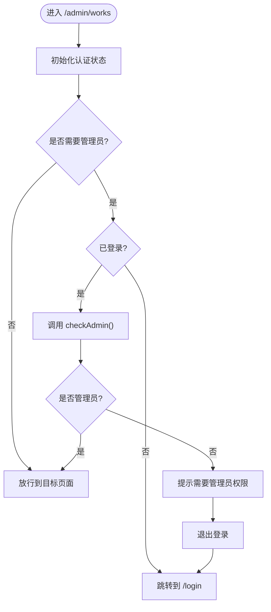
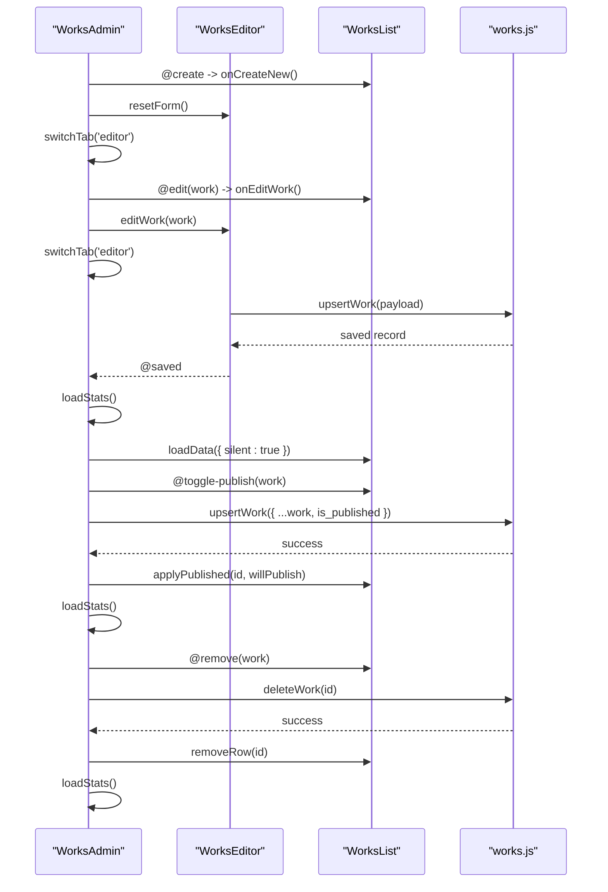
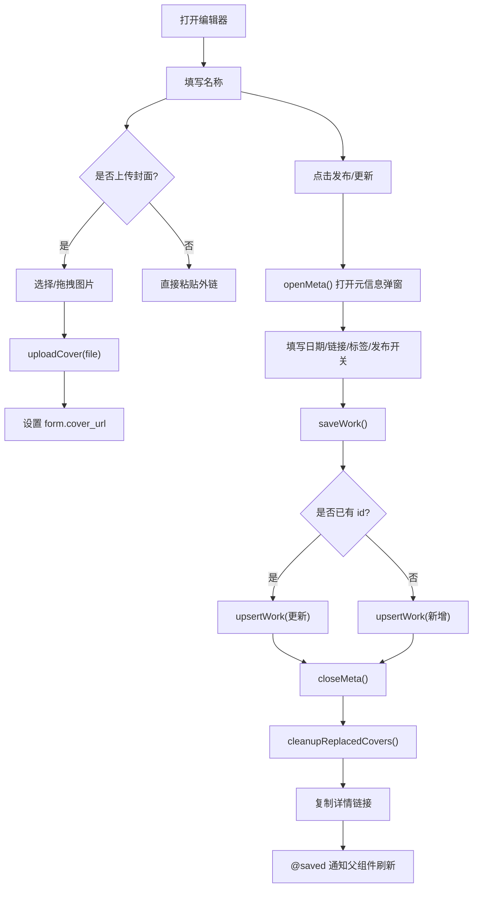
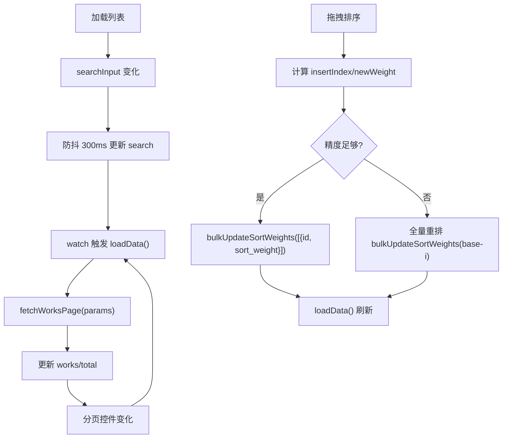
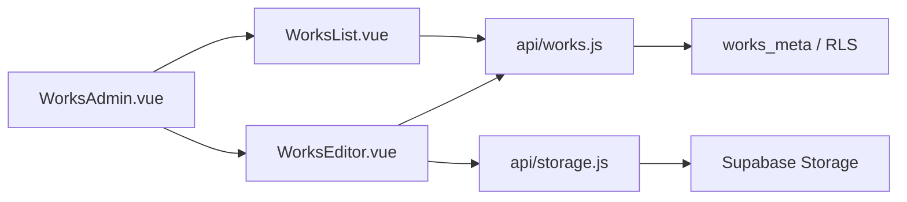

# 内容管理系统

<cite>
**本文引用的文件**   
- [src/router/index.js](file://src/router/index.js)
- [src/stores/auth.js](file://src/stores/auth.js)
- [src/views/admin/WorksAdmin.vue](file://src/views/admin/WorksAdmin.vue)
- [src/views/admin/WorksEditor.vue](file://src/views/admin/WorksEditor.vue)
- [src/views/admin/WorksList.vue](file://src/views/admin/WorksList.vue)
- [src/api/works.js](file://src/api/works.js)
- [src/api/storage.js](file://src/api/storage.js)
- [src/components/markdown/MarkdownBody.vue](file://src/components/markdown/MarkdownBody.vue)
- [sql/001-rbac-setup.sql](file://sql/001-rbac-setup.sql)
</cite>

## 目录
1. [引言](#引言)
2. [项目结构](#项目结构)
3. [核心组件](#核心组件)
4. [架构总览](#架构总览)
5. [详细组件分析](#详细组件分析)
6. [依赖关系分析](#依赖关系分析)
7. [性能与体验优化](#性能与体验优化)
8. [故障排查指南](#故障排查指南)
9. [使用示例与扩展指南](#使用示例与扩展指南)
10. [结论](#结论)

## 引言
本技术文档面向内容管理系统的后台管理模块，重点解释以下目标：
- 后台管理入口 WorksAdmin.vue 的路由守卫与权限验证机制。
- 富文本编辑器 WorksEditor.vue 的 Markdown 编辑、实时预览、封面上传等实现。
- 作品列表 WorksList.vue 的 CRUD、批量操作、状态管理与拖拽排序。
- 管理界面权限控制机制，确保只有管理员可访问管理功能。
- 提供具体使用示例与二次开发扩展指南，帮助开发者理解并扩展内容管理能力。

## 项目结构
内容管理相关代码集中在以下路径：
- 路由与权限：`src/router/index.js`
- 认证状态：`src/stores/auth.js`
- 管理页面：`src/views/admin/`
- 数据接口：`src/api/works.js`、`src/api/storage.js`
- Markdown 渲染：`src/components/markdown/MarkdownBody.vue`
- RBAC 数据库脚本：`sql/001-rbac-setup.sql`

**图表来源**
- [src/router/index.js:31-35](file://src/router/index.js#L31-L35)
- [src/views/admin/WorksAdmin.vue:93-110](file://src/views/admin/WorksAdmin.vue#L93-L110)
- [src/views/admin/WorksEditor.vue:292-294](file://src/views/admin/WorksEditor.vue#L292-L294)
- [src/views/admin/WorksList.vue:226-227](file://src/views/admin/WorksList.vue#L226-L227)
- [src/api/works.js:1-12](file://src/api/works.js#L1-L12)
- [src/api/storage.js:3-10](file://src/api/storage.js#L3-L10)
- [src/components/markdown/MarkdownBody.vue:5-9](file://src/components/markdown/MarkdownBody.vue#L5-L9)
- [sql/001-rbac-setup.sql:84-92](file://sql/001-rbac-setup.sql#L84-L92)

**章节来源**
- [src/router/index.js:1-73](file://src/router/index.js#L1-L73)
- [src/views/admin/WorksAdmin.vue:1-263](file://src/views/admin/WorksAdmin.vue#L1-L263)
- [src/views/admin/WorksEditor.vue:1-585](file://src/views/admin/WorksEditor.vue#L1-L585)
- [src/views/admin/WorksList.vue:1-585](file://src/views/admin/WorksList.vue#L1-L585)
- [src/api/works.js:1-267](file://src/api/works.js#L1-L267)
- [src/api/storage.js:1-100](file://src/api/storage.js#L1-L100)
- [src/components/markdown/MarkdownBody.vue:1-57](file://src/components/markdown/MarkdownBody.vue#L1-L57)
- [sql/001-rbac-setup.sql:1-128](file://sql/001-rbac-setup.sql#L1-L128)

## 核心组件
- 路由与权限：通过 `router.beforeEach` 对 `/admin/works` 进行登录态与管理员角色校验。
- 认证状态：Pinia store 封装 Supabase Auth，提供会话初始化、登录、登出、管理员判断等方法。
- 管理入口：WorksAdmin.vue 聚合编辑器与列表，负责统计展示、侧边抽屉、标签切换、保存后刷新。
- 编辑器：WorksEditor.vue 提供 Markdown 编辑、实时预览、封面上传（本地拖拽或选择）、元信息弹窗、发布/草稿切换。
- 列表：WorksList.vue 提供分页、搜索、标签筛选、条件筛选、行内发布开关、删除、打开详情、拖拽排序。
- 数据接口：works.js 封装 works_meta 表查询、分页、统计、增删改；storage.js 封装封面上传与清理。
- Markdown 渲染：MarkdownBody.vue 同步渲染 HTML，异步高亮代码块，外链新窗口打开。

**章节来源**
- [src/router/index.js:51-70](file://src/router/index.js#L51-L70)
- [src/stores/auth.js:5-80](file://src/stores/auth.js#L5-L80)
- [src/views/admin/WorksAdmin.vue:115-247](file://src/views/admin/WorksAdmin.vue#L115-L247)
- [src/views/admin/WorksEditor.vue:288-569](file://src/views/admin/WorksEditor.vue#L288-L569)
- [src/views/admin/WorksList.vue:221-559](file://src/views/admin/WorksList.vue#L221-L559)
- [src/api/works.js:1-267](file://src/api/works.js#L1-L267)
- [src/api/storage.js:1-100](file://src/api/storage.js#L1-L100)
- [src/components/markdown/MarkdownBody.vue:1-57](file://src/components/markdown/MarkdownBody.vue#L1-L57)

## 架构总览
系统采用前后端分离模式，前端基于 Vue 3 + Pinia + Vue Router，后端通过 Supabase 提供数据库与对象存储能力。RBAC 权限在数据库层通过 RLS 策略与 SQL 函数保障，前端仅做轻量校验与用户体验增强。

**图表来源**
- [src/router/index.js:51-70](file://src/router/index.js#L51-L70)
- [src/stores/auth.js:59-66](file://src/stores/auth.js#L59-L66)
- [sql/001-rbac-setup.sql:84-92](file://sql/001-rbac-setup.sql#L84-L92)
- [src/views/admin/WorksAdmin.vue:179-195](file://src/views/admin/WorksAdmin.vue#L179-L195)
- [src/views/admin/WorksEditor.vue:388-401](file://src/views/admin/WorksEditor.vue#L388-L401)
- [src/api/storage.js:62-83](file://src/api/storage.js#L62-L83)
- [src/api/works.js:203-231](file://src/api/works.js#L203-L231)
- [src/views/admin/WorksList.vue:377-407](file://src/views/admin/WorksList.vue#L377-L407)

## 详细组件分析

### 路由守卫与权限控制
- 路由定义中 `/admin/works` 标记 `requiresAdmin: true`。
- 全局前置守卫在进入路由前：
  - 初始化认证状态。
  - 若需要管理员权限，则检查登录态；未登录跳转 `/login`。
  - 调用 `authStore.checkAdmin()` 判断是否为管理员；非管理员弹出提示、退出登录并跳转 `/login`。

**图表来源**
- [src/router/index.js:31-35](file://src/router/index.js#L31-L35)
- [src/router/index.js:51-70](file://src/router/index.js#L51-L70)
- [src/stores/auth.js:59-66](file://src/stores/auth.js#L59-L66)

**章节来源**
- [src/router/index.js:31-35](file://src/router/index.js#L31-L35)
- [src/router/index.js:51-70](file://src/router/index.js#L51-L70)
- [src/stores/auth.js:59-66](file://src/stores/auth.js#L59-L66)
- [sql/001-rbac-setup.sql:84-92](file://sql/001-rbac-setup.sql#L84-L92)

### 管理入口 WorksAdmin.vue
职责与行为：
- 顶部导航：切换“编辑”和“列表”两个标签页，显示当前列表总数。
- 侧边抽屉：展示用户头像、用户名、邮箱、统计数据（总数、已发布、有封面、已配置链接），并提供退出登录。
- 主区域：根据 activeTab 显示 WorksEditor 或 WorksList，并通过 ref 调用子组件方法。
- 滚动位置记忆：切换标签时记录并恢复滚动位置，避免 v-show 导致的布局塌陷。
- 事件处理：新建、编辑、发布/取消发布、删除，均通过子组件暴露的方法与父组件协调。

关键交互流程：
- 新建：清空表单并切换到编辑器。
- 编辑：将选中作品数据注入编辑器并切换到编辑器。
- 保存成功：静默刷新统计与列表缓存，不强制重拉整页，保留分页与滚动位置。
- 发布/取消发布：局部更新行状态，提升体验。
- 删除：确认后删除，局部移除行，必要时回退页码。

**图表来源**
- [src/views/admin/WorksAdmin.vue:102-110](file://src/views/admin/WorksAdmin.vue#L102-L110)
- [src/views/admin/WorksAdmin.vue:202-243](file://src/views/admin/WorksAdmin.vue#L202-L243)
- [src/views/admin/WorksEditor.vue:516-566](file://src/views/admin/WorksEditor.vue#L516-L566)
- [src/api/works.js:203-231](file://src/api/works.js#L203-L231)
- [src/views/admin/WorksList.vue:420-438](file://src/views/admin/WorksList.vue#L420-L438)

**章节来源**
- [src/views/admin/WorksAdmin.vue:1-263](file://src/views/admin/WorksAdmin.vue#L1-L263)

### 富文本编辑器 WorksEditor.vue
功能要点：
- 名称输入：必填项，作为发布/更新的主键标识之一。
- 封面上传：支持点击选择与拖拽上传，限制类型与大小，上传成功后生成公开 URL；支持复制链接；换图后延迟清理旧图。
- Markdown 正文：左侧 textarea 编辑，右侧实时预览（可选）；字符计数；兼容旧 HTML 字段提示。
- 元信息弹窗：日期、代码地址、文章链接、CodePen、打开地址、标签管理、发布开关。
- 快捷键：Ctrl/Cmd + Shift + P 切换预览。
- 保存逻辑：构建 payload，区分新建与更新；新建成功后回填 id；关闭弹框；清理被替换的旧封面；复制详情链接；触发父组件刷新。

**图表来源**
- [src/views/admin/WorksEditor.vue:365-401](file://src/views/admin/WorksEditor.vue#L365-L401)
- [src/views/admin/WorksEditor.vue:467-492](file://src/views/admin/WorksEditor.vue#L467-L492)
- [src/views/admin/WorksEditor.vue:516-566](file://src/views/admin/WorksEditor.vue#L516-L566)
- [src/api/storage.js:62-83](file://src/api/storage.js#L62-L83)
- [src/api/works.js:203-231](file://src/api/works.js#L203-L231)

**章节来源**
- [src/views/admin/WorksEditor.vue:1-585](file://src/views/admin/WorksEditor.vue#L1-L585)
- [src/api/storage.js:1-100](file://src/api/storage.js#L1-L100)
- [src/components/markdown/MarkdownBody.vue:1-57](file://src/components/markdown/MarkdownBody.vue#L1-L57)

### 作品列表 WorksList.vue
功能要点：
- 搜索与筛选：搜索框带防抖；标签多选；条件筛选浮层（封面/日期/链接存在性、发布状态）。
- 分页：每页条数可选，上一页/下一页，计算总页数。
- 行内操作：发布开关、编辑、删除、打开详情。
- 拖拽排序：仅在无搜索/筛选/标签过滤时可用；按插入位置计算新权重；精度不足时全量重排整数权重。
- 局部更新：发布状态变更与删除行不重载整页，保持分页与滚动位置。

**图表来源**
- [src/views/admin/WorksList.vue:326-353](file://src/views/admin/WorksList.vue#L326-L353)
- [src/views/admin/WorksList.vue:377-407](file://src/views/admin/WorksList.vue#L377-L407)
- [src/views/admin/WorksList.vue:447-542](file://src/views/admin/WorksList.vue#L447-L542)
- [src/api/works.js:115-140](file://src/api/works.js#L115-L140)
- [src/api/works.js:240-249](file://src/api/works.js#L240-L249)

**章节来源**
- [src/views/admin/WorksList.vue:1-585](file://src/views/admin/WorksList.vue#L1-L585)
- [src/api/works.js:115-140](file://src/api/works.js#L115-L140)
- [src/api/works.js:240-249](file://src/api/works.js#L240-L249)

### Markdown 渲染组件 MarkdownBody.vue
职责：
- 同步产出 HTML（v-html），保证所见即所得。
- 异步加载代码高亮模块，提升首屏性能。
- 外链统一新窗口打开，增加安全属性。
- 收集目录（TOC）供外部使用。

**章节来源**
- [src/components/markdown/MarkdownBody.vue:1-57](file://src/components/markdown/MarkdownBody.vue#L1-L57)

## 依赖关系分析
- 组件耦合：
  - WorksAdmin.vue 聚合 WorksEditor.vue 与 WorksList.vue，通过 ref 与事件通信，低耦合。
  - WorksEditor.vue 依赖 storage.js 与 works.js，关注编辑与保存。
  - WorksList.vue 依赖 works.js，关注查询、分页、排序。
- 外部依赖：
  - Supabase Auth：会话与管理员判断。
  - Supabase Database：works_meta 表与 RLS 策略。
  - Supabase Storage：封面对象存储。
- 潜在循环依赖：无直接循环导入；API 层与视图层解耦清晰。

**图表来源**
- [src/views/admin/WorksAdmin.vue:115-123](file://src/views/admin/WorksAdmin.vue#L115-L123)
- [src/views/admin/WorksEditor.vue:292-294](file://src/views/admin/WorksEditor.vue#L292-L294)
- [src/views/admin/WorksList.vue:226-227](file://src/views/admin/WorksList.vue#L226-L227)
- [src/api/works.js:1-12](file://src/api/works.js#L1-L12)
- [src/api/storage.js:1-10](file://src/api/storage.js#L1-L10)

**章节来源**
- [src/views/admin/WorksAdmin.vue:115-123](file://src/views/admin/WorksAdmin.vue#L115-L123)
- [src/views/admin/WorksEditor.vue:292-294](file://src/views/admin/WorksEditor.vue#L292-L294)
- [src/views/admin/WorksList.vue:226-227](file://src/views/admin/WorksList.vue#L226-L227)
- [src/api/works.js:1-12](file://src/api/works.js#L1-L12)
- [src/api/storage.js:1-10](file://src/api/storage.js#L1-L10)

## 性能与体验优化
- 列表加载竞态保护：使用 loadSeq 防止快速翻页导致旧响应覆盖新数据。
- 搜索防抖：300ms 防抖减少频繁请求。
- 局部更新：发布/删除不重载整页，保留分页与滚动位置。
- 封面上传缓存：Storage 对象设置长缓存头，降低带宽消耗。
- 分页与排序：服务端分页 + 稳定排序键（sort_weight、date、created_at、id），避免重复或漏行。
- 预览性能：Markdown 高亮异步加载，避免阻塞首屏。

[本节为通用性能建议，不直接分析具体文件]

## 故障排查指南
常见问题与定位思路：
- 无法访问管理页：
  - 检查路由守卫是否正确拦截非管理员。
  - 确认 `authStore.init()` 已执行且会话有效。
  - 检查数据库 `is_admin()` 函数返回结果。
- 封面上传失败：
  - 检查 MIME 类型与文件大小是否符合限制。
  - 确认 Storage bucket 的 RLS 策略允许 admin 写入。
  - 查看浏览器控制台错误与 Supabase Storage 日志。
- 列表分页异常：
  - 检查排序键稳定性与唯一列兜底。
  - 确认分页参数 page/pageSize 正确传递。
- Markdown 渲染问题：
  - 检查 content 是否为空或包含非法 HTML。
  - 确认高亮模块异步加载成功。

**章节来源**
- [src/router/index.js:51-70](file://src/router/index.js#L51-L70)
- [src/stores/auth.js:59-66](file://src/stores/auth.js#L59-L66)
- [src/api/storage.js:62-83](file://src/api/storage.js#L62-L83)
- [src/api/works.js:25-30](file://src/api/works.js#L25-L30)
- [src/components/markdown/MarkdownBody.vue:28-44](file://src/components/markdown/MarkdownBody.vue#L28-L44)

## 使用示例与扩展指南

### 管理员首次启用
- 运行 RBAC 初始化脚本，创建 profiles 表、RLS 策略与 `is_admin()` 函数。
- 使用 service_role 调用 `bootstrap_first_admin(user_email)` 将指定邮箱的用户提升为管理员。
- 登录系统后访问 `/admin/works`，路由守卫会校验管理员身份。

**章节来源**
- [sql/001-rbac-setup.sql:8-16](file://sql/001-rbac-setup.sql#L8-L16)
- [sql/001-rbac-setup.sql:84-92](file://sql/001-rbac-setup.sql#L84-L92)
- [sql/001-rbac-setup.sql:106-121](file://sql/001-rbac-setup.sql#L106-L121)
- [src/router/index.js:51-70](file://src/router/index.js#L51-L70)

### 新增作品
- 在列表页点击“+ 新建”，进入编辑器。
- 填写作品名称、封面（可选）、Markdown 正文（可选）、元信息（日期、链接、标签、发布开关）。
- 点击“发布”或“存为草稿”，保存成功后自动复制详情链接。

**章节来源**
- [src/views/admin/WorksList.vue:70-75](file://src/views/admin/WorksList.vue#L70-L75)
- [src/views/admin/WorksEditor.vue:452-465](file://src/views/admin/WorksEditor.vue#L452-L465)
- [src/views/admin/WorksEditor.vue:516-566](file://src/views/admin/WorksEditor.vue#L516-L566)

### 编辑与发布管理
- 在列表页点击“编辑”，进入编辑器填充现有数据。
- 在列表行内切换发布开关，或进入编辑器修改发布状态。
- 删除作品前会弹出确认对话框，删除成功后局部移除行。

**章节来源**
- [src/views/admin/WorksList.vue:153-173](file://src/views/admin/WorksList.vue#L153-L173)
- [src/views/admin/WorksList.vue:420-438](file://src/views/admin/WorksList.vue#L420-L438)
- [src/views/admin/WorksEditor.vue:452-465](file://src/views/admin/WorksEditor.vue#L452-L465)

### 扩展建议
- 新增字段：
  - 在编辑器表单中添加输入控件，并在 payload 中携带。
  - 在 works.js 的查询与统计逻辑中补充对应字段。
- 新增筛选维度：
  - 在 filterGroups 中增加新的分组与选项。
  - 在 works.js 的 `applyPresenceFilters` 或查询条件中实现服务端过滤。
- 扩展权限：
  - 在 RBAC 脚本中扩展 roles 与策略，或在 `checkAdmin()` 基础上增加更细粒度权限判断。
- 优化预览：
  - 在 MarkdownBody.vue 中扩展 TOC 导航或目录联动。
  - 增加主题切换或样式定制。

[本节为概念性扩展建议，不直接分析具体文件]

## 结论
本内容管理系统的后台管理模块以清晰的组件分层与明确的权限边界为基础，实现了从路由守卫到数据接口的完整闭环。通过 Supabase 的 RLS 与 SQL 函数，权限校验下沉至数据库层，前端专注于用户体验与交互优化。编辑器与列表组件职责明确，配合局部更新与分页优化，提供了流畅的管理体验。开发者可在现有架构上便捷扩展字段、筛选维度与权限模型，以满足更多业务场景需求。