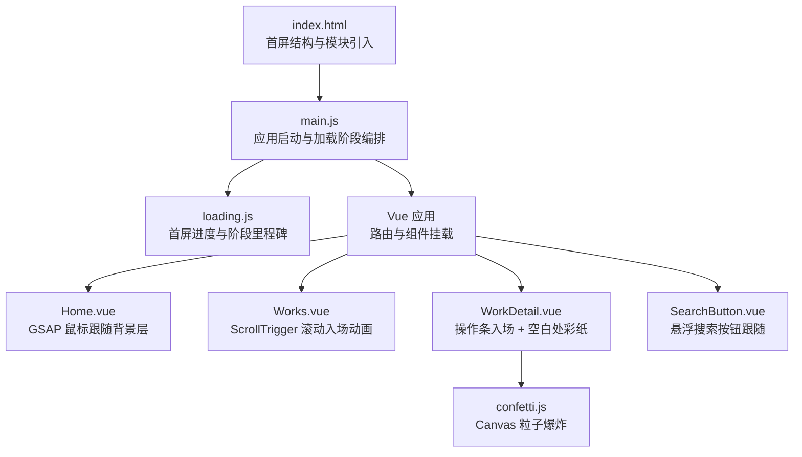
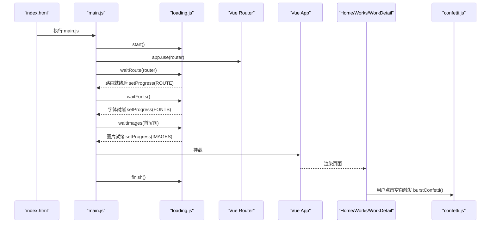
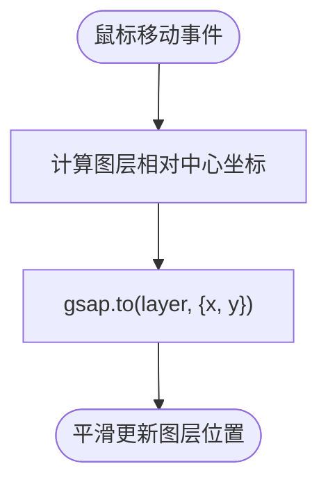
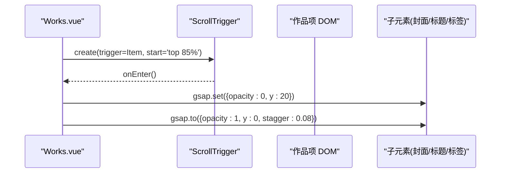
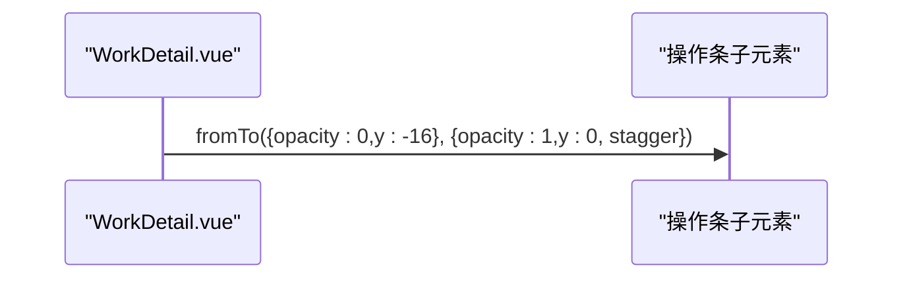
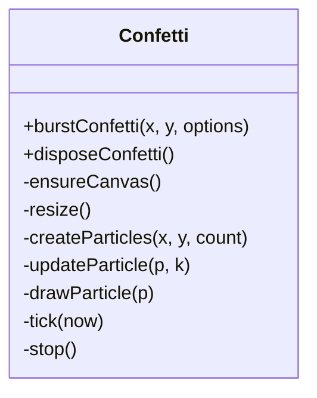
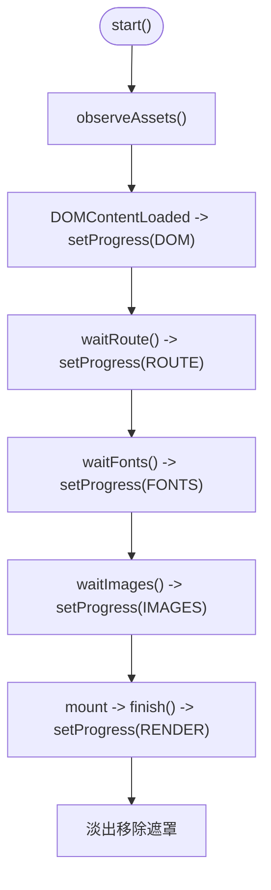
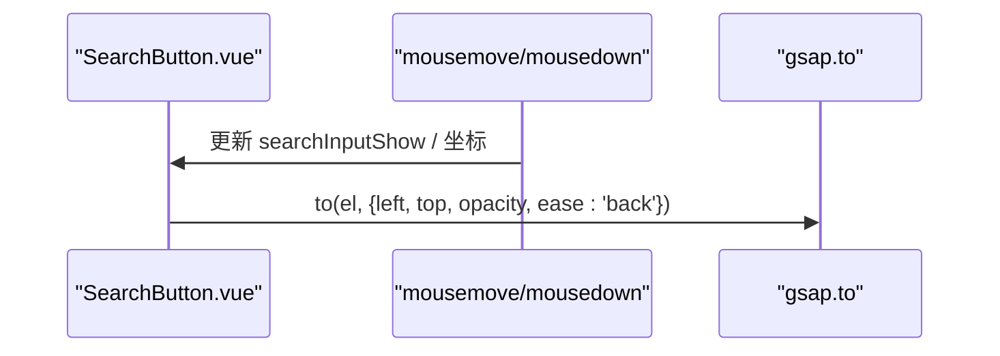
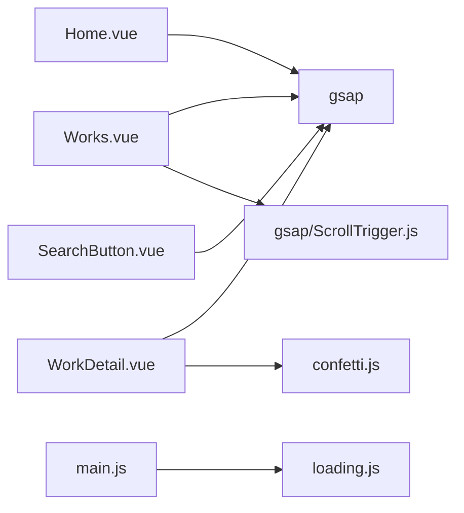

# 动画效果系统

<cite>
**本文引用的文件**   
- [Home.vue](file://src/views/Home.vue)
- [Works.vue](file://src/views/Works.vue)
- [WorkDetail.vue](file://src/views/WorkDetail.vue)
- [SearchButton.vue](file://src/components/SearchButton.vue)
- [confetti.js](file://src/utils/confetti.js)
- [loading.js](file://src/utils/loading.js)
- [main.js](file://src/main.js)
- [index.html](file://index.html)
- [package.json](file://package.json)
</cite>

## 目录
1. [引言](#引言)
2. [项目结构](#项目结构)
3. [核心组件](#核心组件)
4. [架构总览](#架构总览)
5. [详细组件分析](#详细组件分析)
6. [依赖关系分析](#依赖关系分析)
7. [性能与优化策略](#性能与优化策略)
8. [故障排查指南](#故障排查指南)
9. [结论](#结论)
10. [附录：配置与扩展指南](#附录配置与扩展指南)

## 引言
本技术文档聚焦站点中的动画效果系统，围绕基于 GSAP 的首页视差、鼠标跟随、元素入场动画，以及自定义彩纸特效 confetti.js 和首屏加载进度 loading.js 展开。文档从代码级实现出发，解释数据流、事件流、动画生命周期与性能优化要点，并提供可复用的配置示例与扩展建议，帮助开发者快速理解并扩展动画能力。

## 项目结构
动画相关能力主要分布在以下位置：
- 视图层动画：首页视差与鼠标跟随、作品列表滚动入场、详情页操作条入场等
- 工具层动画：彩纸特效 confetti.js、首屏加载进度 loading.js
- 应用启动流程：main.js 串联路由、字体、图片与首帧渲染，驱动 loading.js 阶段推进
- 入口 HTML：提供 loading 遮罩 DOM 与模块脚本引入顺序

**图表来源**
- [index.html:29-90](file://index.html#L29-L90)
- [main.js:16-37](file://src/main.js#L16-L37)
- [loading.js:15-22](file://src/utils/loading.js#L15-L22)
- [Home.vue:1-23](file://src/views/Home.vue#L1-L23)
- [Works.vue:11-13](file://src/views/Works.vue#L11-L13)
- [WorkDetail.vue:16](file://src/views/WorkDetail.vue#L16)
- [confetti.js:1-13](file://src/utils/confetti.js#L1-L13)
- [SearchButton.vue:1-9](file://src/components/SearchButton.vue#L1-L9)

**章节来源**
- [index.html:29-90](file://index.html#L29-L90)
- [main.js:16-37](file://src/main.js#L16-L37)

## 核心组件
- 首页视差与鼠标跟随：使用 GSAP 监听鼠标移动，平滑驱动背景图层位移，营造轻微视差感。
- 作品列表滚动入场：通过 ScrollTrigger 监听元素进入视口，对封面、标题、标签进行延迟交错淡入上移。
- 详情页操作条入场：使用 gsap.fromTo 依次淡入下落右侧悬浮操作按钮。
- 空白处彩纸特效：原生 Canvas 2D 实现，点击空白区域触发粒子爆炸，支持减少动态效果检测与自动清理。
- 首屏加载进度：按真实里程碑（DOM、资源、路由、字体、图片、首帧）推进百分比，rAF 插值数字滚动，超时兜底放行。

**章节来源**
- [Home.vue:1-23](file://src/views/Home.vue#L1-L23)
- [Works.vue:86-114](file://src/views/Works.vue#L86-L114)
- [WorkDetail.vue:29-38](file://src/views/WorkDetail.vue#L29-L38)
- [confetti.js:1-13](file://src/utils/confetti.js#L1-L13)
- [loading.js:15-22](file://src/utils/loading.js#L15-L22)

## 架构总览
动画系统由“视图层动画 + 工具层动画 + 启动编排”三部分构成：
- 视图层动画负责交互与滚动触发的视觉反馈
- 工具层动画提供可复用的彩纸与加载进度能力
- 启动编排确保首屏关键资源就绪后再展示内容，避免白屏或闪烁

**图表来源**
- [index.html:88-90](file://index.html#L88-L90)
- [main.js:16-37](file://src/main.js#L16-L37)
- [loading.js:95-115](file://src/utils/loading.js#L95-L115)
- [loading.js:117-173](file://src/utils/loading.js#L117-L173)
- [loading.js:175-198](file://src/utils/loading.js#L175-L198)
- [WorkDetail.vue:134-140](file://src/views/WorkDetail.vue#L134-L140)
- [confetti.js:170-176](file://src/utils/confetti.js#L170-L176)

## 详细组件分析

### 首页视差与鼠标跟随（Home.vue）
- 监听 window mousemove，计算目标图层相对中心偏移，使用 gsap.to 平滑驱动 x/y 位移，形成轻量视差。
- 在 onMounted/onUnmounted 中正确注册/移除监听，避免内存泄漏。
- 适合在小范围容器内使用，避免全局大位移造成布局抖动。

**图表来源**
- [Home.vue:7-22](file://src/views/Home.vue#L7-L22)

**章节来源**
- [Home.vue:1-23](file://src/views/Home.vue#L1-L23)

### 作品列表滚动入场（Works.vue）
- 使用 ScrollTrigger.create 监听每个作品项进入视口，对子元素设置初始状态（透明、下移），再在 onEnter 中用 gsap.to 做交错淡入上移。
- 在 onActivated/onDeactivated 中管理 ScrollTrigger 实例，切换视图模式时 killAll 重建，保证动画一致性。
- 移动端强制竖列模式，避免平铺布局下的复杂动画问题。

**图表来源**
- [Works.vue:86-114](file://src/views/Works.vue#L86-L114)
- [Works.vue:47-70](file://src/views/Works.vue#L47-L70)

**章节来源**
- [Works.vue:11-13](file://src/views/Works.vue#L11-L13)
- [Works.vue:47-70](file://src/views/Works.vue#L47-L70)
- [Works.vue:86-114](file://src/views/Works.vue#L86-L114)

### 详情页操作条入场（WorkDetail.vue）
- 使用 gsap.fromTo 对右侧悬浮操作条子元素进行依次淡入下落，stagger 控制节奏。
- 在 nextTick 后播放，确保 DOM 已更新；配合 data-no-confetti 属性避免误触发彩纸。

**图表来源**
- [WorkDetail.vue:29-38](file://src/views/WorkDetail.vue#L29-L38)

**章节来源**
- [WorkDetail.vue:29-38](file://src/views/WorkDetail.vue#L29-L38)

### 空白处彩纸特效（confetti.js）
- 首次调用时创建全屏 fixed canvas，pointer-events: none 不拦截交互；后续点击复用同一画布与 rAF 循环。
- 粒子物理模型包含重力、阻力、旋转、抖动、寿命与末段淡出；根据 DPR 调整画布尺寸，避免高分屏模糊。
- 尊重 prefers-reduced-motion，开启则直接不播放；粒子清空后自动移除 canvas 与监听，避免内存泄漏。
- 对外暴露 burstConfetti(x, y, options) 与 disposeConfetti()。

**图表来源**
- [confetti.js:38-67](file://src/utils/confetti.js#L38-L67)
- [confetti.js:69-94](file://src/utils/confetti.js#L69-L94)
- [confetti.js:96-147](file://src/utils/confetti.js#L96-L147)
- [confetti.js:149-181](file://src/utils/confetti.js#L149-L181)

**章节来源**
- [confetti.js:1-13](file://src/utils/confetti.js#L1-L13)
- [confetti.js:33-36](file://src/utils/confetti.js#L33-L36)
- [confetti.js:170-181](file://src/utils/confetti.js#L170-L181)

### 首屏加载进度（loading.js）
- 定义阶段常量：DOM、ASSETS、ROUTE、FONTS、IMAGES、RENDER，作为里程碑百分比。
- 使用 PerformanceObserver 统计资源完成数量，渐进式推进到 ASSETS 上限；DOMContentLoaded 推进到 DOM。
- waitRoute/waitFonts/waitImages 分别等待路由、字体、图片，完成后推进对应阶段；所有阶段带超时保护，防止卡死。
- 数字滚动通过 rAF 插值实现平滑过渡，finish 补到 100% 并淡出移除遮罩。

**图表来源**
- [loading.js:15-22](file://src/utils/loading.js#L15-L22)
- [loading.js:68-84](file://src/utils/loading.js#L68-L84)
- [loading.js:95-115](file://src/utils/loading.js#L95-L115)
- [loading.js:117-173](file://src/utils/loading.js#L117-L173)
- [loading.js:175-198](file://src/utils/loading.js#L175-L198)

**章节来源**
- [loading.js:15-22](file://src/utils/loading.js#L15-L22)
- [loading.js:68-84](file://src/utils/loading.js#L68-L84)
- [loading.js:95-115](file://src/utils/loading.js#L95-L115)
- [loading.js:117-173](file://src/utils/loading.js#L117-L173)
- [loading.js:175-198](file://src/utils/loading.js#L175-L198)

### 悬浮搜索按钮跟随（SearchButton.vue）
- 非移动端隐藏默认光标，使用自定义浮动按钮跟随鼠标；按下长按打开输入框，回车/Esc 提交或关闭。
- 使用 gsap.to 平滑更新 left/top 与 opacity，ease 使用 back 增强回弹感。
- 在 onActivated/onMounted/onUnmounted/onDeactivated 中增删监听，避免重复绑定与泄漏。

**图表来源**
- [SearchButton.vue:29-47](file://src/components/SearchButton.vue#L29-L47)
- [SearchButton.vue:72-85](file://src/components/SearchButton.vue#L72-L85)

**章节来源**
- [SearchButton.vue:1-9](file://src/components/SearchButton.vue#L1-L9)
- [SearchButton.vue:29-47](file://src/components/SearchButton.vue#L29-L47)
- [SearchButton.vue:72-85](file://src/components/SearchButton.vue#L72-L85)

## 依赖关系分析
- GSAP 与 ScrollTrigger 作为动画引擎，被多个视图组件引用。
- confetti.js 为纯工具模块，无外部依赖，供详情页触发。
- loading.js 独立于框架，仅依赖浏览器 API（PerformanceObserver、requestAnimationFrame）。
- main.js 协调 loading.js 的阶段推进与 Vue 应用挂载时机。

**图表来源**
- [package.json:12-23](file://package.json#L12-L23)
- [Home.vue:3](file://src/views/Home.vue#L3)
- [Works.vue:11-12](file://src/views/Works.vue#L11-L12)
- [WorkDetail.vue:5](file://src/views/WorkDetail.vue#L5)
- [WorkDetail.vue:16](file://src/views/WorkDetail.vue#L16)
- [SearchButton.vue:4](file://src/components/SearchButton.vue#L4)
- [main.js:11](file://src/main.js#L11)

**章节来源**
- [package.json:12-23](file://package.json#L12-L23)
- [Home.vue:3](file://src/views/Home.vue#L3)
- [Works.vue:11-12](file://src/views/Works.vue#L11-L12)
- [WorkDetail.vue:5](file://src/views/WorkDetail.vue#L5)
- [WorkDetail.vue:16](file://src/views/WorkDetail.vue#L16)
- [SearchButton.vue:4](file://src/components/SearchButton.vue#L4)
- [main.js:11](file://src/main.js#L11)

## 性能与优化策略
- 动画节流与防抖
  - 搜索输入使用 debounce 降低高频输入导致的重渲染与动画压力。
  - 鼠标移动事件仅在必要时驱动动画，避免每帧复杂计算。
- requestAnimationFrame 与时间步长
  - 彩纸与加载进度均使用 rAF 驱动，彩纸内部以 60fps 基准换算步长，高刷屏与掉帧保持一致速度。
- 资源观测与渐进推进
  - 使用 PerformanceObserver 统计资源完成数，渐进推进进度条，避免一次性跳变。
- 减少动态效果支持
  - 彩纸特效检测 prefers-reduced-motion，满足无障碍需求。
- 内存管理与生命周期
  - 在 onUnmounted/onDeactivated 中移除事件监听、kill ScrollTrigger、清理 rAF 与 Canvas，避免泄漏。
- 移动端适配
  - 悬浮搜索按钮在非移动端启用；作品列表在移动端固定竖列，避免复杂布局动画。
- 高分屏适配
  - 彩纸画布按 devicePixelRatio 缩放，避免模糊。

**章节来源**
- [SearchButton.vue:86-88](file://src/components/SearchButton.vue#L86-L88)
- [confetti.js:128-147](file://src/utils/confetti.js#L128-L147)
- [loading.js:68-84](file://src/utils/loading.js#L68-L84)
- [confetti.js:33-36](file://src/utils/confetti.js#L33-L36)
- [Works.vue:64-70](file://src/views/Works.vue#L64-L70)
- [SearchButton.vue:31-39](file://src/components/SearchButton.vue#L31-L39)
- [confetti.js:58-67](file://src/utils/confetti.js#L58-L67)

## 故障排查指南
- 彩纸不触发
  - 检查是否启用了“减少动态效果”，prefers-reduced-motion 会阻止播放。
  - 确认点击目标未被忽略选择器过滤（正文、目录、操作条、链接、按钮等）。
- 彩纸卡顿或内存增长
  - 确认组件卸载时调用了 disposeConfetti，清理 rAF 与 Canvas。
  - 避免频繁大量连点导致粒子总数超过上限。
- 加载进度卡住
  - 检查路由守卫是否长时间挂起，waitRoute 有超时保护但仍可能影响体验。
  - 确认字体与图片 URL 有效，失败也会放行但会影响进度推进。
- 滚动动画异常
  - 切换视图模式后需 killAll 并重建 ScrollTrigger，否则旧实例可能残留。
  - keep-alive 返回时需恢复滚动位置，避免入场动画丢失。

**章节来源**
- [confetti.js:33-36](file://src/utils/confetti.js#L33-L36)
- [WorkDetail.vue:120-151](file://src/views/WorkDetail.vue#L120-L151)
- [WorkDetail.vue:158-159](file://src/views/WorkDetail.vue#L158-L159)
- [loading.js:86-93](file://src/utils/loading.js#L86-L93)
- [loading.js:117-131](file://src/utils/loading.js#L117-L131)
- [Works.vue:118-128](file://src/views/Works.vue#L118-L128)
- [Works.vue:55-62](file://src/views/Works.vue#L55-L62)

## 结论
该动画系统以 GSAP 为核心，结合 ScrollTrigger 实现滚动驱动的入场动画；通过原生 Canvas 实现轻量彩纸特效；以 loading.js 统一首屏加载阶段的可视化与兜底机制。整体设计强调生命周期管理、性能优化与无障碍支持，便于在不同页面与场景中复用与扩展。

## 附录：配置与扩展指南

### 彩纸特效配置参考
- 基础用法
  - 在任意点击事件中调用 burstConfetti(clientX, clientY)，传入视口坐标。
  - 组件卸载时调用 disposeConfetti 清理资源。
- 可选参数
  - count：本次生成的粒子数量，默认值适中，可根据场景调整。
- 行为特性
  - 尊重 prefers-reduced-motion，开启后不播放。
  - 粒子总数有上限，避免极端连点导致性能问题。
  - 自动清理画布与监听，无需手动维护 DOM。

**章节来源**
- [confetti.js:170-181](file://src/utils/confetti.js#L170-L181)
- [confetti.js:1-13](file://src/utils/confetti.js#L1-L13)

### 首屏加载进度配置参考
- 阶段常量
  - DOM、ASSETS、ROUTE、FONTS、IMAGES、RENDER，用于标记不同里程碑对应的最低百分比。
- 常用方法
  - start：启动进度，自动监听 DOM 与资源。
  - waitRoute：等待路由就绪，需在 app.use(router) 之后调用。
  - waitFonts：等待字体就绪，支持主动触发字体加载。
  - waitImages：等待首屏图片，支持空数组直接放行。
  - finish：补到 100%，淡出移除遮罩。
- 注意事项
  - 所有阶段具备超时保护，避免阻塞首屏。
  - 数字滚动通过 rAF 插值，不会凭空推进目标值。

**章节来源**
- [loading.js:15-22](file://src/utils/loading.js#L15-L22)
- [loading.js:95-115](file://src/utils/loading.js#L95-L115)
- [loading.js:117-173](file://src/utils/loading.js#L117-L173)
- [loading.js:175-198](file://src/utils/loading.js#L175-L198)

### GSAP 动画扩展建议
- 视差与鼠标跟随
  - 将鼠标事件限制在必要容器内，避免全局监听开销。
  - 使用 gsap.to 的缓动函数（如 power3.out、back）提升自然感。
- 滚动入场
  - 使用 ScrollTrigger 的 once 选项避免重复触发。
  - 对子元素使用 stagger 实现交错动画，提升层次感。
- 生命周期管理
  - 在 onUnmounted/onDeactivated 中销毁动画与监听，避免内存泄漏。
  - 切换视图或数据变化后重建 ScrollTrigger，确保状态一致。

**章节来源**
- [Home.vue:7-22](file://src/views/Home.vue#L7-L22)
- [Works.vue:86-114](file://src/views/Works.vue#L86-L114)
- [SearchButton.vue:72-85](file://src/components/SearchButton.vue#L72-L85)