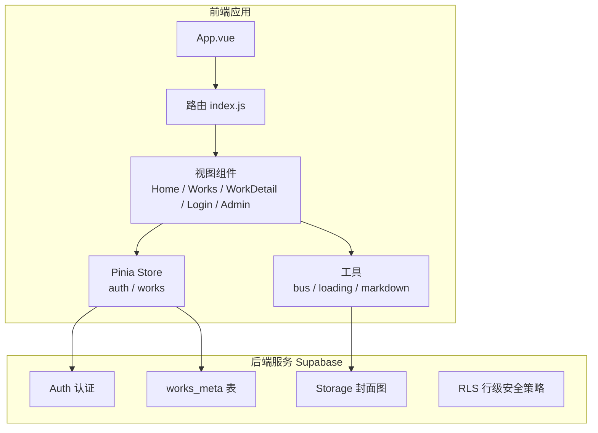
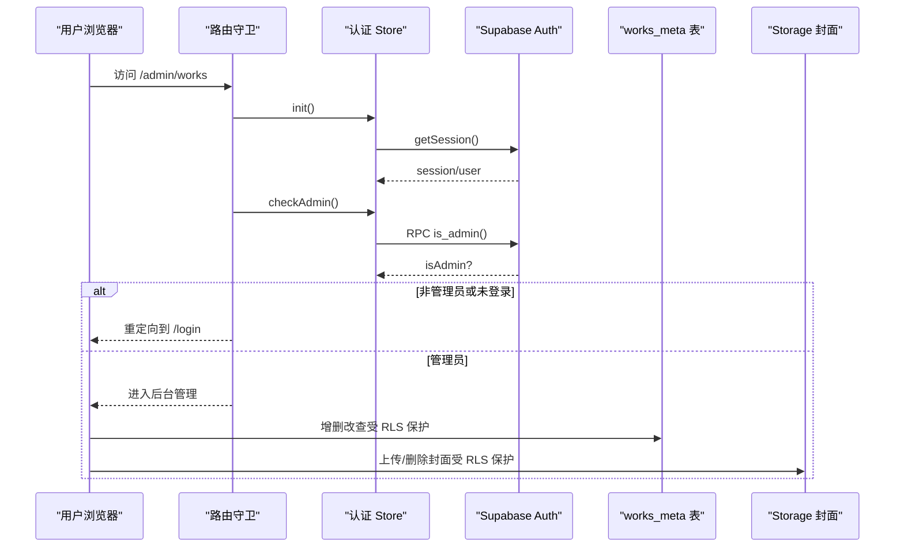
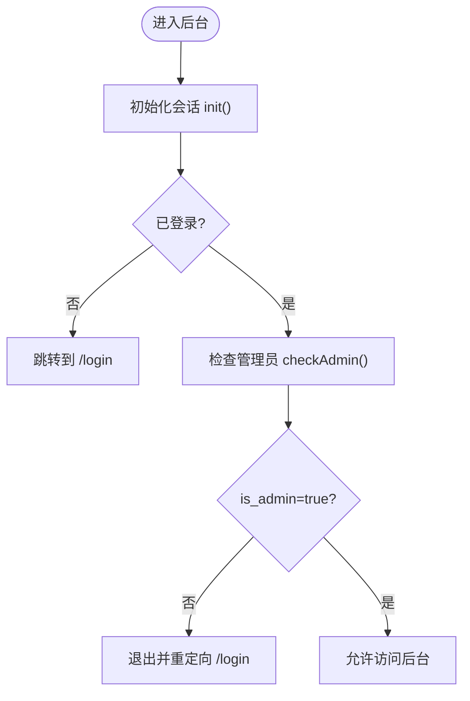
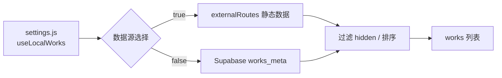
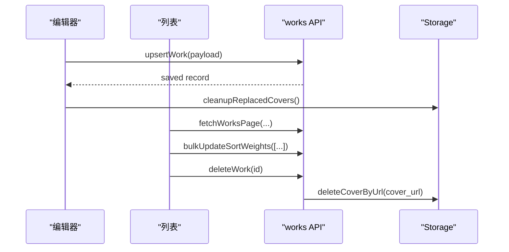
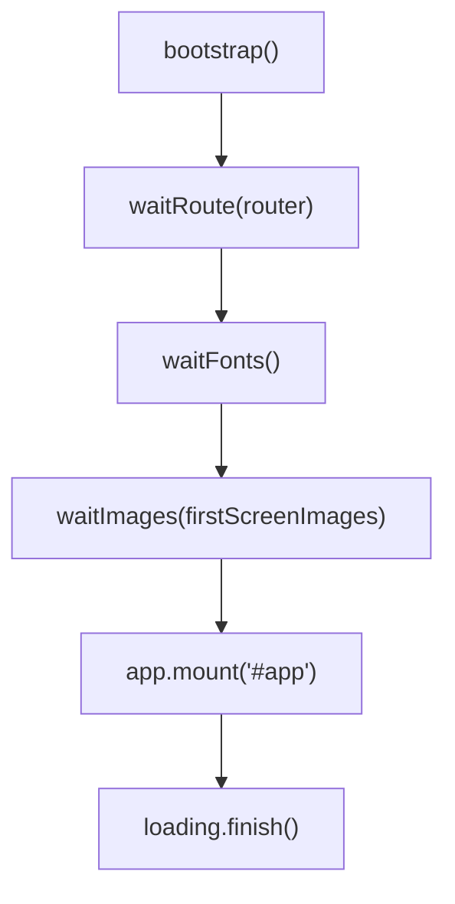
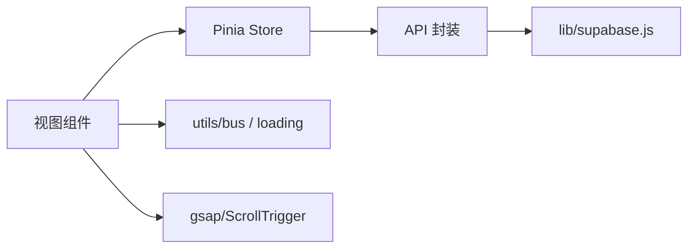

# 核心功能模块

<cite>
**本文引用的文件**   
- [README.md](file://README.md)
- [package.json](file://package.json)
- [main.js](file://src/main.js)
- [settings.js](file://src/settings.js)
- [supabase.js](file://src/lib/supabase.js)
- [auth.js](file://src/stores/auth.js)
- [works.js](file://src/stores/works.js)
- [works.js（API）](file://src/api/works.js)
- [storage.js](file://src/api/storage.js)
- [index.js（路由）](file://src/router/index.js)
- [Login.vue](file://src/views/Login.vue)
- [Works.vue](file://src/views/Works.vue)
- [WorksAdmin.vue](file://src/views/admin/WorksAdmin.vue)
- [WorksList.vue](file://src/views/admin/WorksList.vue)
- [WorksEditor.vue](file://src/views/admin/WorksEditor.vue)
- [bus.js](file://src/utils/bus.js)
- [loading.js](file://src/utils/loading.js)
</cite>

## 目录
1. [引言](#引言)
2. [项目结构](#项目结构)
3. [核心组件](#核心组件)
4. [架构总览](#架构总览)
5. [详细组件分析](#详细组件分析)
6. [依赖关系分析](#依赖关系分析)
7. [性能与体验优化](#性能与体验优化)
8. [故障排查指南](#故障排查指南)
9. [结论](#结论)
10. [附录：扩展与定制指南](#附录扩展与定制指南)

## 引言
本项目是一个基于 Vue 3、TailwindCSS 与 Supabase 的个人作品展示站点，核心能力包括：
- 用户认证系统：邮箱密码登录与 GitHub OAuth，结合 Supabase RLS 实现管理员权限控制。
- 作品展示系统：合并本地静态数据与线上数据库，支持搜索、视图切换、滚动动画与详情页分享链接。
- 内容管理系统：后台编辑、列表管理、分页筛选、拖拽排序、封面上传与发布状态管理。
- 动画效果系统：GSAP ScrollTrigger 驱动的首屏加载进度、作品卡片入场动画与页面交互反馈。

本技术文档从职责边界、接口定义、数据结构、业务逻辑、依赖通信、错误处理与性能特征等维度进行系统化说明，并提供扩展与二次开发建议。

## 项目结构
项目采用“功能域 + 分层”组织方式：
- 视图层：首页、作品列表、详情、关于、登录、后台管理。
- 状态层：Pinia Store 管理认证与作品数据。
- API 层：封装 Supabase 的认证、数据库与存储操作。
- 工具层：事件总线、首屏加载进度、Markdown 渲染等。
- 配置层：Vite、Tailwind、Supabase 客户端与环境变量。

图表来源
- [main.js:16-39](file://src/main.js#L16-L39)
- [index.js（路由）:4-49](file://src/router/index.js#L4-L49)
- [auth.js:5-81](file://src/stores/auth.js#L5-L81)
- [works.js（Store）:7-28](file://src/stores/works.js#L7-L28)
- [works.js（API）:45-266](file://src/api/works.js#L45-L266)
- [storage.js:62-99](file://src/api/storage.js#L62-L99)

章节来源
- [README.md:37-67](file://README.md#L37-L67)
- [README.md:158-189](file://README.md#L158-L189)

## 核心组件
- 用户认证系统
  - 职责：初始化会话、监听认证状态变化、提供邮箱密码与 OAuth 登录、注册、登出、管理员校验。
  - 关键接口：init、subscribeAuthChange、signInWithOAuth、signInWithPassword、signUp、signOut、checkAdmin。
  - 依赖：Supabase Auth、RPC is_admin。
- 作品展示系统
  - 职责：根据 useLocalWorks 选择数据源，合并并过滤已发布作品，提供搜索、视图切换、滚动动画与详情跳转。
  - 关键接口：useWorksStore.init()、fetchPublishedWorks()、fetchWorkDetail()。
  - 依赖：settings.js、api/works.js、api/works.local.js、gsap。
- 内容管理系统
  - 职责：后台编辑表单、封面上传、元信息弹窗、列表分页与筛选、拖拽排序、发布状态切换、删除与统计。
  - 关键接口：upsertWork、deleteWork、fetchWorksPage、bulkUpdateSortWeights、fetchWorksStats。
  - 依赖：Supabase Database、Storage、auth store。
- 动画效果系统
  - 职责：首屏加载进度条、字体与图片就绪检测、作品卡片滚动入场动画、滚动位置记忆与恢复。
  - 关键接口：loading.start/waitRoute/waitFonts/waitImages/finish、ScrollTrigger。
  - 依赖：performance observer、document.fonts、Image、gsap。

章节来源
- [auth.js:5-81](file://src/stores/auth.js#L5-L81)
- [works.js（Store）:7-28](file://src/stores/works.js#L7-L28)
- [works.js（API）:45-266](file://src/api/works.js#L45-L266)
- [storage.js:62-99](file://src/api/storage.js#L62-L99)
- [loading.js:14-207](file://src/utils/loading.js#L14-L207)
- [Works.vue:1-153](file://src/views/Works.vue#L1-L153)

## 架构总览
整体架构围绕“前端 Vue 3 + Pinia + Router”与“Supabase BaaS（Auth + Database + Storage + RLS）”协作展开。前台公开浏览通过 anon 读取已发布作品；后台管理需要已登录且具备管理员权限，可读写数据与封面资源。

图表来源
- [index.js（路由）:51-70](file://src/router/index.js#L51-L70)
- [auth.js:12-66](file://src/stores/auth.js#L12-L66)
- [works.js（API）:198-266](file://src/api/works.js#L198-L266)
- [storage.js:62-99](file://src/api/storage.js#L62-L99)

## 详细组件分析

### 用户认证系统
- 职责边界
  - 维护当前用户与会话状态，订阅认证变化。
  - 提供登录、注册、登出与管理员权限校验。
  - 与路由守卫配合，限制后台管理入口。
- 关键流程
  - 初始化会话：获取 session 并填充 user。
  - 订阅变化：onAuthStateChange 同步 session/user。
  - 管理员校验：调用 RPC is_admin 判断是否 admin。
- 错误处理
  - checkAdmin 失败时记录错误并返回 false。
  - signOut 成功后清空 session/user。

图表来源
- [index.js（路由）:51-70](file://src/router/index.js#L51-L70)
- [auth.js:12-66](file://src/stores/auth.js#L12-L66)

章节来源
- [auth.js:5-81](file://src/stores/auth.js#L5-L81)
- [index.js（路由）:51-70](file://src/router/index.js#L51-L70)
- [Login.vue:95-144](file://src/views/Login.vue#L95-L144)

### 作品展示系统
- 职责边界
  - 根据 settings.useLocalWorks 决定数据源：本地静态 externalRoutes 或 Supabase works_meta。
  - 合并后按 sort_weight/date/created_at/id 排序，过滤 hidden 项，对外暴露 works 列表。
  - 提供搜索、视图切换（list/grid）、滚动动画与详情跳转。
- 数据结构
  - 本地外部路由字段：name、meta.open/code/link/info/sort/date/hidden/tags/cover/codepen。
  - 线上作品字段：id/name/cover_url/info_html/info_md/code_url/link_url/codepen_url/open_url/sort_weight/date/tags/is_published/is_hidden。
- 关键流程
  - fetchPublishedWorks：仅读 is_published=true 的记录。
  - fetchWorkDetail：useLocalWorks 时匹配 id，否则校验 UUID 后查询单条。
  - 列表页：onActivated 复用缓存或刷新数据，重建 ScrollTrigger 动画。

图表来源
- [settings.js:1-8](file://src/settings.js#L1-L8)
- [works.js（Store）:12-25](file://src/stores/works.js#L12-L25)
- [works.js（API）:45-55](file://src/api/works.js#L45-L55)
- [works.js（API）:186-195](file://src/api/works.js#L186-L195)

章节来源
- [settings.js:1-288](file://src/settings.js#L1-L288)
- [works.js（Store）:7-28](file://src/stores/works.js#L7-L28)
- [works.js（API）:45-55](file://src/api/works.js#L45-L55)
- [works.js（API）:186-195](file://src/api/works.js#L186-L195)
- [Works.vue:1-153](file://src/views/Works.vue#L1-L153)

### 内容管理系统
- 职责边界
  - 编辑器：封面上传（本地拖拽/点击）、Markdown 正文、元信息弹窗（日期/外链/标签/发布开关）。
  - 列表：分页、搜索、标签筛选、条件筛选（封面/日期/链接/状态）、拖拽排序、发布开关、删除。
  - 统计：总数、已发布、有封面、已配置链接。
- 关键接口
  - upsertWork：新增或更新，新建时自动分配 sort_weight。
  - bulkUpdateSortWeights：批量更新排序权重。
  - deleteWork：删除记录并清理旧封面。
  - fetchWorksPage：服务端分页查询，支持搜索、标签、条件筛选。
  - fetchWorksStats：轻量统计。
- 业务流程
  - 保存：校验名称 → 打开元信息弹窗 → 提交 payload → 成功后清理被替换的旧封面 → 复制详情链接。
  - 排序：计算插入位置与权重，必要时整页重算权重避免浮点精度问题。

图表来源
- [WorksEditor.vue:516-566](file://src/views/admin/WorksEditor.vue#L516-L566)
- [works.js（API）:203-249](file://src/api/works.js#L203-L249)
- [works.js（API）:256-266](file://src/api/works.js#L256-L266)
- [storage.js:90-99](file://src/api/storage.js#L90-L99)

章节来源
- [WorksEditor.vue:1-585](file://src/views/admin/WorksEditor.vue#L1-L585)
- [WorksList.vue:1-585](file://src/views/admin/WorksList.vue#L1-L585)
- [WorksAdmin.vue:115-247](file://src/views/admin/WorksAdmin.vue#L115-L247)
- [works.js（API）:115-162](file://src/api/works.js#L115-L162)
- [works.js（API）:203-249](file://src/api/works.js#L203-L249)
- [storage.js:62-99](file://src/api/storage.js#L62-L99)

### 动画效果系统
- 职责边界
  - 首屏加载进度：DOM/资源/路由/字体/图片/首帧渲染各阶段推进百分比，超时兜底。
  - 作品列表动画：ScrollTrigger 监听元素进入视口，依次淡入与上移。
  - 滚动位置记忆：keep-alive 下恢复滚动位置，重建 ScrollTrigger。
- 关键流程
  - main.js 启动 bootstrap：等待路由就绪、字体就绪、首屏图片就绪，最后 finish 遮罩。
  - Works.vue onActivated：注册 ScrollTrigger，重建动画，恢复滚动位置。

图表来源
- [main.js:16-39](file://src/main.js#L16-L39)
- [loading.js:117-198](file://src/utils/loading.js#L117-L198)

章节来源
- [main.js:16-39](file://src/main.js#L16-L39)
- [loading.js:14-207](file://src/utils/loading.js#L14-L207)
- [Works.vue:47-114](file://src/views/Works.vue#L47-L114)

## 依赖关系分析
- 组件耦合
  - 视图层依赖 Pinia Store 获取认证与作品数据。
  - Store 依赖 API 层封装的 Supabase 客户端。
  - API 层依赖 lib/supabase.js 提供的客户端实例。
  - 编辑器与列表通过事件与 ref 方法解耦，父组件协调生命周期与状态。
- 外部依赖
  - @supabase/supabase-js：认证、数据库、存储。
  - gsap + ScrollTrigger：滚动动画。
  - mitt：事件总线。
  - vue-router：路由与守卫。
  - pinia：状态管理。

图表来源
- [package.json:12-23](file://package.json#L12-L23)
- [supabase.js:1-16](file://src/lib/supabase.js#L1-L16)
- [bus.js:1-15](file://src/utils/bus.js#L1-L15)
- [loading.js:14-207](file://src/utils/loading.js#L14-L207)

章节来源
- [package.json:12-23](file://package.json#L12-L23)
- [supabase.js:1-16](file://src/lib/supabase.js#L1-L16)
- [bus.js:1-15](file://src/utils/bus.js#L1-L15)

## 性能与体验优化
- 首屏加载
  - 使用 PerformanceObserver 渐进推进资源完成百分比，避免阻塞。
  - 路由就绪、字体就绪、首屏图片就绪分别推进进度，最终 finish 淡出遮罩。
- 列表动画
  - 仅在元素进入视口时触发动画，once:true 避免重复执行。
  - 视图切换后 killAll 并重建 ScrollTrigger，保证动画正确性。
- 数据请求
  - 列表分页与服务端筛选减少数据传输量。
  - 并发翻页使用 loadSeq 丢弃旧响应，避免数据覆盖。
- 资源缓存
  - Storage 上传设置 cacheControl=31536000，提升长缓存命中率。

章节来源
- [loading.js:69-115](file://src/utils/loading.js#L69-L115)
- [loading.js:117-198](file://src/utils/loading.js#L117-L198)
- [Works.vue:87-128](file://src/views/Works.vue#L87-L128)
- [WorksList.vue:370-407](file://src/views/admin/WorksList.vue#L370-L407)
- [storage.js:72-82](file://src/api/storage.js#L72-L82)

## 故障排查指南
- 环境变量缺失
  - 现象：启动时报缺少 VITE_SUPABASE_URL 或 VITE_SUPABASE_PUBLISHABLE_KEY。
  - 处理：在 .env.local 中配置正确的 Supabase 凭证。
- 认证失败
  - 现象：登录失败或无法进入后台。
  - 处理：检查邮箱密码是否正确；确认 GitHub OAuth 已配置；检查 is_admin RPC 是否可用。
- 作品数据为空
  - 现象：前台作品列表无数据。
  - 处理：确认 useLocalWorks=false 时 Supabase 中有 is_published=true 的记录；或开启 useLocalWorks 调试本地数据。
- 封面上传失败
  - 现象：上传报错或类型/大小不符。
  - 处理：检查 MIME 类型与文件大小限制；确认 Storage bucket 策略允许 admin 写入。
- 排序异常
  - 现象：拖拽后排序错乱或重复。
  - 处理：检查 canSort 条件（无搜索/筛选/标签）；确认 bulkUpdateSortWeights 执行成功；必要时整页重算权重。

章节来源
- [supabase.js:6-8](file://src/lib/supabase.js#L6-L8)
- [auth.js:59-66](file://src/stores/auth.js#L59-L66)
- [works.js（Store）:12-25](file://src/stores/works.js#L12-L25)
- [storage.js:62-82](file://src/api/storage.js#L62-L82)
- [WorksList.vue:447-542](file://src/views/admin/WorksList.vue#L447-L542)

## 结论
本项目以清晰的职责划分与模块化设计实现了用户认证、作品展示、内容管理与动画效果四大核心功能。通过 Supabase 的认证、数据库、存储与 RLS 能力，前后端解耦且安全性可控；通过 Pinia 与 API 封装，前端状态与网络请求清晰可维护；通过 GSAP 与首屏加载进度，用户体验流畅自然。建议在扩展新功能时遵循现有分层与接口约定，优先复用已有 Store 与 API 封装，保持代码一致性与可测试性。

## 附录：扩展与定制指南
- 新增外部作品
  - 在 settings.js 的 externalRoutes 中添加条目，确保 meta 字段完整；如需本地调试，将 useLocalWorks 设为 true。
- 新增后台字段
  - 在 works.js（API）的 upsertWork 与 editor 表单中增加字段映射；同步数据库 schema 与 RLS 策略。
- 自定义动画
  - 在 Works.vue 中扩展 ScrollTrigger 动画参数；注意视图切换后重建动画。
- 接入第三方登录
  - 在 auth.js 中扩展 signInWithOAuth provider；在路由守卫与登录页适配跳转与提示。
- 优化首屏体验
  - 调整 loading.js 的阶段阈值与超时时间；按需增减 waitImages 的关键图片集合。

章节来源
- [settings.js:1-288](file://src/settings.js#L1-L288)
- [works.js（API）:203-249](file://src/api/works.js#L203-L249)
- [Works.vue:87-128](file://src/views/Works.vue#L87-L128)
- [auth.js:29-43](file://src/stores/auth.js#L29-L43)
- [loading.js:147-173](file://src/utils/loading.js#L147-L173)