# 用户认证系统

<cite>
**本文引用的文件**   
- [src/stores/auth.js](file://src/stores/auth.js)
- [src/lib/supabase.js](file://src/lib/supabase.js)
- [src/views/Login.vue](file://src/views/Login.vue)
- [sql/001-rbac-setup.sql](file://sql/001-rbac-setup.sql)
</cite>

## 目录
1. [简介](#简介)
2. [项目结构](#项目结构)
3. [核心组件](#核心组件)
4. [架构总览](#架构总览)
5. [详细组件分析](#详细组件分析)
6. [依赖关系分析](#依赖关系分析)
7. [性能与可靠性](#性能与可靠性)
8. [故障排查指南](#故障排查指南)
9. [结论](#结论)

## 简介
本技术文档围绕基于 Supabase 的用户认证系统展开，覆盖以下关键主题：
- OAuth 登录（GitHub）与邮箱密码登录
- 会话管理与状态同步
- 权限控制与 RBAC 模型（管理员检查）
- useAuthStore 的状态管理逻辑与认证流程
- 集成与扩展建议

该实现以 Pinia store 作为前端状态中心，通过 Supabase JS SDK 完成认证、会话持久化与订阅；后端使用 PostgreSQL + RLS 策略与自定义函数实现 RBAC。

## 项目结构
与认证相关的关键文件如下：
- src/lib/supabase.js：Supabase 客户端初始化与环境变量校验
- src/stores/auth.js：认证状态管理、会话订阅、OAuth/密码登录、登出、管理员检查
- src/views/Login.vue：邮箱密码登录 UI 与交互
- sql/001-rbac-setup.sql：RBAC 表结构、RLS 策略、is_admin 等函数

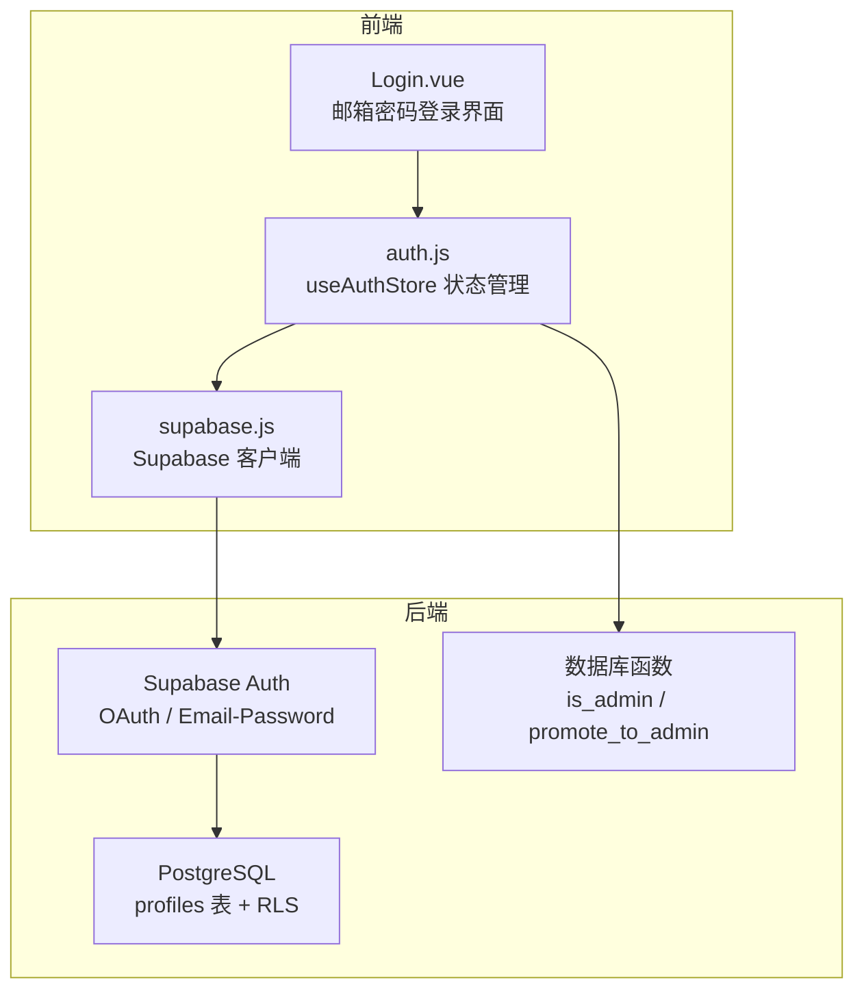

**图表来源**
- [src/views/Login.vue:95-143](file://src/views/Login.vue#L95-L143)
- [src/stores/auth.js:5-81](file://src/stores/auth.js#L5-L81)
- [src/lib/supabase.js:1-17](file://src/lib/supabase.js#L1-L17)
- [sql/001-rbac-setup.sql:8-16](file://sql/001-rbac-setup.sql#L8-L16)
- [sql/001-rbac-setup.sql:84-92](file://sql/001-rbac-setup.sql#L84-L92)

**章节来源**
- [src/lib/supabase.js:1-17](file://src/lib/supabase.js#L1-L17)
- [src/stores/auth.js:5-81](file://src/stores/auth.js#L5-L81)
- [src/views/Login.vue:95-143](file://src/views/Login.vue#L95-L143)
- [sql/001-rbac-setup.sql:8-16](file://sql/001-rbac-setup.sql#L8-L16)
- [sql/001-rbac-setup.sql:84-92](file://sql/001-rbac-setup.sql#L84-L92)

## 核心组件
- Supabase 客户端：负责连接 Supabase 服务，配置会话持久化、自动刷新令牌与 URL 中的会话检测。
- useAuthStore：封装认证状态（用户、会话、加载）、初始化、订阅认证变化、OAuth 登录、邮箱密码登录/注册、登出、管理员权限检查。
- 登录页面：提供邮箱密码登录表单，调用 store 方法完成登录并跳转。
- RBAC SQL：定义 profiles 表、触发器、RLS 策略与 is_admin 等函数，支撑权限判断。

**章节来源**
- [src/lib/supabase.js:1-17](file://src/lib/supabase.js#L1-L17)
- [src/stores/auth.js:5-81](file://src/stores/auth.js#L5-L81)
- [src/views/Login.vue:95-143](file://src/views/Login.vue#L95-L143)
- [sql/001-rbac-setup.sql:8-16](file://sql/001-rbac-setup.sql#L8-L16)
- [sql/001-rbac-setup.sql:84-92](file://sql/001-rbac-setup.sql#L84-L92)

## 架构总览
下图展示从浏览器到 Supabase 的认证与权限判定流程：

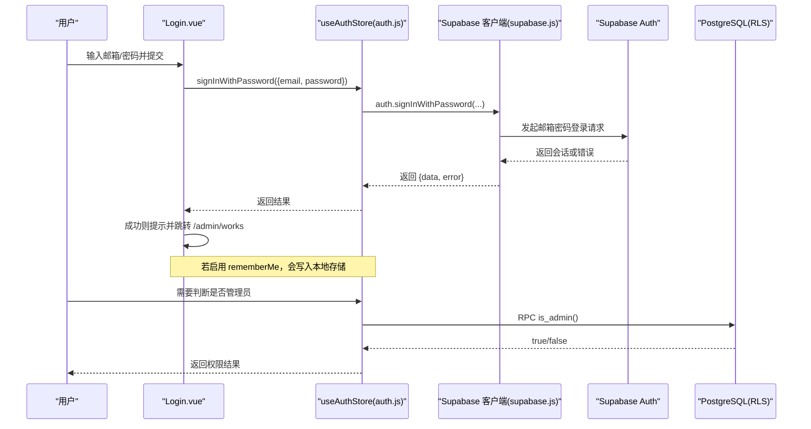

**图表来源**
- [src/views/Login.vue:122-143](file://src/views/Login.vue#L122-L143)
- [src/stores/auth.js:37-43](file://src/stores/auth.js#L37-L43)
- [src/stores/auth.js:59-66](file://src/stores/auth.js#L59-L66)
- [src/lib/supabase.js:10-16](file://src/lib/supabase.js#L10-L16)
- [sql/001-rbac-setup.sql:84-92](file://sql/001-rbac-setup.sql#L84-L92)

## 详细组件分析

### Supabase 客户端初始化
- 从环境变量读取 Supabase URL 与 Publishable Key，缺失时抛出错误。
- 创建客户端并开启：
  - 会话持久化
  - 自动刷新令牌
  - 检测 URL 中的会话参数（用于 OAuth 回调）

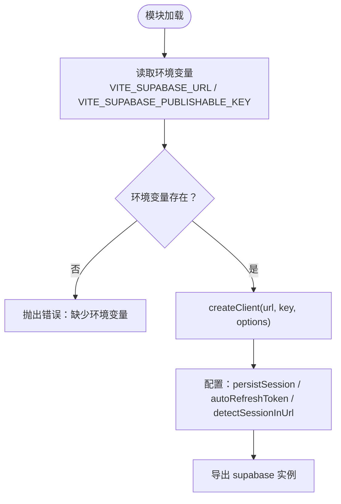

**图表来源**
- [src/lib/supabase.js:1-17](file://src/lib/supabase.js#L1-L17)

**章节来源**
- [src/lib/supabase.js:1-17](file://src/lib/supabase.js#L1-L17)

### useAuthStore 状态管理
- 状态字段：
  - user：当前用户对象
  - session：当前会话对象
  - loading：初始化与异步操作加载态
  - isAuthenticated：计算属性，基于 user 是否存在
- 生命周期与订阅：
  - init：获取当前会话并填充 user/session，结束 loading
  - subscribeAuthChange：订阅认证状态变化，自动同步 user/session
- 认证能力：
  - signInWithOAuth：支持 provider（默认 GitHub）与 redirectTo
  - signInWithPassword：邮箱密码登录
  - signUp：邮箱密码注册
  - signOut：清除本地状态并调用登出
- 权限检查：
  - checkAdmin：调用数据库函数 is_admin() 判断是否为管理员

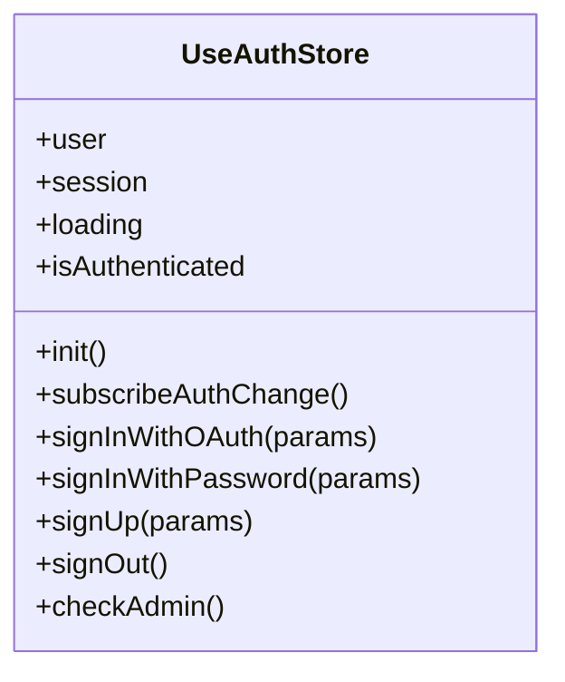

**图表来源**
- [src/stores/auth.js:5-81](file://src/stores/auth.js#L5-L81)

**章节来源**
- [src/stores/auth.js:5-81](file://src/stores/auth.js#L5-L81)

### 邮箱密码登录流程（Login.vue）
- 页面维护 email/password/showPassword/loading/rememberMe 等状态。
- 首次挂载时尝试从本地存储恢复“记住账号”的邮箱。
- 提交时：
  - 根据 rememberMe 更新本地存储
  - 调用 useAuthStore.signInWithPassword
  - 成功则提示并跳转到管理页 /admin/works
  - 失败则显示错误提示

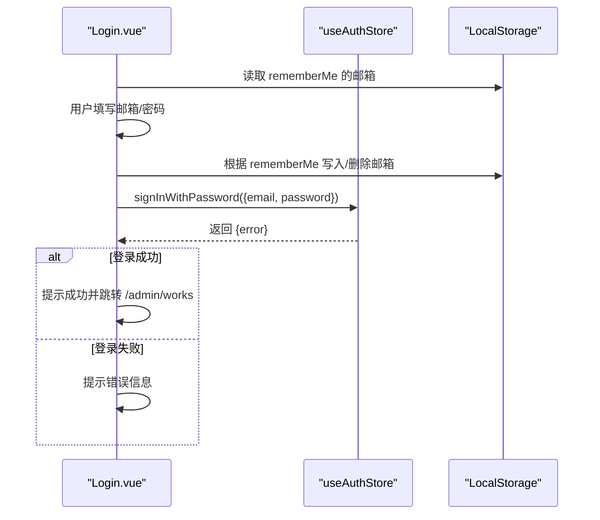

**图表来源**
- [src/views/Login.vue:114-143](file://src/views/Login.vue#L114-L143)
- [src/stores/auth.js:37-43](file://src/stores/auth.js#L37-L43)

**章节来源**
- [src/views/Login.vue:95-143](file://src/views/Login.vue#L95-L143)
- [src/stores/auth.js:37-43](file://src/stores/auth.js#L37-L43)

### OAuth 授权登录（GitHub）
- 通过 useAuthStore.signInWithOAuth(provider='github', redirectTo) 发起授权。
- Supabase 客户端在选项中启用了 detectSessionInUrl，便于处理 OAuth 回调中的会话参数。
- 成功后，onAuthStateChange 会自动更新 store 中的 user/session。

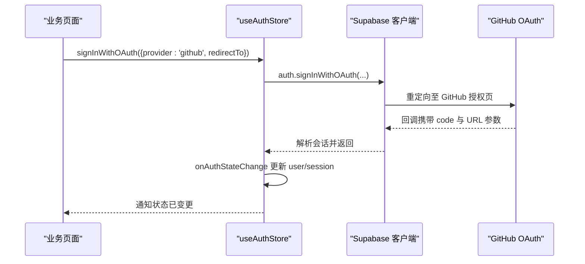

**图表来源**
- [src/stores/auth.js:29-35](file://src/stores/auth.js#L29-L35)
- [src/stores/auth.js:22-27](file://src/stores/auth.js#L22-L27)
- [src/lib/supabase.js:10-16](file://src/lib/supabase.js#L10-L16)

**章节来源**
- [src/stores/auth.js:22-35](file://src/stores/auth.js#L22-L35)
- [src/lib/supabase.js:10-16](file://src/lib/supabase.js#L10-L16)

### 会话管理与状态同步
- 初始化阶段：
  - 设置 loading=true
  - 调用 getSession 获取当前会话
  - 将 session.user 映射到 store.user
  - 设置 loading=false
- 实时同步：
  - 订阅 onAuthStateChange，当会话变化时自动更新 user/session

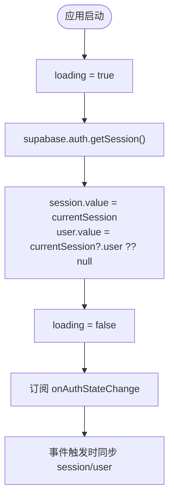

**图表来源**
- [src/stores/auth.js:12-27](file://src/stores/auth.js#L12-L27)

**章节来源**
- [src/stores/auth.js:12-27](file://src/stores/auth.js#L12-L27)

### 登出流程
- 调用 supabase.auth.signOut()
- 若无错误，清空 store 中的 session 与 user
- 返回错误信息供上层处理

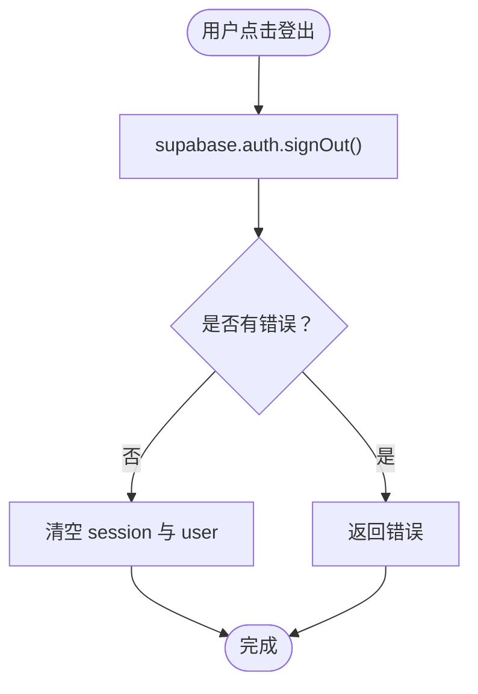

**图表来源**
- [src/stores/auth.js:50-57](file://src/stores/auth.js#L50-L57)

**章节来源**
- [src/stores/auth.js:50-57](file://src/stores/auth.js#L50-L57)

### RBAC 权限模型与管理员检查
- 数据模型：
  - public.profiles 表与 auth.users 一一对应，包含 role 字段（user/admin）
  - 触发器在用户注册时自动插入 profile
  - updated_at 自动更新
- RLS 策略：
  - 已登录用户可读取所有 profiles
  - 用户只能更新自己的记录
  - 仅管理员可删除
- 辅助函数：
  - is_admin()：判断当前用户是否为管理员
  - promote_to_admin(target_id)：由现有管理员提升目标用户为管理员
  - bootstrap_first_admin(user_email)：仅 service_role 可执行，用于初始化管理员

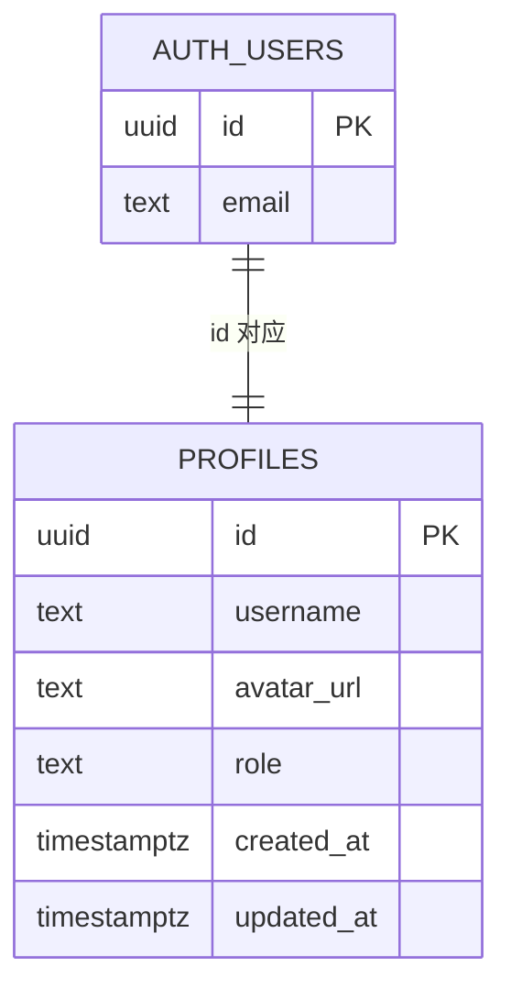

**图表来源**
- [sql/001-rbac-setup.sql:8-16](file://sql/001-rbac-setup.sql#L8-L16)

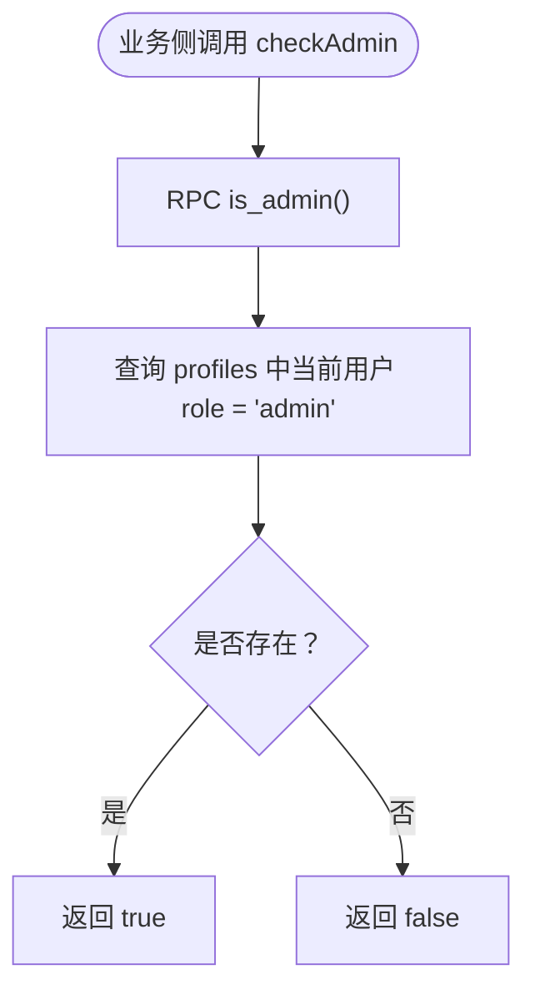

**图表来源**
- [src/stores/auth.js:59-66](file://src/stores/auth.js#L59-L66)
- [sql/001-rbac-setup.sql:84-92](file://sql/001-rbac-setup.sql#L84-L92)

**章节来源**
- [sql/001-rbac-setup.sql:8-16](file://sql/001-rbac-setup.sql#L8-L16)
- [sql/001-rbac-setup.sql:55-82](file://sql/001-rbac-setup.sql#L55-L82)
- [sql/001-rbac-setup.sql:84-121](file://sql/001-rbac-setup.sql#L84-L121)
- [src/stores/auth.js:59-66](file://src/stores/auth.js#L59-L66)

## 依赖关系分析
- Login.vue 依赖 useAuthStore 进行邮箱密码登录。
- useAuthStore 依赖 supabase.js 提供的客户端实例。
- useAuthStore 通过 RPC 调用数据库函数 is_admin() 进行权限判断。
- RBAC 依赖 profiles 表与 RLS 策略保证数据安全。

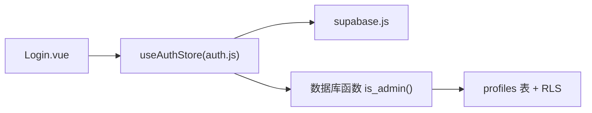

**图表来源**
- [src/views/Login.vue:95-143](file://src/views/Login.vue#L95-L143)
- [src/stores/auth.js:5-81](file://src/stores/auth.js#L5-L81)
- [src/lib/supabase.js:1-17](file://src/lib/supabase.js#L1-L17)
- [sql/001-rbac-setup.sql:84-92](file://sql/001-rbac-setup.sql#L84-L92)

**章节来源**
- [src/views/Login.vue:95-143](file://src/views/Login.vue#L95-L143)
- [src/stores/auth.js:5-81](file://src/stores/auth.js#L5-L81)
- [src/lib/supabase.js:1-17](file://src/lib/supabase.js#L1-L17)
- [sql/001-rbac-setup.sql:84-92](file://sql/001-rbac-setup.sql#L84-L92)

## 性能与可靠性
- 会话持久化与自动刷新：
  - persistSession 与 autoRefreshToken 减少频繁登录与令牌过期问题
  - detectSessionInUrl 优化 OAuth 回调体验
- 状态同步：
  - onAuthStateChange 避免轮询，降低无效请求
- 初始化加载：
  - 使用 loading 标志位避免闪烁，提升用户体验
- 权限检查：
  - is_admin() 为轻量 SQL 查询，开销低

[本节为通用指导，不直接分析具体文件]

## 故障排查指南
- 环境变量缺失：
  - 现象：启动时报错提示缺少 VITE_SUPABASE_URL 或 VITE_SUPABASE_PUBLISHABLE_KEY
  - 处理：检查 .env 或构建环境配置是否正确注入
- OAuth 回调异常：
  - 现象：登录后未正确跳转或会话未建立
  - 处理：确认 Supabase 项目中已配置 GitHub OAuth 与回调地址；确保 detectSessionInUrl 启用
- 管理员权限判断失败：
  - 现象：checkAdmin 返回 false
  - 处理：确认 profiles.role 是否为 admin；检查 is_admin() 函数是否存在且可用；确认当前 JWT 中的用户 ID 有效
- 登录失败：
  - 现象：邮箱密码登录报错
  - 处理：检查邮箱/密码是否正确；查看 Supabase Auth 日志；确认邮件发送与验证策略（如启用）

**章节来源**
- [src/lib/supabase.js:6-8](file://src/lib/supabase.js#L6-L8)
- [src/stores/auth.js:59-66](file://src/stores/auth.js#L59-L66)
- [src/views/Login.vue:122-143](file://src/views/Login.vue#L122-L143)

## 结论
本项目采用 Pinia store 集中管理认证状态，结合 Supabase 的 OAuth 与邮箱密码认证能力，实现了完整的登录、会话与权限控制。RBAC 通过 profiles 表与 RLS 策略保障数据安全，is_admin() 函数为前端权限判断提供可靠依据。整体架构清晰、职责分离，易于扩展新的认证方式与权限规则。

[本节为总结性内容，不直接分析具体文件]