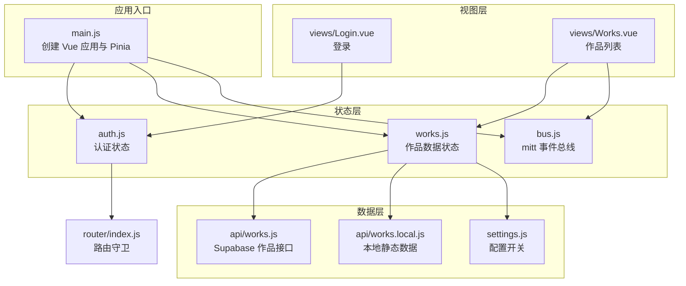
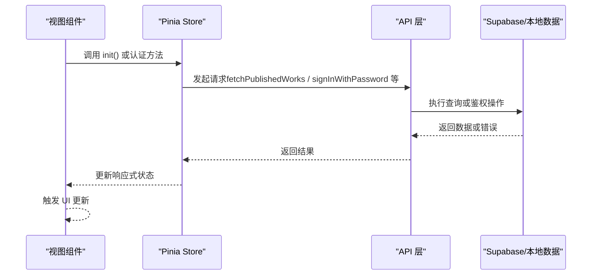
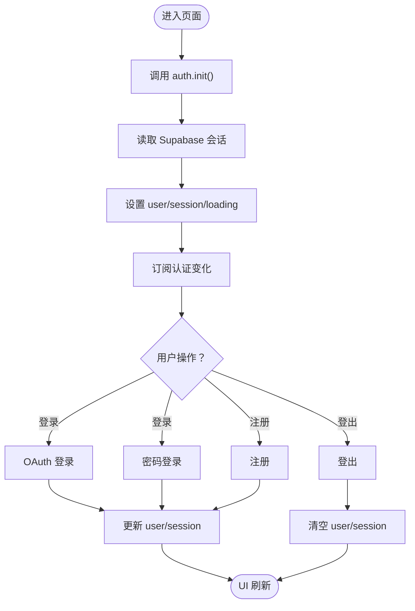
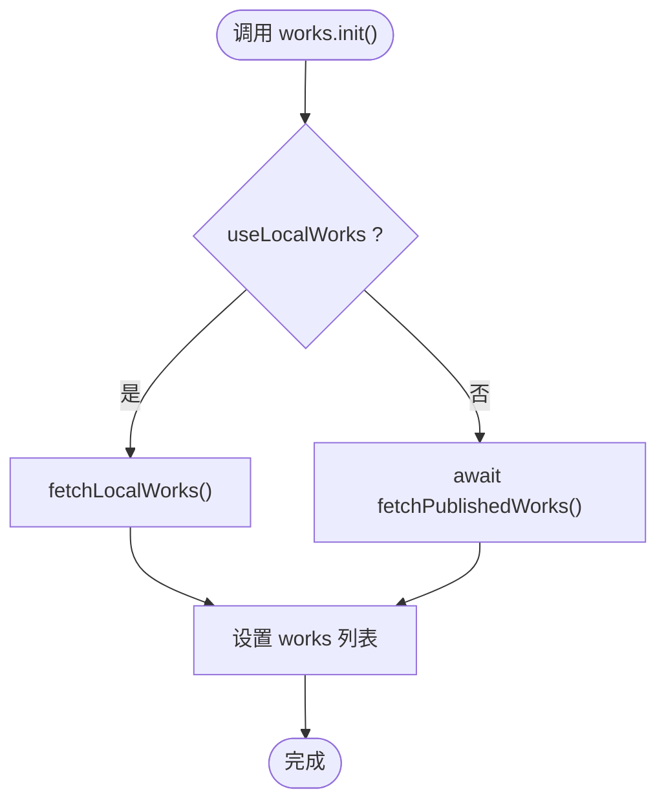
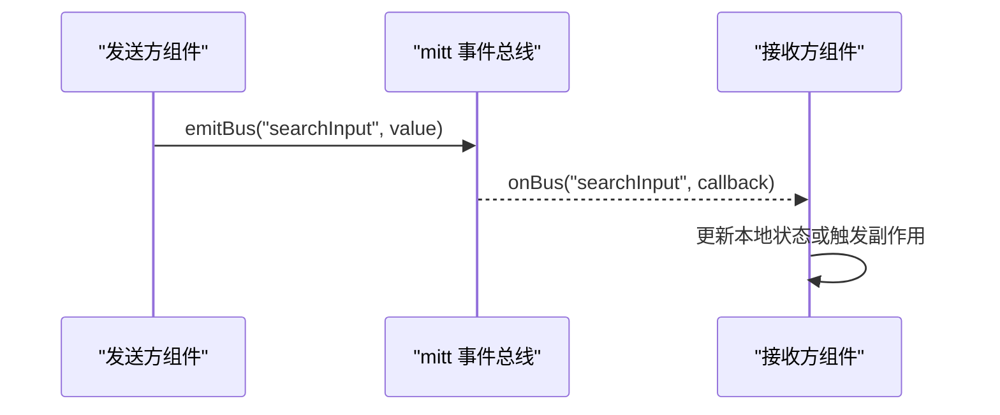
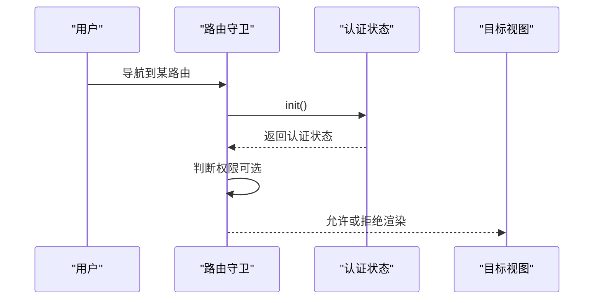
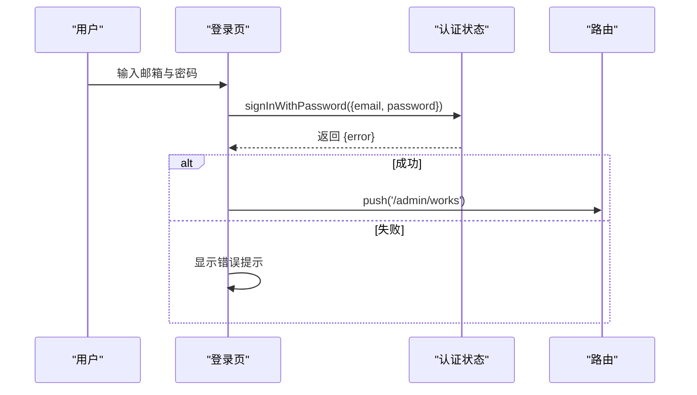
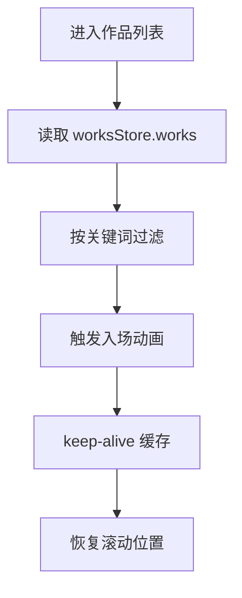
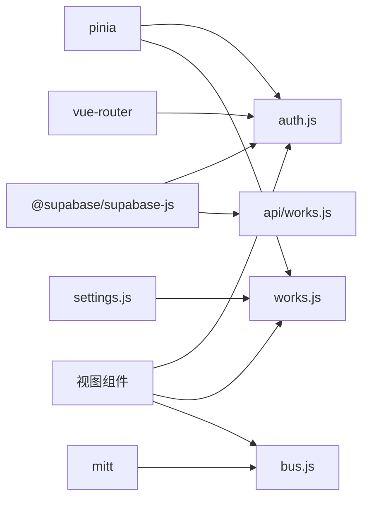

# 状态管理

<cite>
**本文引用的文件**   
- [src/stores/auth.js](file://src/stores/auth.js)
- [src/stores/works.js](file://src/stores/works.js)
- [src/utils/bus.js](file://src/utils/bus.js)
- [src/main.js](file://src/main.js)
- [package.json](file://package.json)
- [src/router/index.js](file://src/router/index.js)
- [src/views/Login.vue](file://src/views/Login.vue)
- [src/views/Works.vue](file://src/views/Works.vue)
- [src/api/works.js](file://src/api/works.js)
- [src/api/works.local.js](file://src/api/works.local.js)
- [src/settings.js](file://src/settings.js)
</cite>

## 目录
1. [简介](#简介)
2. [项目结构](#项目结构)
3. [核心组件](#核心组件)
4. [架构总览](#架构总览)
5. [详细组件分析](#详细组件分析)
6. [依赖关系分析](#依赖关系分析)
7. [性能与优化](#性能与优化)
8. [故障排查指南](#故障排查指南)
9. [结论](#结论)
10. [附录：调试与监控建议](#附录调试与监控建议)

## 简介
本技术文档围绕 sunwenxu1997.github.io 的状态管理系统展开，重点说明基于 Pinia 的认证状态管理与作品数据管理实现，以及使用 mitt 事件总线在组件间通信的应用。文档将解释状态定义、更新机制、组件同步策略、错误处理、性能优化和调试方法，帮助开发者理解并维护应用的状态流转。

## 项目结构
该项目的状态管理集中在以下位置：
- Pinia Store：认证状态与作品数据分别由独立的 store 管理
- 事件总线：mitt 封装的事件总线用于跨组件通信
- API 层：Supabase 查询与本地静态数据源统一抽象
- 路由守卫：在导航前初始化认证状态
- 视图组件：登录页与作品列表页消费 store 状态

图表来源
- [src/main.js:16-39](file://src/main.js#L16-L39)
- [src/stores/auth.js:5-80](file://src/stores/auth.js#L5-L80)
- [src/stores/works.js:7-28](file://src/stores/works.js#L7-L28)
- [src/utils/bus.js:1-15](file://src/utils/bus.js#L1-L15)
- [src/router/index.js:1-54](file://src/router/index.js#L1-L54)
- [src/views/Login.vue:103-144](file://src/views/Login.vue#L103-L144)
- [src/views/Works.vue:27-58](file://src/views/Works.vue#L27-L58)
- [src/api/works.js:45-55](file://src/api/works.js#L45-L55)
- [src/api/works.local.js:53-58](file://src/api/works.local.js#L53-L58)
- [src/settings.js:1-8](file://src/settings.js#L1-L8)

章节来源
- [src/main.js:16-39](file://src/main.js#L16-L39)
- [package.json:12-23](file://package.json#L12-L23)

## 核心组件
- 认证状态（auth.js）
  - 状态字段：用户对象、会话对象、加载标志
  - 派生状态：是否已认证
  - 关键方法：初始化、订阅认证变化、OAuth 登录、密码登录、注册、登出、管理员校验
- 作品数据状态（works.js）
  - 状态字段：作品列表、加载标志、错误信息
  - 关键方法：初始化（根据配置选择本地或 Supabase 数据源）
- 事件总线（bus.js）
  - 提供 emitBus 与 onBus 两个导出函数，封装 mitt 实例
- 数据访问层（api/works.js、api/works.local.js）
  - 公开接口：获取已发布作品
  - 后台接口：分页查询、统计、增删改、批量排序更新
  - 本地数据：将 settings.externalRoutes 映射为 works_meta 结构
- 配置（settings.js）
  - useLocalWorks 开关控制数据源切换
  - externalRoutes 提供本地演示数据

章节来源
- [src/stores/auth.js:5-80](file://src/stores/auth.js#L5-L80)
- [src/stores/works.js:7-28](file://src/stores/works.js#L7-L28)
- [src/utils/bus.js:1-15](file://src/utils/bus.js#L1-L15)
- [src/api/works.js:45-55](file://src/api/works.js#L45-L55)
- [src/api/works.local.js:53-58](file://src/api/works.local.js#L53-L58)
- [src/settings.js:1-8](file://src/settings.js#L1-L8)

## 架构总览
整体架构采用“视图层 → Pinia Store → API 层”的分层模式，结合路由守卫进行认证前置检查，mitt 事件总线作为轻量级跨组件通信通道。

图表来源
- [src/stores/auth.js:12-27](file://src/stores/auth.js#L12-L27)
- [src/stores/works.js:12-25](file://src/stores/works.js#L12-L25)
- [src/api/works.js:45-55](file://src/api/works.js#L45-L55)

## 详细组件分析

### 认证状态管理（auth.js）
- 状态设计
  - user：当前用户对象
  - session：当前会话对象
  - loading：初始化加载标志
  - isAuthenticated：计算属性，判断是否已认证
- 生命周期与同步
  - init：从 Supabase 获取当前会话并填充 user/session
  - subscribeAuthChange：监听认证状态变化，自动更新 user/session
- 认证流程
  - OAuth 登录：signInWithOAuth
  - 密码登录：signInWithPassword
  - 注册：signUp
  - 登出：signOut（清空 user/session）
  - 管理员校验：checkAdmin（调用数据库 RPC）

图表来源
- [src/stores/auth.js:12-27](file://src/stores/auth.js#L12-L27)
- [src/stores/auth.js:29-57](file://src/stores/auth.js#L29-L57)

章节来源
- [src/stores/auth.js:5-80](file://src/stores/auth.js#L5-L80)

### 作品数据管理（works.js）
- 状态设计
  - works：作品列表数组
  - loading：加载标志
  - error：错误信息
- 初始化逻辑
  - 根据 settings.useLocalWorks 决定数据源
  - 本地数据：fetchLocalWorks 将 externalRoutes 映射为 works_meta 结构
  - Supabase 数据：fetchPublishedWorks 获取已发布作品
- 错误处理
  - 捕获异常并记录错误信息，同时重置 works 为空数组

图表来源
- [src/stores/works.js:12-25](file://src/stores/works.js#L12-L25)
- [src/api/works.local.js:53-58](file://src/api/works.local.js#L53-L58)
- [src/api/works.js:45-55](file://src/api/works.js#L45-L55)

章节来源
- [src/stores/works.js:7-28](file://src/stores/works.js#L7-L28)
- [src/api/works.local.js:1-59](file://src/api/works.local.js#L1-L59)
- [src/api/works.js:45-55](file://src/api/works.js#L45-L55)
- [src/settings.js:1-8](file://src/settings.js#L1-L8)

### 事件总线（bus.js）
- 功能概述
  - 封装 mitt 实例，提供 emitBus 与 onBus
  - onBus 在订阅前先移除旧监听，避免重复绑定
- 典型用法
  - 搜索输入：在作品列表页订阅 searchInput 事件，接收外部输入并过滤列表
  - 跨组件通知：如弹窗提示、全局刷新等

图表来源
- [src/utils/bus.js:1-15](file://src/utils/bus.js#L1-L15)
- [src/views/Works.vue:47-58](file://src/views/Works.vue#L47-L58)

章节来源
- [src/utils/bus.js:1-15](file://src/utils/bus.js#L1-L15)
- [src/views/Works.vue:47-58](file://src/views/Works.vue#L47-L58)

### 路由守卫与认证集成（router/index.js）
- 在每次导航前调用 authStore.init()，确保认证状态就绪后再继续导航
- 对需要管理员权限的路由（如 /admin/works），可结合 checkAdmin 做权限控制

图表来源
- [src/router/index.js:51-54](file://src/router/index.js#L51-L54)
- [src/stores/auth.js:12-27](file://src/stores/auth.js#L12-L27)

章节来源
- [src/router/index.js:1-54](file://src/router/index.js#L1-L54)
- [src/stores/auth.js:12-27](file://src/stores/auth.js#L12-L27)

### 登录流程（Login.vue）
- 使用 authStore.signInWithPassword 进行密码登录
- 成功后跳转到后台管理页
- 失败时显示错误提示

图表来源
- [src/views/Login.vue:122-144](file://src/views/Login.vue#L122-L144)
- [src/stores/auth.js:37-43](file://src/stores/auth.js#L37-L43)

章节来源
- [src/views/Login.vue:103-144](file://src/views/Login.vue#L103-L144)
- [src/stores/auth.js:37-43](file://src/stores/auth.js#L37-L43)

### 作品列表与动画（Works.vue）
- 使用 worksStore.works 作为数据源，支持关键词搜索过滤
- 通过 watch 监听作品列表变化，重新执行入场动画
- 使用 keep-alive 缓存组件状态，并在激活时复用滚动位置与数据

图表来源
- [src/views/Works.vue:27-58](file://src/views/Works.vue#L27-L58)
- [src/stores/works.js:7-28](file://src/stores/works.js#L7-L28)

章节来源
- [src/views/Works.vue:27-58](file://src/views/Works.vue#L27-L58)
- [src/stores/works.js:7-28](file://src/stores/works.js#L7-L28)

## 依赖关系分析
- 运行时依赖
  - pinia：状态管理库
  - mitt：轻量事件总线
  - @supabase/supabase-js：后端交互
  - vue、vue-router：框架与路由
- 模块耦合
  - auth.js 依赖 supabase 客户端与路由守卫
  - works.js 依赖 api/works.js 与 api/works.local.js，并通过 settings.js 控制数据源
  - bus.js 被多个视图组件引用，解耦组件间通信

图表来源
- [package.json:12-23](file://package.json#L12-L23)
- [src/stores/auth.js:1-4](file://src/stores/auth.js#L1-L4)
- [src/stores/works.js:1-5](file://src/stores/works.js#L1-L5)
- [src/utils/bus.js:1-2](file://src/utils/bus.js#L1-L2)
- [src/router/index.js:1-3](file://src/router/index.js#L1-L3)

章节来源
- [package.json:12-23](file://package.json#L12-L23)
- [src/stores/auth.js:1-4](file://src/stores/auth.js#L1-L4)
- [src/stores/works.js:1-5](file://src/stores/works.js#L1-L5)
- [src/utils/bus.js:1-2](file://src/utils/bus.js#L1-L2)
- [src/router/index.js:1-3](file://src/router/index.js#L1-L3)

## 性能与优化
- 首屏加载优化
  - main.js 中通过 loading.waitRoute/waitFonts/waitImages 顺序等待路由 chunk、字体与首屏图片，提升首帧体验
- 数据加载优化
  - works.js 根据 useLocalWorks 选择本地静态数据，减少网络请求
  - api/works.js 服务端分页查询与精确 count，避免全量传输
- 渲染优化
  - Works.vue 使用 keep-alive 缓存组件状态，避免重复请求与重建
  - 通过 watch 仅在数据变化时重执行动画，降低不必要的开销
- 事件总线优化
  - bus.js 在 onBus 前移除旧监听，防止重复订阅导致内存泄漏

章节来源
- [src/main.js:16-39](file://src/main.js#L16-L39)
- [src/stores/works.js:12-25](file://src/stores/works.js#L12-L25)
- [src/api/works.js:115-140](file://src/api/works.js#L115-L140)
- [src/views/Works.vue:47-58](file://src/views/Works.vue#L47-L58)
- [src/utils/bus.js:11-14](file://src/utils/bus.js#L11-L14)

## 故障排查指南
- 认证相关
  - 若登录后未跳转或状态未更新，检查 authStore.init() 是否在路由守卫中正确调用
  - 登出后 user/session 应被清空，若未清空，检查 signOut 分支逻辑
- 作品列表相关
  - 若列表为空，检查 worksStore.init() 是否正确执行，以及 error 字段是否有值
  - 本地数据源模式下，确认 settings.useLocalWorks 与 externalRoutes 配置正确
- 事件总线相关
  - 若事件未触发，检查 onBus 是否先 off 再 on，避免重复订阅
  - 检查 emitBus 的事件名是否与 onBus 一致
- 日志定位
  - auth.js 中 checkAdmin 失败会打印错误日志
  - works.js 加载失败会打印错误日志并设置 error 字段

章节来源
- [src/stores/auth.js:59-66](file://src/stores/auth.js#L59-L66)
- [src/stores/works.js:18-24](file://src/stores/works.js#L18-L24)
- [src/utils/bus.js:11-14](file://src/utils/bus.js#L11-L14)

## 结论
本项目通过 Pinia 实现了清晰的认证与作品数据状态管理，结合路由守卫与 mitt 事件总线，形成了稳定且易扩展的状态体系。API 层对 Supabase 与本地静态数据进行了统一抽象，便于开发与调试。建议在后续迭代中引入更完善的错误边界与性能监控，进一步提升用户体验与维护效率。

## 附录：调试与监控建议
- 状态调试
  - 使用浏览器 DevTools 中的 Pinia 插件查看 store 状态变化
  - 在关键方法前后添加 console.log，观察状态更新时机
- 监控建议
  - 对网络请求增加埋点，记录成功率与耗时
  - 对事件总线增加日志，追踪事件传播路径
- 最佳实践
  - 保持 store 职责单一，避免跨领域状态耦合
  - 合理使用 computed 与 watch，避免过度响应式导致的性能问题
  - 在组件销毁时清理事件监听，防止内存泄漏

[本节为通用建议，不直接分析具体文件]