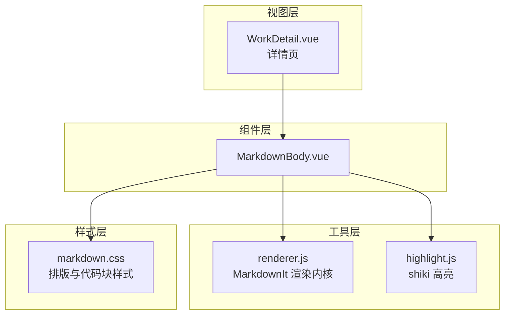
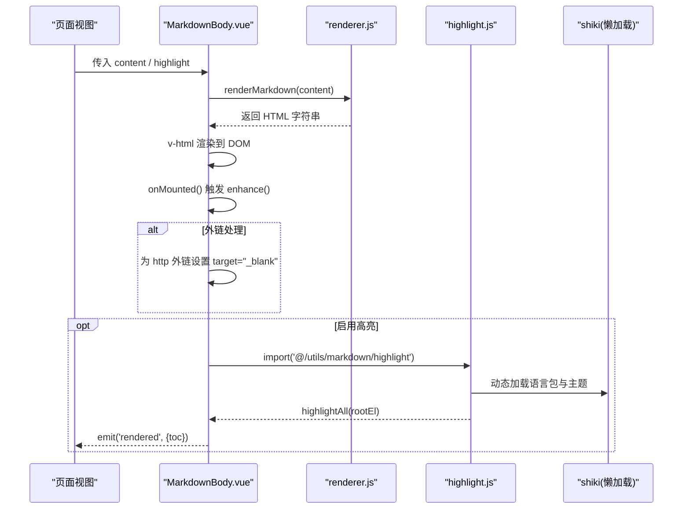
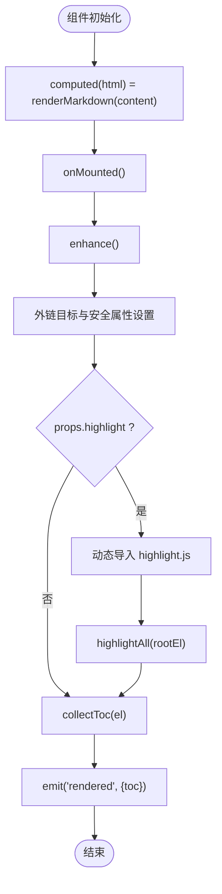
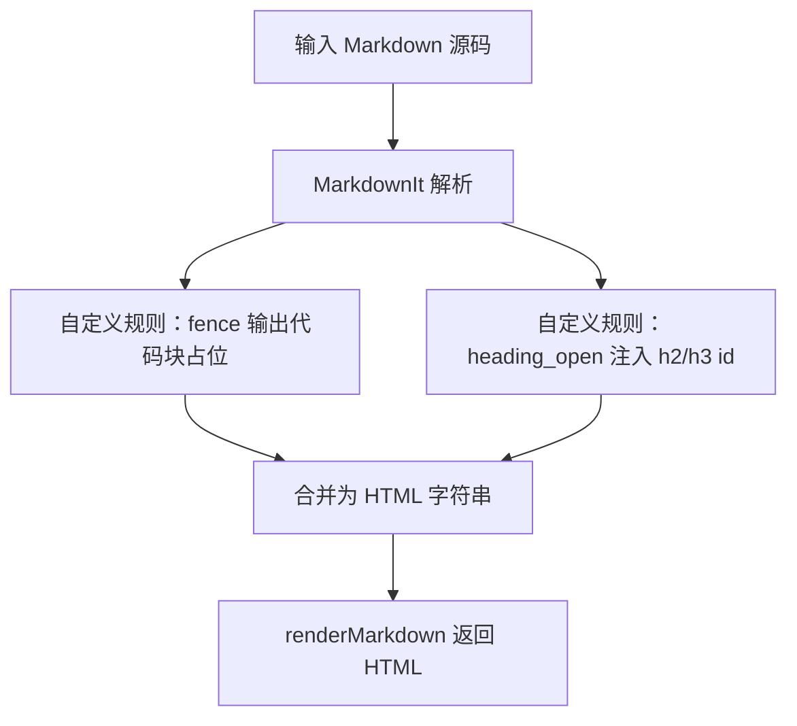
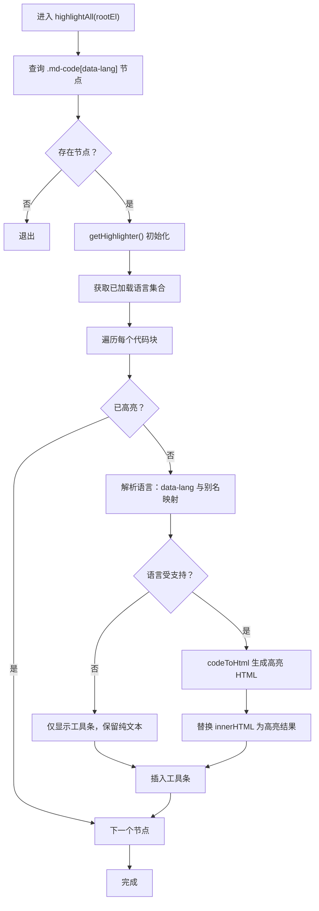
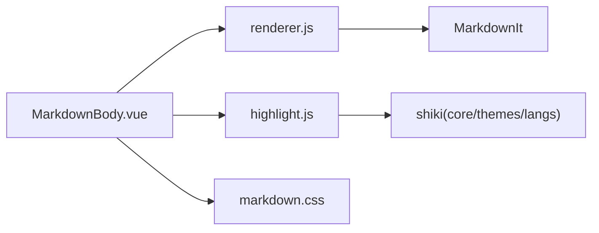

# Markdown 组件

<cite>
**本文引用的文件**   
- [MarkdownBody.vue](file://src/components/markdown/MarkdownBody.vue)
- [renderer.js](file://src/utils/markdown/renderer.js)
- [highlight.js](file://src/utils/markdown/highlight.js)
- [markdown.css](file://src/assets/markdown.css)
- [WorkDetail.vue](file://src/views/WorkDetail.vue)
</cite>

## 目录
1. [简介](#简介)
2. [项目结构](#项目结构)
3. [核心组件](#核心组件)
4. [架构总览](#架构总览)
5. [详细组件分析](#详细组件分析)
6. [依赖关系分析](#依赖关系分析)
7. [性能与渲染特性](#性能与渲染特性)
8. [配置与扩展指南](#配置与扩展指南)
9. [常见问题排查](#常见问题排查)
10. [结论](#结论)

## 简介
本文件面向开发者，系统性说明 Markdown 正文渲染组件 MarkdownBody 的实现原理、渲染流程、语法高亮机制、链接处理、图片展示以及可定制点。该组件以“同步解析 + 异步高亮”为核心策略：列表页等大量内容场景下保证首屏性能，详情页在 DOM 挂载后按需加载代码高亮引擎，实现“所见即所得”。

## 项目结构
Markdown 相关能力分布在以下位置：
- 组件层：src/components/markdown/MarkdownBody.vue
- 渲染内核：src/utils/markdown/renderer.js
- 代码高亮：src/utils/markdown/highlight.js
- 样式主题：src/assets/markdown.css
- 使用示例：src/views/WorkDetail.vue（详情页）



**图表来源**
- [MarkdownBody.vue:1-56](file://src/components/markdown/MarkdownBody.vue#L1-L56)
- [renderer.js:1-105](file://src/utils/markdown/renderer.js#L1-L105)
- [highlight.js:1-148](file://src/utils/markdown/highlight.js#L1-L148)
- [markdown.css:1-230](file://src/assets/markdown.css#L1-L230)
- [WorkDetail.vue:295-297](file://src/views/WorkDetail.vue#L295-L297)

**章节来源**
- [MarkdownBody.vue:1-56](file://src/components/markdown/MarkdownBody.vue#L1-L56)
- [renderer.js:1-105](file://src/utils/markdown/renderer.js#L1-L105)
- [highlight.js:1-148](file://src/utils/markdown/highlight.js#L1-L148)
- [markdown.css:1-230](file://src/assets/markdown.css#L1-L230)
- [WorkDetail.vue:295-297](file://src/views/WorkDetail.vue#L295-L297)

## 核心组件
MarkdownBody 是 Markdown 正文的容器组件，负责：
- 将 Markdown 源码通过 renderer.js 同步转换为 HTML
- 在 DOM 挂载后增强外链行为（新窗口打开）
- 按需异步加载 highlight.js 对代码块进行语法高亮
- 收集 h2/h3 标题生成目录数据，并通过事件向上抛出

关键属性与事件：
- content：Markdown 源码字符串
- highlight：是否启用代码高亮（默认开启）
- rendered：渲染完成后回调，携带目录信息 toc

**章节来源**
- [MarkdownBody.vue:10-18](file://src/components/markdown/MarkdownBody.vue#L10-L18)
- [MarkdownBody.vue:28-44](file://src/components/markdown/MarkdownBody.vue#L28-L44)
- [MarkdownBody.vue:46-51](file://src/components/markdown/MarkdownBody.vue#L46-L51)

## 架构总览
Markdown 渲染链路分为两条路径：
- 同步路径：Markdown -> HTML（MarkdownIt），用于列表摘要、快速预览等高性能场景
- 异步路径：DOM 挂载后 -> shiki 高亮（仅需要时加载），用于详情页或展开卡片



**图表来源**
- [MarkdownBody.vue:17-51](file://src/components/markdown/MarkdownBody.vue#L17-L51)
- [renderer.js:75-77](file://src/utils/markdown/renderer.js#L75-L77)
- [highlight.js:47-71](file://src/utils/markdown/highlight.js#L47-L71)
- [highlight.js:109-147](file://src/utils/markdown/highlight.js#L109-L147)

## 详细组件分析

### MarkdownBody 组件
职责与行为：
- 计算属性 html 调用 renderMarkdown 得到 HTML
- mounted 与 watch 变化时执行 enhance：
  - 统一外链安全打开
  - 按需加载 highlightAll 完成代码高亮
  - 收集 h2/h3 目录并触发 rendered 事件



**图表来源**
- [MarkdownBody.vue:17-51](file://src/components/markdown/MarkdownBody.vue#L17-L51)

**章节来源**
- [MarkdownBody.vue:1-56](file://src/components/markdown/MarkdownBody.vue#L1-L56)

### 渲染内核 renderer.js
设计要点：
- 使用 MarkdownIt，关闭原始 HTML 注入，避免 XSS
- 同步渲染，保障列表页性能
- 围栏代码块输出占位结构，供后续高亮替换
- 为 h2/h3 生成锚点 id，便于目录跳转

重点实现：
- escapeHtml：转义 HTML 字符
- slugify：标题文本转 id，保留中文
- fence 规则：输出 .md-code 外壳，包含 data-lang 与可选 data-title
- heading_open 规则：为 h2/h3 注入 id
- renderMarkdown：对外暴露的同步渲染入口
- extractSummary：抽取纯文本摘要，供列表卡使用



**图表来源**
- [renderer.js:12-16](file://src/utils/markdown/renderer.js#L12-L16)
- [renderer.js:40-53](file://src/utils/markdown/renderer.js#L40-L53)
- [renderer.js:55-68](file://src/utils/markdown/renderer.js#L55-L68)
- [renderer.js:75-77](file://src/utils/markdown/renderer.js#L75-L77)

**章节来源**
- [renderer.js:1-105](file://src/utils/markdown/renderer.js#L1-L105)

### 代码高亮 highlight.js
设计要点：
- 懒加载 shiki，仅在需要时加载
- 白名单语言 + 别名映射，减少打包体积
- JavaScript 正则引擎，避免额外 wasm 依赖
- 幂等处理，已高亮的节点跳过

核心逻辑：
- getHighlighter：首次创建高亮器，缓存 Promise
- LANG_ALIAS：常见语言别名映射
- buildBar：构建代码块顶部工具条（语言标签 + 复制按钮）
- highlightAll：遍历 .md-code[data-lang] 节点，按语言高亮并插入工具条



**图表来源**
- [highlight.js:47-71](file://src/utils/markdown/highlight.js#L47-L71)
- [highlight.js:73-102](file://src/utils/markdown/highlight.js#L73-L102)
- [highlight.js:109-147](file://src/utils/markdown/highlight.js#L109-L147)

**章节来源**
- [highlight.js:1-148](file://src/utils/markdown/highlight.js#L1-L148)

### 样式 markdown.css
覆盖范围：
- 基础排版：段落、标题、引用、列表、表格、图片等
- 行内代码：黑底白字风格
- 代码块外壳：.md-code 容器、工具条 .md-code__bar、语言标签、复制按钮
- shiki 输出适配：.md-code pre.shiki 背景与字体
- 触屏设备：复制按钮常驻可见

注意：
- 基础排版由 Tailwind Typography（.prose）提供，此处做站点化微调
- 代码块工具条由 highlight.js 在高亮后插入

**章节来源**
- [markdown.css:1-230](file://src/assets/markdown.css#L1-L230)

### 使用示例 WorkDetail.vue
详情页中直接传入 work.info_md，并在 rendered 事件中接收 toc 用于目录导航。

**章节来源**
- [WorkDetail.vue:295-297](file://src/views/WorkDetail.vue#L295-L297)

## 依赖关系分析
- MarkdownBody.vue 依赖 renderer.js 的 renderMarkdown 与 highlight.js 的 highlightAll
- renderer.js 基于 MarkdownIt，不引入 DOMPurify，html: false 确保安全性
- highlight.js 依赖 shiki 核心与主题、语言模块，采用动态 import 懒加载
- markdown.css 为组件提供视觉样式，与组件和工具层解耦



**图表来源**
- [MarkdownBody.vue:1-56](file://src/components/markdown/MarkdownBody.vue#L1-L56)
- [renderer.js:1-16](file://src/utils/markdown/renderer.js#L1-L16)
- [highlight.js:47-71](file://src/utils/markdown/highlight.js#L47-L71)
- [markdown.css:1-230](file://src/assets/markdown.css#L1-L230)

**章节来源**
- [MarkdownBody.vue:1-56](file://src/components/markdown/MarkdownBody.vue#L1-L56)
- [renderer.js:1-105](file://src/utils/markdown/renderer.js#L1-L105)
- [highlight.js:1-148](file://src/utils/markdown/highlight.js#L1-L148)
- [markdown.css:1-230](file://src/assets/markdown.css#L1-L230)

## 性能与渲染特性
- 同步渲染：MarkdownIt 全程同步，适合列表页批量渲染
- 异步高亮：shiki 按需加载，首屏零成本；未支持语言回退为纯文本
- 外链安全：统一 target="_blank" 与 rel="noopener noreferrer"
- 目录采集：h2/h3 自动注入 id，组件收集 toc 供外部导航使用
- 摘要提取：extractSummary 剥离格式标记，生成短摘要用于列表卡

优化建议：
- 控制代码块数量与语言种类，减少 shiki 语言包体积
- 合理设置 highlight 开关，非详情场景可关闭高亮提升性能
- 使用 extractSummary 替代完整渲染，降低列表页压力

**章节来源**
- [renderer.js:6-10](file://src/utils/markdown/renderer.js#L6-L10)
- [highlight.js:1-7](file://src/utils/markdown/highlight.js#L1-L7)
- [MarkdownBody.vue:32-41](file://src/components/markdown/MarkdownBody.vue#L32-L41)
- [renderer.js:85-104](file://src/utils/markdown/renderer.js#L85-L104)

## 配置与扩展指南

### 组件属性
- content：Markdown 源码字符串
- highlight：布尔值，控制是否启用代码高亮（默认 true）

### 事件
- rendered：回调参数包含 toc 数组，元素结构含 id、text、level

### 代码块语法
- 围栏代码块支持 language 与 title 元信息
  - 示例语法：```js title="a.js"
  - 渲染产物：.md-code[data-lang][data-title] 包裹 <pre><code>
- 语言别名映射见 highlight.js 中的 LANG_ALIAS

### 标题与目录
- h2/h3 会自动生成 id，id 生成规则见 slugify
- 组件会收集 h2/h3 生成目录，供外部导航使用

### 链接与图片
- 外链统一新窗口打开，并添加安全属性
- 图片遵循 markdown.css 的 img 样式，最大宽度 100%

### 自定义渲染器
- 若需扩展 MarkdownIt 规则，可在 renderer.js 中追加 md.renderer.rules.*
- 注意保持同步渲染原则，避免引入阻塞逻辑

### 自定义高亮
- 扩展语言：在 LANG_LOADERS 中添加语言加载器，并在 LANG_ALIAS 增加别名
- 更换主题：修改 THEME 变量指向 shiki 内置主题或自定义主题

### 样式定制
- 调整 .md-body 下的排版变量与颜色
- 调整 .md-code 与 .md-code__bar 的工具条样式
- 适配移动端：hover:none 媒体查询下复制按钮常驻

**章节来源**
- [MarkdownBody.vue:10-18](file://src/components/markdown/MarkdownBody.vue#L10-L18)
- [MarkdownBody.vue:20-26](file://src/components/markdown/MarkdownBody.vue#L20-L26)
- [MarkdownBody.vue:32-44](file://src/components/markdown/MarkdownBody.vue#L32-L44)
- [renderer.js:40-53](file://src/utils/markdown/renderer.js#L40-L53)
- [renderer.js:55-68](file://src/utils/markdown/renderer.js#L55-L68)
- [highlight.js:11-43](file://src/utils/markdown/highlight.js#L11-L43)
- [highlight.js:47-71](file://src/utils/markdown/highlight.js#L47-L71)
- [markdown.css:7-117](file://src/assets/markdown.css#L7-L117)
- [markdown.css:134-216](file://src/assets/markdown.css#L134-L216)

## 常见问题排查
- 代码块未高亮
  - 检查 props.highlight 是否为 true
  - 确认语言是否在 LANG_LOADERS 与 LANG_ALIAS 中
  - 查看控制台是否有 shiki 加载失败的警告
- 外链未在新窗口打开
  - 确认链接 href 以 http 开头
  - 检查 enhance 函数是否执行
- 目录无法跳转
  - 确认标题为 h2/h3 且包含文本
  - 检查 slugify 生成的 id 是否与链接一致
- 摘要过长或格式残留
  - 调整 extractSummary 的 max 参数
  - 检查 Markdown 源码是否存在未处理的 HTML

**章节来源**
- [highlight.js:117-121](file://src/utils/markdown/highlight.js#L117-L121)
- [MarkdownBody.vue:32-44](file://src/components/markdown/MarkdownBody.vue#L32-L44)
- [renderer.js:27-34](file://src/utils/markdown/renderer.js#L27-L34)
- [renderer.js:85-104](file://src/utils/markdown/renderer.js#L85-L104)

## 结论
MarkdownBody 组件通过“同步渲染 + 异步高亮”的组合策略，在保证列表页性能的同时，为详情页提供了完整的代码高亮、外链安全、目录导航与样式定制能力。开发者可通过扩展 renderer.js 的规则与 highlight.js 的语言/主题配置，灵活定制渲染效果，满足多样化的业务需求。