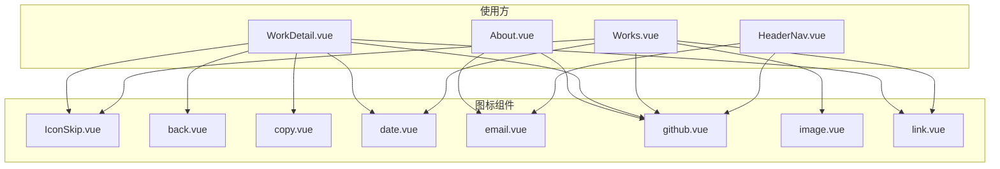
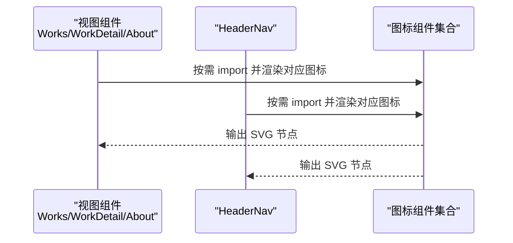
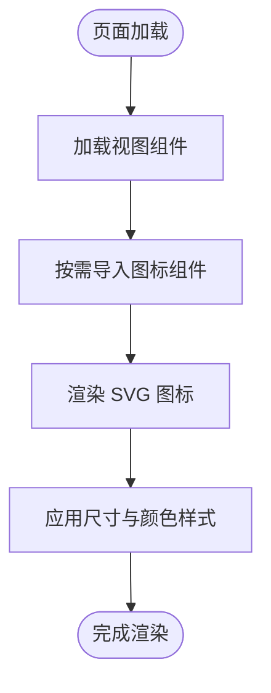
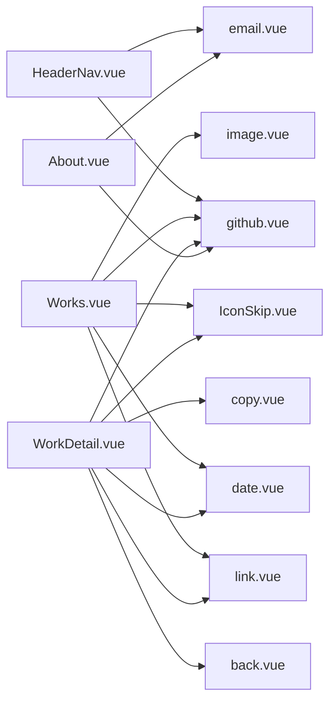

# 图标组件

<cite>
**本文引用的文件**   
- [IconSkip.vue](file://src/components/icons/IconSkip.vue)
- [back.vue](file://src/components/icons/back.vue)
- [copy.vue](file://src/components/icons/copy.vue)
- [date.vue](file://src/components/icons/date.vue)
- [email.vue](file://src/components/icons/email.vue)
- [github.vue](file://src/components/icons/github.vue)
- [image.vue](file://src/components/icons/image.vue)
- [link.vue](file://src/components/icons/link.vue)
- [HeaderNav.vue](file://src/components/HeaderNav.vue)
- [Works.vue](file://src/views/Works.vue)
- [WorkDetail.vue](file://src/views/WorkDetail.vue)
- [About.vue](file://src/views/About.vue)
</cite>

## 目录
1. [简介](#简介)
2. [项目结构](#项目结构)
3. [核心组件](#核心组件)
4. [架构总览](#架构总览)
5. [详细组件分析](#详细组件分析)
6. [依赖关系分析](#依赖关系分析)
7. [性能与可访问性](#性能与可访问性)
8. [故障排查指南](#故障排查指南)
9. [结论](#结论)
10. [附录：扩展新图标的规范](#附录扩展新图标的规范)

## 简介
本文件系统化梳理项目中所有自定义图标组件的实现方式与设计规范，覆盖每个图标的功能用途、属性配置、使用方式、SVG 结构与样式定制选项、尺寸控制策略，以及组合使用模式与扩展新图标的指导。目标是确保图标在视觉一致性、可维护性与可扩展性方面达到统一标准。

## 项目结构
图标组件集中位于 src/components/icons 目录下，采用“按功能命名”的扁平组织方式，便于按需引入与复用。各图标以 Vue 单文件组件形式提供，内部直接渲染 SVG 节点，不依赖第三方图标库（除部分页面中使用的 lucide-vue-next 外）。

图表来源
- [HeaderNav.vue:7-8](file://src/components/HeaderNav.vue#L7-L8)
- [Works.vue:5-9](file://src/views/Works.vue#L5-L9)
- [WorkDetail.vue:9-15](file://src/views/WorkDetail.vue#L9-L15)
- [About.vue:3-4](file://src/views/About.vue#L3-L4)

章节来源
- [HeaderNav.vue:1-52](file://src/components/HeaderNav.vue#L1-L52)
- [Works.vue:1-30](file://src/views/Works.vue#L1-L30)
- [WorkDetail.vue:1-20](file://src/views/WorkDetail.vue#L1-L20)
- [About.vue:1-10](file://src/views/About.vue#L1-L10)

## 核心组件
本节对每个图标组件进行说明，包括功能用途、SVG 结构要点、样式与尺寸控制方式、以及在业务中的典型用法。

- IconSkip
  - 用途：用于内容跳过或跳转场景（例如快速跳转到正文）。
  - SVG 结构：包含一个带填充色的路径图形，外层 svg 设置了 viewBox 与宽高。
  - 样式与尺寸：通过内联 width/height 控制尺寸；fill 颜色由父级上下文或内联样式决定。
  - 使用示例：在作品列表页作为“跳到正文”按钮的图标。
  - 参考实现
    - [IconSkip.vue:1-14](file://src/components/icons/IconSkip.vue#L1-L14)
  - 使用位置
    - [Works.vue:7](file://src/views/Works.vue#L7)
    - [WorkDetail.vue:13](file://src/views/WorkDetail.vue#L13)

- back
  - 用途：返回上一页或返回列表。
  - SVG 结构：基于 stroke 线条与折线构成的左箭头。
  - 样式与尺寸：默认使用 stroke="currentColor"，可通过父级 text-color 继承颜色；width/height 固定为小尺寸。
  - 使用示例：详情页返回按钮。
  - 参考实现
    - [back.vue:1-17](file://src/components/icons/back.vue#L1-L17)
  - 使用位置
    - [WorkDetail.vue:14](file://src/views/WorkDetail.vue#L14)

- copy
  - 用途：复制文本或链接到剪贴板。
  - SVG 结构：矩形与路径组合的复制图标。
  - 样式与尺寸：stroke 风格，currentColor 继承颜色；width/height 小尺寸。
  - 使用示例：详情页复制代码或链接。
  - 参考实现
    - [copy.vue:1-17](file://src/components/icons/copy.vue#L1-L17)
  - 使用位置
    - [WorkDetail.vue:15](file://src/views/WorkDetail.vue#L15)

- date
  - 用途：展示日期信息。
  - SVG 结构：日历形状的路径。
  - 样式与尺寸：内联 width/height 控制尺寸；class 为 icon。
  - 使用示例：作品详情时间显示。
  - 参考实现
    - [date.vue:1-4](file://src/components/icons/date.vue#L1-L4)
  - 使用位置
    - [Works.vue:9](file://src/views/Works.vue#L9)
    - [WorkDetail.vue:9](file://src/views/WorkDetail.vue#L9)

- email
  - 用途：邮箱联系入口。
  - SVG 结构：信封轮廓与折线。
  - 样式与尺寸：内联宽高较大，实际显示由父容器控制；class 为 icon。
  - 使用示例：导航栏与关于页的邮箱图标。
  - 参考实现
    - [email.vue:1-4](file://src/components/icons/email.vue#L1-L4)
  - 使用位置
    - [HeaderNav.vue:8](file://src/components/HeaderNav.vue#L8)
    - [About.vue:4](file://src/views/About.vue#L4)

- github
  - 用途：GitHub 外链入口。
  - SVG 结构：复杂路径组成的 GitHub Logo。
  - 样式与尺寸：内联宽高较大，实际显示由父容器控制；fill 颜色由父级上下文决定。
  - 使用示例：导航栏与关于页的 GitHub 图标。
  - 参考实现
    - [github.vue:1-7](file://src/components/icons/github.vue#L1-L7)
  - 使用位置
    - [HeaderNav.vue:7](file://src/components/HeaderNav.vue#L7)
    - [Works.vue:5](file://src/views/Works.vue#L5)
    - [WorkDetail.vue:10](file://src/views/WorkDetail.vue#L10)
    - [About.vue:3](file://src/views/About.vue#L3)

- image
  - 用途：图片占位或图片相关操作。
  - SVG 结构：图片框与山峰路径。
  - 样式与尺寸：内联宽高较小；class 为 icon。
  - 使用示例：作品列表卡片图片占位。
  - 参考实现
    - [image.vue:1-17](file://src/components/icons/image.vue#L1-L17)
  - 使用位置
    - [Works.vue:8](file://src/views/Works.vue#L8)

- link
  - 用途：外链或锚点链接。
  - SVG 结构：复杂路径组成的链接图标。
  - 样式与尺寸：内联宽高较大，实际显示由父容器控制；fill 颜色由父级上下文决定。
  - 使用示例：作品详情外链入口。
  - 参考实现
    - [link.vue:1-8](file://src/components/icons/link.vue#L1-L8)
  - 使用位置
    - [Works.vue:6](file://src/views/Works.vue#L6)
    - [WorkDetail.vue:11](file://src/views/WorkDetail.vue#L11)

章节来源
- [IconSkip.vue:1-14](file://src/components/icons/IconSkip.vue#L1-L14)
- [back.vue:1-17](file://src/components/icons/back.vue#L1-L17)
- [copy.vue:1-17](file://src/components/icons/copy.vue#L1-L17)
- [date.vue:1-4](file://src/components/icons/date.vue#L1-L4)
- [email.vue:1-4](file://src/components/icons/email.vue#L1-L4)
- [github.vue:1-7](file://src/components/icons/github.vue#L1-L7)
- [image.vue:1-17](file://src/components/icons/image.vue#L1-L17)
- [link.vue:1-8](file://src/components/icons/link.vue#L1-L8)
- [HeaderNav.vue:7-8](file://src/components/HeaderNav.vue#L7-L8)
- [Works.vue:5-9](file://src/views/Works.vue#L5-L9)
- [WorkDetail.vue:9-15](file://src/views/WorkDetail.vue#L9-L15)
- [About.vue:3-4](file://src/views/About.vue#L3-L4)

## 架构总览
图标组件被多个视图与布局组件引用，形成“多对一”的使用关系。整体调用流程如下：

图表来源
- [Works.vue:5-9](file://src/views/Works.vue#L5-L9)
- [WorkDetail.vue:9-15](file://src/views/WorkDetail.vue#L9-L15)
- [About.vue:3-4](file://src/views/About.vue#L3-L4)
- [HeaderNav.vue:7-8](file://src/components/HeaderNav.vue#L7-L8)

## 详细组件分析

### 通用设计原则
- 无状态纯展示：所有图标组件均为无状态展示型组件，不包含业务逻辑。
- 尺寸控制：优先通过父组件传入 class 或 style 控制尺寸，避免在图标组件内部硬编码固定尺寸导致复用困难。
- 颜色继承：尽量使用 stroke="currentColor" 或 fill 由父级上下文决定，保证主题色一致。
- 语义化：为交互型图标（如 back、copy）提供 aria-label 或 title，提升可访问性。
- 命名规范：组件名使用语义化名词，导入时统一加前缀 Icon*，避免命名冲突。

### 组合使用模式
- 导航区组合：HeaderNav 将 github 与 email 并列展示，作为社交联系方式。
- 列表区组合：Works 将 github、link、skip、image、date 等图标组合在作品卡片或工具栏中。
- 详情页组合：WorkDetail 将 date、github、link、skip、back、copy 组合在标题、元信息与操作区。

[此图为概念流程图，无需源码映射]

### 样式定制与尺寸控制
- 尺寸控制建议
  - 小尺寸（约 16px）：适用于行内工具图标，如 back、copy。
  - 中等尺寸（约 20-24px）：适用于导航与列表项图标，如 date、image。
  - 大尺寸（约 200px+）：适用于品牌或装饰性图标，如 github、link、email；建议在父容器中用 CSS 限制最大宽高。
- 颜色定制建议
  - 使用 Tailwind 的 text-* 类设置父容器颜色，使 stroke="currentColor" 的图标自动适配。
  - 对于 fill 固定的图标，可在父容器通过 CSS filter 或变量覆盖，但需保持对比度。
- 响应式建议
  - 在小屏幕下适当缩小图标尺寸，避免拥挤。
  - 在大屏上可适当放大品牌图标以提升识别度。

章节来源
- [back.vue:1-17](file://src/components/icons/back.vue#L1-L17)
- [copy.vue:1-17](file://src/components/icons/copy.vue#L1-L17)
- [date.vue:1-4](file://src/components/icons/date.vue#L1-L4)
- [image.vue:1-17](file://src/components/icons/image.vue#L1-L17)
- [email.vue:1-4](file://src/components/icons/email.vue#L1-L4)
- [github.vue:1-7](file://src/components/icons/github.vue#L1-L7)
- [link.vue:1-8](file://src/components/icons/link.vue#L1-L8)

## 依赖关系分析
图标组件之间相互独立，无彼此依赖；它们仅被上层视图与布局组件引用。

图表来源
- [HeaderNav.vue:7-8](file://src/components/HeaderNav.vue#L7-L8)
- [Works.vue:5-9](file://src/views/Works.vue#L5-L9)
- [WorkDetail.vue:9-15](file://src/views/WorkDetail.vue#L9-L15)
- [About.vue:3-4](file://src/views/About.vue#L3-L4)

章节来源
- [HeaderNav.vue:1-52](file://src/components/HeaderNav.vue#L1-L52)
- [Works.vue:1-30](file://src/views/Works.vue#L1-L30)
- [WorkDetail.vue:1-20](file://src/views/WorkDetail.vue#L1-L20)
- [About.vue:1-10](file://src/views/About.vue#L1-L10)

## 性能与可访问性
- 性能
  - 图标为轻量 SVG，渲染开销低；按需导入避免打包体积膨胀。
  - 避免在高频更新区域重复创建大型 SVG；必要时缓存或使用 sprite。
- 可访问性
  - 为可点击图标添加 role="button" 与 aria-label，确保键盘与读屏可用。
  - 对非装饰性图标提供有意义的标题或描述。
- 主题适配
  - 优先使用 currentColor 继承主题色，减少硬编码颜色。
  - 注意不同背景下的对比度，必要时调整 fill/stroke。

[本节为通用指导，无需源码映射]

## 故障排查指南
- 图标尺寸异常
  - 检查父容器是否限制了宽高；确认未与全局样式冲突。
  - 对于大尺寸品牌图标（如 github、link），建议在父容器设置 max-width/max-height。
- 颜色不一致
  - 若使用 stroke="currentColor"，请确保父容器设置了正确的 text-* 颜色。
  - 若使用固定 fill，检查是否被全局样式覆盖。
- 无法点击或无焦点
  - 为交互型图标添加 tabindex="0" 与键盘事件处理。
  - 补充 aria-label 提升可访问性。
- 引入失败
  - 确认导入路径正确，且组件文件名大小写一致。
  - 检查构建配置是否遗漏了 .vue 文件的解析。

章节来源
- [github.vue:1-7](file://src/components/icons/github.vue#L1-L7)
- [link.vue:1-8](file://src/components/icons/link.vue#L1-L8)
- [email.vue:1-4](file://src/components/icons/email.vue#L1-L4)
- [back.vue:1-17](file://src/components/icons/back.vue#L1-L17)
- [copy.vue:1-17](file://src/components/icons/copy.vue#L1-L17)

## 结论
本项目图标组件采用简洁的 SVG 直出方案，配合视图层按需引入，实现了良好的可维护性与扩展性。通过统一的尺寸与颜色约定、合理的组合模式与扩展规范，能够在不同页面与场景中保持一致的视觉体验。后续新增图标时，建议遵循本文档的设计原则与规范，以确保整体质量与一致性。

[本节为总结性内容，无需源码映射]

## 附录：扩展新图标的规范
- 文件命名
  - 放在 src/components/icons 目录下，文件名使用语义化小写，如 new-icon.vue。
- 组件结构
  - 使用 <template> 包裹单个 <svg>，避免多余包裹元素。
  - 设置合适的 viewBox，确保缩放不失真。
  - 优先使用 stroke="currentColor" 或让 fill 由父级上下文决定。
- 尺寸与样式
  - 不在图标组件内硬编码固定宽高；如需默认尺寸，建议使用 class 并在父容器控制。
  - 对外暴露可选的 size 与 color props（推荐），以便灵活定制。
- 可访问性
  - 为可交互图标添加 aria-label 或 title。
  - 为非装饰性图标提供语义化描述。
- 使用方式
  - 在需要的位置按需 import，并以 <IconXxx /> 形式渲染。
  - 在父组件中通过 class 或 style 控制尺寸与颜色。

章节来源
- [IconSkip.vue:1-14](file://src/components/icons/IconSkip.vue#L1-L14)
- [back.vue:1-17](file://src/components/icons/back.vue#L1-L17)
- [copy.vue:1-17](file://src/components/icons/copy.vue#L1-L17)
- [date.vue:1-4](file://src/components/icons/date.vue#L1-L4)
- [email.vue:1-4](file://src/components/icons/email.vue#L1-L4)
- [github.vue:1-7](file://src/components/icons/github.vue#L1-L7)
- [image.vue:1-17](file://src/components/icons/image.vue#L1-L17)
- [link.vue:1-8](file://src/components/icons/link.vue#L1-L8)