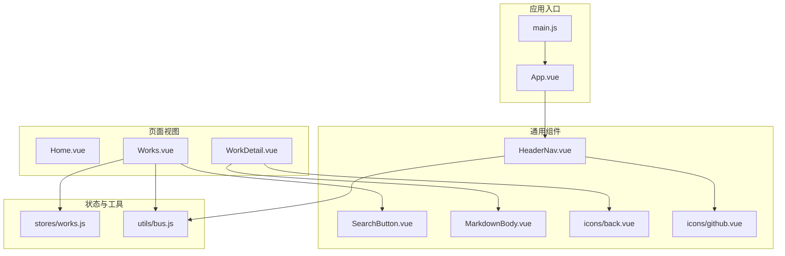
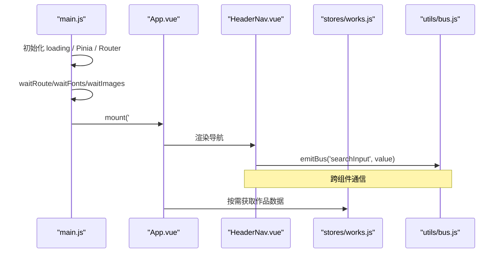
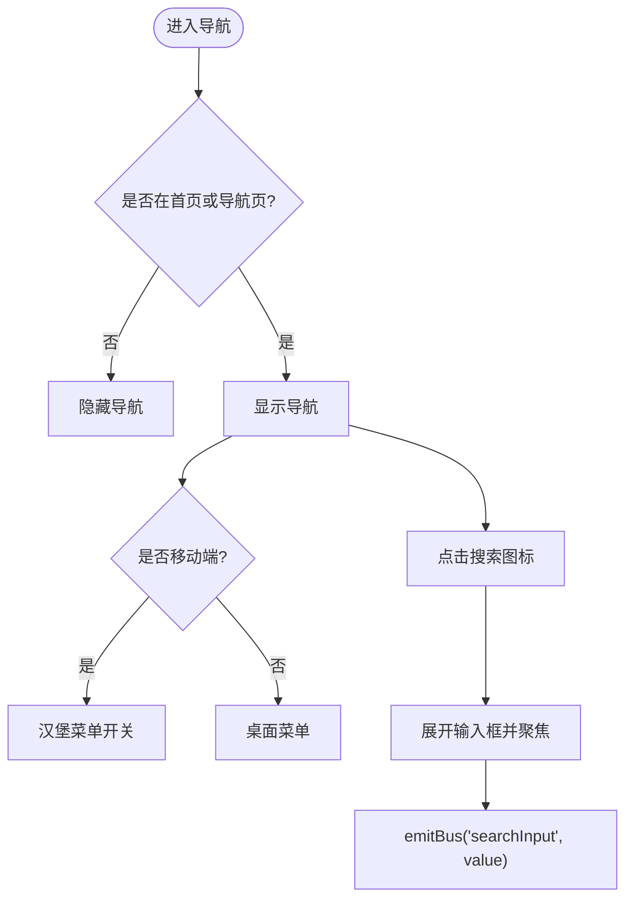
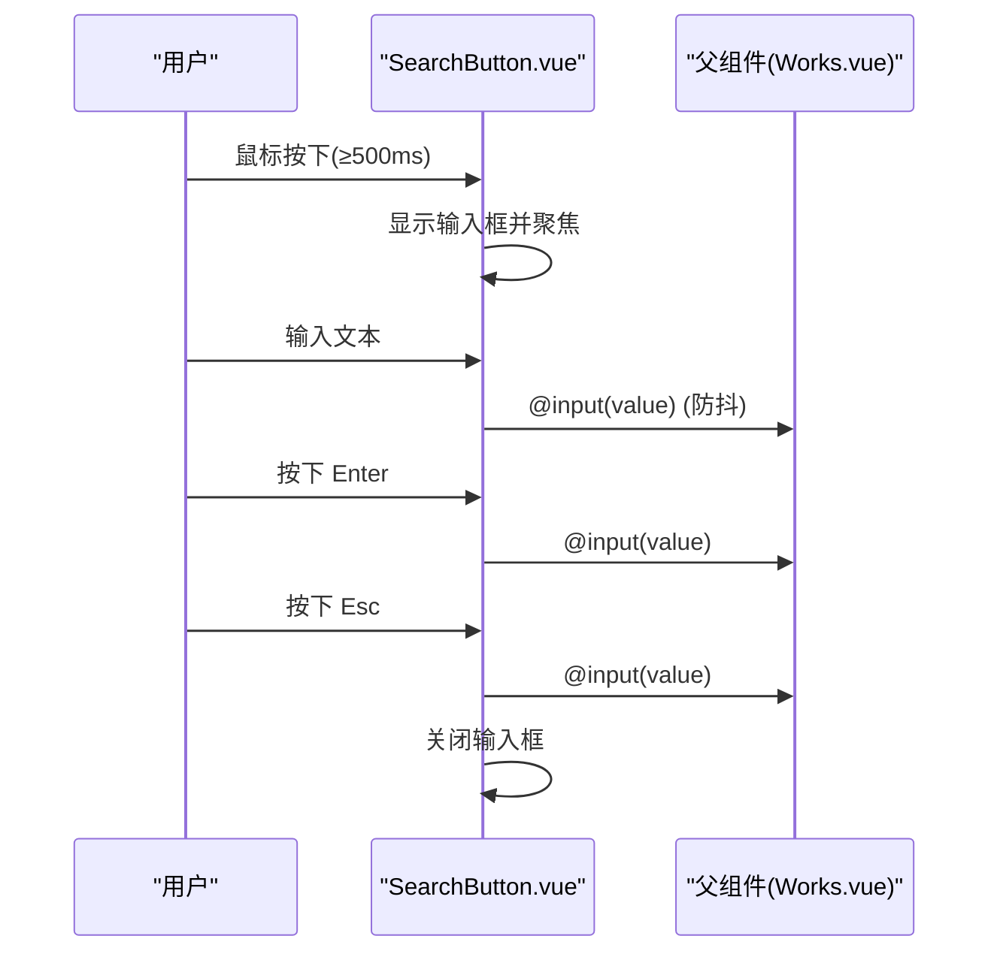
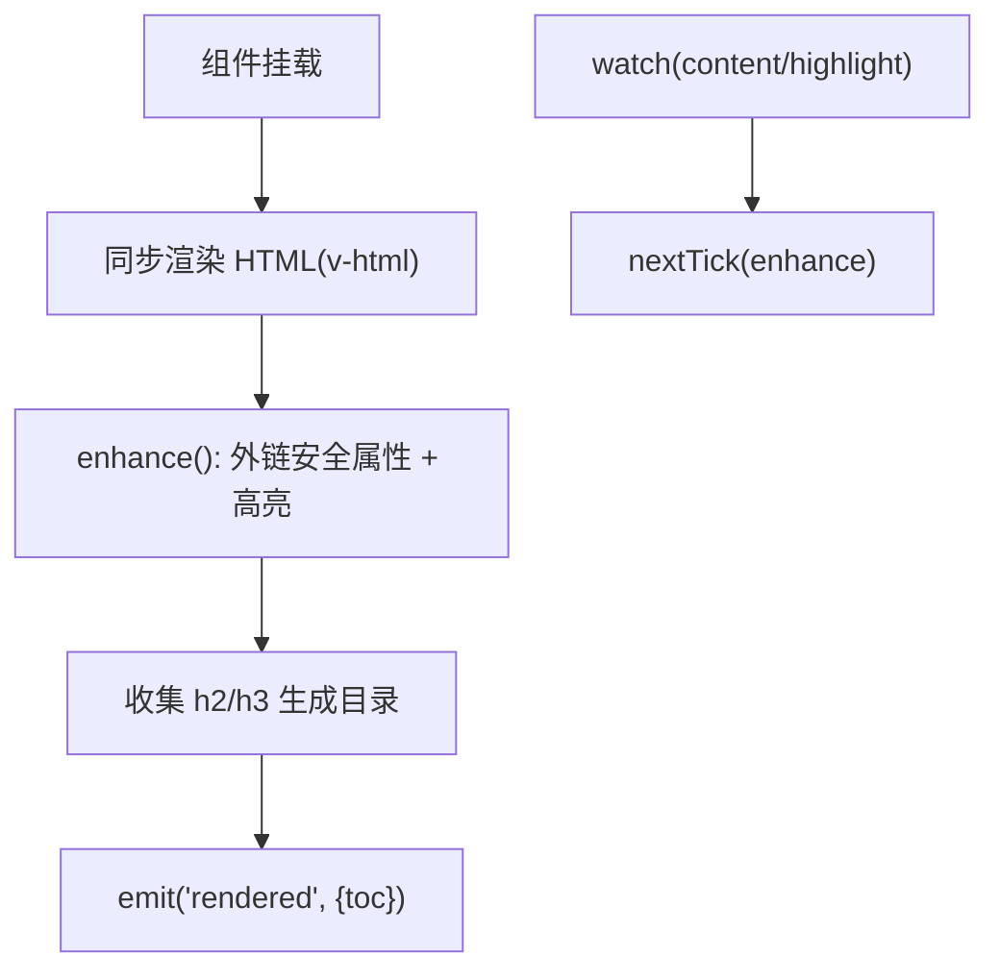
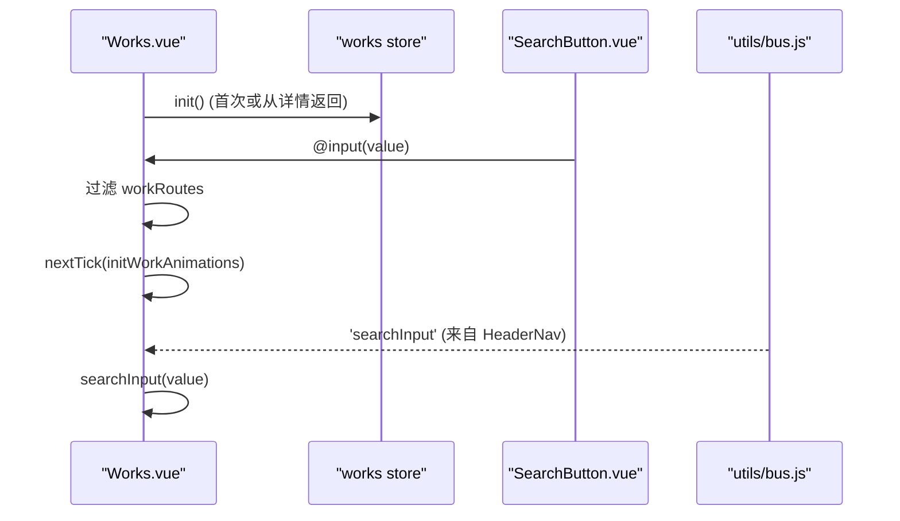
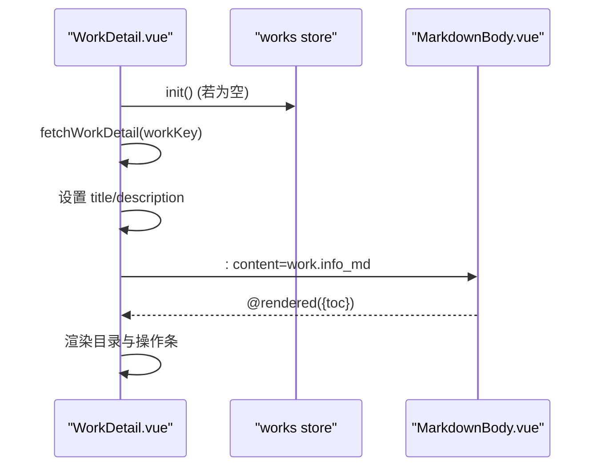
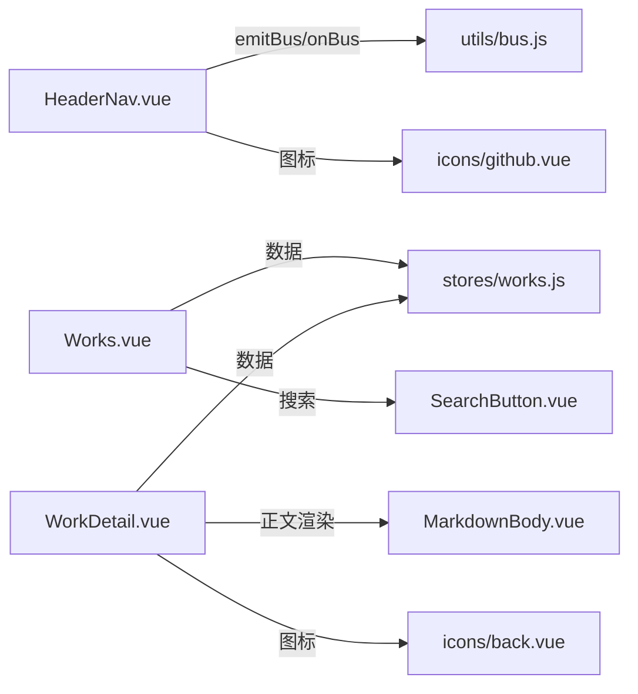

# 组件系统

<cite>
**本文引用的文件**   
- [README.md](file://README.md)
- [main.js](file://src/main.js)
- [App.vue](file://src/App.vue)
- [HeaderNav.vue](file://src/components/HeaderNav.vue)
- [SearchButton.vue](file://src/components/SearchButton.vue)
- [MarkdownBody.vue](file://src/components/markdown/MarkdownBody.vue)
- [back.vue](file://src/components/icons/back.vue)
- [github.vue](file://src/components/icons/github.vue)
- [Home.vue](file://src/views/Home.vue)
- [Works.vue](file://src/views/Works.vue)
- [WorkDetail.vue](file://src/views/WorkDetail.vue)
- [works.js](file://src/stores/works.js)
- [bus.js](file://src/utils/bus.js)
</cite>

## 目录
1. [简介](#简介)
2. [项目结构](#项目结构)
3. [核心组件](#核心组件)
4. [架构总览](#架构总览)
5. [详细组件分析](#详细组件分析)
6. [依赖关系分析](#依赖关系分析)
7. [性能与可访问性](#性能与可访问性)
8. [故障排查指南](#故障排查指南)
9. [结论](#结论)
10. [附录：组合模式与最佳实践](#附录组合模式与最佳实践)

## 简介
本组件系统基于 Vue 3 + Vite，采用 TailwindCSS 构建响应式界面，结合 Pinia 进行状态管理、Vue Router 进行路由控制，并通过 Supabase 提供认证与数据服务。文档聚焦于可复用组件的设计原则、API 接口、事件处理、插槽使用与样式定制选项，覆盖通用组件（导航、搜索、图标）与页面级组件的实现细节，并提供组合模式与最佳实践，帮助开发者快速上手并扩展该组件库。

## 项目结构
仓库采用按功能域组织的结构：
- src/components：通用组件与图标
- src/views：页面级视图
- src/stores：Pinia 状态模块
- src/utils：工具函数与事件总线
- src/api：后端 API 封装
- src/router：路由配置与守卫
- public/assets：静态资源与样式

图表来源
- [main.js:16-39](file://src/main.js#L16-L39)
- [App.vue:1-26](file://src/App.vue#L1-L26)
- [HeaderNav.vue:1-235](file://src/components/HeaderNav.vue#L1-L235)
- [SearchButton.vue:1-124](file://src/components/SearchButton.vue#L1-L124)
- [MarkdownBody.vue:1-57](file://src/components/markdown/MarkdownBody.vue#L1-L57)
- [works.js:1-29](file://src/stores/works.js#L1-L29)
- [bus.js:1-15](file://src/utils/bus.js#L1-L15)

章节来源
- [README.md:12-28](file://README.md#L12-L28)
- [README.md:158-189](file://README.md#L158-L189)

## 核心组件
本节概述通用组件的职责、属性、事件与使用方式。

- HeaderNav.vue（导航与全局搜索入口）
  - 职责：顶部导航、移动端菜单、全局搜索输入、外链与版权信息展示。
  - 关键行为：根据当前路由决定是否显示；移动端展开/收起菜单；通过事件总线发布搜索关键词。
  - 对外交互：emitBus('searchInput', value) 将输入值广播给订阅方。
  - 样式定制：Tailwind 类名为主，支持 mask-image 渐变遮罩与主题色切换。

- SearchButton.vue（悬浮跟随鼠标搜索按钮）
  - 职责：非移动端设备下提供跟随鼠标的搜索浮层，长按触发输入框，回车/Esc 提交或关闭。
  - 属性：searchIconShow（Boolean，默认 true），控制是否显示搜索图标。
  - 事件：input(value) 实时上报输入值；search（可选）用于显式提交。
  - 动画：GSAP 驱动跟随移动与淡入效果。
  - 无障碍：在移动端自动降级为常规交互；键盘 Enter/Esc 支持。

- MarkdownBody.vue（Markdown 正文渲染）
  - 职责：同步渲染 HTML，异步补挂代码高亮，外链统一新窗口打开，收集目录节点。
  - 属性：content（String，默认 ''）、highlight（Boolean，默认 true）。
  - 事件：rendered({ toc }) 回调返回目录列表。
  - 样式：基于 prose 的站点化样式，可通过外层容器自定义宽度与排版。

- 图标组件（icons/*）
  - 职责：纯展示型 SVG 图标，如 back、github 等。
  - 使用：直接作为子组件引入，无需额外属性。

章节来源
- [HeaderNav.vue:1-235](file://src/components/HeaderNav.vue#L1-L235)
- [SearchButton.vue:1-124](file://src/components/SearchButton.vue#L1-L124)
- [MarkdownBody.vue:1-57](file://src/components/markdown/MarkdownBody.vue#L1-L57)
- [back.vue:1-17](file://src/components/icons/back.vue#L1-L17)
- [github.vue:1-7](file://src/components/icons/github.vue#L1-L7)

## 架构总览
应用启动后，main.js 初始化加载遮罩、安装 Pinia 与 Router，等待路由就绪、字体与首屏图片加载完成后挂载 App。App.vue 中注入 Toaster 通知、HeaderNav 导航，并使用 keep-alive 缓存标记了 meta.keepAlive 的路由视图。

图表来源
- [main.js:16-39](file://src/main.js#L16-L39)
- [App.vue:1-26](file://src/App.vue#L1-L26)
- [HeaderNav.vue:1-235](file://src/components/HeaderNav.vue#L1-L235)
- [works.js:1-29](file://src/stores/works.js#L1-L29)
- [bus.js:1-15](file://src/utils/bus.js#L1-L15)

## 详细组件分析

### 导航组件 HeaderNav.vue
- 设计要点
  - 响应式布局：PC 端固定导航，移动端汉堡菜单。
  - 条件显示：仅在首页与指定导航路径显示。
  - 搜索联动：移动端内嵌搜索输入，通过事件总线广播关键词。
  - 外部链接：邮箱与 GitHub 外链在新窗口打开。
- 关键流程
  - 点击搜索图标 → 展开输入框 → 输入变化 → emitBus('searchInput', value)。
  - 移动端菜单开关 → 控制 body overflow 与菜单显隐。
- 样式与可访问性
  - 使用 Tailwind 类名实现渐变遮罩与过渡动效。
  - 外链使用 rel="noopener" 提升安全性。

图表来源
- [HeaderNav.vue:37-73](file://src/components/HeaderNav.vue#L37-L73)
- [HeaderNav.vue:101-141](file://src/components/HeaderNav.vue#L101-L141)
- [HeaderNav.vue:142-219](file://src/components/HeaderNav.vue#L142-L219)

章节来源
- [HeaderNav.vue:1-235](file://src/components/HeaderNav.vue#L1-L235)

### 悬浮搜索按钮 SearchButton.vue
- 设计要点
  - 非移动端设备才启用自定义光标与跟随动画。
  - 长按 500ms 触发输入框；Enter 提交，Esc 关闭。
  - 防抖上报输入值，减少父组件计算压力。
- 属性与事件
  - 属性：searchIconShow（Boolean，默认 true）。
  - 事件：input(value) 实时上报；search（可选）用于显式提交。
- 动画与交互
  - GSAP 驱动跟随鼠标移动与透明度变化。
  - 监听 onActivated/onDeactivated 以配合 keep-alive 生命周期。

图表来源
- [SearchButton.vue:16-47](file://src/components/SearchButton.vue#L16-L47)
- [SearchButton.vue:48-88](file://src/components/SearchButton.vue#L48-L88)
- [SearchButton.vue:90-124](file://src/components/SearchButton.vue#L90-L124)

章节来源
- [SearchButton.vue:1-124](file://src/components/SearchButton.vue#L1-L124)

### Markdown 正文渲染 MarkdownBody.vue
- 设计要点
  - 同步产出 HTML（v-html），异步懒加载代码高亮模块。
  - 外链统一 target="_blank" 与 rel="noopener noreferrer"。
  - 收集 h2/h3 标题生成目录，供详情页侧边栏导航。
- 属性与事件
  - 属性：content（String）、highlight（Boolean）。
  - 事件：rendered({ toc }) 返回目录数组。
- 渲染流程
  - 挂载时执行 enhance()，更新外链属性与高亮；内容或 highlight 变化时重新增强。

图表来源
- [MarkdownBody.vue:18-51](file://src/components/markdown/MarkdownBody.vue#L18-L51)

章节来源
- [MarkdownBody.vue:1-57](file://src/components/markdown/MarkdownBody.vue#L1-L57)

### 页面组件 Works.vue（作品列表）
- 设计要点
  - 支持两种视图模式：竖列（list）与平铺卡片（grid），移动端强制竖列。
  - 使用 GSAP ScrollTrigger 实现滚动入场动画与滚动位置记忆。
  - 集成 SearchButton 悬浮搜索，同时支持 HeaderNav 移动端搜索输入。
  - 通过 Pinia works store 获取已发布作品列表，本地过滤关键词。
- 关键流程
  - onActivated：注册 ScrollTrigger、恢复滚动位置、重建动画。
  - setViewMode：切换视图模式后重建 ScrollTrigger 与入场动画。
  - searchInput：接收 SearchButton 输入并过滤列表。

图表来源
- [Works.vue:47-70](file://src/views/Works.vue#L47-L70)
- [Works.vue:87-128](file://src/views/Works.vue#L87-L128)
- [Works.vue:115-149](file://src/views/Works.vue#L115-L149)
- [Works.vue:264-269](file://src/views/Works.vue#L264-L269)

章节来源
- [Works.vue:1-394](file://src/views/Works.vue#L1-L394)

### 页面组件 WorkDetail.vue（作品详情）
- 设计要点
  - 根据路由参数解析作品 id，支持含斜杠的本地静态路由。
  - 加载成功后设置页面标题与描述，右侧悬浮操作条依次入场动画。
  - 使用 MarkdownBody 渲染正文，收集目录至左侧固定目录栏。
  - 空白区域点击礼花特效，忽略正文、目录与操作区。
- 关键流程
  - load()：滚动到顶部、读取详情、更新 SEO、nextTick 播放操作条动画。
  - copyLink：复制当前 URL 并 toast 提示。
  - 目录跳转 scrollTo(id) 平滑滚动。

图表来源
- [WorkDetail.vue:68-93](file://src/views/WorkDetail.vue#L68-L93)
- [WorkDetail.vue:100-118](file://src/views/WorkDetail.vue#L100-L118)
- [WorkDetail.vue:153-161](file://src/views/WorkDetail.vue#L153-L161)
- [WorkDetail.vue:268-297](file://src/views/WorkDetail.vue#L268-L297)

章节来源
- [WorkDetail.vue:1-340](file://src/views/WorkDetail.vue#L1-L340)

### 首页 Home.vue（视觉与动效）
- 设计要点
  - 背景图层随鼠标移动产生视差效果。
  - 使用 SVG filter 与 feImage 实现磨砂滤镜效果。
  - 底部版权与管理入口外链。

章节来源
- [Home.vue:1-86](file://src/views/Home.vue#L1-L86)

## 依赖关系分析
- 组件耦合
  - HeaderNav 与 SearchButton 通过 utils/bus.js 进行跨组件通信，降低直接依赖。
  - Works.vue 依赖 stores/works.js 获取数据，依赖 SearchButton 与图标组件。
  - WorkDetail.vue 依赖 MarkdownBody 渲染正文，依赖 stores/works.js 提供上下篇导航。
- 外部依赖
  - GSAP 与 ScrollTrigger 用于动画与滚动监听。
  - lucide-vue-next 提供通用图标。
  - vue-sonner 提供通知提示。

图表来源
- [HeaderNav.vue:1-235](file://src/components/HeaderNav.vue#L1-L235)
- [SearchButton.vue:1-124](file://src/components/SearchButton.vue#L1-L124)
- [MarkdownBody.vue:1-57](file://src/components/markdown/MarkdownBody.vue#L1-L57)
- [works.js:1-29](file://src/stores/works.js#L1-L29)
- [bus.js:1-15](file://src/utils/bus.js#L1-L15)
- [back.vue:1-17](file://src/components/icons/back.vue#L1-L17)
- [github.vue:1-7](file://src/components/icons/github.vue#L1-L7)

章节来源
- [README.md:37-67](file://README.md#L37-L67)

## 性能与可访问性
- 性能优化
  - 首屏关键资源预加载：main.js 中等待路由 chunk、字体与首屏图片后再挂载，避免闪烁。
  - 懒加载与按需引入：MarkdownBody 异步导入代码高亮模块，减少初始包体积。
  - 防抖与节流：SearchButton 对输入事件进行防抖，降低父组件计算频率。
  - 滚动动画优化：ScrollTrigger 在组件激活时创建、失活时销毁，避免内存泄漏。
- 可访问性
  - 外链统一添加 rel="noopener noreferrer"，提升安全性与可访问性。
  - 目录项提供 role="button" 与 tabindex="0"，支持键盘 Enter 跳转。
  - 移动端自动降级：SearchButton 在非移动端禁用自定义光标与跟随逻辑。
  - 语义化标签：article/header/nav 等用于详情页面结构。

章节来源
- [main.js:16-39](file://src/main.js#L16-L39)
- [MarkdownBody.vue:28-51](file://src/components/markdown/MarkdownBody.vue#L28-L51)
- [SearchButton.vue:29-47](file://src/components/SearchButton.vue#L29-L47)
- [WorkDetail.vue:170-190](file://src/views/WorkDetail.vue#L170-L190)

## 故障排查指南
- 搜索无响应
  - 检查 HeaderNav 是否正确 emitBus('searchInput', value)，Works.vue 是否 onBus('searchInput', ...)。
  - 确认 SearchButton 的 input 事件是否被父组件监听。
- 滚动动画异常
  - 确保在 onActivated 中注册 ScrollTrigger，onDeactivated 中 killAll。
  - 切换视图模式后需重建 ScrollTrigger 与入场动画。
- Markdown 高亮未生效
  - 确认 highlight 属性为 true，且内容变化后触发了 nextTick(enhance)。
- 详情页面 404
  - 检查路由参数解码与 workKey 拼接逻辑，确认 fetchWorkDetail 返回值。

章节来源
- [HeaderNav.vue:119-128](file://src/components/HeaderNav.vue#L119-L128)
- [Works.vue:47-70](file://src/views/Works.vue#L47-L70)
- [Works.vue:118-128](file://src/views/Works.vue#L118-L128)
- [MarkdownBody.vue:46-51](file://src/components/markdown/MarkdownBody.vue#L46-L51)
- [WorkDetail.vue:68-93](file://src/views/WorkDetail.vue#L68-L93)

## 结论
该组件系统以清晰的职责划分与松耦合的通信机制为基础，提供了可复用的导航、搜索与 Markdown 渲染能力，并结合 GSAP 与 TailwindCSS 实现了流畅的响应式体验。通过 Pinia 与 Supabase 的数据整合，使得内容管理与展示解耦，便于扩展与维护。遵循本文档的组合模式与最佳实践，开发者可以快速搭建新的页面与组件，并保持风格一致性与性能稳定。

## 附录：组合模式与最佳实践
- 组合模式
  - 导航 + 搜索：HeaderNav 负责全局搜索输入，SearchButton 提供悬浮搜索，两者通过事件总线协作。
  - 列表 + 详情：Works.vue 提供作品列表与筛选，WorkDetail.vue 负责详情渲染与目录导航。
  - 正文 + 目录：MarkdownBody 输出 HTML 与目录，WorkDetail 将其嵌入页面并渲染侧边目录。
- 最佳实践
  - 使用 keep-alive 缓存高频访问页面，注意在 onActivated/onDeactivated 中管理副作用（如动画、滚动监听）。
  - 对外部链接统一添加安全属性，避免 XSS 与安全风险。
  - 对长列表与大图使用懒加载与占位骨架，提升首屏性能。
  - 通过 Tailwind 原子类进行样式定制，保持样式一致性并减少 CSS 复杂度。
  - 在移动端优先保证可用性与可读性，必要时降级复杂交互。

章节来源
- [App.vue:1-26](file://src/App.vue#L1-L26)
- [Works.vue:17-25](file://src/views/Works.vue#L17-L25)
- [WorkDetail.vue:170-190](file://src/views/WorkDetail.vue#L170-L190)
- [MarkdownBody.vue:32-41](file://src/components/markdown/MarkdownBody.vue#L32-L41)