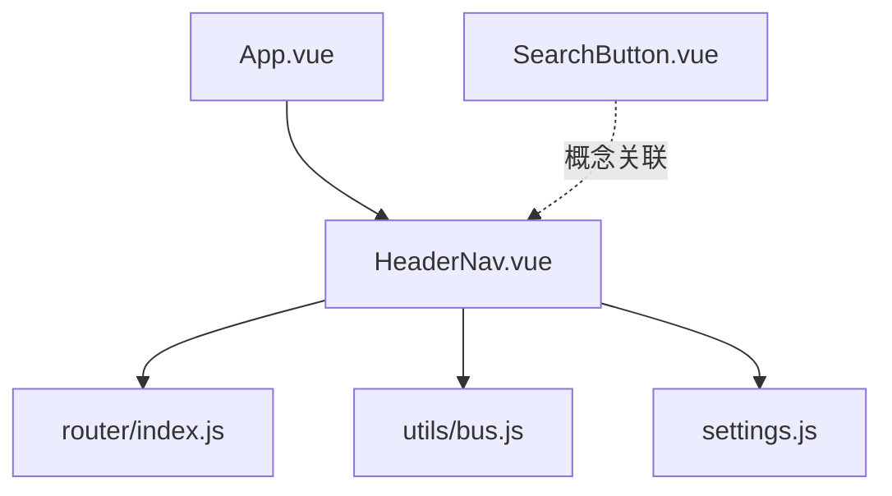
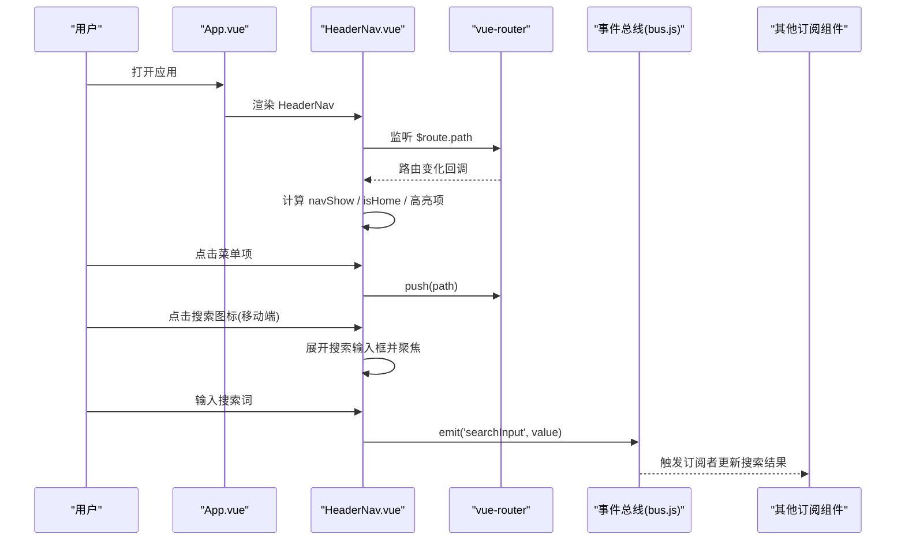
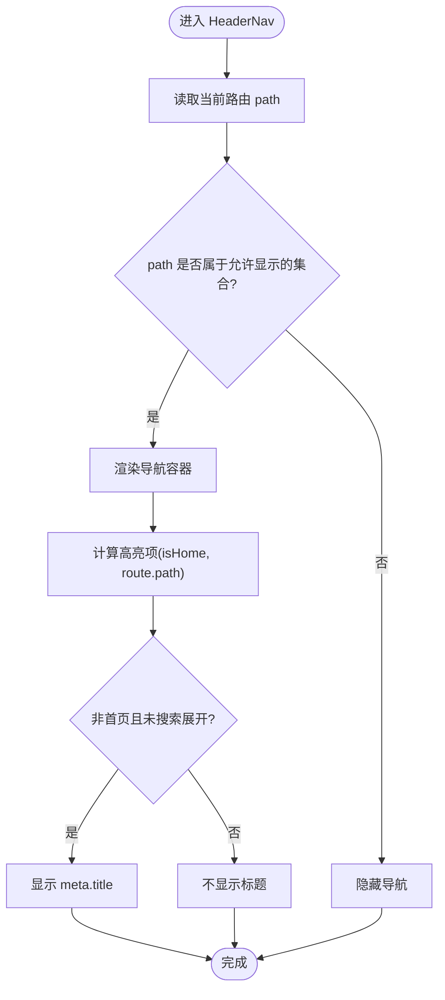
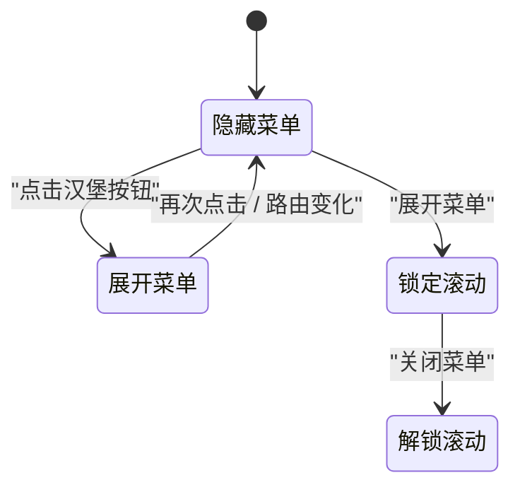
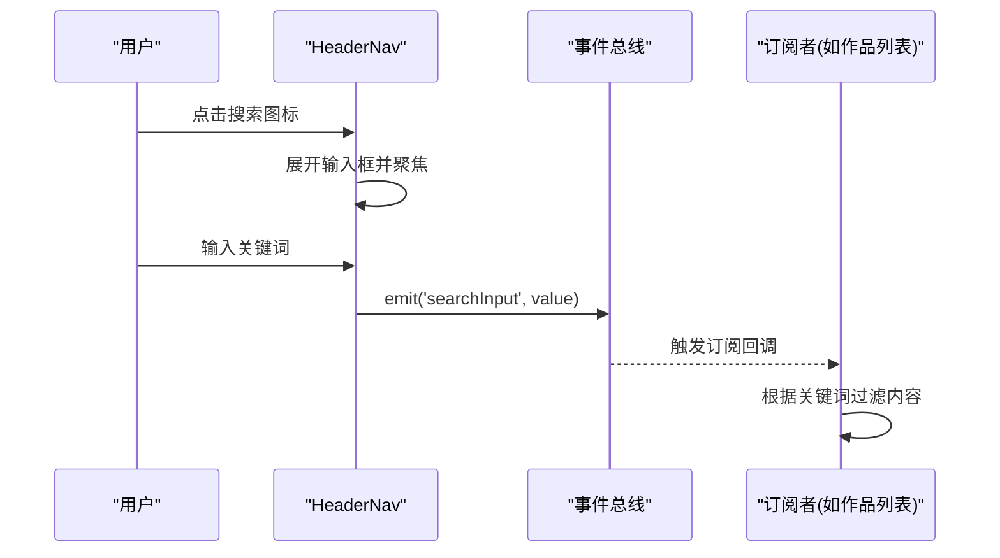
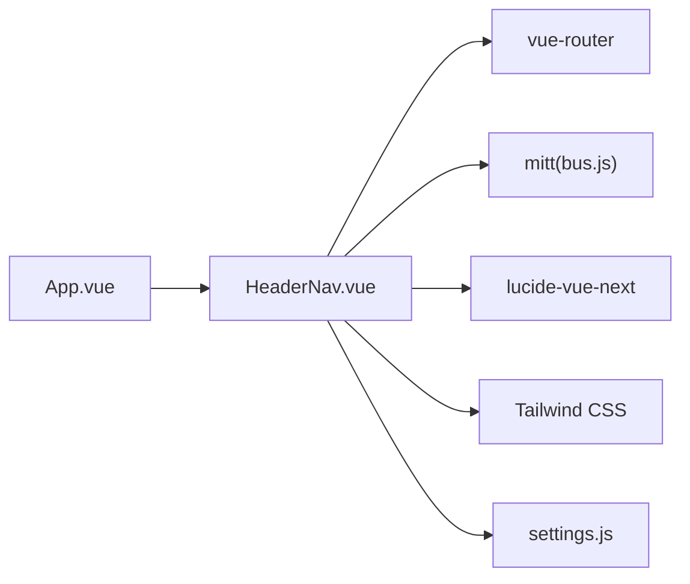

# HeaderNav 导航组件

<cite>
**本文引用的文件**   
- [HeaderNav.vue](file://src/components/HeaderNav.vue)
- [App.vue](file://src/App.vue)
- [index.js](file://src/router/index.js)
- [bus.js](file://src/utils/bus.js)
- [SearchButton.vue](file://src/components/SearchButton.vue)
- [settings.js](file://src/settings.js)
</cite>

## 目录
1. [简介](#简介)
2. [项目结构](#项目结构)
3. [核心组件与职责](#核心组件与职责)
4. [架构总览](#架构总览)
5. [详细组件分析](#详细组件分析)
6. [依赖关系分析](#依赖关系分析)
7. [性能与可访问性](#性能与可访问性)
8. [故障排查](#故障排查)
9. [结论](#结论)
10. [附录：使用示例与扩展指南](#附录使用示例与扩展指南)

## 简介
HeaderNav 是站点全局顶部导航组件，负责：
- 根据当前路由动态显示/隐藏导航栏
- 提供桌面端与移动端两套导航交互
- 管理当前页面高亮状态
- 在移动端集成搜索输入框并通过事件总线向外广播搜索关键词
- 通过配置项注入邮箱、GitHub 等外部链接信息

该组件与 Vue Router 深度集成，并与 App.vue 的 keep-alive 缓存策略配合，确保导航在不同页面切换时的体验一致性。

## 项目结构
HeaderNav 位于 components 目录，作为全局布局的一部分被 App.vue 引入并渲染在所有视图之上。路由定义在 router/index.js，设置项集中在 settings.js，跨组件通信通过 utils/bus.js 的事件总线完成。

图表来源
- [App.vue:1-28](file://src/App.vue#L1-L28)
- [HeaderNav.vue:1-235](file://src/components/HeaderNav.vue#L1-L235)
- [index.js:1-73](file://src/router/index.js#L1-L73)
- [bus.js:1-15](file://src/utils/bus.js#L1-L15)
- [settings.js:1-288](file://src/settings.js#L1-L288)

章节来源
- [App.vue:1-28](file://src/App.vue#L1-L28)
- [HeaderNav.vue:1-235](file://src/components/HeaderNav.vue#L1-L235)
- [index.js:1-73](file://src/router/index.js#L1-L73)
- [bus.js:1-15](file://src/utils/bus.js#L1-L15)
- [settings.js:1-288](file://src/settings.js#L1-L288)

## 核心组件与职责
- HeaderNav.vue
  - 控制导航可见性（仅在首页和指定导航路径下显示）
  - 维护移动端菜单展开状态与滚动锁定
  - 处理移动端搜索输入框的显隐与聚焦
  - 根据当前路由计算高亮项
  - 调用路由进行页面跳转
  - 通过事件总线发出搜索关键词
- App.vue
  - 全局挂载 HeaderNav
  - 基于路由 meta.keepAlive 启用 keep-alive 缓存
- router/index.js
  - 定义站点路由与元信息（title、keepAlive、requiresAdmin 等）
- bus.js
  - 封装 mitt 事件总线，提供 emitBus/onBus
- SearchButton.vue
  - 非移动端的悬浮跟随鼠标搜索按钮（与 HeaderNav 的移动端搜索为互补方案）
- settings.js
  - 提供用户名、邮箱、GitHub 等站点级配置，HeaderNav 用于展示联系信息与外链

章节来源
- [HeaderNav.vue:1-235](file://src/components/HeaderNav.vue#L1-L235)
- [App.vue:1-28](file://src/App.vue#L1-L28)
- [index.js:1-73](file://src/router/index.js#L1-L73)
- [bus.js:1-15](file://src/utils/bus.js#L1-L15)
- [SearchButton.vue:1-124](file://src/components/SearchButton.vue#L1-L124)
- [settings.js:1-288](file://src/settings.js#L1-L288)

## 架构总览
HeaderNav 作为顶层 UI 组件，依赖路由系统决定自身可见性与高亮状态；通过事件总线将搜索行为解耦到任意订阅者；样式层采用 Tailwind CSS 实现响应式布局；移动端交互包含遮罩渐变、滚动锁定与汉堡菜单动画。

图表来源
- [HeaderNav.vue:34-66](file://src/components/HeaderNav.vue#L34-L66)
- [HeaderNav.vue:119-128](file://src/components/HeaderNav.vue#L119-L128)
- [bus.js:1-15](file://src/utils/bus.js#L1-L15)
- [index.js:1-73](file://src/router/index.js#L1-L73)

## 详细组件分析

### 导航可见性与路由集成
- 导航显示条件
  - 仅当当前路由为首页或内置导航项路径时显示
  - 通过计算属性判断当前路径是否在允许显示的集合中
- 路由高亮
  - 桌面端与移动端均根据 $route.path === item.path 判定高亮
  - 非首页时默认降低非高亮项透明度以突出当前页
- 标题展示
  - 非首页且未处于搜索展开态时，显示当前路由 meta.title

图表来源
- [HeaderNav.vue:34-62](file://src/components/HeaderNav.vue#L34-L62)
- [index.js:6-47](file://src/router/index.js#L6-L47)

章节来源
- [HeaderNav.vue:34-62](file://src/components/HeaderNav.vue#L34-L62)
- [index.js:6-47](file://src/router/index.js#L6-L47)

### 响应式布局与移动端适配
- 断点与显示策略
  - 小屏（< sm）：隐藏桌面菜单，显示汉堡按钮与移动端搜索入口
  - 大屏（>= sm）：显示桌面菜单，隐藏移动端专属元素
- 移动端菜单
  - 点击汉堡按钮切换全屏覆盖菜单
  - 打开菜单时锁定 body 滚动，关闭时恢复
  - 路由变化自动关闭菜单并恢复滚动
- 视觉过渡
  - 非首页且未展开移动端菜单时，头部背景带渐变遮罩
  - 移动端搜索输入框支持宽度与内边距过渡动画

图表来源
- [HeaderNav.vue:40-58](file://src/components/HeaderNav.vue#L40-L58)
- [HeaderNav.vue:164-219](file://src/components/HeaderNav.vue#L164-L219)

章节来源
- [HeaderNav.vue:40-58](file://src/components/HeaderNav.vue#L40-L58)
- [HeaderNav.vue:164-219](file://src/components/HeaderNav.vue#L164-L219)

### 搜索功能集成
- 移动端搜索
  - 点击搜索图标展开输入框，延迟聚焦以提升体验
  - 输入值实时通过事件总线发出 searchInput 事件
  - 失焦时若值为空则收起输入框
- 事件总线
  - 使用 mitt 封装的 bus.js 提供 emitBus/onBus
  - 任何组件均可订阅 searchInput 事件以执行过滤逻辑
- 与 SearchButton 的关系
  - SearchButton 为非移动端的悬浮搜索控件，与 HeaderNav 的移动端搜索形成互补
  - 两者均通过事件机制向外暴露搜索输入，便于统一接入业务逻辑

图表来源
- [HeaderNav.vue:20-33](file://src/components/HeaderNav.vue#L20-L33)
- [HeaderNav.vue:119-128](file://src/components/HeaderNav.vue#L119-L128)
- [bus.js:1-15](file://src/utils/bus.js#L1-L15)

章节来源
- [HeaderNav.vue:20-33](file://src/components/HeaderNav.vue#L20-L33)
- [HeaderNav.vue:119-128](file://src/components/HeaderNav.vue#L119-L128)
- [bus.js:1-15](file://src/utils/bus.js#L1-L15)
- [SearchButton.vue:1-124](file://src/components/SearchButton.vue#L1-L124)

### 与其他组件的通信方式
- 与路由
  - 使用 useRouter/useRoute 获取实例，监听路由变化，驱动导航状态与高亮
- 与事件总线
  - 通过 emitBus 发布搜索关键词，供任意组件订阅
- 与配置中心
  - 从 settings.js 读取 email、github 等站点信息，用于移动端底部联系区与外链

章节来源
- [HeaderNav.vue:34-66](file://src/components/HeaderNav.vue#L34-L66)
- [HeaderNav.vue:187-218](file://src/components/HeaderNav.vue#L187-L218)
- [settings.js:1-288](file://src/settings.js#L1-L288)

### 当前页面高亮状态管理
- 高亮规则
  - 桌面端与移动端均依据 $route.path === item.path 判定高亮
  - 非首页时，非高亮项默认半透明，高亮项保持完全不透明
- 首页特殊处理
  - 首页时汉堡按钮颜色与背景对比度随主题调整
  - 非首页时显示当前页面标题，增强上下文感知

章节来源
- [HeaderNav.vue:59-62](file://src/components/HeaderNav.vue#L59-L62)
- [HeaderNav.vue:143-161](file://src/components/HeaderNav.vue#L143-L161)
- [HeaderNav.vue:164-186](file://src/components/HeaderNav.vue#L164-L186)

## 依赖关系分析
- 内部依赖
  - vue-router：路由实例与钩子
  - mitt：事件总线
  - lucide-vue-next：图标资源
  - Tailwind CSS：响应式与原子化样式
- 外部依赖
  - settings.js：站点配置
  - App.vue：全局挂载与 keep-alive 缓存

图表来源
- [HeaderNav.vue:1-10](file://src/components/HeaderNav.vue#L1-L10)
- [bus.js:1-15](file://src/utils/bus.js#L1-L15)
- [App.vue:1-28](file://src/App.vue#L1-L28)
- [settings.js:1-288](file://src/settings.js#L1-L288)

章节来源
- [HeaderNav.vue:1-10](file://src/components/HeaderNav.vue#L1-L10)
- [bus.js:1-15](file://src/utils/bus.js#L1-L15)
- [App.vue:1-28](file://src/App.vue#L1-L28)
- [settings.js:1-288](file://src/settings.js#L1-L288)

## 性能与可访问性
- 性能
  - 导航项为静态数组，无额外请求开销
  - 移动端菜单切换通过布尔状态控制，避免频繁 DOM 操作
  - 滚动锁只在菜单展开时生效，减少不必要的重排
- 可访问性
  - 建议为汉堡按钮添加 aria-label 与键盘焦点管理
  - 搜索输入框应保留 placeholder 与语义化标签
  - 对外链 a 标签增加 rel="noopener noreferrer" 提升安全性

[本节为通用指导，不直接分析具体文件]

## 故障排查
- 导航不显示
  - 检查当前路由是否为首页或内置导航路径
  - 确认路由定义是否存在且 name/path 正确
- 移动端菜单无法关闭
  - 检查路由变化监听是否生效
  - 确认 body 滚动样式未被其他组件覆盖
- 搜索输入框不聚焦
  - 检查移动端搜索图标点击逻辑是否触发
  - 确认 setTimeout 延迟后 ref 已挂载
- 搜索事件未触发
  - 确认 emitBus 是否正确调用
  - 检查订阅方是否使用 onBus 订阅了 searchInput 事件

章节来源
- [HeaderNav.vue:37-49](file://src/components/HeaderNav.vue#L37-L49)
- [HeaderNav.vue:119-128](file://src/components/HeaderNav.vue#L119-L128)
- [bus.js:1-15](file://src/utils/bus.js#L1-L15)

## 结论
HeaderNav 是一个轻量、可组合的全局导航组件，具备以下特点：
- 基于路由的可见性与高亮控制，保证导航状态与页面一致
- 完善的移动端适配，包括菜单切换、滚动锁定与搜索输入
- 通过事件总线解耦搜索行为，便于多组件协作
- 与 App.vue 的 keep-alive 缓存策略协同，提升页面切换体验

在实际项目中，可通过扩展内置导航数组、接入更丰富的搜索逻辑与样式定制来满足多样化需求。

[本节为总结性内容，不直接分析具体文件]

## 附录：使用示例与扩展指南

### 在 App.vue 中全局挂载
- 在根组件中引入并渲染 HeaderNav，使其作用于所有页面
- 结合 keep-alive 对需要缓存的路由进行缓存，提升用户体验

章节来源
- [App.vue:1-28](file://src/App.vue#L1-L28)

### 在路由中配置标题与缓存
- 为需要缓存的页面设置 meta.keepAlive
- 为每个路由设置 meta.title，以便在非首页时显示当前页面标题

章节来源
- [index.js:6-47](file://src/router/index.js#L6-L47)

### 订阅搜索事件
- 在任意组件中使用 onBus 订阅 searchInput 事件
- 根据传入的关键词执行本地过滤或远程查询

章节来源
- [bus.js:1-15](file://src/utils/bus.js#L1-L15)
- [HeaderNav.vue:119-128](file://src/components/HeaderNav.vue#L119-L128)

### 样式定制与扩展
- 导航项
  - 可在 HeaderNav 的内置导航数组中添加新项，支持 dot 标记小红点
- 主题色与字体
  - 通过 Tailwind 类名与自定义 SCSS 调整颜色、字号与字族
- 移动端菜单
  - 可调整覆盖层背景、间距与底部联系区布局
- 搜索交互
  - 可替换为 SearchButton 的非移动端悬浮搜索方案，或在 HeaderNav 中扩展更多搜索能力

章节来源
- [HeaderNav.vue:9-19](file://src/components/HeaderNav.vue#L9-L19)
- [HeaderNav.vue:143-161](file://src/components/HeaderNav.vue#L143-L161)
- [HeaderNav.vue:164-219](file://src/components/HeaderNav.vue#L164-L219)
- [SearchButton.vue:1-124](file://src/components/SearchButton.vue#L1-L124)