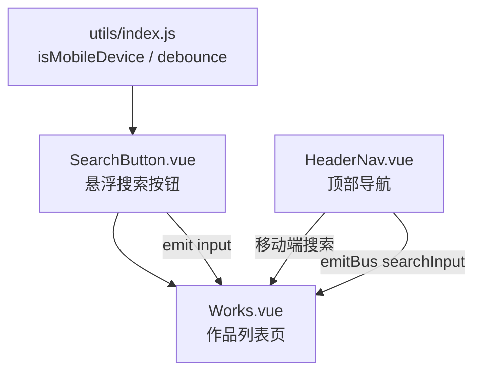
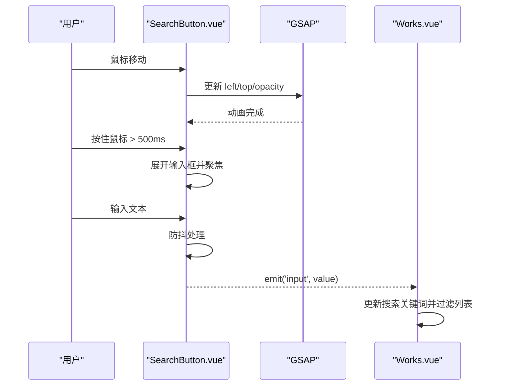
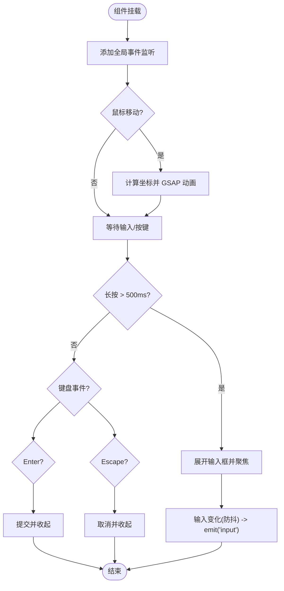
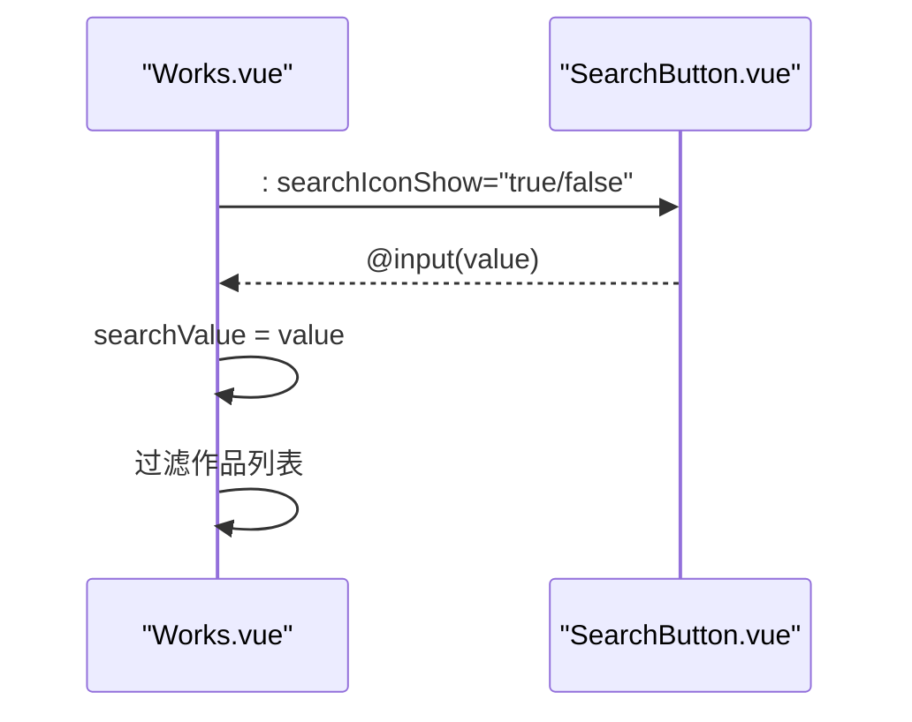
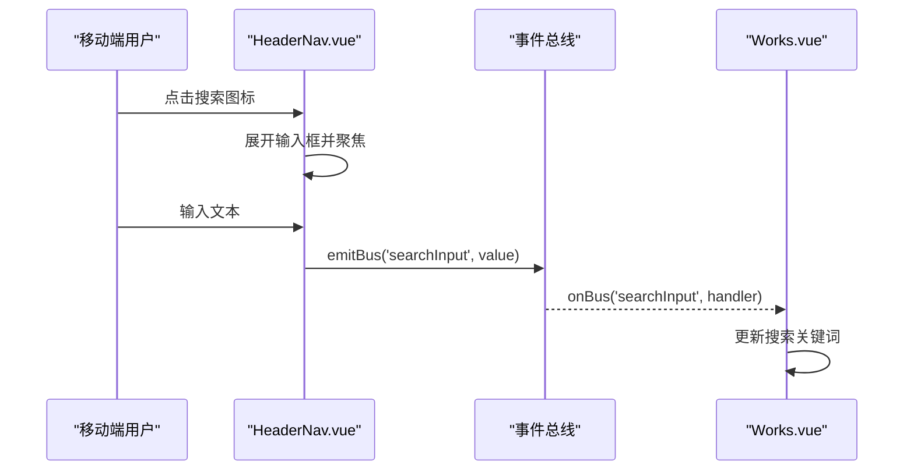
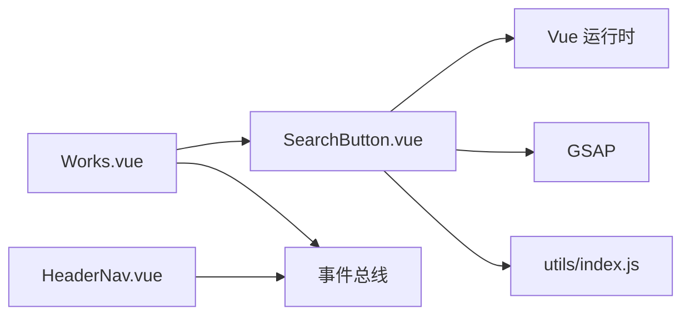

# SearchButton 搜索按钮组件

<cite>
**本文引用的文件**   
- [SearchButton.vue](file://src/components/SearchButton.vue)
- [Works.vue](file://src/views/Works.vue)
- [HeaderNav.vue](file://src/components/HeaderNav.vue)
- [index.js](file://src/utils/index.js)
</cite>

## 目录
1. [简介](#简介)
2. [项目结构](#项目结构)
3. [核心组件与职责](#核心组件与职责)
4. [架构总览](#架构总览)
5. [详细组件分析](#详细组件分析)
6. [依赖关系分析](#依赖关系分析)
7. [性能与动画特性](#性能与动画特性)
8. [使用示例与集成方式](#使用示例与集成方式)
9. [移动端与桌面端差异](#移动端与桌面端差异)
10. [样式定制指南](#样式定制指南)
11. [故障排查](#故障排查)
12. [结论](#结论)

## 简介
SearchButton 是一个悬浮跟随鼠标的搜索按钮组件，主要用于在桌面端提供“随鼠标移动”的交互体验。它通过监听鼠标移动、按下、抬起和键盘事件，驱动一个可展开的输入框，并在用户输入时触发父级搜索逻辑。该组件内置防抖处理，结合 GSAP 实现平滑的跟随动画，同时根据设备类型自动切换展示策略：在移动端不显示自定义悬浮按钮，由导航栏提供基础搜索能力。

## 项目结构
SearchButton 位于组件目录中，被作品列表页面引入并作为全局搜索入口之一；导航栏也包含一套独立的搜索输入，用于移动端或特定场景下的搜索。工具函数库提供设备检测与防抖等通用能力。

**图表来源**
- [SearchButton.vue:1-124](file://src/components/SearchButton.vue#L1-L124)
- [Works.vue:1-394](file://src/views/Works.vue#L1-L394)
- [HeaderNav.vue:1-235](file://src/components/HeaderNav.vue#L1-L235)
- [index.js:1-70](file://src/utils/index.js#L1-L70)

**章节来源**
- [SearchButton.vue:1-124](file://src/components/SearchButton.vue#L1-L124)
- [Works.vue:1-394](file://src/views/Works.vue#L1-L394)
- [HeaderNav.vue:1-235](file://src/components/HeaderNav.vue#L1-L235)
- [index.js:1-70](file://src/utils/index.js#L1-L70)

## 核心组件与职责
- SearchButton 组件
  - 负责悬浮按钮的渲染、跟随动画、输入框展开收起、键盘交互（回车/Esc）以及向父组件派发搜索值。
  - 在非移动端设备上启用自定义光标隐藏与跟随行为。
- Works 页面
  - 引入 SearchButton，接收其 input 事件，更新本地搜索关键词，过滤作品列表。
  - 控制 SearchButton 的图标显隐状态，配合悬停交互优化视觉体验。
- HeaderNav 组件
  - 提供移动端的基础搜索输入，通过事件总线将搜索词广播给需要订阅的页面。
- utils/index.js
  - 提供 isMobileDevice 设备检测与 debounce 防抖工具，被 SearchButton 使用。

**章节来源**
- [SearchButton.vue:1-124](file://src/components/SearchButton.vue#L1-L124)
- [Works.vue:1-394](file://src/views/Works.vue#L1-L394)
- [HeaderNav.vue:1-235](file://src/components/HeaderNav.vue#L1-L235)
- [index.js:1-70](file://src/utils/index.js#L1-L70)

## 架构总览
SearchButton 以“事件驱动 + 动画驱动”的方式工作：
- 鼠标移动驱动位置更新（GSAP）。
- 长按触发输入框展开。
- 输入变化经防抖后向上抛出。
- 父组件接收并执行搜索过滤。

**图表来源**
- [SearchButton.vue:29-88](file://src/components/SearchButton.vue#L29-L88)
- [Works.vue:115-117](file://src/views/Works.vue#L115-L117)

## 详细组件分析

### SearchButton 组件
- 属性定义
  - searchIconShow: Boolean，默认 true，控制是否显示搜索图标与输入框。
- 内部状态
  - searchBtnRef: 按钮容器 DOM 引用。
  - searchInputShow: 控制输入框展开/收起。
  - searchInputRef: 输入框 DOM 引用。
  - searchInputValue: 当前输入值。
- 生命周期与事件绑定
  - onMounted/onActivated 添加监听；onUnmounted/onDeactivated 移除监听。
  - 非移动端下监听 mousemove/mousedown/mouseup/keydown。
- 交互逻辑
  - 鼠标移动：计算相对坐标，使用 GSAP 平滑移动到目标位置。
  - 鼠标按下：延迟 500ms 后展开输入框并聚焦。
  - 键盘回车：提交搜索值并收起输入框。
  - 键盘 Esc：取消搜索并收起输入框。
  - 输入变化：防抖后向上派发 input 事件。
- 样式与可见性
  - 非移动端才渲染悬浮按钮。
  - 根据 searchIconShow 与 searchInputShow 动态调整内边距、背景色与混合模式。
  - 初始 opacity 为 0，跟随鼠标时提升透明度。

**图表来源**
- [SearchButton.vue:29-88](file://src/components/SearchButton.vue#L29-L88)

**章节来源**
- [SearchButton.vue:1-124](file://src/components/SearchButton.vue#L1-L124)

### Works 页面中的集成
- 引入 SearchButton 并通过 ref 获取实例，传递 searchIconShow 控制图标显隐。
- 监听 SearchButton 的 input 事件，更新 searchValue，进而过滤作品列表。
- 在作品项 hover 时隐藏搜索图标，离开时恢复，避免遮挡内容。

**图表来源**
- [Works.vue:264-269](file://src/views/Works.vue#L264-L269)
- [Works.vue:115-117](file://src/views/Works.vue#L115-L117)

**章节来源**
- [Works.vue:1-394](file://src/views/Works.vue#L1-L394)

### 导航栏搜索（移动端）
- HeaderNav 提供移动端搜索输入，点击图标展开输入框，失焦时若为空则收起。
- 通过事件总线 emitBus('searchInput', value) 广播搜索词，供其他页面订阅。

**图表来源**
- [HeaderNav.vue:20-33](file://src/components/HeaderNav.vue#L20-L33)
- [HeaderNav.vue:109-128](file://src/components/HeaderNav.vue#L109-L128)
- [Works.vue:47-50](file://src/views/Works.vue#L47-L50)

**章节来源**
- [HeaderNav.vue:1-235](file://src/components/HeaderNav.vue#L1-L235)
- [Works.vue:1-394](file://src/views/Works.vue#L1-L394)

## 依赖关系分析
- SearchButton 依赖
  - Vue 响应式 API：ref、onMounted、onUnmounted、onDeactivated、onActivated。
  - GSAP：用于跟随动画。
  - utils/index.js：isMobileDevice 与 debounce。
- Works 页面依赖
  - SearchButton 组件。
  - 事件总线（用于导航栏搜索）。
  - GSAP ScrollTrigger（用于滚动动画，与搜索无直接耦合）。
- HeaderNav 依赖
  - 事件总线（用于移动端搜索广播）。

**图表来源**
- [SearchButton.vue:1-10](file://src/components/SearchButton.vue#L1-L10)
- [Works.vue:1-15](file://src/views/Works.vue#L1-L15)
- [HeaderNav.vue:1-5](file://src/components/HeaderNav.vue#L1-L5)
- [index.js:1-37](file://src/utils/index.js#L1-L37)

**章节来源**
- [SearchButton.vue:1-124](file://src/components/SearchButton.vue#L1-L124)
- [Works.vue:1-394](file://src/views/Works.vue#L1-L394)
- [HeaderNav.vue:1-235](file://src/components/HeaderNav.vue#L1-L235)
- [index.js:1-70](file://src/utils/index.js#L1-L70)

## 性能与动画特性
- 动画
  - 使用 GSAP 对按钮容器的 left、top、opacity 进行平滑过渡，ease 为 back(0.1)，duration 0.3s，带来轻微回弹效果。
- 防抖
  - 输入变化通过 debounce 包裹，减少频繁的事件派发，降低父组件过滤开销。
- 事件监听
  - 在组件挂载与激活时添加监听，卸载与失活时移除，避免内存泄漏。
- 设备判断
  - 仅在非移动端启用自定义光标与跟随逻辑，保证移动端性能与体验。

**章节来源**
- [SearchButton.vue:29-88](file://src/components/SearchButton.vue#L29-L88)
- [index.js:25-37](file://src/utils/index.js#L25-L37)

## 使用示例与集成方式
- 在页面中引入并注册 SearchButton。
- 通过 :searchIconShow 控制图标显隐，配合 hover 交互优化视觉。
- 监听 @input 事件，将搜索词应用到业务逻辑（如过滤列表）。

参考路径
- 引入与绑定：[Works.vue:14](file://src/views/Works.vue#L14)、[Works.vue:264-269](file://src/views/Works.vue#L264-L269)
- 搜索回调处理：[Works.vue:115-117](file://src/views/Works.vue#L115-L117)

**章节来源**
- [Works.vue:1-394](file://src/views/Works.vue#L1-L394)

## 移动端与桌面端差异
- 桌面端
  - 显示悬浮搜索按钮，跟随鼠标移动，长按展开输入框。
  - 隐藏系统默认光标，增强沉浸感。
- 移动端
  - 不显示悬浮按钮，改用导航栏内的搜索输入框。
  - 通过事件总线广播搜索词，页面订阅后执行过滤。

**章节来源**
- [SearchButton.vue:29-40](file://src/components/SearchButton.vue#L29-L40)
- [HeaderNav.vue:109-128](file://src/components/HeaderNav.vue#L109-L128)
- [Works.vue:47-50](file://src/views/Works.vue#L47-L50)

## 样式定制指南
- 容器外观
  - 通过 Tailwind 类名控制圆角、尺寸、定位与层级：flex、fixed、rounded-full、z-50、min-w/min-h。
  - 根据 searchInputShow 与 searchIconShow 动态切换内边距与背景色。
- 图标与输入框
  - 搜索图标为内联 SVG，颜色可通过 fill 属性调整。
  - 输入框透明背景，宽度随展开状态变化。
- 混合模式与缩放
  - 当 searchIconShow 为 false 时，容器采用红色背景与 mix-blend-difference，形成反色效果。
  - 可按需调整 scale 与 transform-origin 以实现不同动效。

参考路径
- 容器与条件样式：[SearchButton.vue:92-99](file://src/components/SearchButton.vue#L92-L99)
- 图标 SVG：[SearchButton.vue:101-111](file://src/components/SearchButton.vue#L101-L111)
- 输入框样式：[SearchButton.vue:112-120](file://src/components/SearchButton.vue#L112-L120)

**章节来源**
- [SearchButton.vue:92-120](file://src/components/SearchButton.vue#L92-L120)

## 故障排查
- 搜索无效
  - 检查父组件是否正确监听 @input 并更新搜索关键词。
  - 确认防抖时间是否过长导致感知延迟。
- 动画卡顿
  - 确认 GSAP 已正确引入且未与其他动画冲突。
  - 检查是否在大量元素上同时触发动画。
- 事件未触发
  - 确认组件处于活跃状态（onActivated 已执行），事件监听已添加。
  - 检查是否在移动端误用桌面端逻辑。
- 光标异常
  - 确认非移动端条件下才设置 document.body.style.cursor = 'none'，并在卸载时恢复。

**章节来源**
- [SearchButton.vue:16-47](file://src/components/SearchButton.vue#L16-L47)
- [Works.vue:115-117](file://src/views/Works.vue#L115-L117)

## 结论
SearchButton 组件以简洁的属性与清晰的交互流程，提供了桌面端沉浸式的悬浮搜索体验。它与 Works 页面的搜索逻辑无缝集成，并通过工具函数与 GSAP 保证了良好的性能与动效。在移动端，导航栏搜索作为补充方案，确保全平台一致的搜索能力。开发者可根据业务需求灵活定制样式与行为，并与其它搜索相关组件协作，构建统一的搜索体验。