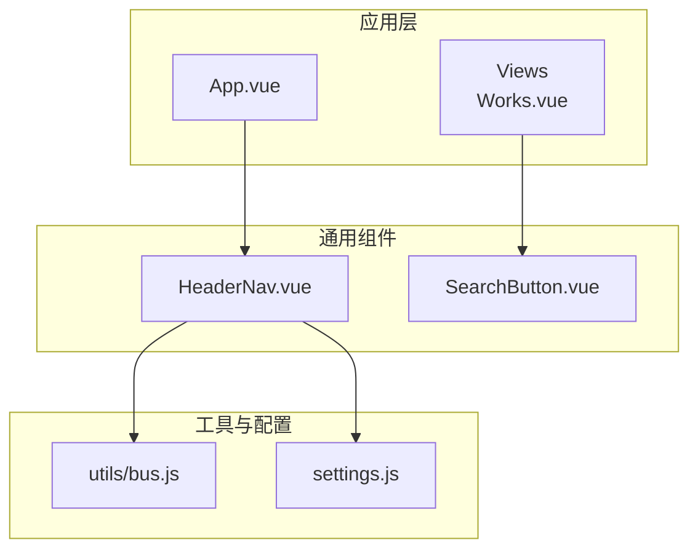
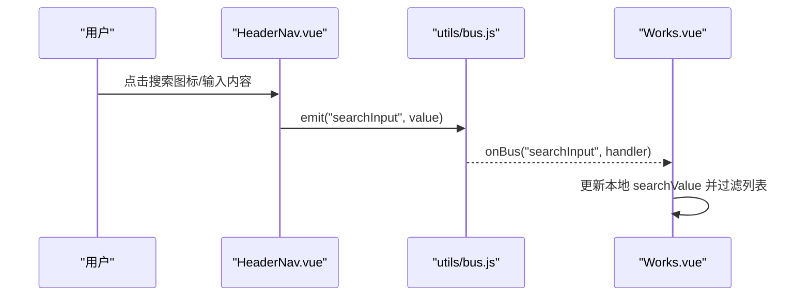
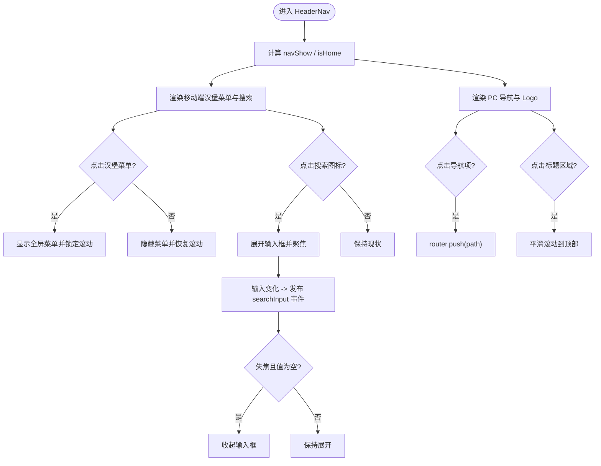
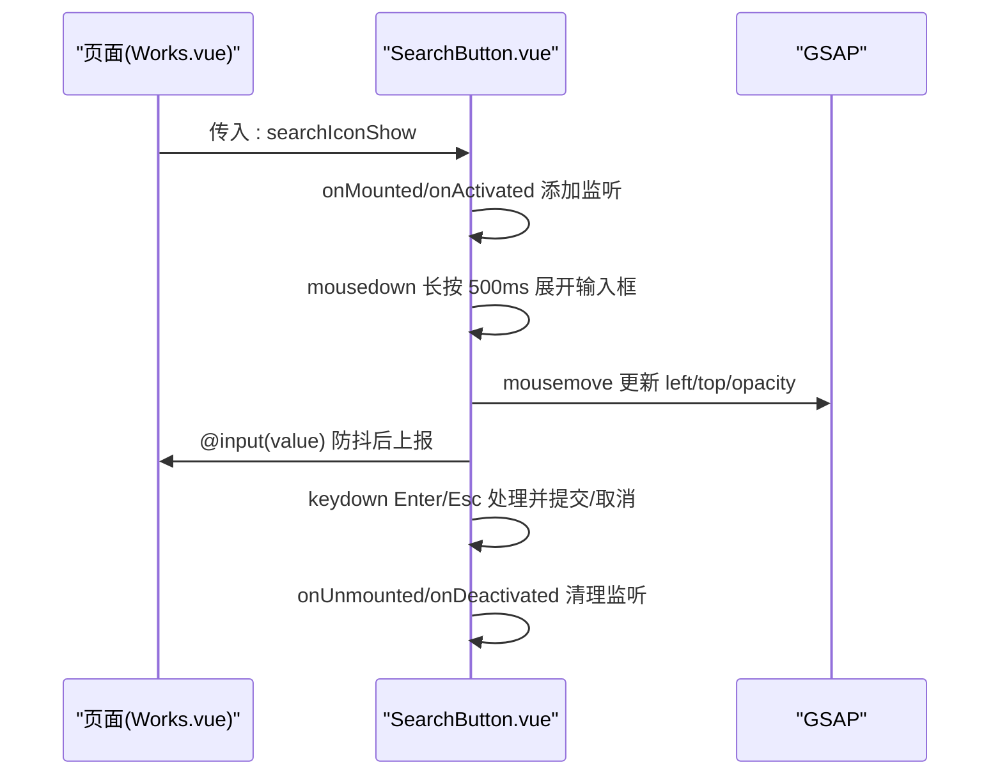
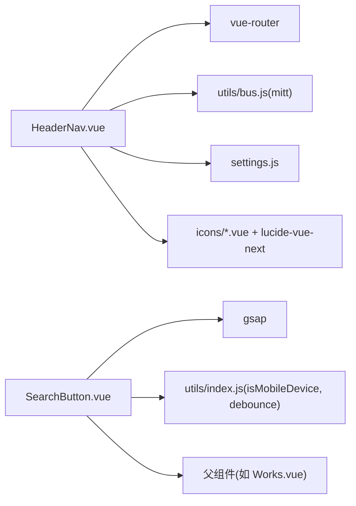

# 通用组件库

<cite>
**本文引用的文件**   
- [HeaderNav.vue](file://src/components/HeaderNav.vue)
- [SearchButton.vue](file://src/components/SearchButton.vue)
- [App.vue](file://src/App.vue)
- [Works.vue](file://src/views/Works.vue)
- [bus.js](file://src/utils/bus.js)
- [settings.js](file://src/settings.js)
</cite>

## 目录
1. [简介](#简介)
2. [项目结构](#项目结构)
3. [核心组件总览](#核心组件总览)
4. [架构总览](#架构总览)
5. [组件详解](#组件详解)
6. [依赖关系分析](#依赖关系分析)
7. [性能与可访问性](#性能与可访问性)
8. [常见问题排查](#常见问题排查)
9. [结论](#结论)
10. [附录：API 速查](#附录api-速查)

## 简介
本文件面向开发者，系统化梳理通用组件库中的两个关键组件：HeaderNav 导航组件与 SearchButton 搜索组件。文档从设计目标、属性接口、事件机制、插槽扩展、样式定制、响应式适配、移动端方案以及与其他模块的集成方式展开，并辅以架构图、流程图和时序图，帮助读者快速理解并在项目中复用这两个组件。

## 项目结构
- HeaderNav 位于 src/components/HeaderNav.vue，负责全局顶部导航、移动端菜单、内置搜索输入与页面滚动回顶等能力。
- SearchButton 位于 src/components/SearchButton.vue，提供悬浮跟随鼠标的搜索入口，支持键盘交互与动画效果。
- App.vue 作为应用根容器，挂载 HeaderNav 并管理路由缓存。
- Works.vue 是作品列表页，集成 SearchButton 实现全局搜索过滤。
- bus.js 提供轻量级事件总线（mitt），用于跨组件通信。
- settings.js 提供站点配置（用户名、邮箱、GitHub 链接等），被 HeaderNav 使用。

图表来源
- [App.vue:1-23](file://src/App.vue#L1-L23)
- [Works.vue:14-15](file://src/views/Works.vue#L14-L15)
- [HeaderNav.vue:1-10](file://src/components/HeaderNav.vue#L1-L10)
- [SearchButton.vue:1-7](file://src/components/SearchButton.vue#L1-L7)
- [bus.js:1-15](file://src/utils/bus.js#L1-L15)
- [settings.js:1-36](file://src/settings.js#L1-L36)

章节来源
- [App.vue:1-23](file://src/App.vue#L1-L23)
- [Works.vue:1-30](file://src/views/Works.vue#L1-L30)
- [HeaderNav.vue:1-20](file://src/components/HeaderNav.vue#L1-L20)
- [SearchButton.vue:1-15](file://src/components/SearchButton.vue#L1-L15)
- [bus.js:1-15](file://src/utils/bus.js#L1-L15)
- [settings.js:1-36](file://src/settings.js#L1-L36)

## 核心组件总览
- HeaderNav
  - 职责：全局导航、移动端菜单、内置搜索输入、回到顶部、外链与版权信息展示。
  - 特性：根据当前路由控制显示；响应式布局；通过事件总线向外广播搜索输入；平滑滚动回顶。
- SearchButton
  - 职责：悬浮跟随鼠标的搜索按钮，非移动端下提供自定义光标体验与动画。
  - 特性：鼠标移动跟随、长按展开输入框、键盘 Enter/Esc 快捷操作、防抖输入事件、可隐藏图标仅保留背景色。

章节来源
- [HeaderNav.vue:1-73](file://src/components/HeaderNav.vue#L1-L73)
- [SearchButton.vue:1-89](file://src/components/SearchButton.vue#L1-L89)

## 架构总览
HeaderNav 与 SearchButton 在应用中分别承担“导航+全局搜索入口”和“悬浮搜索交互”的职责，二者通过不同的通信方式与业务页面协作：
- HeaderNav 通过 mitt 事件总线向任意订阅者发送搜索输入值。
- SearchButton 通过 Vue 的 props/emits 将搜索输入值传递给父组件（如 Works.vue）。

图表来源
- [HeaderNav.vue:119-128](file://src/components/HeaderNav.vue#L119-L128)
- [bus.js:1-15](file://src/utils/bus.js#L1-L15)
- [Works.vue:47-50](file://src/views/Works.vue#L47-L50)
- [Works.vue:115-117](file://src/views/Works.vue#L115-L117)

## 组件详解

### HeaderNav 导航组件
- 设计要点
  - 导航项由内部数组定义，包含名称、路径与是否显示红点标记。
  - 根据当前路由决定导航栏是否显示，首页与非首页采用不同视觉样式。
  - 移动端提供汉堡菜单，切换时锁定/解锁 body 滚动。
  - 内置搜索输入框，聚焦自动 focus，失焦且为空时收起。
  - 提供回到顶部功能，使用平滑滚动。
  - 通过事件总线发布搜索输入事件，供其他组件订阅。

- 属性与行为
  - 无对外 props（内部状态驱动）。
  - 对外事件：通过事件总线发出 searchInput 事件，携带输入值。
  - 导航跳转：调用路由 push。
  - 回到顶部：window.scrollTo({ behavior: 'smooth' })。

- 插槽与扩展
  - 未暴露具名插槽；如需扩展导航项或外部链接，建议通过 settings.js 或新增导航数组项进行扩展。

- 样式定制
  - 使用 Tailwind 类名与少量 SCSS 局部样式（如遮罩渐变、管理员链接样式）。
  - 可通过覆盖 .nav-mobile-mask 与 .admin-link 等类名调整外观。

- 响应式与移动端适配
  - 小屏隐藏 PC 导航，显示汉堡菜单与移动端全屏菜单。
  - 移动端搜索输入仅在特定路由可见，避免干扰。
  - 打开移动端菜单时禁用 body 滚动，关闭时恢复。

图表来源
- [HeaderNav.vue:34-72](file://src/components/HeaderNav.vue#L34-L72)
- [HeaderNav.vue:74-221](file://src/components/HeaderNav.vue#L74-L221)

章节来源
- [HeaderNav.vue:1-73](file://src/components/HeaderNav.vue#L1-L73)
- [HeaderNav.vue:74-221](file://src/components/HeaderNav.vue#L74-L221)
- [HeaderNav.vue:223-234](file://src/components/HeaderNav.vue#L223-L234)
- [bus.js:1-15](file://src/utils/bus.js#L1-L15)
- [settings.js:32-36](file://src/settings.js#L32-L36)

### SearchButton 搜索组件
- 设计要点
  - 非移动端设备下，提供一个悬浮跟随鼠标的圆形按钮，内部可展开输入框。
  - 监听 mousemove/mousedown/mouseup/keydown，实现跟随动画与键盘快捷键。
  - 长按触发展开输入框，输入变化通过防抖后向上抛出 input 事件。
  - 支持隐藏图标，仅保留背景色与混合模式效果。

- 属性与行为
  - props
    - searchIconShow: Boolean，默认 true，控制是否显示搜索图标。
  - emits
    - input: string，实时输入值（已防抖）。
    - search: 声明但未在当前实现中触发，可按需扩展。
  - 生命周期
    - onMounted/onActivated 添加事件监听；onUnmounted/onDeactivated 移除监听。
  - 键盘交互
    - Enter：提交输入并收起输入框。
    - Escape：取消输入并收起输入框。

- 插槽与扩展
  - 未暴露插槽；如需扩展图标或输入框样式，可在组件内修改模板或使用 CSS 覆盖。

- 样式定制
  - 使用 Tailwind 类名控制尺寸、圆角、定位与过渡。
  - 通过 searchIconShow 切换背景色与混合模式，便于与页面主题融合。

- 响应式与移动端适配
  - 在移动端不渲染该组件，避免触摸交互冲突。
  - 非移动端才启用自定义光标与跟随动画。

图表来源
- [SearchButton.vue:16-47](file://src/components/SearchButton.vue#L16-L47)
- [SearchButton.vue:48-88](file://src/components/SearchButton.vue#L48-L88)
- [SearchButton.vue:90-121](file://src/components/SearchButton.vue#L90-L121)

章节来源
- [SearchButton.vue:1-89](file://src/components/SearchButton.vue#L1-L89)
- [SearchButton.vue:90-121](file://src/components/SearchButton.vue#L90-L121)

## 依赖关系分析
- HeaderNav
  - 依赖 vue-router 进行导航跳转与路由判断。
  - 依赖 mitt 事件总线（通过 utils/bus.js）向外广播搜索输入。
  - 依赖 settings.js 获取邮箱、GitHub 等站点信息。
  - 依赖 lucide-vue-next 图标库与内部 icons 组件。
- SearchButton
  - 依赖 gsap 实现跟随动画。
  - 依赖 utils/index.js 的工具函数（isMobileDevice、debounce）。
  - 在 Works.vue 中以 props/emits 形式与父组件通信。

图表来源
- [HeaderNav.vue:1-10](file://src/components/HeaderNav.vue#L1-L10)
- [SearchButton.vue:1-7](file://src/components/SearchButton.vue#L1-L7)
- [bus.js:1-15](file://src/utils/bus.js#L1-L15)
- [settings.js:1-36](file://src/settings.js#L1-L36)

章节来源
- [HeaderNav.vue:1-10](file://src/components/HeaderNav.vue#L1-L10)
- [SearchButton.vue:1-7](file://src/components/SearchButton.vue#L1-L7)
- [bus.js:1-15](file://src/utils/bus.js#L1-L15)
- [settings.js:1-36](file://src/settings.js#L1-L36)

## 性能与可访问性
- HeaderNav
  - 导航项为静态数组，渲染开销低。
  - 移动端菜单切换时直接操作 body 滚动，避免额外重排。
  - 回到顶部使用原生 smooth 滚动，性能友好。
- SearchButton
  - 输入事件使用防抖，减少频繁事件处理。
  - 动画使用 GSAP，具备良好性能与可控性。
  - 在移动端不渲染，避免不必要的 DOM 与事件绑定。
- 可访问性
  - 建议在后续版本为搜索输入增加 aria-label 与焦点管理。
  - 键盘交互（Enter/Esc）已在 SearchButton 中实现，可进一步提示用户。

[本节为通用指导，不直接分析具体文件]

## 常见问题排查
- 搜索输入无响应
  - 检查 HeaderNav 是否正确 emit 了 searchInput 事件。
  - 检查订阅方是否正确注册 onBus('searchInput', handler)。
- 移动端菜单无法关闭
  - 确认点击汉堡菜单逻辑是否正确切换 navMobileShow 并恢复 body 滚动。
- 悬浮搜索按钮不出现
  - 确认当前设备是否为非移动端（isMobileDevice）。
  - 检查父组件是否传入了 searchIconShow=false。
- 动画卡顿
  - 检查是否在大量元素上同时创建 GSAP 动画，必要时分批或节流。
- 样式异常
  - 检查 Tailwind 类名是否被覆盖，必要时提高选择器优先级或使用 scoped 样式隔离。

章节来源
- [HeaderNav.vue:40-58](file://src/components/HeaderNav.vue#L40-L58)
- [SearchButton.vue:29-47](file://src/components/SearchButton.vue#L29-L47)
- [Works.vue:47-50](file://src/views/Works.vue#L47-L50)

## 结论
HeaderNav 与 SearchButton 共同构成了项目的导航与搜索基础能力。前者提供稳定的全局导航与内置搜索入口，并通过事件总线解耦通信；后者在非移动端提供流畅的悬浮搜索体验，并与父组件通过 props/emits 协作。两者均具备良好的响应式支持与可扩展性，适合在通用组件库中复用。

[本节为总结性内容，不直接分析具体文件]

## 附录：API 速查

- HeaderNav
  - 对外事件
    - 事件总线：emit('searchInput', value)
  - 主要方法
    - toPath(path): 路由跳转
    - toTop(): 平滑滚动到顶部
  - 样式钩子
    - .nav-mobile-mask
    - .admin-link

- SearchButton
  - Props
    - searchIconShow: Boolean（默认 true）
  - Events
    - input: string（防抖后的输入值）
    - search: 预留事件（未在当前实现中使用）
  - 键盘快捷键
    - Enter：提交输入
    - Escape：取消输入

章节来源
- [HeaderNav.vue:64-72](file://src/components/HeaderNav.vue#L64-L72)
- [HeaderNav.vue:119-128](file://src/components/HeaderNav.vue#L119-L128)
- [SearchButton.vue:7-10](file://src/components/SearchButton.vue#L7-L10)
- [SearchButton.vue:48-88](file://src/components/SearchButton.vue#L48-L88)