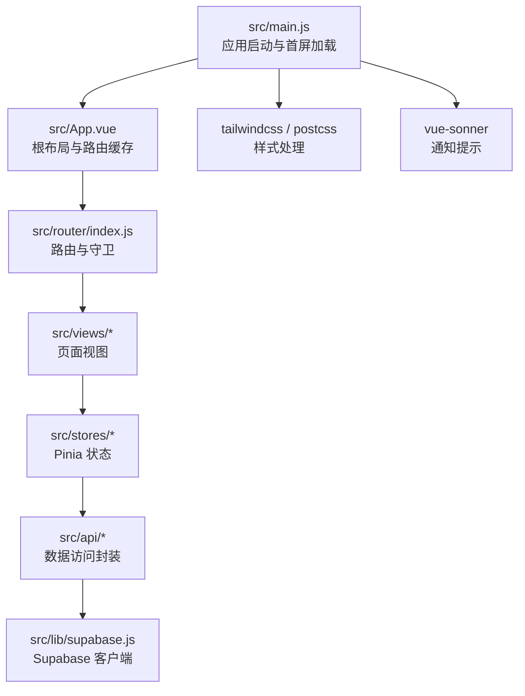
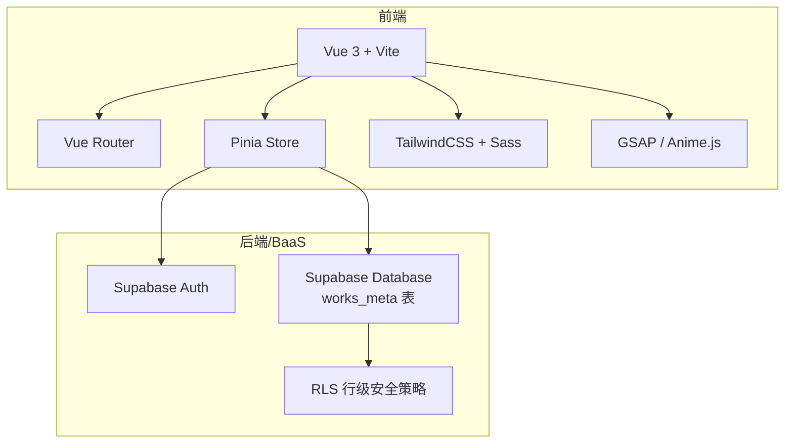
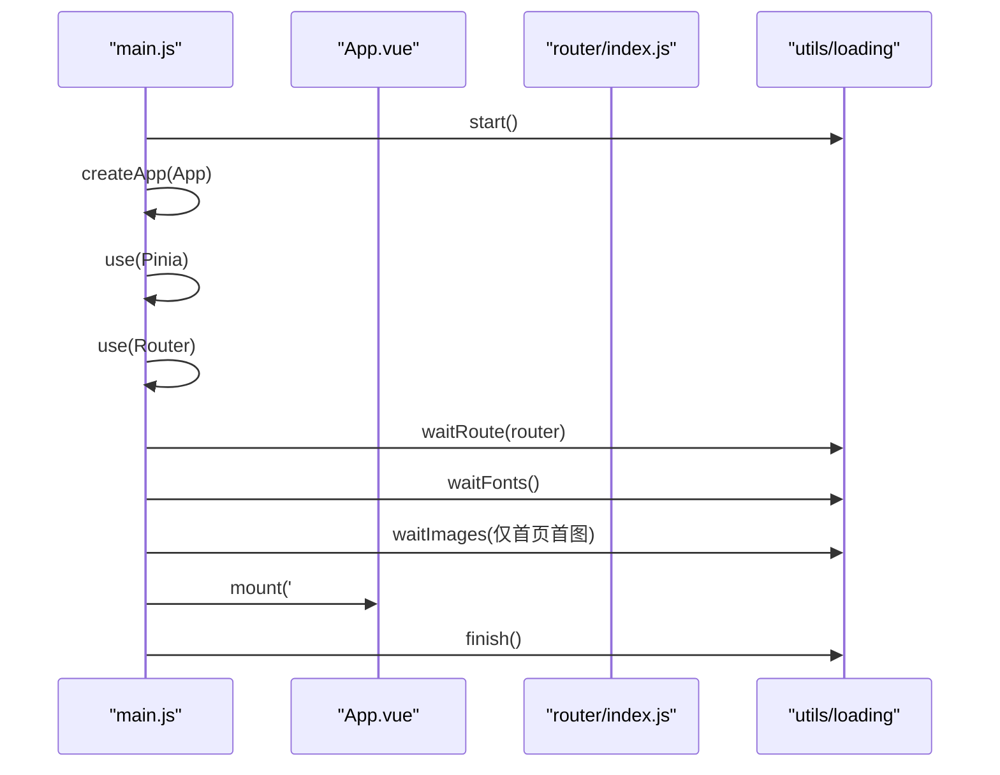
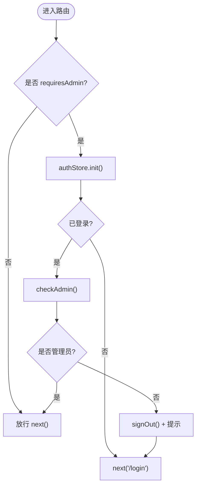
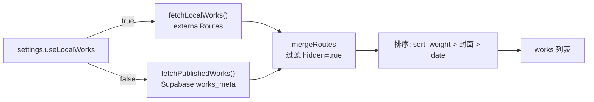
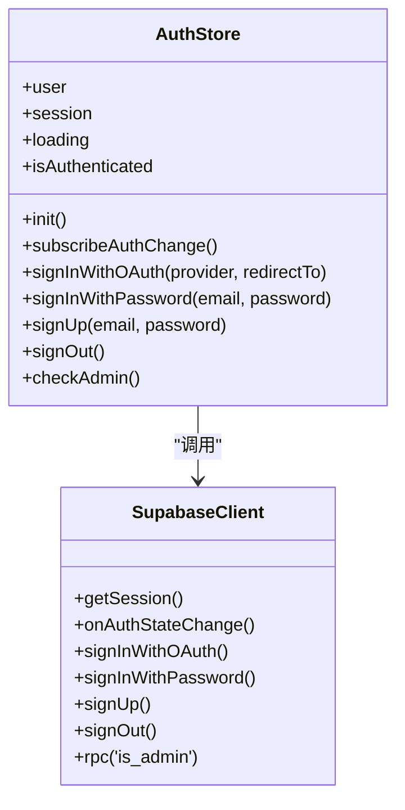
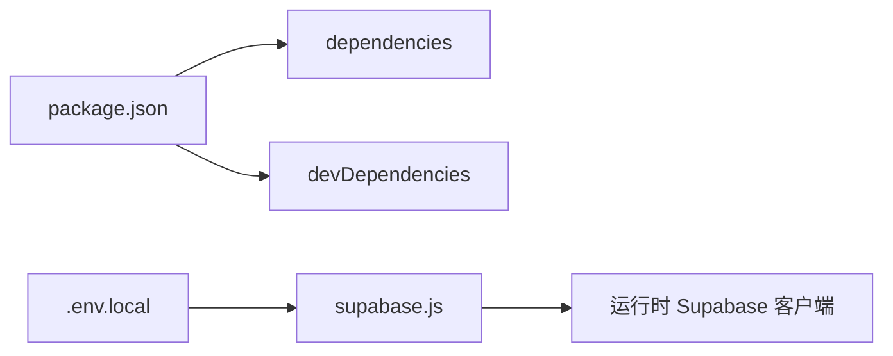

# 项目概述

<cite>
**本文引用的文件**   
- [README.md](file://README.md)
- [package.json](file://package.json)
- [vite.config.js](file://vite.config.js)
- [src/main.js](file://src/main.js)
- [src/App.vue](file://src/App.vue)
- [src/settings.js](file://src/settings.js)
- [src/router/index.js](file://src/router/index.js)
- [src/stores/works.js](file://src/stores/works.js)
- [src/stores/auth.js](file://src/stores/auth.js)
- [src/lib/supabase.js](file://src/lib/supabase.js)
</cite>

## 目录
1. [简介](#简介)
2. [项目结构](#项目结构)
3. [核心功能](#核心功能)
4. [技术架构总览](#技术架构总览)
5. [关键组件与数据流](#关键组件与数据流)
6. [依赖关系分析](#依赖关系分析)
7. [性能与体验优化](#性能与体验优化)
8. [快速开始指南](#快速开始指南)
9. [常见问题排查](#常见问题排查)
10. [结语](#结语)

## 简介
本项目是一个基于 Vue 3 + Vite 构建的个人作品集展示网站，提供作品展示、内容管理、用户认证和动画效果等核心能力。后端服务采用 Supabase（Auth + Database + RLS），样式体系使用 TailwindCSS，动画库包含 GSAP 与 Anime.js，状态管理使用 Pinia，路由由 Vue Router 提供。项目支持 GitHub Pages 自动部署，适合对外展示或加入简历。

设计理念强调“可维护的内容驱动”：作品列表既可由本地静态配置驱动，也可由线上数据库驱动；通过合并策略统一输出最终列表，并支持排序、过滤与隐藏控制。后台管理页面配合 Supabase 行级安全策略，实现管理员对作品元数据的在线编辑与发布。

**章节来源**
- [README.md:1-26](file://README.md#L1-L26)

## 项目结构
项目采用按功能域划分的目录组织方式：
- src/api：封装网络请求（Supabase 数据访问）
- src/assets：全局样式与 Markdown 正文样式
- src/components：公共组件（导航、图标、Markdown 渲染等）
- src/lib：第三方客户端初始化（如 Supabase）
- src/router：路由定义与守卫逻辑
- src/stores：Pinia 状态管理（认证、作品数据）
- src/utils：工具函数（加载、事件总线、特效等）
- src/views：页面视图（首页、作品列表、详情、关于、登录、后台管理等）
- public：静态资源（图片等）
- scripts/sql：数据库脚本与种子数据
- vite.config.js：Vite 构建与开发服务器配置
- tailwind.config.js：Tailwind 样式配置
- package.json：依赖与脚本命令

**图表来源**
- [src/main.js:1-39](file://src/main.js#L1-L39)
- [src/App.vue:1-26](file://src/App.vue#L1-L26)
- [src/router/index.js:1-73](file://src/router/index.js#L1-L73)
- [src/stores/works.js:1-29](file://src/stores/works.js#L1-L29)
- [src/stores/auth.js:1-82](file://src/stores/auth.js#L1-L82)
- [src/lib/supabase.js:1-17](file://src/lib/supabase.js#L1-L17)
- [vite.config.js:1-31](file://vite.config.js#L1-L31)

**章节来源**
- [README.md:158-189](file://README.md#L158-L189)

## 核心功能
- 作品展示：支持从本地静态配置与 Supabase 数据库合并生成作品列表，具备封面、标签、日期、权重排序与隐藏过滤等能力。
- 内容管理：后台管理页可对作品元数据进行增删改查，并通过 RLS 限制权限。
- 用户认证：支持邮箱密码与 GitHub OAuth 登录，结合路由守卫保护管理页面。
- 动画与交互：集成 GSAP、Anime.js 等动画库，配合 TailwindCSS 实现移动端适配与丰富动效。
- 部署与 CI：GitHub Actions 自动构建并部署到 GitHub Pages。

**章节来源**
- [README.md:12-25](file://README.md#L12-L25)
- [README.md:69-156](file://README.md#L69-L156)

## 技术架构总览
前端以 Vue 3 为框架，Vite 作为构建工具；样式层使用 TailwindCSS 与 Sass；状态管理使用 Pinia；路由使用 Vue Router；后端服务使用 Supabase 提供认证与数据库能力；动画库包括 GSAP 与 Anime.js；UI 组件库使用 Element Plus；网络请求使用 Axios；部署走 GitHub Pages。

**图表来源**
- [README.md:12-25](file://README.md#L12-L25)
- [README.md:37-67](file://README.md#L37-L67)

## 关键组件与数据流

### 应用启动与首屏加载流程
应用入口负责安装插件、等待路由就绪、字体与首屏图片加载，完成后挂载应用并结束加载遮罩。

**图表来源**
- [src/main.js:16-39](file://src/main.js#L16-L39)

**章节来源**
- [src/main.js:1-39](file://src/main.js#L1-L39)

### 路由与权限守卫
路由定义了首页、作品列表、关于、登录、后台管理与作品详情等页面，并为需要管理员权限的路由添加守卫，未登录或非管理员将跳转至登录页。

**图表来源**
- [src/router/index.js:1-73](file://src/router/index.js#L1-L73)
- [src/stores/auth.js:1-82](file://src/stores/auth.js#L1-L82)

**章节来源**
- [src/router/index.js:1-73](file://src/router/index.js#L1-L73)

### 作品数据源合并与排序
作品数据来源于本地静态配置与 Supabase 数据库，根据 settings.useLocalWorks 决定数据源；当关闭本地模式时，调用 fetchPublishedWorks 获取已发布作品；随后进行三级排序（sort_weight、封面、date）并过滤 hidden=true 的条目。

**图表来源**
- [src/stores/works.js:1-29](file://src/stores/works.js#L1-L29)
- [src/settings.js:1-8](file://src/settings.js#L1-L8)
- [README.md:82-113](file://README.md#L82-L113)

**章节来源**
- [src/stores/works.js:1-29](file://src/stores/works.js#L1-L29)
- [src/settings.js:1-8](file://src/settings.js#L1-L8)
- [README.md:82-113](file://README.md#L82-L113)

### 认证与管理员校验
认证状态由 Pinia store 管理，支持 GitHub OAuth 与邮箱密码登录；登录后通过 RPC is_admin 判断管理员身份，用于后台管理权限控制。

**图表来源**
- [src/stores/auth.js:1-82](file://src/stores/auth.js#L1-L82)
- [src/lib/supabase.js:1-17](file://src/lib/supabase.js#L1-L17)

**章节来源**
- [src/stores/auth.js:1-82](file://src/stores/auth.js#L1-L82)
- [src/lib/supabase.js:1-17](file://src/lib/supabase.js#L1-L17)

## 依赖关系分析
- 运行时依赖：Vue 3、Vue Router、Pinia、Supabase JS SDK、GSAP、markdown-it、shiki、mitt、lucide-vue-next、vue-sonner。
- 开发依赖：Vite、@vitejs/plugin-vue、TailwindCSS、Autoprefixer、ESLint、Prettier、Sass。
- 环境变量：VITE_SUPABASE_URL、VITE_SUPABASE_PUBLISHABLE_KEY。

**图表来源**
- [package.json:12-35](file://package.json#L12-L35)
- [src/lib/supabase.js:1-17](file://src/lib/supabase.js#L1-L17)

**章节来源**
- [package.json:1-41](file://package.json#L1-L41)
- [src/lib/supabase.js:1-17](file://src/lib/supabase.js#L1-L17)

## 性能与体验优化
- 首屏加载优化：在 main.js 中依次等待路由 chunk、字体与首屏图片加载完成后再挂载应用，减少白屏时间。
- 路由懒加载：各页面组件按需 import，降低初始包体积。
- 组件缓存：通过 keep-alive 缓存标记了 meta.keepAlive 的路由，提升二次进入速度。
- 样式与主题：TailwindCSS 原子化样式，减少冗余 CSS；PostCSS 自动补全前缀。
- 通知与反馈：使用 vue-sonner 提供轻量通知提示，增强交互反馈。

**章节来源**
- [src/main.js:16-39](file://src/main.js#L16-L39)
- [src/App.vue:1-26](file://src/App.vue#L1-L26)
- [vite.config.js:1-31](file://vite.config.js#L1-L31)

## 快速开始指南

### 环境要求
- Node.js >= 16（见 engines 字段）
- npm 或 pnpm/yarn（推荐 npm）

**章节来源**
- [package.json:37-39](file://package.json#L37-L39)

### 安装依赖
在项目根目录执行：
- npm install

**章节来源**
- [README.md:215-219](file://README.md#L215-L219)

### 配置环境变量
复制示例环境变量文件并填写 Supabase 凭证：
- cp .env.local.example .env.local
- 编辑 .env.local，填入 VITE_SUPABASE_URL 与 VITE_SUPABASE_PUBLISHABLE_KEY

注意：若缺少环境变量，应用会在初始化 Supabase 客户端时报错。

**章节来源**
- [README.md:73-80](file://README.md#L73-L80)
- [README.md:221-228](file://README.md#L221-L228)
- [src/lib/supabase.js:3-8](file://src/lib/supabase.js#L3-L8)

### 运行开发服务器
- npm run dev

该命令会启动 Vite 开发服务器，并在开发模式下启用 TailwindCSS 与 PostCSS 处理。

**章节来源**
- [package.json:5-10](file://package.json#L5-L10)
- [vite.config.js:15-29](file://vite.config.js#L15-L29)

### 构建与预览
- 构建：npm run build
- 预览：npm run preview

**章节来源**
- [package.json:5-10](file://package.json#L5-L10)
- [README.md:236-240](file://README.md#L236-L240)

### 基本使用方法
- 首页：展示个人介绍与精选作品。
- 作品列表：浏览所有已发布作品，支持搜索与筛选。
- 作品详情：查看作品的描述、代码链接、在线演示等。
- 关于：作者信息与联系方式。
- 登录：管理员登录后可进入后台管理。
- 后台管理：对作品元数据进行增删改查，控制发布与隐藏状态。

**章节来源**
- [README.md:158-189](file://README.md#L158-L189)

## 常见问题排查
- 环境变量缺失：如果未配置 VITE_SUPABASE_URL 或 VITE_SUPABASE_PUBLISHABLE_KEY，应用启动时会抛出错误。请检查 .env.local 是否正确设置。
- 管理员权限不足：进入后台管理页面前会校验登录态与管理员身份，非管理员将被重定向到登录页。请确认已通过 GitHub OAuth 或邮箱密码登录，且 Supabase RPC is_admin 返回 true。
- 作品列表为空：检查 settings.useLocalWorks 是否为 false（线上默认），并确保 Supabase works_meta 表中存在 is_published=true 的记录。
- 样式异常：确保 TailwindCSS 与 PostCSS 插件正常加载，检查 vite.config.js 中的 css.postcss.plugins 配置。

**章节来源**
- [src/lib/supabase.js:6-8](file://src/lib/supabase.js#L6-L8)
- [src/router/index.js:51-70](file://src/router/index.js#L51-L70)
- [src/stores/works.js:12-25](file://src/stores/works.js#L12-L25)
- [vite.config.js:25-29](file://vite.config.js#L25-L29)

## 结语
该项目以“内容驱动”为核心，结合 Supabase 的后端能力与 Vue 3 的前端生态，提供了完整的个人作品集展示与管理系统。通过清晰的数据合并策略、严格的权限控制与丰富的动画体验，既能满足对外展示需求，也便于持续迭代与维护。建议初学者从 README 的技术栈与目录结构入手，逐步理解路由、状态管理与数据流，再深入到后台管理与数据库脚本，以获得完整的项目认知路径。